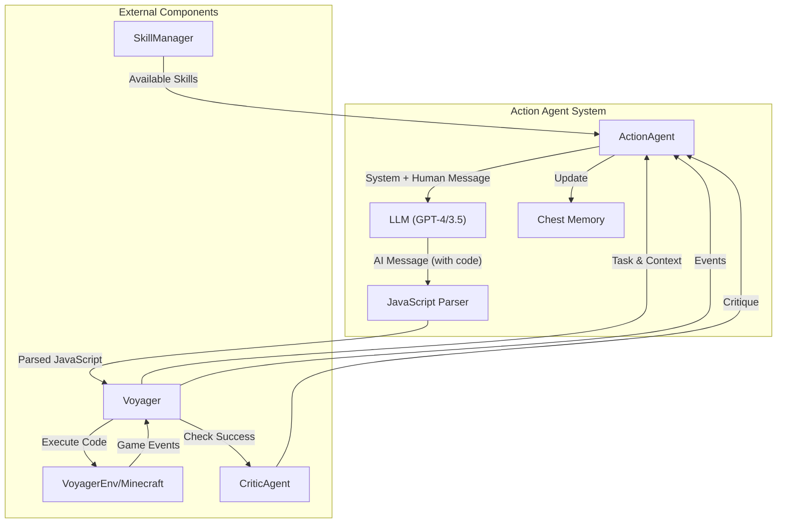
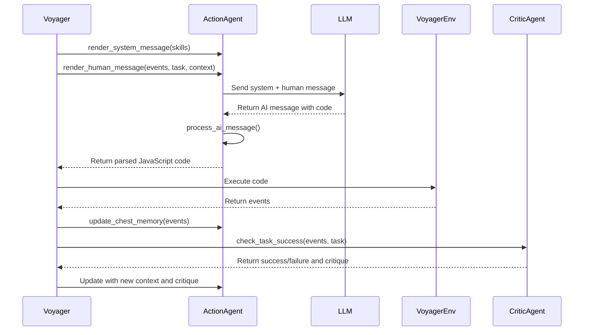
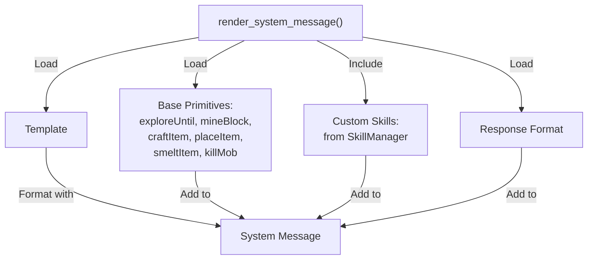
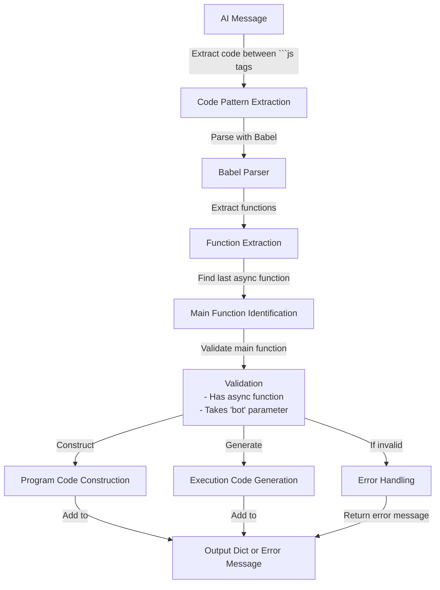
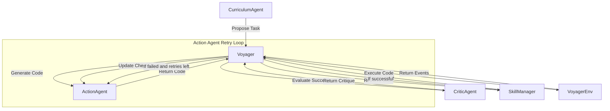

<!-- source: DeepWiki mcp.deepwiki.com · repo MineDojo/Voyager · page 4.2 Action Agent · fetched 2026-10-26 -->

# Action Agent

<details>
<summary>Relevant source files</summary>

The following files were used as context for generating this wiki page:

- [voyager/agents/action.py](voyager/agents/action.py)
- [voyager/voyager.py](voyager/voyager.py)

</details>


The Action Agent is a core component of the Voyager system responsible for translating high-level tasks into executable JavaScript code for the Minecraft environment. It leverages large language models (LLMs) to generate code based on the current game state, task requirements, and available skills.

For information about other agents in the system, see [Curriculum Agent](#4.1), [Critic Agent](#4.3), and [Skill Manager](#4.4).

## Overview



Sources: [voyager/agents/action.py:14-281](), [voyager/voyager.py:118-128]()

## Core Functionality

The Action Agent serves as the "brain" of code generation in Voyager. It performs the following key functions:

1. Receives tasks from the Voyager orchestrator
2. Processes game observations and context
3. Generates executable JavaScript code using LLMs
4. Handles errors and maintains memory of the world state
5. Incorporates feedback from the Critic Agent



Sources: [voyager/voyager.py:165-285](), [voyager/agents/action.py:201-256]()

## Implementation Details

### Initialization

The Action Agent is initialized with configuration parameters that determine its behavior, including the model name, temperature, and checkpoint directory.

```
ActionAgent(
    model_name="gpt-4",  # LLM to use
    temperature=0,       # Deterministic output
    request_timout=240,  # Timeout for API requests
    ckpt_dir="ckpt",     # Directory for checkpoints
    resume=False,        # Whether to resume from checkpoint
    chat_log=True,       # Show chat logs in prompts
    execution_error=True # Show execution errors in prompts
)
```

Sources: [voyager/agents/action.py:14-38](), [voyager/voyager.py:118-128]()

### Message Generation

The Action Agent generates two types of messages that are sent to the LLM:

1. **System Message**: Contains available skills and context for the LLM
2. **Human Message**: Contains game observations, previous code, task, and critique

#### System Message Structure



Sources: [voyager/agents/action.py:75-100]()

#### Human Message Structure

The human message contains a comprehensive observation of the game state, including:

- Previous code execution results
- Execution errors (if any)
- Chat logs
- Biome information
- Time of day
- Nearby blocks and entities
- Health and hunger status
- Player position
- Equipment and inventory
- Chest observations
- Task description
- Context information
- Critique from Critic Agent

Sources: [voyager/agents/action.py:102-199]()

### Processing LLM Response



Sources: [voyager/agents/action.py:201-256]()

## Chest Memory Management

The Action Agent maintains a memory of chest contents in the Minecraft world. This memory is used to inform decision-making when retrieving or storing items.

### Chest Memory Operations

- **Update Chest Memory**: Records the contents of chests discovered in the environment
- **Render Chest Observation**: Formats chest information for inclusion in prompts
- **Save/Load Chest Memory**: Persists chest memory between sessions

Sources: [voyager/agents/action.py:40-73](), [voyager/voyager.py:219-220]()

## Integration with Voyager

The Action Agent is a key component in the Voyager learning loop:

1. Voyager receives a task from the Curriculum Agent
2. Voyager retrieves relevant skills from the Skill Manager
3. Action Agent generates code to accomplish the task
4. Voyager executes the code in the Minecraft environment
5. Critic Agent evaluates success or failure
6. If successful, the solution may be added as a new skill
7. If unsuccessful, the Action Agent may retry with feedback



Sources: [voyager/voyager.py:287-293](), [voyager/voyager.py:200-285]()

## Configuration Parameters

| Parameter | Description | Default Value |
|-----------|-------------|---------------|
| `model_name` | LLM model to use for code generation | "gpt-4" |
| `temperature` | Temperature for LLM sampling | 0 |
| `request_timout` | Timeout for API requests in seconds | 240 |
| `ckpt_dir` | Directory for checkpoints | "ckpt" |
| `resume` | Whether to resume from checkpoint | False |
| `chat_log` | Include chat logs in prompts | True |
| `execution_error` | Include execution errors in prompts | True |
| `task_max_retries` | Maximum retries for a task | 4 |

Sources: [voyager/agents/action.py:14-38](), [voyager/voyager.py:27-33]()

## Technical Implementation

The Action Agent uses several JavaScript libraries for code parsing and validation:

- Babel Core (`@babel/core`): For parsing JavaScript code
- Babel Generator (`@babel/generator`): For generating JavaScript code from AST

The code parsing process follows these steps:

1. Extract code between JavaScript code block markers (```js)
2. Parse the code using Babel
3. Identify function declarations
4. Find the main async function (the last one in the file)
5. Validate that the main function takes a single "bot" parameter
6. Construct the final program and execution code

Sources: [voyager/agents/action.py:201-256]()

## Error Handling

The Action Agent implements robust error handling:

1. It attempts to parse the LLM response up to 3 times if errors occur
2. It captures and reports JavaScript syntax errors before execution
3. It incorporates execution errors into subsequent prompts
4. It maintains a chat log for debugging and context

Sources: [voyager/agents/action.py:201-256](), [voyager/agents/action.py:102-199]()

## Summary

The Action Agent is the code generation engine of Voyager, translating high-level tasks into executable JavaScript for Minecraft. It uses LLMs to generate code based on the current game state, available skills, and task requirements. The agent maintains memory of the world state, particularly chest contents, and incorporates feedback from previous attempts to improve performance on subsequent tries.

---

