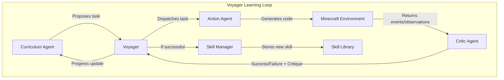
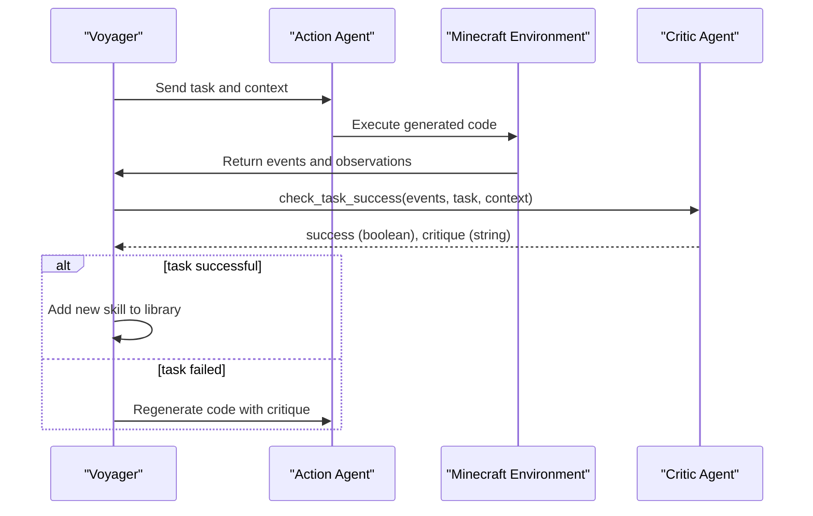
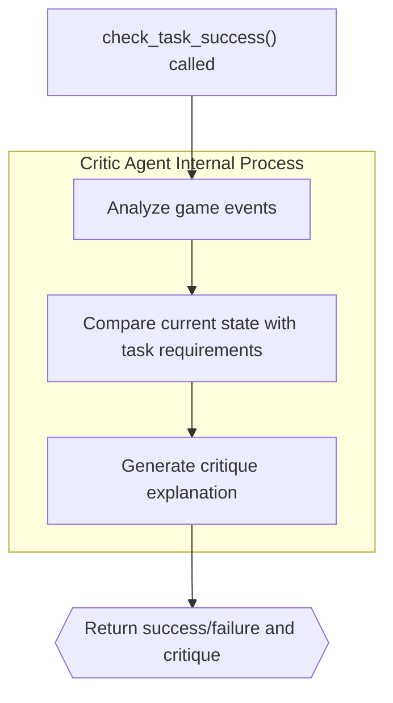

<!-- source: DeepWiki mcp.deepwiki.com · repo MineDojo/Voyager · page 4.3 Critic Agent · fetched 2026-10-26 -->

# Critic Agent

<details>
<summary>Relevant source files</summary>

The following files were used as context for generating this wiki page:

- [voyager/voyager.py](voyager/voyager.py)

</details>


The Critic Agent is a core component of the Voyager system responsible for task success evaluation and feedback generation. It acts as a self-verification mechanism to assess whether tasks executed by the Action Agent were completed successfully in the Minecraft environment.

## Purpose and Role

The Critic Agent serves as an autonomous evaluator within Voyager's learning loop. When the Action Agent executes code in the Minecraft environment, the Critic Agent analyzes the resulting game state and determines if the intended task was accomplished. Additionally, it provides detailed critiques that explain why a task succeeded or failed, which are then used to guide the Action Agent in subsequent attempts.



**Diagram: Critic Agent in the Voyager Learning Loop**

Sources: [voyager/voyager.py:221-226](), [voyager/voyager.py:53-57]()

## Integration with Voyager System

The Critic Agent is initialized in the main Voyager class constructor and is called during the action execution step of the learning process. It receives environmental observations (events) after the Action Agent has executed code in Minecraft, and determines whether the task was successfully completed.



**Diagram: Task Evaluation Process Flow**

Sources: [voyager/voyager.py:221-226](), [voyager/voyager.py:253-257](), [voyager/voyager.py:354]()

## Implementation Details

### Core Methods

The primary method of the Critic Agent is `check_task_success`, which:

1. Takes events (observations from Minecraft), the current task, context, chest observations, and a maximum retry count
2. Analyzes the game state to determine if the task requirements have been met
3. Returns a success boolean and a detailed critique string

```
check_task_success(
    events,           # Game events and observations
    task,             # Current task description
    context,          # Additional task context
    chest_observation, # Nearby chest contents
    max_retries       # Maximum evaluation attempts
) -> (success, critique)
```

Sources: [voyager/voyager.py:221-226]()

### Mode of Operation

The Critic Agent can operate in two modes:

1. **Auto mode (default)**: Automatically evaluates task success using the LLM
2. **Manual mode**: Relies on human verification for task success

Sources: [voyager/voyager.py:43](), [voyager/voyager.py:144]()

## Configuration

The Critic Agent is configured when initializing the Voyager system with the following parameters:

| Parameter | Default Value | Description |
|-----------|---------------|-------------|
| `critic_agent_model_name` | "gpt-4" | The name of the language model to use |
| `critic_agent_temperature` | 0 | The temperature parameter for the model (lower means more deterministic) |
| `critic_agent_mode` | "auto" | Operating mode ("auto" or "manual") |
| `openai_api_request_timeout` | 240 | Timeout for API requests in seconds |

Sources: [voyager/voyager.py:41-43](), [voyager/voyager.py:140-145]()

## Evaluation Process

When evaluating task success, the Critic Agent's process looks like this:



**Diagram: Critic Agent Evaluation Process**

Sources: [voyager/voyager.py:221-226]()

## Usage in the Learning Loop

The Critic Agent's evaluations inform several key decisions in the Voyager learning process:

1. **Task Retry**: If a task fails but retry attempts remain, the critique is provided to the Action Agent to improve the next attempt
2. **Skill Creation**: If a task succeeds, the solution is added to the Skill Library for future use
3. **Curriculum Progress**: Task success/failure updates the Curriculum Agent's exploration progress

If the Critic Agent determines that a task has failed and the `reset_placed_if_failed` option is enabled, Voyager will revert block placements from the last step, allowing the agent to try again without permanent world changes.

Sources: [voyager/voyager.py:229-243](), [voyager/voyager.py:253-257](), [voyager/voyager.py:354](), [voyager/voyager.py:356]()

## Related Components

For more information about how the Critic Agent interacts with other components:
- The Action Agent that generates code: see [Action Agent](#4.2)
- The Curriculum Agent that proposes tasks: see [Curriculum Agent](#4.1) 
- The Skill Manager that stores successful solutions: see [Skill Manager](#4.4)

---

