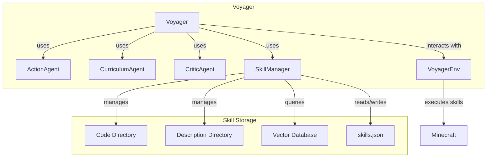
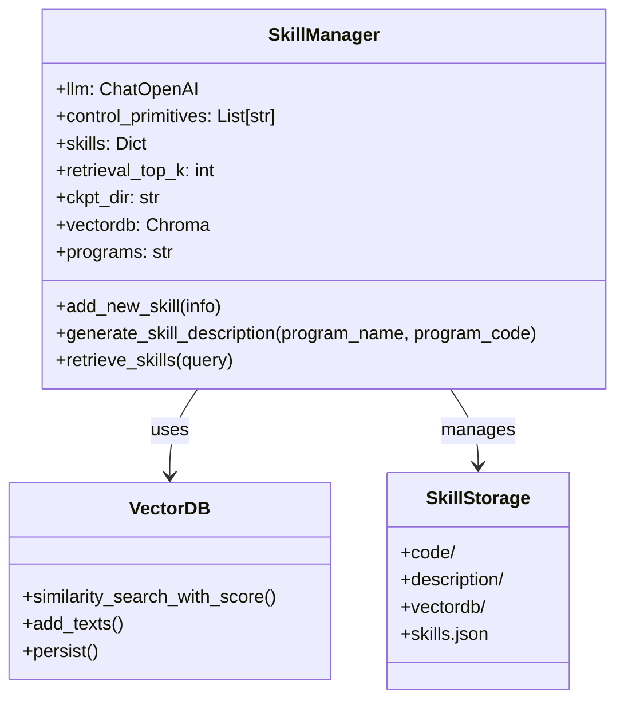
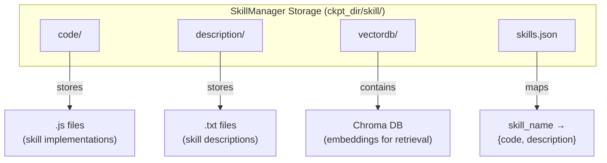
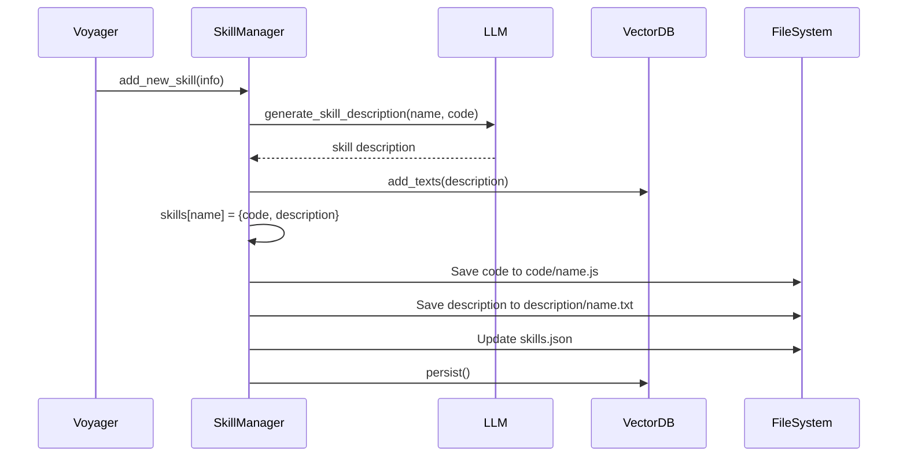
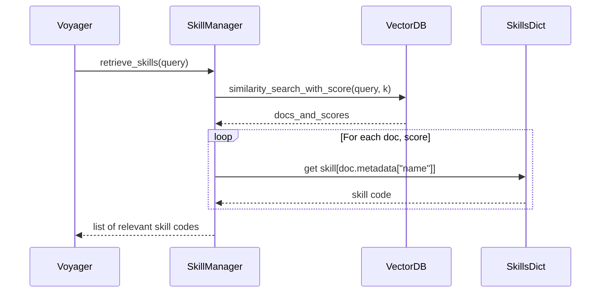
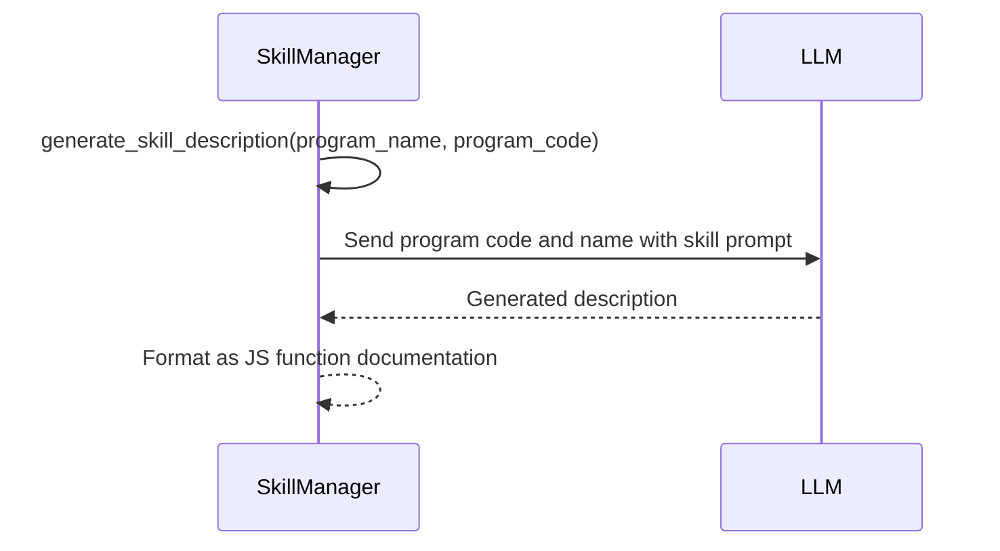
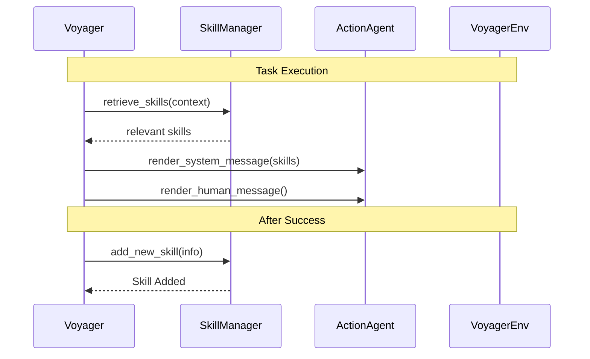
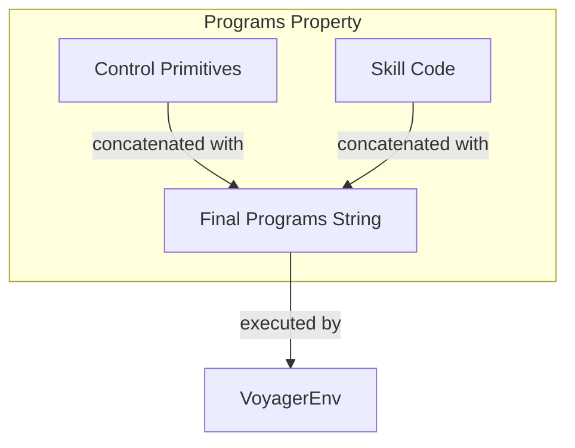

<!-- source: DeepWiki mcp.deepwiki.com · repo MineDojo/Voyager · page 4.4 Skill Manager · fetched 2026-10-26 -->

# Skill Manager

<details>
<summary>Relevant source files</summary>

The following files were used as context for generating this wiki page:

- [voyager/agents/skill.py](voyager/agents/skill.py)
- [voyager/voyager.py](voyager/voyager.py)

</details>


## Overview

The Skill Manager component is responsible for storing, retrieving, and maintaining a library of reusable skills in the Voyager system. It functions as the system's procedural memory, enabling the agent to build upon past accomplishments by storing successful code implementations as reusable skills. This modular approach allows Voyager to compose complex behaviors from simpler building blocks, accelerating learning and problem-solving over time.

For information about how skills are structured and used in the broader system, see [Skill System](#5).

Sources: [voyager/agents/skill.py:13-51](), [voyager/voyager.py:146-153]()

## Architecture

The Skill Manager integrates with the rest of Voyager through a well-defined interface that supports skill storage and retrieval. Its position in the overall system architecture is illustrated below:



The Skill Manager's internal architecture includes several key components:



Sources: [voyager/agents/skill.py:13-51](), [voyager/voyager.py:146-153]()

## Initialization

The Skill Manager is initialized with several important parameters:

```python
def __init__(
    self,
    model_name="gpt-3.5-turbo",
    temperature=0,
    retrieval_top_k=5,
    request_timout=120,
    ckpt_dir="ckpt",
    resume=False,
):
```

Key parameters include:

| Parameter | Default | Description |
|-----------|---------|-------------|
| model_name | "gpt-3.5-turbo" | The LLM used for generating skill descriptions |
| temperature | 0 | Temperature parameter for the LLM (0 = most deterministic) |
| retrieval_top_k | 5 | Number of most relevant skills to retrieve |
| request_timeout | 120 | Timeout for LLM requests in seconds |
| ckpt_dir | "ckpt" | Directory for storing skill data |
| resume | False | Whether to resume from previously saved skills |

During initialization, the Skill Manager creates the necessary directory structure, loads control primitives, and initializes the vector database using OpenAI embeddings.

Sources: [voyager/agents/skill.py:13-51]()

## Skill Storage Structure

The Skill Manager maintains a structured storage system for skills:



The storage system includes:

1. **Code Directory** (`code/`): Contains JavaScript files with skill implementations
2. **Description Directory** (`description/`): Contains text files with LLM-generated skill descriptions
3. **Vector Database Directory** (`vectordb/`): Contains the Chroma vector database for semantic retrieval
4. **Skills Metadata** (`skills.json`): Maps skill names to their code and descriptions

Sources: [voyager/agents/skill.py:28-32](), [voyager/agents/skill.py:92-100]()

## Key Operations

### Adding New Skills

When a task is successfully completed, the Skill Manager can add the implementation as a new reusable skill:



The process includes:
1. Generating a human-readable description of the skill using an LLM
2. Adding the skill description to the vector database
3. Storing the skill code and description in the corresponding directories
4. Updating the skills dictionary and persisting it to `skills.json`
5. Persisting the vector database

Sources: [voyager/agents/skill.py:61-100](), [voyager/voyager.py:353-354]()

### Retrieving Skills

The Skill Manager retrieves relevant skills based on a query (usually the current task and context):



The retrieval process:
1. Performs a similarity search in the vector database
2. Retrieves the skill code for each matched skill
3. Returns a list of relevant skill codes to be used by the action agent

Sources: [voyager/agents/skill.py:114-127](), [voyager/voyager.py:184-185]()

### Generating Skill Descriptions

The Skill Manager uses an LLM to generate human-readable descriptions of skills:



The description generation:
1. Sends the program code and name to the LLM with a specific prompt
2. Receives a descriptive explanation of what the skill does
3. Formats the description as a JavaScript comment within a function structure

Sources: [voyager/agents/skill.py:102-112]()

## Integration with Voyager

The Skill Manager is integrated with the Voyager system in two key ways:

1. **Skill Retrieval for Task Execution**: Before attempting a task, Voyager retrieves relevant skills based on the task and context.
2. **Skill Storage after Success**: When a task is successfully completed, Voyager adds the implementation as a new reusable skill.



The integration flow:
1. Before executing a task, Voyager retrieves relevant skills from the Skill Manager
2. These skills are included in the system message to the Action Agent
3. After successful task completion, Voyager adds the new skill to the Skill Manager

Sources: [voyager/voyager.py:184-185](), [voyager/voyager.py:250-251](), [voyager/voyager.py:353-354]()

## Control Primitives

The Skill Manager also maintains a collection of control primitives, which are basic functions that skills can use. These primitives are loaded during initialization and combined with skill code when executing tasks.



The `programs` property:
1. Concatenates all skill code from the skills dictionary
2. Appends all control primitives
3. Returns the combined code for execution by the environment

Sources: [voyager/agents/skill.py:52-59](), [voyager/voyager.py:215-218]()

## Implementation Details

### Skill Format

Skills are stored as JavaScript async functions with the following structure:

```javascript
async function skillName(bot) {
    // Description generated by LLM explaining what the skill does
    // Implementation code...
}
```

This format allows skills to be easily composed and executed by the Minecraft bot.

Sources: [voyager/agents/skill.py:102-112]()

### Vector Database

The Skill Manager uses Chroma with OpenAI embeddings for semantic search:

1. Each skill description is embedded and stored in the vector database
2. During retrieval, the query is embedded and compared to the stored embeddings
3. The most similar skills (up to `retrieval_top_k`) are returned

Sources: [voyager/agents/skill.py:40-50](), [voyager/agents/skill.py:114-127]()

### Error Handling and Edge Cases

The Skill Manager handles several edge cases:

1. **Duplicate Skills**: If a skill with the same name already exists, it is overwritten in the vector database and a version number is appended to the filename
2. **Empty Skill Library**: If no skills are available, the retrieval function returns an empty list
3. **Database Synchronization**: The manager verifies that the vector database is in sync with the skills dictionary

Sources: [voyager/agents/skill.py:61-100](), [voyager/agents/skill.py:114-127]()

---

