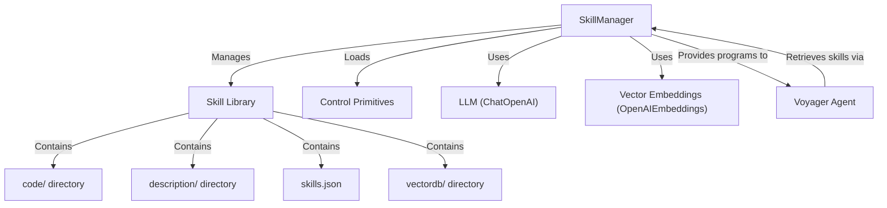
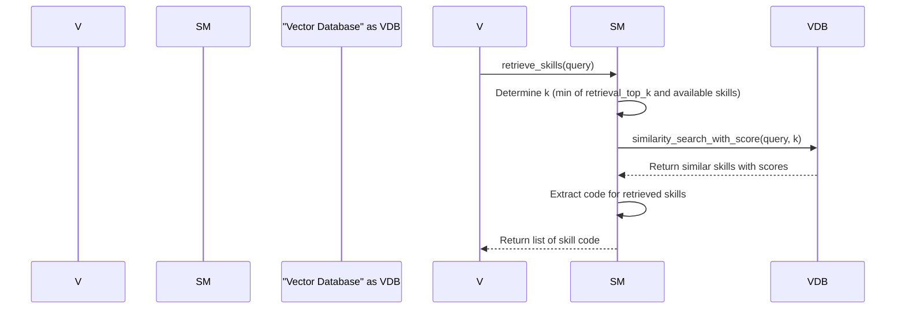
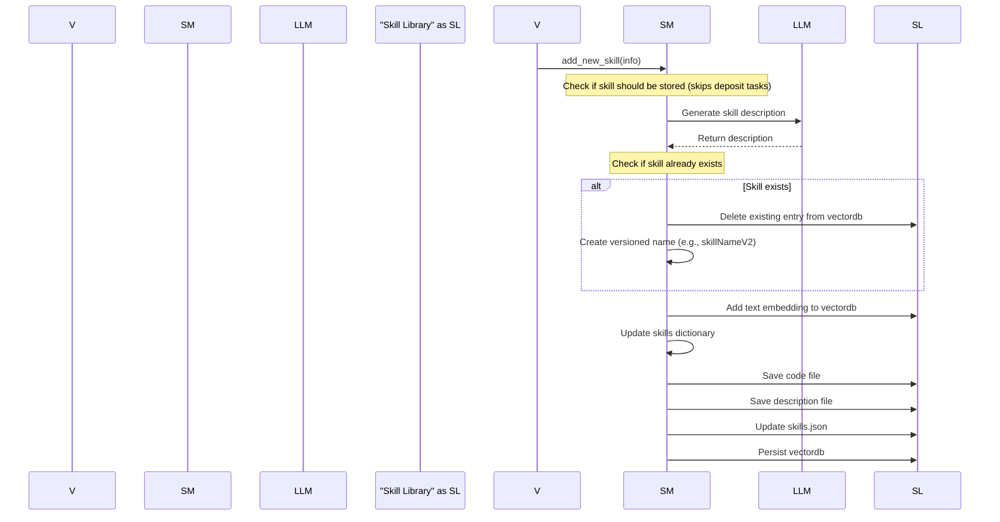
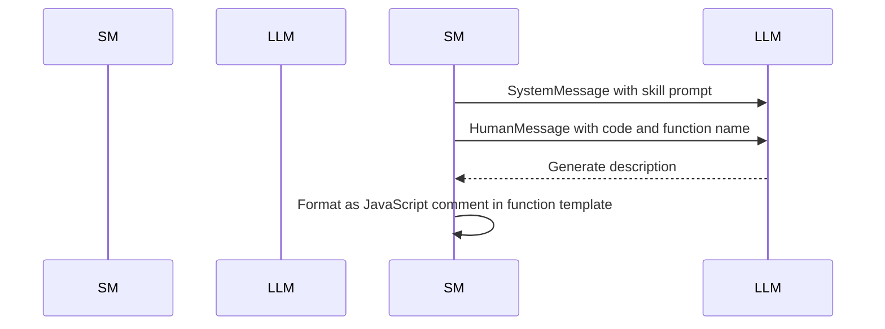
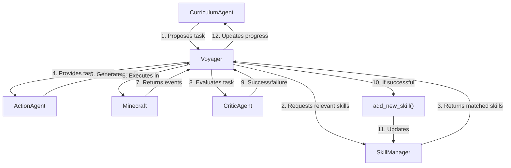
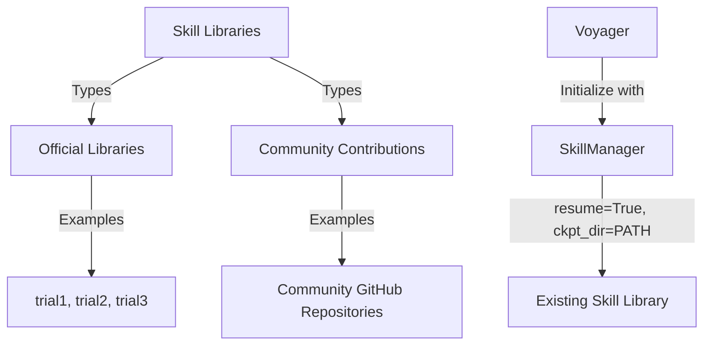

<!-- source: DeepWiki mcp.deepwiki.com · repo MineDojo/Voyager · page 5 Skill System · fetched 2026-10-26 -->

# Skill System

<details>
<summary>Relevant source files</summary>

The following files were used as context for generating this wiki page:

- [skill_library/README.md](skill_library/README.md)
- [voyager/agents/skill.py](voyager/agents/skill.py)

</details>


## Purpose and Overview

The Skill System is a core component of Voyager that enables cumulative learning by storing, retrieving, and utilizing reusable skills that the agent acquires over time. It serves as Voyager's long-term memory, allowing the agent to build upon past experiences and solve increasingly complex tasks by leveraging previously learned capabilities.

For information about specific Skill Library implementations and community contributions, see [Skill Library](#5.1). For details about the implementation of the Skill Manager component, see [Skill Manager](#4.4).

Sources: [voyager/agents/skill.py:13-127](), [skill_library/README.md:1-44]()

## Key Components

The Skill System consists of several interconnected components:



### Skills and Programs

In Voyager, a skill is a reusable piece of JavaScript code that implements a specific capability. The Skill System distinguishes between two types of programs:

1. **Control Primitives**: Built-in, fundamental operations provided by the system
2. **Learned Skills**: Capabilities that Voyager has acquired through successful task completions

Together, these form the complete set of programs available to the agent through the `programs` property of the SkillManager.

Sources: [voyager/agents/skill.py:52-59]()

## Skill Storage and Representation

Each skill in the system is represented by:

```mermaid
classDiagram
    class "Skill Entry" {
        +String code
        +String description
    }
    
    class "SkillManager" {
        -Dict~String, SkillEntry~ skills
        -VectorDB vectordb
        -List~String~ control_primitives
        +programs()
        +add_new_skill(info)
        +retrieve_skills(query)
        +generate_skill_description(name, code)
    }
    
    "SkillManager" "1" --> "*" "Skill Entry": manages
```

The Skill Library has a structured directory organization:

```
skill/
├── code/               # JavaScript files for each skill
│   ├── skillName1.js
│   ├── skillName2.js
│   └── ...
├── description/        # Text descriptions of each skill
│   ├── skillName1.txt
│   ├── skillName2.txt
│   └── ...
├── skills.json         # Metadata for all skills
└── vectordb/          # Vector database for semantic retrieval
```

The `skills.json` file maintains a mapping of skill names to their code and descriptions. The vector database stores embeddings of skill descriptions to enable semantic retrieval.

Sources: [voyager/agents/skill.py:28-50](), [skill_library/README.md:20-42]()

## Skill Operations

### Skill Retrieval Process

When Voyager encounters a new task, it retrieves relevant skills from its library:



The retrieval process uses semantic similarity to identify the most relevant skills for the current task. The system retrieves up to `retrieval_top_k` skills (default is 5), sorted by similarity to the query.

Sources: [voyager/agents/skill.py:114-127]()

### Adding New Skills

When Voyager successfully completes a task, the implementation can be added as a new skill:



The system skips adding skills for routine tasks like depositing items into chests. For existing skills, the system creates versioned backups, allowing the skill to evolve over time.

Sources: [voyager/agents/skill.py:61-100]()

### Generating Skill Descriptions

The SkillManager uses an LLM to generate human-readable descriptions of skills:



The generated descriptions serve two purposes:
1. Making the skills human-readable
2. Providing semantic content for the vector database to enable retrieval

Sources: [voyager/agents/skill.py:102-112]()

## Integration with Voyager Learning Loop

The Skill System is a critical component of Voyager's iterative learning process:



This integration enables Voyager's cumulative learning capabilities:
1. The agent retrieves relevant skills for new tasks
2. Successful solutions become new skills
3. These skills are available for future, more complex tasks
4. Over time, the agent builds a rich library of capabilities

Sources: [voyager/agents/skill.py:13-127]()

## Using Skill Libraries

The Skill System supports using pre-learned skill libraries:



To resume learning from an existing skill library, users can:
1. Set `resume=True` when initializing the SkillManager
2. Specify the checkpoint directory containing the skill library

This enables users to build upon existing progress rather than starting from scratch, including leveraging community-contributed skill libraries.

Sources: [voyager/agents/skill.py:33-37](), [skill_library/README.md:3-16]()

## Technical Implementation

The SkillManager class (`voyager/agents/skill.py`) provides the main implementation of the Skill System:

| Method/Property | Purpose |
|-----------------|---------|
| `__init__` | Initializes the SkillManager with model settings, directories, and loads control primitives |
| `programs` | Property that returns all available programs (concatenated skills and control primitives) |
| `add_new_skill` | Adds a new skill to the library with code, description, and vector embedding |
| `generate_skill_description` | Uses LLM to create a human-readable description of a skill |
| `retrieve_skills` | Finds relevant skills for a given query using semantic similarity |

The SkillManager uses:
- ChatOpenAI for generating skill descriptions
- OpenAIEmbeddings for creating vector embeddings
- Chroma vector database for storing and retrieving skills semantically

Sources: [voyager/agents/skill.py:13-127]()

## Contributing to the Skill Library

After running Voyager's learning process, users can contribute their skill libraries to the community:

1. The learning process creates a checkpoint directory with the skill library
2. Users can share the `skill/` directory from their checkpoint
3. Other users can use these shared libraries by setting the appropriate checkpoint directory

This collaborative approach allows the community to build upon each other's progress in teaching Voyager new capabilities.

Sources: [skill_library/README.md:18-44]()

---

