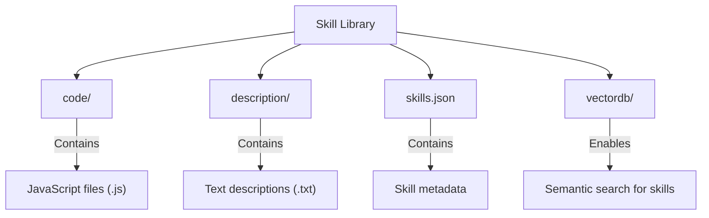
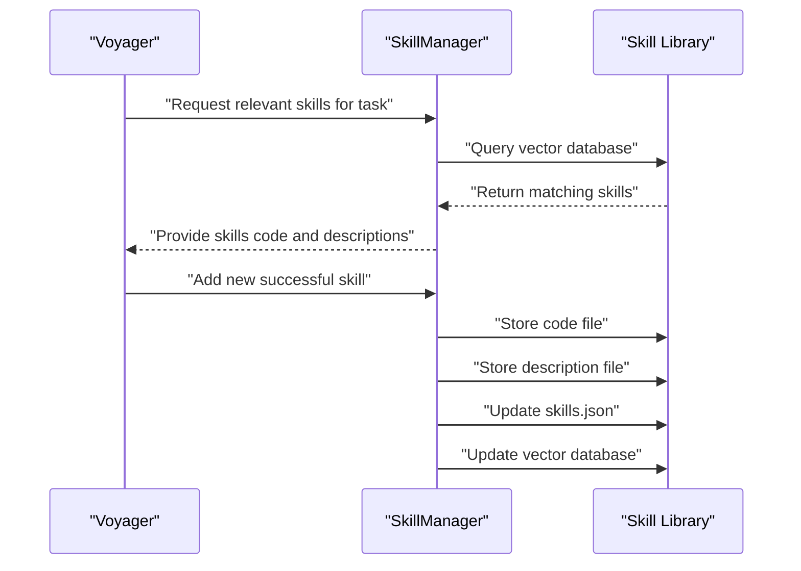
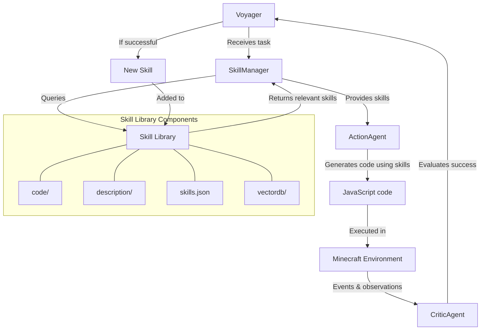

<!-- source: DeepWiki mcp.deepwiki.com · repo MineDojo/Voyager · page 5.1 Skill Library · fetched 2026-10-26 -->

# Skill Library

<details>
<summary>Relevant source files</summary>

The following files were used as context for generating this wiki page:

- [skill_library/README.md](skill_library/README.md)

</details>


The Skill Library is a critical component of the Voyager system that stores, organizes, and enables access to reusable programmatic skills that the agent learns during operation. This page details the structure, usage, and contribution process for the Skill Library. For information about how skills are managed programmatically, see [Skill Manager](#4.4).

## Purpose and Structure

The Skill Library serves as a persistent repository of learned behaviors in the form of executable JavaScript code. Rather than generating new code for every task, Voyager can retrieve and adapt previously learned skills, enabling cumulative learning and knowledge transfer across different tasks and environments.



The Skill Library consists of four main components:

1. **Code Directory** (`code/`): Contains JavaScript files that implement individual skills, each stored as a separate `.js` file with a descriptive name (e.g., `catchThreeFishWithCheck.js`, `collectBamboo.js`).

2. **Description Directory** (`description/`): Contains text files that provide natural language descriptions of each skill, used for semantic search and helping the system understand when to apply a particular skill.

3. **Skills Metadata** (`skills.json`): A JSON file that maintains metadata about all skills in the library, including skill names, success rates, and other relevant information.

4. **Vector Database** (`vectordb/`): Stores embeddings of skill descriptions, enabling semantic retrieval of relevant skills based on the current task context.

Sources: [skill_library/README.md:31-41]()

## Interaction with Voyager System

The Skill Library interacts with the rest of the Voyager system primarily through the SkillManager component, which handles skill storage and retrieval:



When a new task is proposed by the CurriculumAgent, Voyager requests relevant skills from the SkillManager, which queries the Skill Library's vector database to find semantically similar skills. These skills are then provided to the ActionAgent to assist in code generation for the current task. After successful task completion, new skills can be added to the library for future use.

Sources: [skill_library/README.md:42-44]()

## Available Libraries

Voyager provides several pre-trained skill libraries that users can leverage:

### Official Libraries

These are the skill libraries developed by the Voyager team:

| Library | Description |
|---------|-------------|
| trial1  | First experimental skill set |
| trial2  | Improved skill set with broader coverage |
| trial3  | Latest official skill library |

### Community Contributions

Several community members have contributed their own skill libraries:

- daswer123/Voyager_checkpoint
- swen128/Voyager_checkpoint
- DeveloperHarris/voyager_checkpoint

Sources: [skill_library/README.md:3-13]()

## Using a Skill Library

To use an existing skill library in Voyager, you need to specify its location when initializing the system. This allows Voyager to load the skills and their descriptions for use during operation.

### Resuming from Community Contributions

To use a community-contributed skill library:

1. Clone or download the repository containing the skill library
2. Set `skill_library_dir` to the checkpoint directory inside the downloaded folder
3. Initialize Voyager with this parameter

```
skill_library_dir=COMMUNITY_CKPT_DIR
```

Where `COMMUNITY_CKPT_DIR` is the path to the skill directory inside the folder you downloaded.

Sources: [skill_library/README.md:15-16]()

## Contributing Your Own Skill Library

After running the Voyager learning process, a checkpoint directory is created containing the learned skills. To contribute this library:

1. Locate your checkpoint directory, which has a structure like:
   ```
   ./
   ├── action/
   │   └── chest_memory.json
   ├── curriculum/
   │   ├── completed_tasks.json
   │   ├── failed_tasks.json
   │   ├── qa_cache.json
   │   └── vectordb/
   ├── events/
   └── skill/
       ├── code/
       │   ├── catchThreeFishWithCheck.js
       │   ├── collectBamboo.js
       │   ├── ...
       ├── description/
       │   ├── catchThreeFishWithCheck.txt
       │   ├── collectBamboo.txt
       │   └── ...
       ├── skills.json
       └── vectordb/
   ```

2. Only the `YOUR_CKPT_DIR/skill` directory constitutes a skill library that can be shared.

3. Create a public repository containing your skill library and submit a pull request to add your library to the official list.

Sources: [skill_library/README.md:18-44]()

## Skill Library Integration

The following diagram illustrates how the Skill Library integrates with the wider Voyager system during the learning and execution process:



This diagram shows the circular nature of the skill acquisition and usage process. As Voyager successfully completes tasks, it adds new skills to the library, which can then be used to solve more complex tasks in the future.

Sources: [skill_library/README.md:31-44]()

## Technical Implementation

The Skill Library is implemented as a straightforward directory structure that contains the following elements:

1. **JavaScript Skill Implementation Files**:
   - Stored in the `code/` directory
   - Named descriptively (e.g., `catchThreeFishWithCheck.js`)
   - Contain executable JavaScript code that can be run in the Minecraft environment

2. **Natural Language Skill Descriptions**:
   - Stored in the `description/` directory
   - Named to match their corresponding JavaScript files (e.g., `catchThreeFishWithCheck.txt`)
   - Contain text descriptions generated by the LLM explaining what the skill does

3. **Skills Metadata File**:
   - `skills.json` file at the root of the skill library
   - Contains structured information about each skill

4. **Vector Database**:
   - Stored in the `vectordb/` directory
   - Contains embeddings of skill descriptions for efficient semantic retrieval

When a skill is needed, the system performs a semantic search using the vector database to find skills that are relevant to the current task. The retrieved skills are then provided to the ActionAgent, which can incorporate them into new code generation.

Sources: [skill_library/README.md:31-44]()

---

