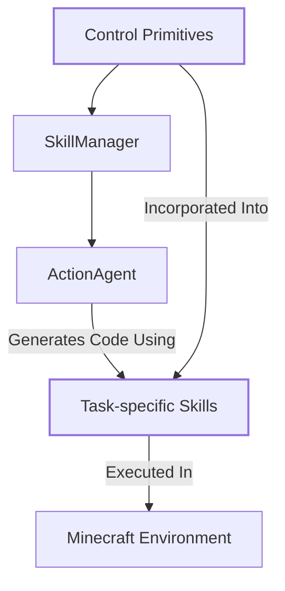
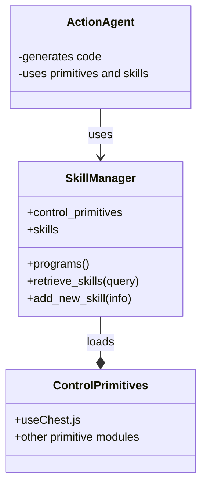
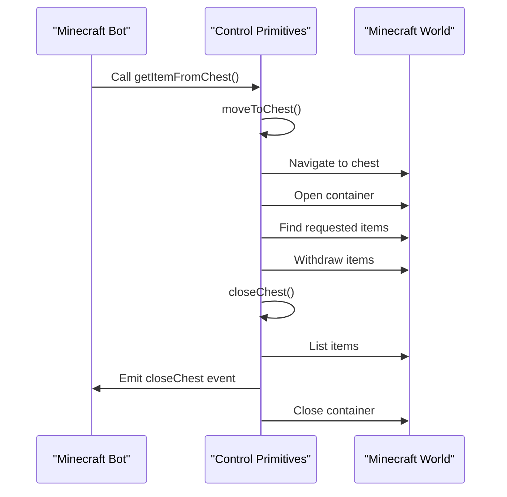
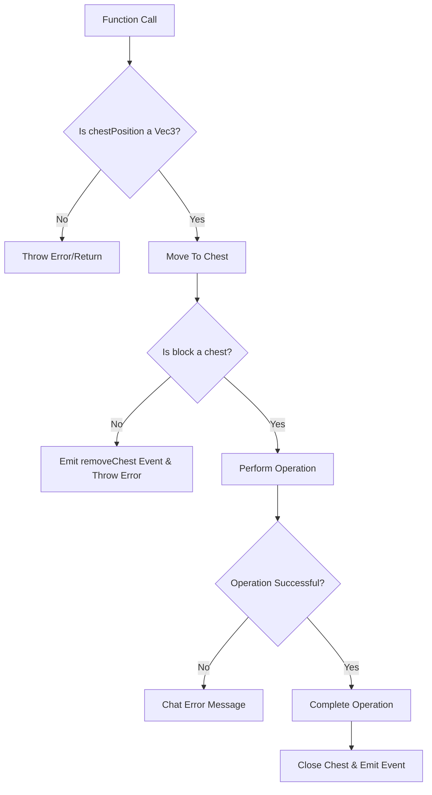

<!-- source: DeepWiki mcp.deepwiki.com · repo MineDojo/Voyager · page 5.2 Control Primitives · fetched 2026-10-26 -->

# Control Primitives

<details>
<summary>Relevant source files</summary>

The following files were used as context for generating this wiki page:

- [voyager/agents/skill.py](voyager/agents/skill.py)
- [voyager/control_primitives/useChest.js](voyager/control_primitives/useChest.js)

</details>


Control Primitives in Voyager are fundamental, predefined JavaScript functions that provide basic interaction capabilities with the Minecraft environment. These primitives serve as building blocks for more complex skills, allowing the ActionAgent to compose them into sophisticated behaviors without having to implement basic functionality from scratch. This document focuses on the predefined control primitives in Voyager, with particular emphasis on chest interaction primitives as a representative example.

For information about how these primitives are used within the broader skill system, see [Skill System](#5) and [Skill Library](#5.1).

## Purpose and Role in the System

Control primitives form the foundation of Voyager's interaction capabilities. They serve several critical purposes:

1. **Abstraction of Basic Interactions**: They encapsulate common Minecraft interactions in reusable functions.
2. **Error Handling**: They implement robust error checking and recovery for basic operations.
3. **Standardization**: They provide a consistent interface for the LLM to use when generating code.
4. **Efficiency**: They reduce the amount of code the ActionAgent needs to generate for each task.

When the ActionAgent generates JavaScript code to perform a task, it combines these primitives with custom logic to create new skills. The SkillManager makes these primitives available during code generation.



Sources: [voyager/agents/skill.py:32-58](voyager/agents/skill.py:32-58)

## Integration with Skill System

Control primitives are loaded by the SkillManager at initialization and made available alongside learned skills when the ActionAgent generates code for new tasks.



The `programs` property of the SkillManager combines both learned skills and control primitives, making them accessible as a single body of code for the ActionAgent to reference when generating new programs.

Sources: [voyager/agents/skill.py:32-33](voyager/agents/skill.py:32-33), [voyager/agents/skill.py:52-59](voyager/agents/skill.py:52-59)

## Chest Interaction Primitives

One of the most important sets of control primitives in Voyager are the chest interaction functions. These functions allow the agent to store and retrieve items, which is essential for inventory management in Minecraft.

### Core Chest Functions

The `useChest.js` file defines several key functions for interacting with chests:

| Function | Purpose | Parameters |
|----------|---------|------------|
| `getItemFromChest` | Retrieves items from a chest | `bot`, `chestPosition`, `itemsToGet` |
| `depositItemIntoChest` | Stores items in a chest | `bot`, `chestPosition`, `itemsToDeposit` |
| `checkItemInsideChest` | Opens and closes a chest to check contents | `bot`, `chestPosition` |
| `moveToChest` | Navigates to a chest | `bot`, `chestPosition` |
| `listItemsInChest` | Lists all items in a chest | `bot`, `chestBlock` |
| `closeChest` | Closes a chest and emits an event | `bot`, `chestBlock` |

Sources: [voyager/control_primitives/useChest.js:1-125](voyager/control_primitives/useChest.js:1-125)

### Chest Interaction Flow

The following diagram illustrates the typical flow of chest interactions using these primitives:



Sources: [voyager/control_primitives/useChest.js:1-29](voyager/control_primitives/useChest.js:1-29), [voyager/control_primitives/useChest.js:118-125](voyager/control_primitives/useChest.js:118-125)

### Detailed Function Behavior

#### Getting Items from a Chest

The `getItemFromChest` function performs these steps:
1. Validates that the chest position is a Vec3 object
2. Moves the bot to the chest using `moveToChest`
3. Opens the chest container
4. For each requested item:
   - Finds the item in the chest
   - Withdraws the specified quantity
5. Closes the chest

#### Depositing Items into a Chest

The `depositItemIntoChest` function follows a similar pattern:
1. Validates the chest position
2. Moves to the chest
3. Opens the chest container
4. For each item to deposit:
   - Finds the item in the bot's inventory
   - Deposits the specified quantity into the chest
5. Closes the chest

Sources: [voyager/control_primitives/useChest.js:1-59](voyager/control_primitives/useChest.js:1-59)

### Error Handling in Chest Primitives

The chest interaction primitives include robust error handling:



Error handling includes:
- Validating parameters before operations
- Checking if the targeted block is actually a chest
- Handling cases where requested items don't exist
- Managing insufficient quantities
- Emitting events for inventory tracking

Sources: [voyager/control_primitives/useChest.js:2-6](voyager/control_primitives/useChest.js:2-6), [voyager/control_primitives/useChest.js:33-37](voyager/control_primitives/useChest.js:33-37), [voyager/control_primitives/useChest.js:87-92](voyager/control_primitives/useChest.js:87-92)

## Usage in the Skill System

The SkillManager includes all control primitives when providing code context to the ActionAgent. This happens through the `programs` property, which concatenates all skill code and control primitives into a single string:

```python
@property
def programs(self):
    programs = ""
    for skill_name, entry in self.skills.items():
        programs += f"{entry['code']}\n\n"
    for primitives in self.control_primitives:
        programs += f"{primitives}\n\n"
    return programs
```

This makes control primitives available as utility functions that can be called by the AI-generated code, similar to how learned skills are used.

Sources: [voyager/agents/skill.py:52-59](voyager/agents/skill.py:52-59)

## System Integration of Control Primitives

```mermaid
graph TD
    subgraph "Voyager System"
        VA["Voyager Agent"]
        AA["ActionAgent"]
        SM["SkillManager"]
        CM["CurriculumAgent"]
        CA["CriticAgent"]
    end
    
    subgraph "Code Generation"
        CP["Control Primitives"]
        SL["Skill Library"]
        GC["Generated Code"]
    end
    
    subgraph "Minecraft Environment"
        ME["Minecraft Engine"]
        MB["Minecraft Bot"]
        MW["Minecraft World"]
    end
    
    VA --> CM
    CM -->|"Proposes Task"| AA
    VA --> AA
    AA -->|"Requests Context"| SM
    SM -->|"Provides Skills & Primitives"| AA
    SM --* CP
    SM --* SL
    AA -->|"Generates"| GC
    GC -->|"Executes On"| MB
    MB -->|"Interacts With"| MW
    MB --> ME
    MW --> ME
    VA --> CA
    CA -->|"Evaluates"| GC
```

The above diagram illustrates how control primitives fit into the overall Voyager architecture. They're loaded by the SkillManager, provided to the ActionAgent during code generation, and then used in the generated code that runs on the Minecraft bot.

Sources: [voyager/agents/skill.py:32-33](voyager/agents/skill.py:32-33), [voyager/agents/skill.py:52-59](voyager/agents/skill.py:52-59)

## Conclusion

Control Primitives serve as the foundational building blocks of the Voyager skill system. They provide reliable, reusable functions for common Minecraft interactions, enabling the ActionAgent to focus on higher-level logic when generating code for new tasks. The chest interaction primitives represent just one set of these primitives but demonstrate their structure, error handling, and integration with the skill system.

By abstracting common operations into well-defined primitives, Voyager simplifies the code generation task for the LLM and ensures consistent, reliable behavior for basic operations in the Minecraft environment.

---

