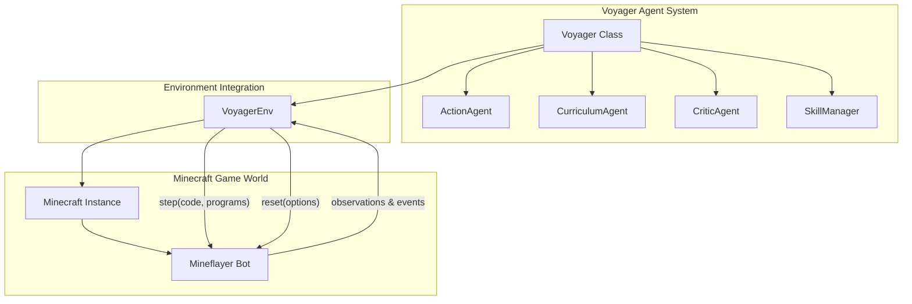
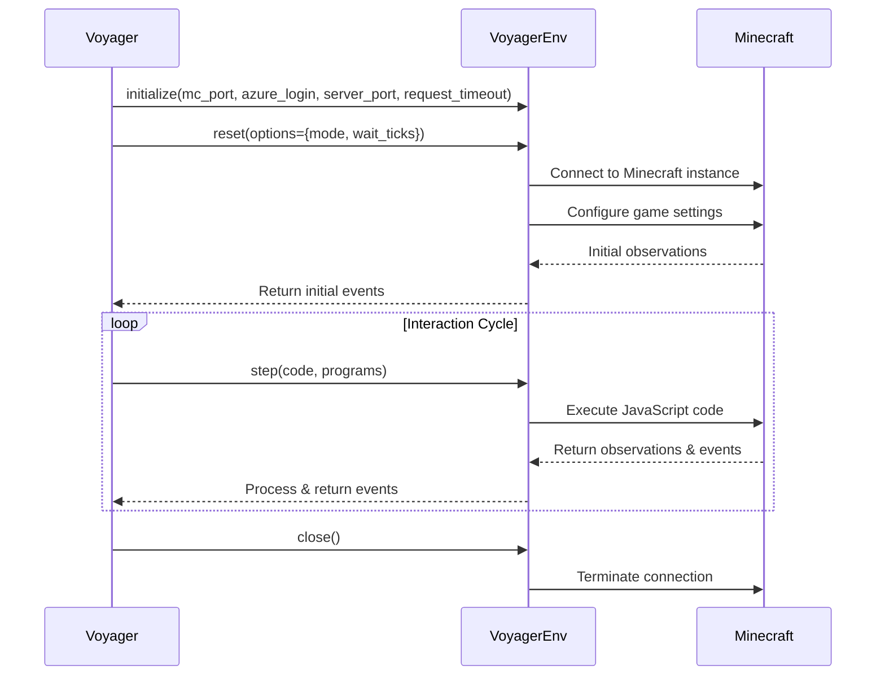
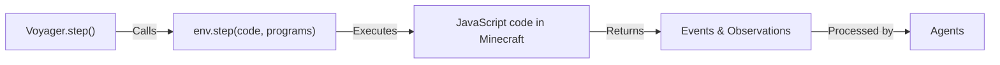
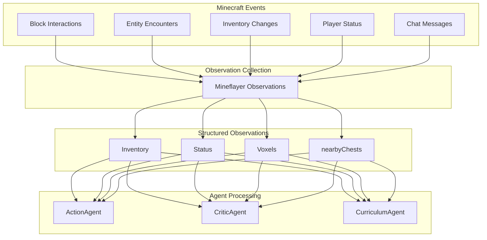
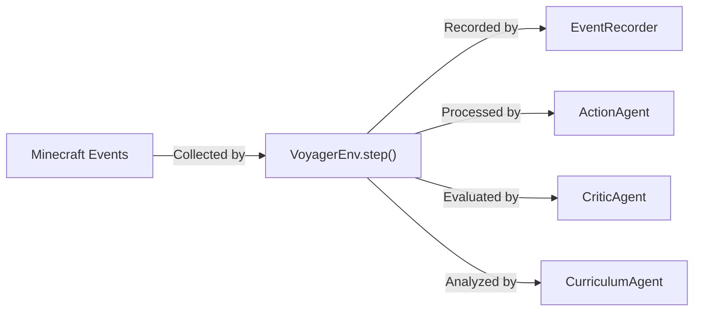

<!-- source: DeepWiki mcp.deepwiki.com · repo MineDojo/Voyager · page 6 Environment Integration · fetched 2026-10-26 -->

# Environment Integration

Relevant source files

The following files were used as context for generating this wiki page:

- [installation/minecraft_instance_install.md](installation/minecraft_instance_install.md)
- [voyager/env/mineflayer/lib/observation/chests.js](voyager/env/mineflayer/lib/observation/chests.js)
- [voyager/voyager.py](voyager/voyager.py)

This page explains how Voyager integrates with and observes the Minecraft environment. It covers the VoyagerEnv component, which serves as the bridge between Voyager's agent systems and the Minecraft game world, allowing for bidirectional communication, observation collection, and action execution.

## Overview of Environment Integration

The environment integration system in Voyager provides a structured interface for the agent components to interact with Minecraft. This involves:

1. Establishing connections to Minecraft instances
2. Sending commands and code to be executed in the game
3. Collecting observations and events from the game
4. Processing these observations to inform agent decisions

This system is essential for Voyager's functionality as it creates the communication channel between the LLM-powered agents and the virtual world they operate in.

Sources: [voyager/voyager.py:7-9](), [voyager/voyager.py:104-110]()

## Environment Architecture

### VoyagerEnv Bridge

The VoyagerEnv class serves as the crucial bridge between Voyager's agent systems and the Minecraft game world. It handles initialization of the Minecraft connection, sending commands via JavaScript code, and collecting observation data from the game.

Sources: [voyager/voyager.py:8](), [voyager/voyager.py:104-109]()

### Environment Initialization Flow

This diagram illustrates the initialization and interaction flow between Voyager and the Minecraft environment through VoyagerEnv.

Sources: [voyager/voyager.py:104-110](), [voyager/voyager.py:165-198](), [voyager/voyager.py:215-220]()

## Environment Configuration

VoyagerEnv is configured with the following key parameters when initialized in the Voyager class:

| Parameter | Description | Default |
|-----------|-------------|---------|
| `mc_port` | Minecraft game port | None |
| `azure_login` | Microsoft Azure login configuration | None |
| `server_port` | Mineflayer port | 3000 |
| `request_timeout` | Timeout for environment requests in seconds | 600 |
| `env_wait_ticks` | How many game ticks to wait after each step | 20 |

The environment can be initialized using either of two authentication methods:

1. **Azure Login Method** - Recommended for automatic resumption after timeouts
2. **Official Launcher Method** - Manual setup and port configuration

Sources: [voyager/voyager.py:18-25](), [voyager/voyager.py:104-110](), [installation/minecraft_instance_install.md:6-30]()

## Environment Interaction

### Step Function

The primary method for interacting with the Minecraft environment is the `step` method:

When Voyager needs to perform an action, it uses the `step` method to:

1. Execute JavaScript code in the Minecraft environment
2. Receive events and observations that resulted from the action
3. Process these events to inform agent decisions

Sources: [voyager/voyager.py:215-220](), [voyager/voyager.py:200-285]()

### Reset Function

The environment can be reset in different modes:

| Mode | Description |
|------|-------------|
| `hard` | Completely resets the environment, clearing inventory |
| `soft` | Preserves inventory and other player states |

The reset function accepts additional options like:
- `wait_ticks`: Number of game ticks to wait after reset
- `inventory`: Inventory items to restore
- `equipment`: Equipment to restore
- `position`: Position to restore

Sources: [voyager/voyager.py:165-198](), [voyager/voyager.py:340-347]()

## Observation System

Voyager collects various types of observations from the Minecraft environment, which are then processed and provided to the agent components for decision-making.

Sources: [voyager/voyager.py:220](), [voyager/env/mineflayer/lib/observation/chests.js:1-31]()

### Chest Observation

One specific type of observation is chest contents, implemented in the `Chests` class:

| Method | Purpose |
|--------|---------|
| `observe()` | Finds nearby chests and returns their contents |
| Event: `closeChest` | Updates chest contents when a chest is closed |
| Event: `removeChest` | Marks chest as invalid when removed |

The chest observation system:
1. Finds all chests within 16 blocks
2. Tracks their contents as "Unknown", actual items, or "Invalid"
3. Provides this information to agents for inventory management

This observation is used by the ActionAgent through its `update_chest_memory` method.

Sources: [voyager/env/mineflayer/lib/observation/chests.js:3-29](), [voyager/voyager.py:220]()

## Event Handling

Events in Voyager represent meaningful occurrences in the Minecraft environment. The system:

1. Collects events during each step
2. Records events using the EventRecorder
3. Processes events to extract relevant information
4. Provides events to agents for decision-making

Special handling exists for placed blocks in failed tasks:

1. If `reset_placed_if_failed` is enabled and a task fails
2. The system identifies blocks placed during the task
3. It removes those blocks to revert environment changes
4. It restores the player's inventory with those items

Sources: [voyager/voyager.py:229-244](), [voyager/voyager.py:221]()

## Integration with Agent System

The environment integration is tightly coupled with Voyager's agent system:

1. **ActionAgent**: Generates code to be executed in the environment and processes observations
2. **CriticAgent**: Evaluates success/failure based on environment observations
3. **CurriculumAgent**: Proposes tasks based on environment state
4. **SkillManager**: Provides programs that can be executed in the environment

For each action cycle:
1. The ActionAgent generates JavaScript code
2. VoyagerEnv executes this code in Minecraft
3. Events and observations are returned
4. Observations update the agent's understanding
5. The CriticAgent evaluates task success

Sources: [voyager/voyager.py:200-285](), [voyager/voyager.py:119-153]()

## Error Handling and Recovery

The environment integration includes mechanisms for handling errors and recovering from failures:

1. Request timeouts are configurable (default: 600 seconds)
2. When errors occur during rollout:
   - The environment is reset
   - Inventory, equipment, and position can be restored
   - Error information is displayed
3. Azure login method enables automatic resumption after timeouts

This ensures that Voyager can continue operating even when encountering errors in the Minecraft environment.

Sources: [voyager/voyager.py:333-351](), [installation/minecraft_instance_install.md:4-5]()

## Conclusion

The Environment Integration system in Voyager provides a robust interface between the agent components and the Minecraft game world. Through VoyagerEnv, Voyager can execute actions, collect observations, and process events from Minecraft, enabling the agents to make informed decisions and learn from their interactions with the environment.

For more information about the agent system that uses these environment observations, see [Agents](#4).

---

