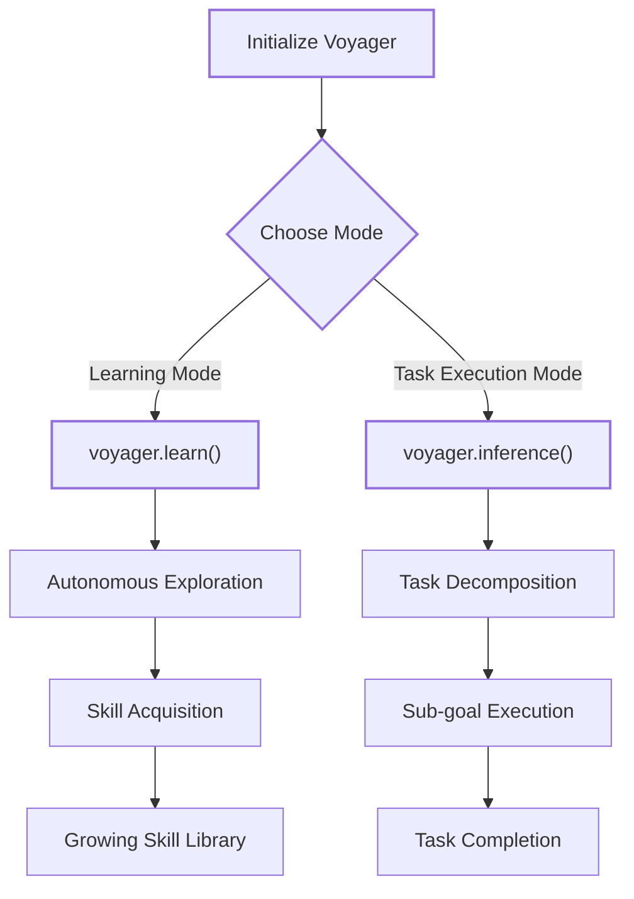
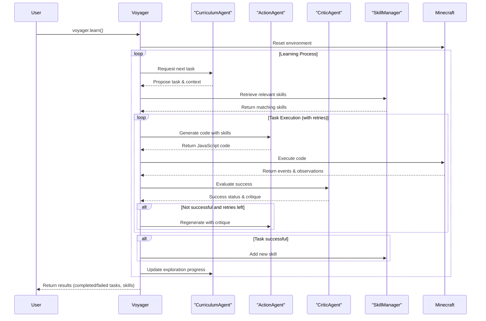
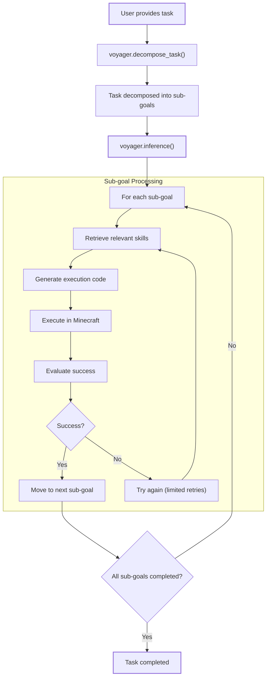

<!-- source: DeepWiki mcp.deepwiki.com · repo MineDojo/Voyager · page 7 Usage and Examples · fetched 2026-10-26 -->

# Usage and Examples

<details>
<summary>Relevant source files</summary>

The following files were used as context for generating this wiki page:

- [README.md](README.md)
- [skill_library/README.md](skill_library/README.md)
- [voyager/voyager.py](voyager/voyager.py)

</details>


This page provides practical instructions and examples for operating Voyager, an LLM-powered embodied lifelong learning agent in Minecraft. It covers how to start Voyager in various modes, run task-specific operations, and utilize pre-trained skill libraries. For information about the core architecture and components, see [Core Architecture](#3), and for environment setup, refer to [Installation and Setup](#2).

## Basic Usage Patterns

Voyager offers two primary usage patterns:

1. **Learning Mode**: Voyager explores the Minecraft world autonomously, discovers new skills, and builds its skill library without human intervention
2. **Task Execution Mode**: Voyager uses previously learned skills to accomplish specific user-defined tasks



Sources: [voyager/voyager.py:287-294](), [voyager/voyager.py:370-379](), [voyager/voyager.py:380-411]()

## Initializing Voyager

To use Voyager, you first need to import and initialize the `Voyager` class with appropriate parameters:

```python
from voyager import Voyager

# Initialize with Azure Login (recommended)
voyager = Voyager(
    azure_login={
        "client_id": "YOUR_CLIENT_ID",
        "redirect_url": "https://127.0.0.1/auth-response",
        "secret_value": "[OPTIONAL] YOUR_SECRET_VALUE",
        "version": "fabric-loader-0.14.18-1.19",
    },
    openai_api_key="YOUR_OPENAI_API_KEY",
)

# Alternatively, initialize with Minecraft port
voyager = Voyager(
    mc_port=YOUR_PORT_NUMBER,
    openai_api_key="YOUR_OPENAI_API_KEY",
)
```

The `Voyager` class accepts many configuration parameters, including:

| Parameter | Description | Default Value |
|-----------|-------------|---------------|
| `mc_port` | Minecraft in-game port | `None` |
| `azure_login` | Minecraft login config | `None` |
| `server_port` | Mineflayer port | `3000` |
| `openai_api_key` | OpenAI API key | Required |
| `env_wait_ticks` | Ticks to wait at the end of each step | `20` |
| `max_iterations` | Maximum number of learning iterations | `160` |
| `action_agent_model_name` | Model for Action Agent | `"gpt-4"` |
| `curriculum_agent_model_name` | Model for Curriculum Agent | `"gpt-4"` |
| `critic_agent_model_name` | Model for Critic Agent | `"gpt-4"` |
| `skill_manager_model_name` | Model for Skill Manager | `"gpt-3.5-turbo"` |
| `ckpt_dir` | Checkpoint directory | `"ckpt"` |
| `skill_library_dir` | Skill library directory | `None` |
| `resume` | Whether to resume from checkpoint | `False` |

Sources: [voyager/voyager.py:18-156]()

### Azure Login Note

When using Azure Login for the first time:
1. Follow the command line instructions to generate a config file
2. Manually select a world and open it to LAN
3. Set Game Mode to "Creative" and Difficulty to "Peaceful"
4. Enable cheats when opening to LAN

Sources: [README.md:99-104]()

## Learning Mode

In Learning Mode, Voyager autonomously explores the Minecraft world, proposes tasks for itself, acquires diverse skills, and builds its skill library.

```python
# Start the lifelong learning process
voyager.learn()
```

The `learn()` method starts Voyager's autonomous learning loop, which continues until reaching the maximum number of iterations specified during initialization.



During learning, Voyager:
1. Proposes tasks through the Curriculum Agent
2. Retrieves relevant skills from the Skill Manager
3. Generates code through the Action Agent
4. Executes the code in Minecraft
5. Evaluates success through the Critic Agent
6. Stores successful skills in the Skill Library
7. Updates exploration progress and repeats

Sources: [voyager/voyager.py:295-368]()

## Task Execution Mode

In Task Execution Mode, Voyager uses previously learned skills to accomplish specific user-defined tasks:

```python
# Example 1: Execute a specific high-level task
task = "Craft a diamond pickaxe"
sub_goals = voyager.decompose_task(task=task)
voyager.inference(sub_goals=sub_goals)

# Example 2: Execute directly with the task
voyager.inference(task="Craft a diamond pickaxe")

# Example 3: Execute with manually defined sub-goals
sub_goals = [
    "Mine wood from a tree",
    "Craft a crafting table",
    "Craft wooden pickaxe",
    "Mine stone",
    "Craft stone pickaxe",
    "Mine iron ore",
    "Smelt iron ore",
    "Craft iron pickaxe",
    "Mine diamond ore",
    "Craft diamond pickaxe"
]
voyager.inference(sub_goals=sub_goals)
```

The task execution process involves:



The `inference()` method takes either a `task` parameter or a `sub_goals` list. If only a task is provided, it first calls `decompose_task()` to break it down into manageable sub-goals.

Sources: [voyager/voyager.py:370-411]()

## Checkpoint Management

Voyager can save its progress and resume learning from checkpoints:

```python
# Initialize Voyager to resume from a checkpoint
voyager = Voyager(
    azure_login=azure_login,
    openai_api_key=openai_api_key,
    ckpt_dir="YOUR_CHECKPOINT_DIRECTORY",
    resume=True,
)

# Resume learning
voyager.learn()
```

When resumed, Voyager maintains its:
- Completed and failed tasks history
- Skill library
- Chest memory
- Exploration progress

Sources: [voyager/voyager.py:295-368](), [README.md:107-118]()

## Using Skill Libraries

Voyager can leverage pre-trained skill libraries, including official ones and community contributions:

```python
# Load a pre-trained skill library
voyager = Voyager(
    azure_login=azure_login,
    openai_api_key=openai_api_key,
    skill_library_dir="./skill_library/trial1",  # Path to skill library
    ckpt_dir="NEW_CHECKPOINT_DIR",  # Different from skill library directory
    resume=False,  # Do not resume from the skill library
)

# Execute a task using the loaded skill library
task = "Craft a diamond pickaxe"
sub_goals = voyager.decompose_task(task=task)
voyager.inference(sub_goals=sub_goals)
```

### Available Skill Libraries

Voyager provides several official skill libraries:
- `skill_library/trial1`
- `skill_library/trial2`
- `skill_library/trial3`

Community contributions are also available:
- daswer123/Voyager_checkpoint
- swen128/Voyager_checkpoint
- DeveloperHarris/voyager_checkpoint

### Skill Library Structure

```
skill_library/
└── trial1/
    ├── code/
    │   ├── skill1.js
    │   ├── skill2.js
    │   └── ...
    ├── description/
    │   ├── skill1.txt
    │   ├── skill2.txt
    │   └── ...
    ├── skills.json
    └── vectordb/
```

Sources: [skill_library/README.md:1-45](), [README.md:121-146]()

## Advanced Usage Examples

### Custom Task Decomposition and Execution

You can decompose a task into sub-goals and then execute them:

```python
# Decompose a complex task
task = "Build a small house with a garden"
sub_goals = voyager.decompose_task(task=task)

# Print the sub-goals
print("Sub-goals:", sub_goals)

# Optionally modify the sub-goals
sub_goals.insert(2, "Collect flowers for garden")

# Execute the modified sub-goals
voyager.inference(sub_goals=sub_goals)
```

### Reset Options for Task Execution

The `inference()` method accepts a `reset_mode` parameter to control environment reset behavior:

```python
# Execute with hard reset (clears inventory)
voyager.inference(task="Craft stone tools", reset_mode="hard")

# Execute with soft reset (preserves inventory)
voyager.inference(task="Build a shelter", reset_mode="soft")
```

### Controlling Maximum Retries

You can set the maximum number of retries for each task during initialization:

```python
# Set a higher retry limit for difficult tasks
voyager = Voyager(
    azure_login=azure_login,
    openai_api_key=openai_api_key,
    action_agent_task_max_retries=8,  # Default is 4
)
```

Sources: [voyager/voyager.py:18-156](), [voyager/voyager.py:380-411]()

## Sample Usage Workflows

### Lifelong Learning Workflow

```python
from voyager import Voyager

# Initialize Voyager
voyager = Voyager(
    azure_login={
        "client_id": "YOUR_CLIENT_ID",
        "redirect_url": "https://127.0.0.1/auth-response",
        "version": "fabric-loader-0.14.18-1.19",
    },
    openai_api_key="YOUR_OPENAI_API_KEY",
    max_iterations=200,  # Increase max iterations
)

# Start lifelong learning
results = voyager.learn()

# Print results
print(f"Completed tasks: {results['completed_tasks']}")
print(f"Failed tasks: {results['failed_tasks']}")
print(f"Learned skills: {len(results['skills'])}")
```

### Task-Specific Execution Workflow

```python
from voyager import Voyager

# Initialize Voyager with a pre-trained skill library
voyager = Voyager(
    azure_login={
        "client_id": "YOUR_CLIENT_ID",
        "redirect_url": "https://127.0.0.1/auth-response",
        "version": "fabric-loader-0.14.18-1.19",
    },
    openai_api_key="YOUR_OPENAI_API_KEY",
    skill_library_dir="./skill_library/trial1",
)

# Define a complex task
task = "Build a small house with a chest inside containing iron tools"

# Decompose the task
sub_goals = voyager.decompose_task(task=task)
print(f"Task decomposed into {len(sub_goals)} sub-goals:")
for i, sg in enumerate(sub_goals):
    print(f"{i+1}. {sg}")

# Execute the task
voyager.inference(sub_goals=sub_goals)
```

Sources: [voyager/voyager.py:295-368](), [voyager/voyager.py:380-411](), [README.md:78-144]()

---

