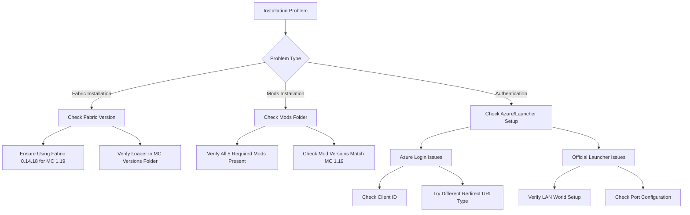
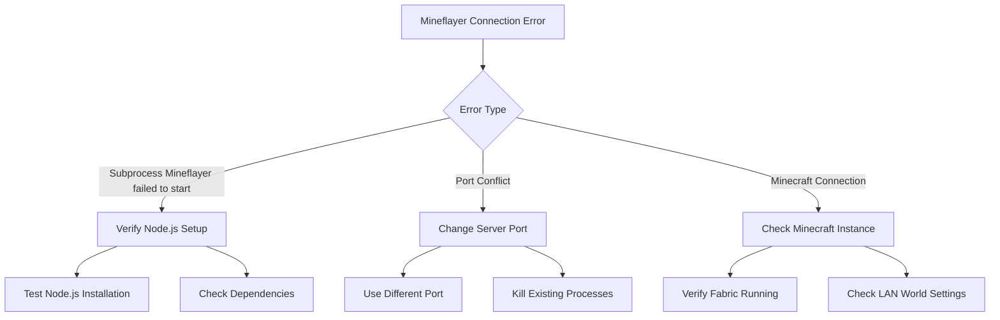
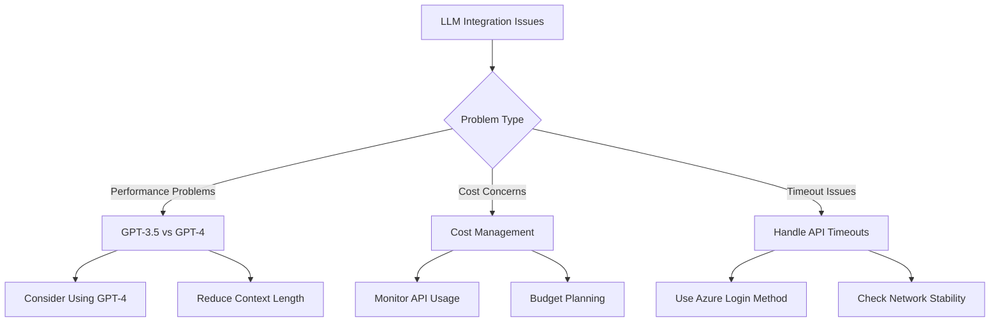
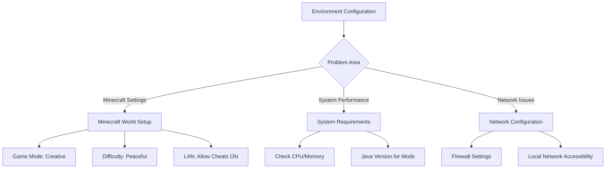
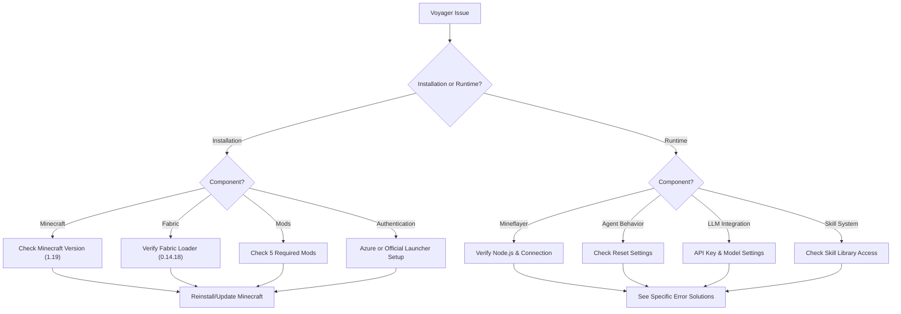
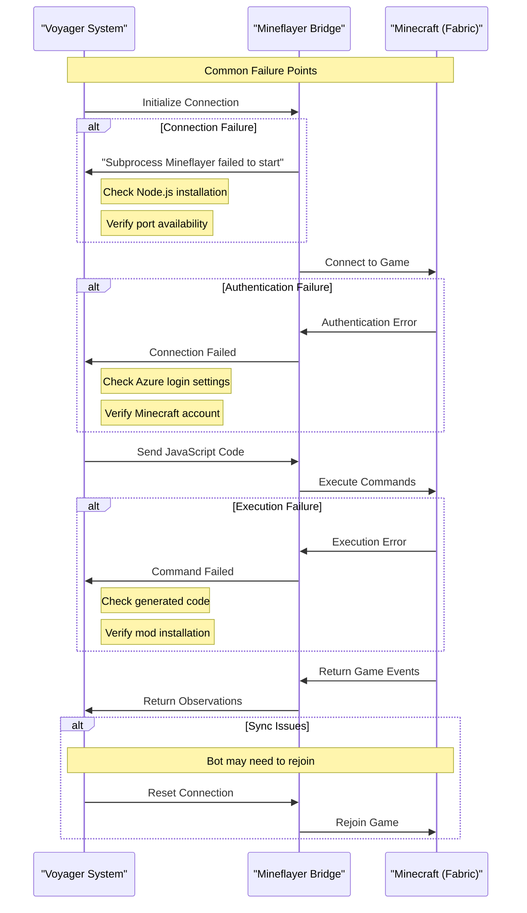

<!-- source: DeepWiki mcp.deepwiki.com · repo MineDojo/Voyager · page 8 Troubleshooting · fetched 2026-10-26 -->

# Troubleshooting

<details>
<summary>Relevant source files</summary>

The following files were used as context for generating this wiki page:

- [FAQ.md](FAQ.md)
- [installation/fabric_mods_install.md](installation/fabric_mods_install.md)
- [installation/minecraft_instance_install.md](installation/minecraft_instance_install.md)

</details>


This page provides solutions to common issues encountered when setting up and running Voyager. It covers installation problems, runtime errors, connection issues, and performance considerations. For information about general usage of Voyager, see [Usage and Examples](#7).

## Common Installation Issues

### Minecraft and Fabric Setup



#### Missing or Incorrect Fabric Version

**Issue**: Voyager fails to connect to Minecraft or cannot find the correct Fabric version.

**Solution**:
1. Ensure you've installed Fabric Loader 0.14.18 for Minecraft 1.19
2. Verify the Fabric version appears in your Minecraft launcher under "Installations"
3. Check that the `version` parameter in your configuration matches exactly: `fabric-loader-0.14.18-1.19`

#### Missing Required Mods

**Issue**: Voyager crashes or behaves unexpectedly due to missing mods.

**Solution**:
1. Verify all 5 required mods are installed in your Minecraft mods folder:
   - Fabric API
   - Mod Menu
   - Complete Config
   - Multi Server Pause
   - Better Respawn
2. Ensure all mods are compatible with Minecraft 1.19
3. For Better Respawn, verify you've compiled it correctly and updated the config file

Sources: [installation/fabric_mods_install.md:1-22]()

### Authentication Problems

#### Azure Login Connection Error

**Issue**: Connection error after clicking on the Azure login link and logging into Microsoft account.

**Solution**:
- This is normal behavior. You'll get a connection refused or 404 error after login
- Copy the new URL from your browser (containing `code=M.C....`) and use it as instructed

#### KeyError: 'access_token' After Copying Link

**Issue**: Error `KeyError: 'access_token'` appears after copying the authentication link.

**Solution**:
1. Try changing the Redirect URI Type from "Public client/native" to "Web" in your Azure app registration
2. If that doesn't work, refer to the [minecraft-launcher-lib tutorial](https://minecraft-launcher-lib.readthedocs.io/en/stable/tutorial/microsoft_login.html)
3. If problems persist, consider using the Minecraft Official Launcher method instead

Sources: [FAQ.md:10-18]()

## Runtime Issues

### Mineflayer Connection Problems



#### Subprocess Mineflayer Failed to Start

**Issue**: Error message `Subprocess Mineflayer failed to start` when launching Voyager.

**Solution**:
1. Verify Node.js installation:
   ```bash
   cd voyager/env/mineflayer
   node index.js
   ```
   You should see "Server started on port {PORT}"
2. Ensure Fabric is installed correctly and selectable in the Minecraft launcher
3. If running multiple Voyager instances, use different ports:
   ```python
   voyager = Voyager(
       server_port=3001,  # default is 3000
       ...
   )
   ```

Sources: [FAQ.md:19-37]()

### Bot Behavior Issues

#### Bot Leaving and Rejoining After Each Task

**Issue**: The bot leaves and rejoins the game after completing each task.

**Solution**:
- This is default behavior to synchronize Mineflayer with Minecraft
- If you want to prevent this, use:
  ```python
  voyager.learn(reset_env=False)
  ```
- Consider increasing `env_wait_ticks` value to give Mineflayer more time to sync

#### Unable to See Bot's First-Person View

**Issue**: Cannot see what the bot is seeing in first-person.

**Solution**:
- This is a limitation of Mineflayer
- For recording bot actions, use [replay-mod](https://www.replaymod.com/)
- Start recording before the bot plays, then come back to render the view later

Sources: [FAQ.md:38-45]()

## LLM Integration Issues



### Using GPT-3.5 Instead of GPT-4

**Issue**: Considering using GPT-3.5 for cost reasons but concerned about performance.

**Solution**:
- GPT-4 is highly recommended for Voyager
- GPT-3.5 has poorer code quality, reasoning ability, and a more limited context length
- If you must use GPT-3.5, configure with `skill_manager_retrieval_top_k` ≤ 2 to reduce context length

### API Costs and Budget Considerations

**Issue**: Concerns about the cost of running Voyager.

**Solution**:
- Approximately 160 iterations with GPT-4 costs around $50 USD
- Monitor your OpenAI API expenses closely
- When starting Voyager, observe the bot for a while to ensure it completes tasks successfully

Sources: [FAQ.md:48-54]()

## Environment Configuration Issues



### Minecraft World Setup

**Issue**: Voyager cannot interact properly with the Minecraft world.

**Solution**:
1. Ensure your world is set up correctly:
   - Game Mode: Creative
   - Difficulty: Peaceful
2. When using Official Launcher:
   - Ensure "Open to LAN" is enabled
   - "Allow cheats" must be ON
   - Note the port number from the chat log

### Java Version Issues for Mod Compilation

**Issue**: Errors when compiling Better Respawn mod.

**Solution**:
1. You need Java Runtime Environment v17+ to build the Better Respawn mod
2. Some newer JRE versions may cause errors during build
3. If encountering problems, download JRE v17 from the archive link provided in the installation instructions

Sources: [installation/fabric_mods_install.md:10-13](), [installation/minecraft_instance_install.md:35-42]()

## System Diagnosis Flowchart



## Component-Specific Troubleshooting

### Voyager Core System Issues

If the Voyager main system is not running correctly, check:

1. Python environment is properly set up with all dependencies
2. OpenAI API key is valid and has sufficient credits
3. Correct model is specified (GPT-4 recommended)
4. System paths are correctly configured

### Agent Subsystem Issues

If specific agents are not functioning properly:

1. **ActionAgent**: Verify JavaScript code generation is working
2. **CurriculumAgent**: Check task proposal and context gathering
3. **CriticAgent**: Ensure task success evaluation is running
4. **SkillManager**: Verify skill storage and retrieval functionality

Sources: [FAQ.md:1-54]()

## Voyager-Minecraft Communication Diagram



Sources: [FAQ.md:19-37](), [FAQ.md:38-45]()