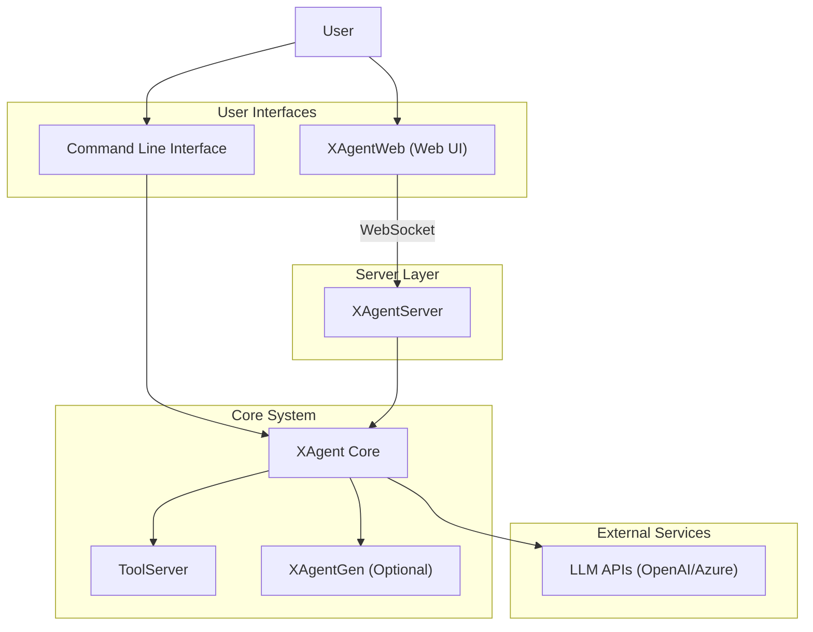
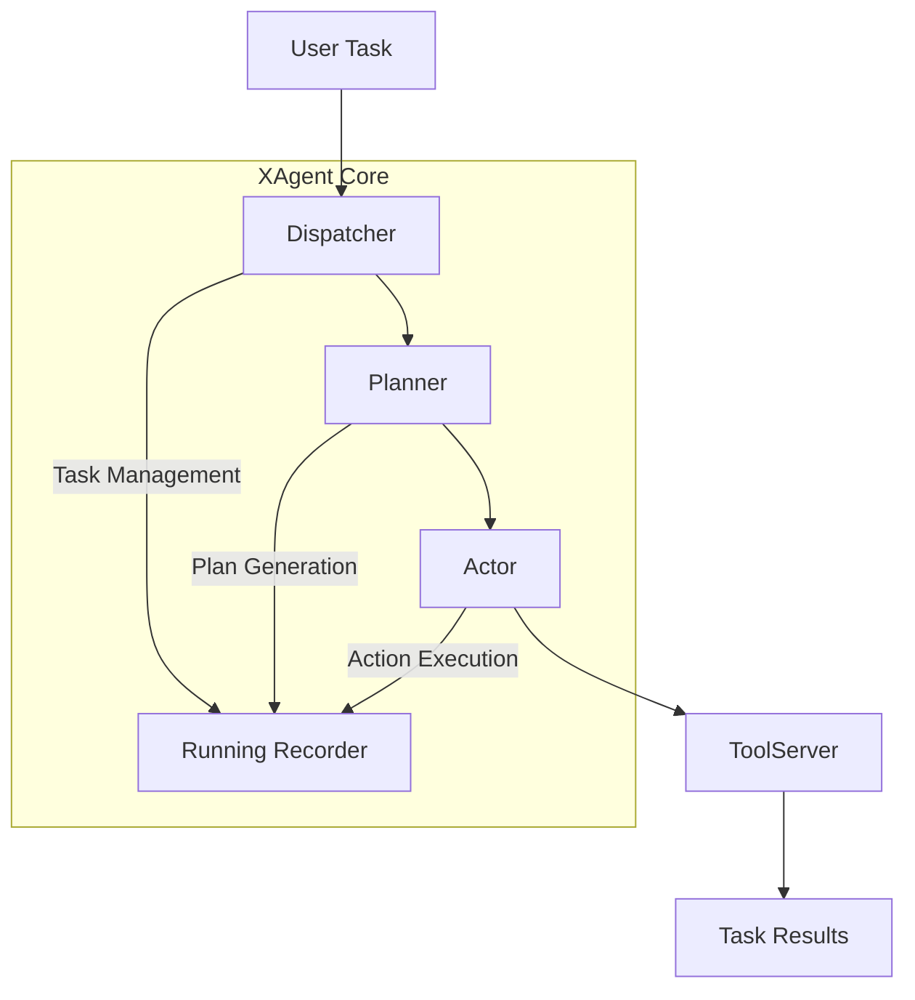
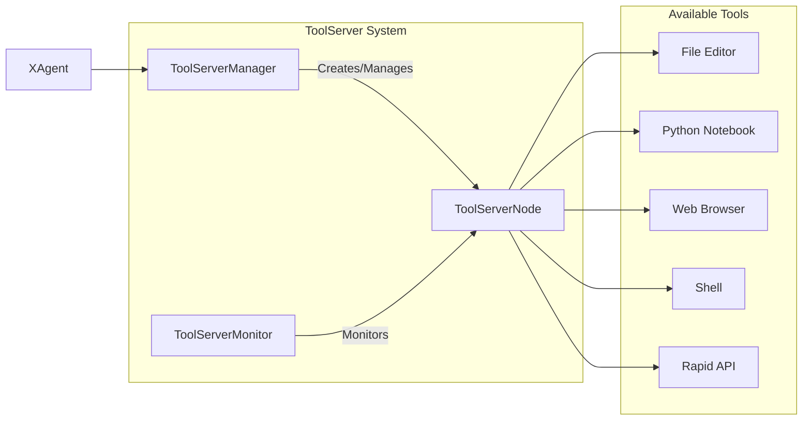
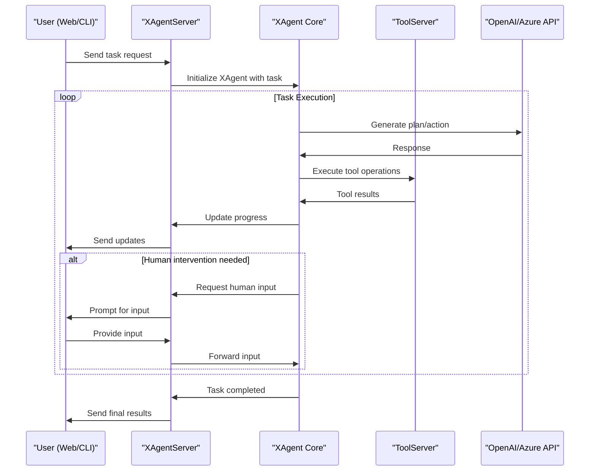
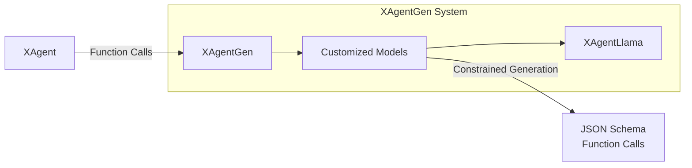

<!-- source: DeepWiki mcp.deepwiki.com · repo OpenBMB/XAgent · page 1 Overview · fetched 2026-10-26 -->

# Overview

Relevant source files

The following files were used as context for generating this wiki page:

- [README.md](README.md)
- [README_JA.md](README_JA.md)
- [README_ZH.md](README_ZH.md)
- [XAgentGen/README.md](XAgentGen/README.md)

XAgent is an open-source autonomous agent system powered by Large Language Models (LLMs) designed to solve complex tasks without human intervention. This page provides a high-level overview of XAgent's architecture, key components, and capabilities. For installation instructions, see [Installation and Setup](#1.2).

## What is XAgent?

XAgent is an experimental autonomous agent framework that leverages the reasoning capabilities of large language models to break down complex tasks, plan solutions, and execute them using various tools. The system is designed with the following key features:

- **Autonomy**: Automatically solves various tasks without human participation
- **Safety**: All actions are constrained inside a Docker container
- **Extensibility**: Easily extensible with new tools and agents
- **GUI**: User-friendly interface for interaction
- **Human Collaboration**: Can follow human guidance and seek human assistance when needed

Sources: [README.md:28-48]()

## System Architecture

XAgent consists of several interconnected systems that work together to provide a complete autonomous agent experience.

**XAgent System Components:**

| Component | Description |
|-----------|-------------|
| XAgent Core | The main intelligent agent system that processes tasks, generates plans, and executes actions |
| ToolServer | Provides a safe environment with various tools for XAgent to use |
| XAgentServer | Facilitates client-agent interaction via WebSockets |
| XAgentWeb | Web interface for interacting with XAgent |
| XAgentGen | Component for generating customized models to support XAgent |

Sources: [README.md:50-53](), [README.md:61-70]()

## Core Components

XAgent's core system consists of three main components that work together to process tasks:

**XAgent Core Components:**

| Component | Description |
|-----------|-------------|
| Dispatcher | Responsible for dynamically instantiating and dispatching tasks to different agents |
| Planner | Generates and rectifies plans for tasks, dividing tasks into subtasks with milestones |
| Actor | Conducts actions to achieve goals and finish subtasks using various tools |
| Running Recorder | Records task execution for later inspection and analysis |

The workflow of XAgent involves:
1. The Dispatcher receives a task and manages its execution
2. The Planner breaks down the task into subtasks with specific milestones
3. The Actor executes each subtask using appropriate tools
4. The Running Recorder logs all interactions for later analysis

Sources: [README.md:51-53](), [README.md:54-59]()

## ToolServer System

ToolServer provides a safe execution environment for XAgent's tools through Docker containers.

**Available Tools in ToolServer:**

| Tool | Description |
|------|-------------|
| File Editor | Provides text editing capabilities to write, read, and modify files |
| Python Notebook | Interactive Python environment that can run code to validate ideas and visualize data |
| Web Browser | Allows searching and visiting webpages |
| Shell | Bash shell that can execute shell commands, install programs, and host services |
| Rapid API | Retrieves and calls APIs from Rapid API |

Sources: [README.md:62-70]()

## Data Flow and Communication

XAgent components communicate and persist data through various channels:

**Data Storage:**

| Storage Type | Purpose |
|--------------|---------|
| MySQL Database | Stores interaction data through XAgentServer |
| Redis | Manages session state |
| Running Records | Logs all execution details including LLM calls and tool usage |
| File System | Stores files generated during task execution |
| Local Workspace | Provides workspace for the current session |

Sources: [README.md:126-136]()

## Integration with XAgentGen

XAgentGen extends XAgent's capabilities by providing customized models with constrained text generation:

XAgentGen allows XAgent to use custom models that can generate function calls with complex JSON schemas, similar to OpenAI's function calling capability.

Sources: [XAgentGen/README.md:1-9]()

## Use Cases and Capabilities

XAgent can handle a wide range of complex tasks, such as:

1. **Data Analysis**: Processing and analyzing datasets, generating visualizations and reports
2. **Information Retrieval**: Searching the web for specific information and compiling reports
3. **Code Development**: Writing, debugging, and optimizing code
4. **Model Training**: Training machine learning models based on user requirements
5. **Task Automation**: Automating repetitive tasks through planning and tool execution

Sources: [README.md:153-176]()

---

