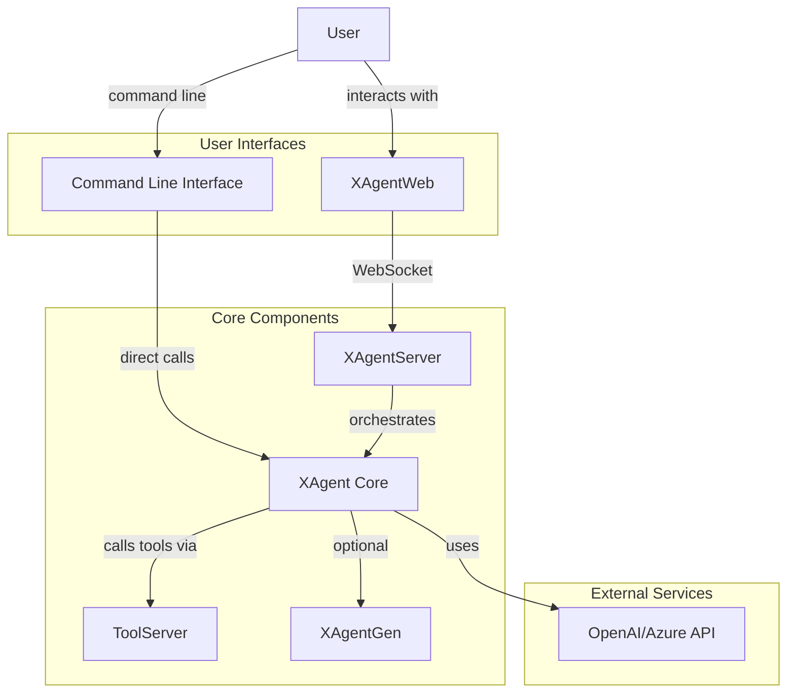
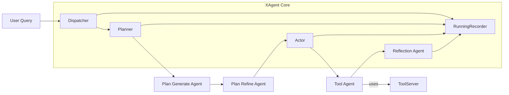
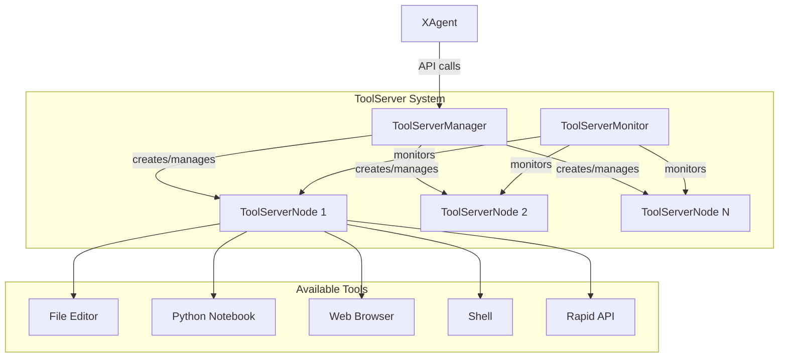
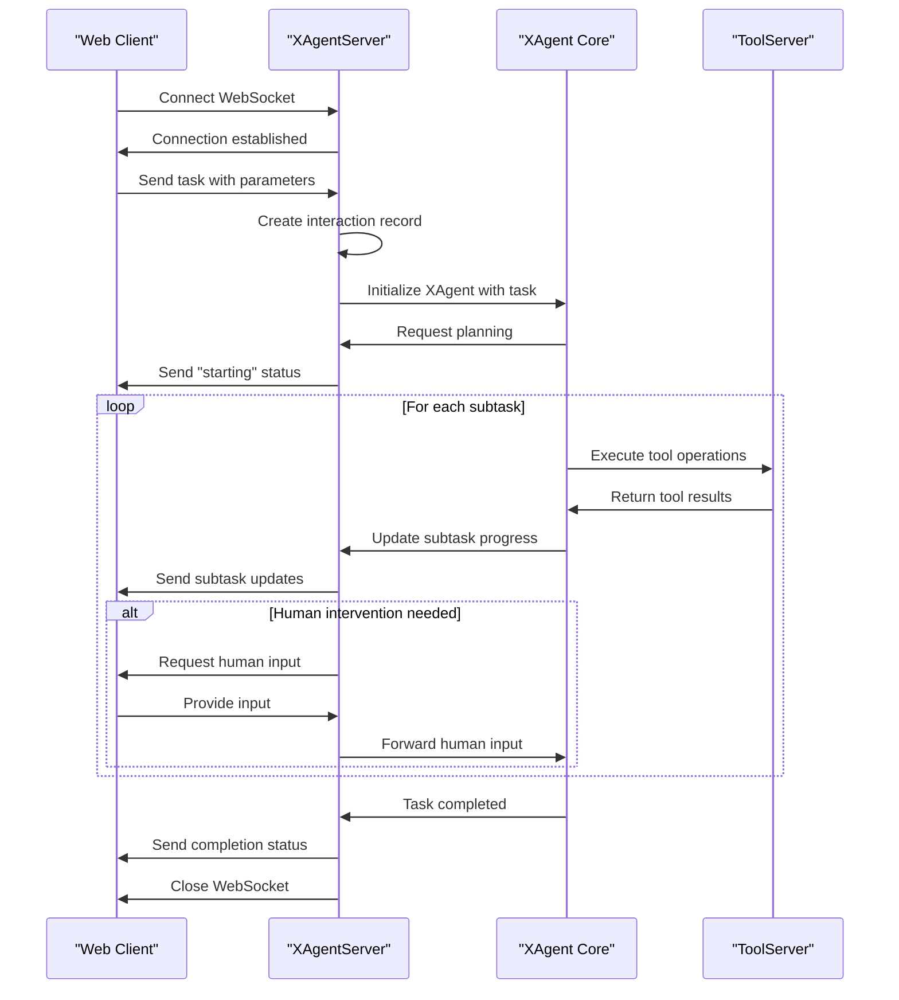
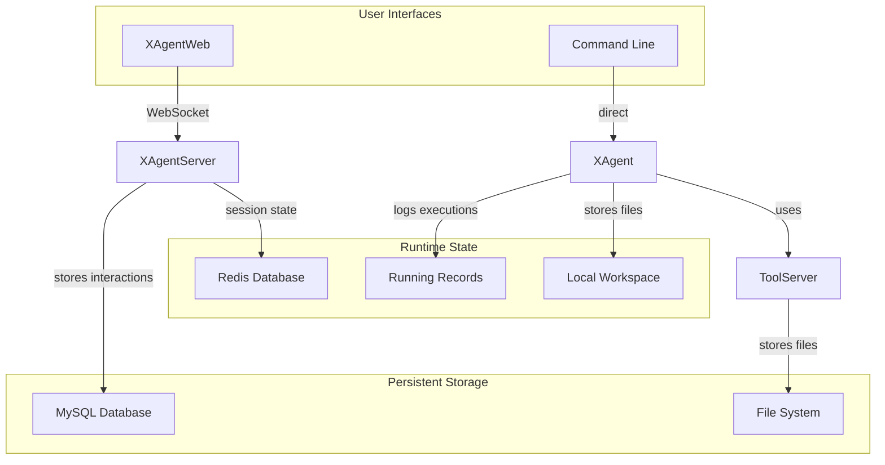
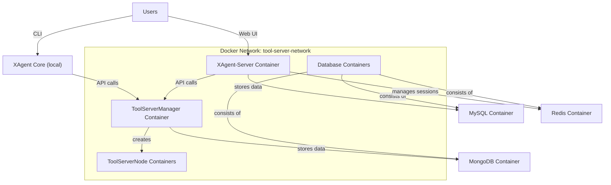

<!-- source: DeepWiki mcp.deepwiki.com · repo OpenBMB/XAgent · page 1.1 Architecture · fetched 2026-10-26 -->

# Architecture

Relevant source files

The following files were used as context for generating this wiki page:

- [README.md](README.md)
- [README_JA.md](README_JA.md)
- [README_ZH.md](README_ZH.md)
- [XAgent/recorder.py](XAgent/recorder.py)
- [XAgentGen/README.md](XAgentGen/README.md)
- [XAgentServer/server.py](XAgentServer/server.py)
- [docker-compose.yml](docker-compose.yml)

This document provides an overview of the XAgent system architecture, explaining the relationships and interactions between its core components. It aims to help developers understand the high-level design and how different parts of the system work together.

For details on installation, see [Installation and Setup](#1.2). For deeper information about specific subsystems, refer to their dedicated wiki pages ([XAgent Core](#2), [ToolServer](#3), [XAgentServer](#4), and [XAgentWeb](#5)).

## System Overview

XAgent is an autonomous agent system designed to solve complex tasks using large language models (LLMs). The system architecture follows a modular design that separates concerns between task planning, tool execution, user interaction, and persistence.

**XAgent System Architecture**

Sources:
- [README.md:41-53]()
- [README.md:61-70]()
- [docker-compose.yml:1-110]()

## Key Components

### XAgent Core

The XAgent Core is the central component responsible for processing user tasks, planning solutions, and coordinating execution. It consists of several key subcomponents:

**XAgent Core Components**

1. **Dispatcher**: Dynamically instantiates and dispatches tasks to different agents based on task requirements.
2. **Planner**: Generates and refines plans for tasks, dividing complex tasks into manageable subtasks with milestones.
3. **Actor**: Conducts actions to achieve goals and complete subtasks using various tools and potentially collaborating with humans.
4. **Reflection Agent**: Learns from execution processes to improve future task handling.
5. **RunningRecorder**: Records all interactions and execution details for later inspection and analysis.

Sources:
- [README.md:50-53]()
- [XAgent/recorder.py:48-346]()
- [XAgentServer/server.py:20-109]()

### ToolServer

The ToolServer provides a safe and controlled environment for executing tools requested by XAgent. It runs as a Docker container to isolate tool execution from the host system.

**ToolServer Architecture**

The ToolServer provides the following tools:
- **File Editor**: For writing, reading, and modifying files
- **Python Notebook**: Interactive Python environment for code execution
- **Web Browser**: For web searches and browsing
- **Shell**: Bash shell for executing system commands
- **Rapid API**: For retrieving and calling external APIs

Sources:
- [README.md:61-70]()
- [docker-compose.yml:4-30]()

### XAgentServer

XAgentServer acts as the bridge between user interfaces (primarily XAgentWeb) and the XAgent Core system. It handles WebSocket connections, manages user sessions, and persists interaction data.

**XAgentServer Communication Flow**

The server component integrates with:
- **MySQL**: For storing interaction data and user information
- **Redis**: For managing session state
- **ToolServerManager**: For creating and managing ToolServer instances

Sources:
- [XAgentServer/server.py:1-109]()
- [docker-compose.yml:43-64]()

### XAgentWeb

XAgentWeb provides a graphical user interface for interacting with XAgent. It communicates with XAgentServer via WebSockets to send tasks and receive updates.

### XAgentGen (Optional)

XAgentGen is an optional component that implements guided generation of customized models to support XAgent. It allows models to generate function calls with complex JSON schemas similar to OpenAI's function calling.

Sources:
- [XAgentGen/README.md:1-49]()

## Data Flow and Persistence

XAgent maintains several types of persistent storage for different purposes:

**Data Flow and Persistence**

- **MySQL Database**: Stores user information, interaction history, and task details
- **Redis Database**: Manages session state and temporary data
- **Running Records**: Logs detailed execution records including LLM inputs/outputs and tool calls
- **Local Workspace**: Stores files generated during task execution
- **File System**: Used by ToolServer to manage files in the isolated environment

Sources:
- [XAgent/recorder.py:48-346]()
- [docker-compose.yml:66-94]()

## Deployment Architecture

The entire XAgent system is designed to be deployed using Docker containers, with the following container structure:

**Deployment Architecture**

This containerized approach ensures:
1. Isolation of tool execution for security
2. Scalability through container orchestration
3. Easy deployment across different environments
4. Separation of concerns between components

Sources:
- [docker-compose.yml:1-110]()

## System Workflow

When a user submits a task to XAgent, the following workflow is initiated:

1. **Task Reception**: The task is received either through the web interface or command line interface
2. **Task Planning**: XAgent Core's Planner breaks down the task into subtasks and creates a plan
3. **Tool Execution**: The Actor executes the plan using tools provided by ToolServer
4. **Progress Monitoring**: The system continuously monitors progress and updates the user
5. **Human Collaboration**: If needed, XAgent can request human assistance for specific subtasks
6. **Task Completion**: When all subtasks are completed, the final results are presented to the user

Throughout this process, the RunningRecorder logs all activities for later inspection and analysis.

Sources:
- [README.md:50-59]()
- [XAgentServer/server.py:27-109]()

## Key Technical Specifications

| Component | Technology | Purpose |
|-----------|------------|---------|
| XAgent Core | Python | Task planning and execution |
| ToolServer | Docker | Isolated tool execution environment |
| XAgentServer | FastAPI | WebSocket API and HTTP endpoints |
| XAgentWeb | React | User interface |
| Database | MySQL, Redis, MongoDB | Data persistence |
| LLM Integration | OpenAI API | Language processing capabilities |

Sources:
- [docker-compose.yml:1-110]()
- [README.md:26-70]()

## Security Architecture

XAgent is designed with security in mind:

1. **Isolation**: All tool execution occurs in isolated Docker containers
2. **Controlled Access**: ToolServer restricts access to system resources
3. **API Key Management**: Sensitive information like API keys is securely managed
4. **Authentication**: The web interface requires authentication for access

This architecture ensures that potentially risky operations (like shell commands) can be executed safely without endangering the host system.

Sources:
- [README.md:44-46]()
- [docker-compose.yml:24-30]()

## Conclusion

The XAgent architecture is designed to be modular, extensible, and secure. By separating concerns between planning, execution, and user interaction, the system can effectively tackle a wide range of tasks autonomously. The use of Docker containers for tool execution provides a safe environment for running potentially risky operations, while the integration with large language models enables sophisticated reasoning and planning capabilities.

For more detailed information about specific components, please refer to their dedicated wiki pages.

---

