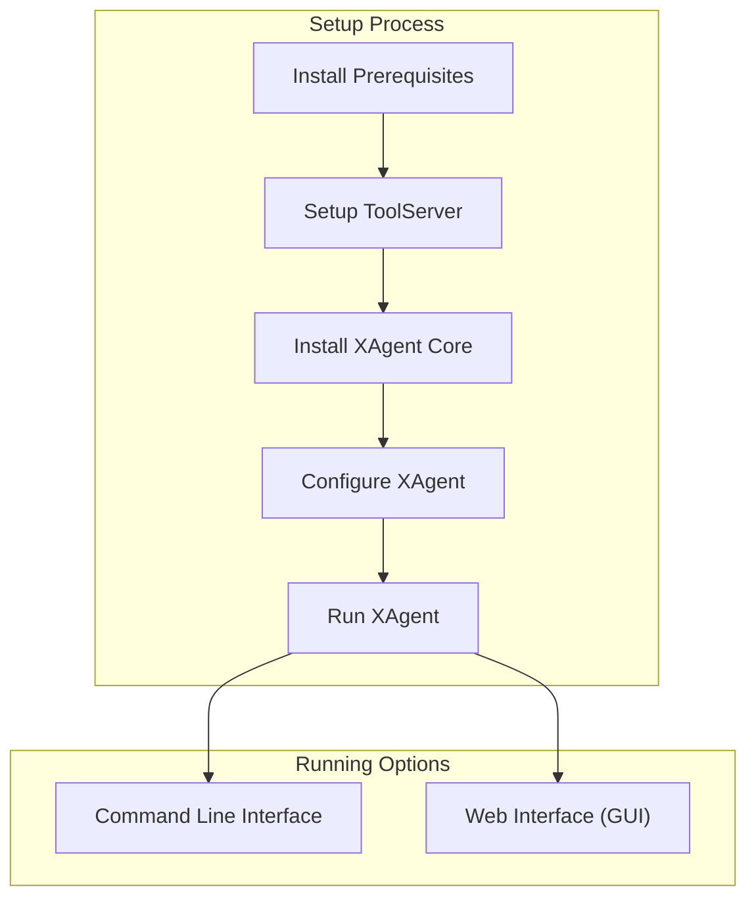
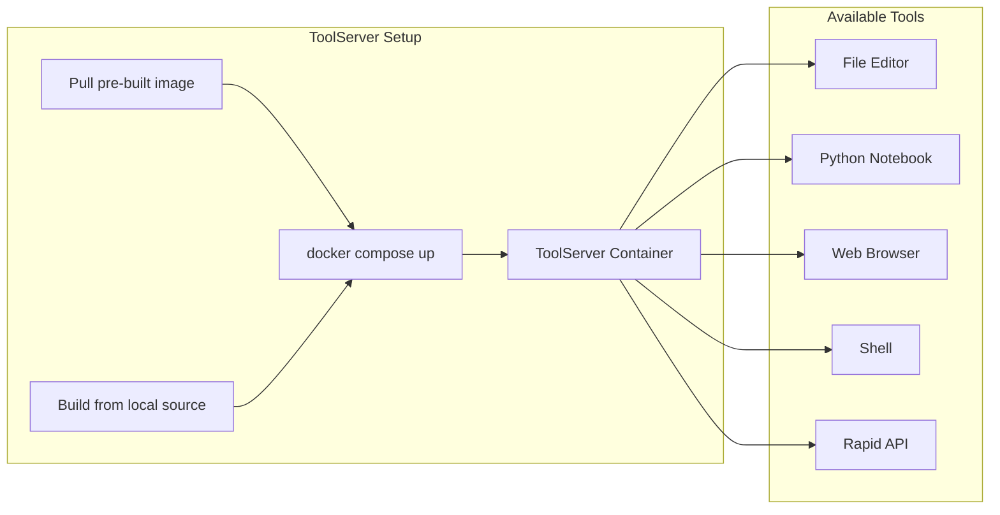
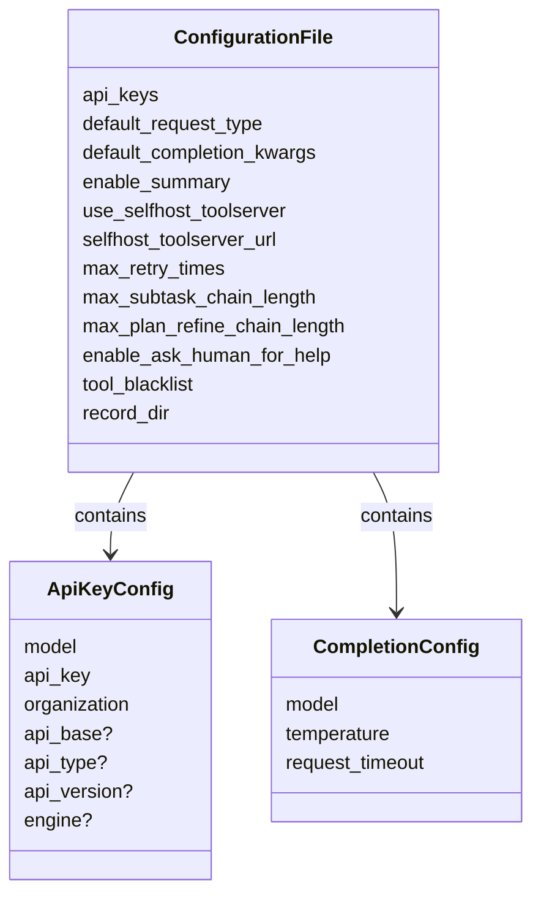
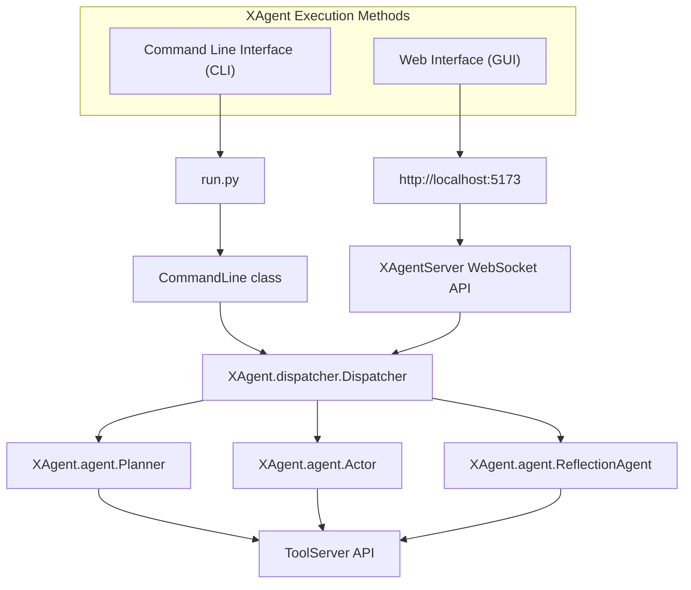

<!-- source: DeepWiki mcp.deepwiki.com · repo OpenBMB/XAgent · page 1.2 Installation and Setup · fetched 2026-10-26 -->

# Installation and Setup

<details>
<summary>Relevant source files</summary>

The following files were used as context for generating this wiki page:

- [README.md](README.md)
- [README_JA.md](README_JA.md)
- [README_ZH.md](README_ZH.md)
- [XAgentGen/README.md](XAgentGen/README.md)
- [assets/config.yml](assets/config.yml)
- [assets/gpt-3.5-turbo_config.yml](assets/gpt-3.5-turbo_config.yml)
- [assets/gpt4_config.yml](assets/gpt4_config.yml)
- [requirements.txt](requirements.txt)
- [tests/__init__.py](tests/__init__.py)
- [tests/test_1106_model_openai.py](tests/test_1106_model_openai.py)
- [tests/test_model_alias.py](tests/test_model_alias.py)
- [tests/test_run.py](tests/test_run.py)

</details>


This document provides detailed instructions for installing and configuring XAgent, an autonomous agent system driven by Large Language Models (LLMs). It covers the prerequisites, core components setup, configuration options, and running methods. For information about XAgent's architecture, see [Architecture](#1.1).

## Overview of Setup Process

XAgent consists of multiple interrelated components that need to be properly set up and configured to work together. The main setup steps include:

1. Setting up the ToolServer environment (Docker container)
2. Installing XAgent Core dependencies
3. Configuring API keys and system settings
4. Running XAgent via command line or web interface



Sources: [README.md:72-147](). [XAgentGen/README.md:10-48]()

## Prerequisites

Before installing XAgent, ensure your system meets the following requirements:

- **Python**: Version 3.10 or higher
- **Docker**: Latest stable version (for ToolServer)
- **docker-compose**: Latest stable version (for ToolServer)
- **Hardware**: 
  - Any standard system capable of running Docker containers
  - For XAgentGen (optional): NVIDIA GPU with CUDA support

Sources: [README.md:110-111](). [XAgentGen/README.md:12-14]()

## Setting up ToolServer

ToolServer provides a safe environment (Docker container) for XAgent to use tools like file editing, web browsing, Python execution, and shell commands.

### Method 1: Pull pre-built image and start containers

```bash
docker compose up
```

Run in background mode with:

```bash
docker compose up -d
```

### Method 2: Build image from local sources

```bash
docker compose build
docker compose up
```

To update ToolServer after changes:

```bash
docker compose pull
```
or
```bash
docker compose build
```



Sources: [README.md:76-106](). [README.md:61-70]()

## Installing XAgent Core

After setting up ToolServer, install the XAgent Core:

1. Install Python requirements:

```bash
pip install -r requirements.txt
```

Sources: [README.md:110-116](). [requirements.txt:1-31]()

## Configuring XAgent

XAgent requires configuration before running. The main configuration file is `assets/config.yml`.

### API Key Configuration

At minimum, configure your OpenAI API keys in the configuration file:

```yaml
api_keys:
  gpt-3.5-turbo-16k:
    - api_key: sk-xxxxx
      organization: org-xxxxx
      model: gpt-3.5-turbo-16k
  gpt-4:    
    - api_key: sk-xxxxx
      organization: org-xxxxx
      model: gpt-4
  gpt-4-32k:
    - api_key: sk-xxxxx
      organization: org-xxxxx
      model: gpt-4-32k
```

You can also configure Azure OpenAI endpoints:

```yaml
api_keys:
  gpt-3.5-turbo-16k:
    - api_key: sk-xxxxx
      api_base: https://example.com
      api_type: azure
      api_version: 2023-07-01-preview
      engine: GPT-35-Turbo-16k
```

### Model Selection

Specify which model to use as default:

```yaml
default_request_type: openai
default_completion_kwargs:
  model: gpt-4-32k  # or gpt-4, gpt-3.5-turbo-16k
  temperature: 0.2
  request_timeout: 60
```

### Other Configuration Options

```yaml
# ToolServer connection
use_selfhost_toolserver: true
selfhost_toolserver_url: http://localhost:8080

# Task handling parameters
max_retry_times: 5
max_subtask_chain_length: 15
max_plan_refine_chain_length: 3
max_plan_tree_depth: 3
max_plan_tree_width: 5
max_plan_length: 8192

# Feature toggles
enable_summary: true
enable_ask_human_for_help: False

# Tool configurations
rapidapi_retrieve_tool_count: 0
tool_blacklist:
  - FileSystemEnv_print_filesys_struture
```



Sources: [assets/config.yml:1-59](). [assets/gpt4_config.yml:1-48](). [assets/gpt-3.5-turbo_config.yml:1-40]()

## Running XAgent

### Command Line Interface

Run XAgent with a specific task using:

```bash
python run.py --task "put your task here" --config-file "assets/config.yml"
```

Additional options:
- `--upload-files`: Select initial files to submit to XAgent
- `--record-dir`: Load from a previous record to reproduce a former run

### Web Interface (GUI)

After starting the containers with `docker compose up`, access the web interface:

1. Navigate to `http://localhost:5173` in your browser
2. Log in with default credentials:
   - Username: `guest`
   - Password: `xagent`



Sources: [README.md:125-148](). [tests/test_run.py:1-58]()

## Output and Records

After execution:

1. Local workspace is created in the `local_workspace` directory
2. Running records containing intermediate steps information are stored in `running_records`
3. The entire workspace from ToolServerNode is copied to `running_records`

You can examine:
- Task statuses
- LLM's input-output pairs
- Used tools
- Generated files

Sources: [README.md:130-137]()

## Optional: Setting up XAgentGen (Custom Models)

For those who want to use custom models instead of OpenAI APIs, XAgent supports running with XAgentLlama via XAgentGen.

### Install CUDA Container Toolkit

Follow the [NVIDIA documentation](https://docs.nvidia.com/datacenter/cloud-native/container-toolkit/install-guide.html#docker) to install the CUDA Container Toolkit.

### Set up XAgentGen Container

Pull the pre-built Docker image:

```bash
docker pull xagentteam/xagentgen:latest
```

Or build from source:

```bash
docker build -f dockerfiles/XAgentGen/Dockerfile -t xagentteam/xagentgen .
```

Run the Docker image:

```bash
docker run -it -p 13520:13520 --network tool-server-network -v /host/model/path:/model:rw --gpus all --ipc=host xagentteam/xagentgen:latest python app.py --model-path /model --port 13520
```

### Configure XAgent to Use Custom Model

Use the sample configuration file `assets/xagentllama.yml` and run XAgent with:

```bash
python run.py --task "your task" --config-file "assets/xagentllama.yml"
```

Sources: [XAgentGen/README.md:10-48]()

## Troubleshooting

Common issues:

1. **Docker container not starting**: Ensure Docker and docker-compose are properly installed and have sufficient permissions
2. **API key errors**: Verify your OpenAI API keys are correctly configured with proper organization IDs
3. **Model availability**: Some models like `gpt-4-32k` may have limited availability; have fallback models configured

For tests to ensure your setup is correct, you can run:

```bash
pytest tests/test_model_alias.py  # Test model aliasing
pytest tests/test_1106_model_openai.py  # Test OpenAI API integration
```

Sources: [tests/test_model_alias.py:1-53](). [tests/test_1106_model_openai.py:1-53]()

---

