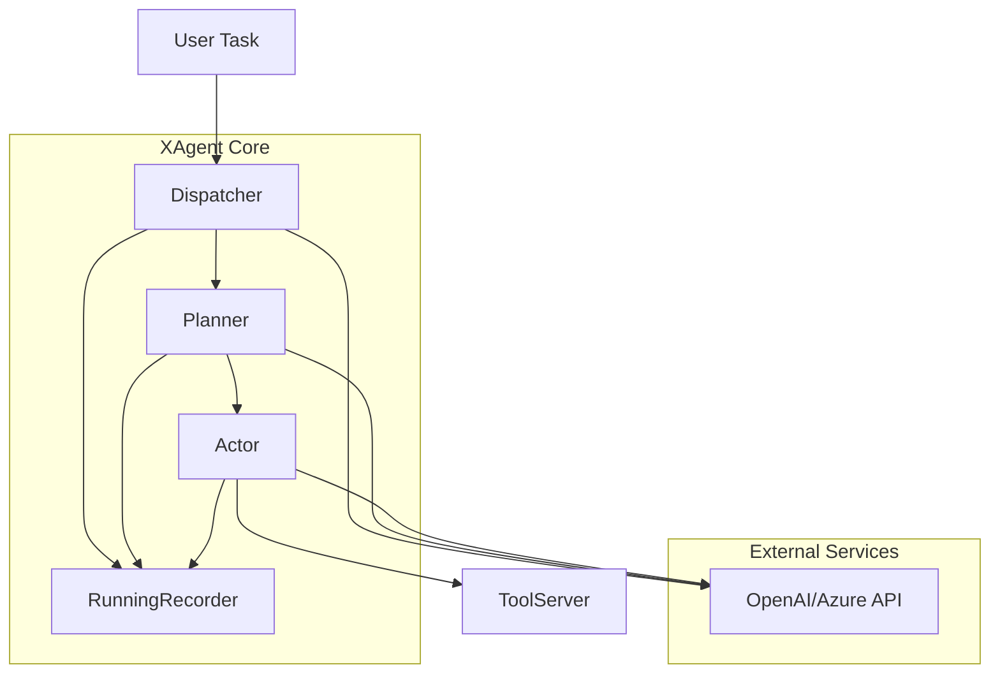
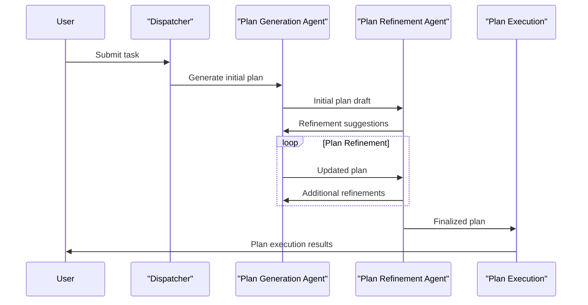
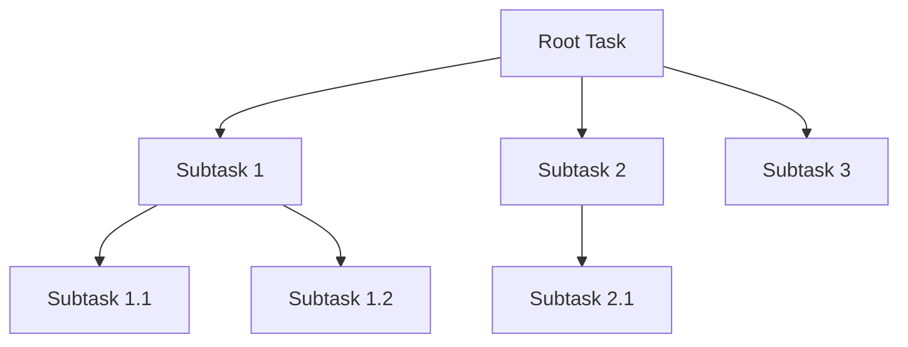
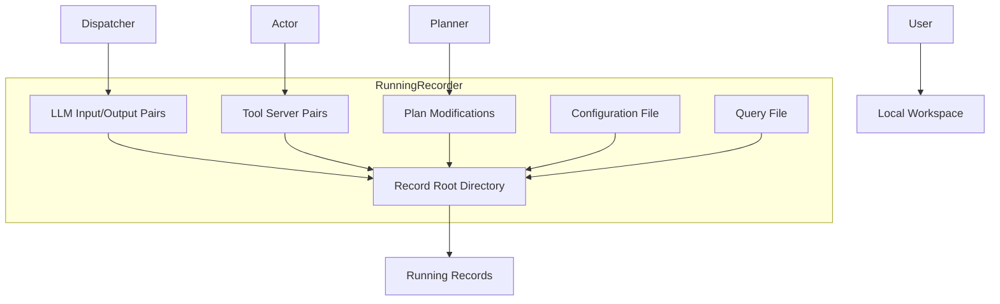
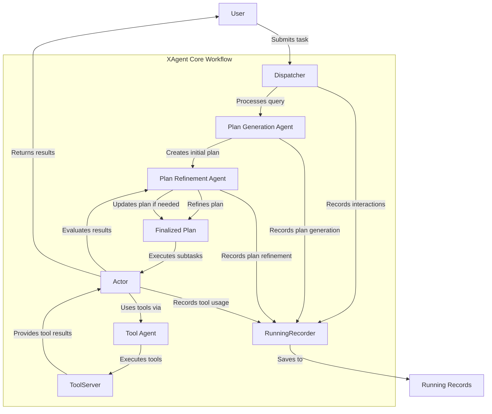

<!-- source: DeepWiki mcp.deepwiki.com · repo OpenBMB/XAgent · page 2 XAgent Core · fetched 2026-10-26 -->

# XAgent Core

<details>
<summary>Relevant source files</summary>

The following files were used as context for generating this wiki page:

- [README.md](README.md)
- [README_JA.md](README_JA.md)
- [README_ZH.md](README_ZH.md)
- [XAgent/agent/utils.py](XAgent/agent/utils.py)
- [XAgent/running_recorder.py](XAgent/running_recorder.py)
- [XAgent/vector_db.py](XAgent/vector_db.py)
- [XAgent/workflow/plan_exec.py](XAgent/workflow/plan_exec.py)
- [XAgentGen/README.md](XAgentGen/README.md)
- [run.py](run.py)

</details>


XAgent Core is the central component of the XAgent system that provides the intelligence, planning, and execution capabilities for autonomous task solving. It serves as the brain of the system, coordinating the planning and execution of complex tasks through a structured workflow involving multiple specialized agents.

This page documents the architecture, components, and workflow of XAgent Core. For information about the ToolServer system that provides tools for XAgent, see [ToolServer](#3). For details about user interfaces, see [XAgentServer](#4) and [XAgentWeb](#5).

## Architecture Overview

XAgent Core follows a structured architecture designed to break down complex tasks into manageable subtasks, plan their execution, and carry them out using appropriate tools. At a high level, XAgent Core consists of three primary components:



The core components work together to process tasks through a sequential workflow:

1. **Dispatcher**: Dynamically instantiates and dispatches tasks to different specialized agents
2. **Planner**: Generates and refines plans for tasks, breaking them down into subtasks with milestones
3. **Actor**: Executes actions to achieve goals and complete subtasks
4. **RunningRecorder**: Records all task execution details for logging and analysis

Sources: [README.md:50-53]()

## Dispatcher

The Dispatcher is the entry point for user tasks into the XAgent system. It's responsible for:

- Processing the initial user query
- Dynamically instantiating appropriate agents for different aspects of the task
- Dispatching tasks to specialized agents based on their capabilities
- Coordinating the overall task execution flow

This component enables XAgent to be extensible, as new agents can be added to handle different types of tasks or provide specialized capabilities.

## Planner

The Planner is the strategic component of XAgent Core, responsible for generating, refining, and managing execution plans. It plays a crucial role in breaking down complex tasks into manageable subtasks.

### Planning Process



### Plan Structure

The Planner organizes tasks in a hierarchical tree structure:



Each node in the plan tree is a `Plan` object which contains:
- Task name and description
- Goal of the task
- Status (TODO, IN_PROGRESS, DONE, FAILED, etc.)
- Relations to parent and child tasks

The implementation limits the plan tree's width and depth through configuration parameters (`max_plan_tree_width` and `max_plan_tree_depth`).

Key classes involved in planning:
- `PlanAgent`: Manages the overall planning process
- `PlanRefineChain`: Tracks plan refinement history
- `Plan`: Represents a node in the plan tree

Sources: [XAgent/workflow/plan_exec.py:32-495](), [README.md:51-52]()

## Actor

The Actor is the execution component of XAgent Core, responsible for carrying out actions to achieve goals and complete the subtasks defined in the plan. It serves as the bridge between the planning stage and actual tool usage.

### Actor Responsibilities

- Executing subtasks according to the plan
- Using appropriate tools through ToolServer
- Evaluating the results of tool executions
- Deciding next steps based on execution results
- Collaborating with humans when necessary

### Tool Interaction Process

```mermaid
sequenceDiagram
    participant Actor as "Actor"
    participant ToolAgent as "Tool Agent"
    participant ToolServer as "ToolServer"
    participant Tools as "Tools (Web/Shell/Python/etc.)"
    
    Actor->>ToolAgent: Request tool use for subtask
    ToolAgent->>ToolServer: Select appropriate tool
    ToolServer->>Tools: Execute tool operation
    Tools->>ToolServer: Operation result
    ToolServer->>ToolAgent: Tool execution result
    ToolAgent->>Actor: Processed result
```

The Actor uses a specialized Tool Agent to interact with ToolServer, which provides access to various tools like the File Editor, Python Notebook, Web Browser, Shell, and Rapid API.

Sources: [README.md:53]()

## RunningRecorder

The RunningRecorder is responsible for logging and persistence of the execution process. It captures the entire execution flow, which is valuable for debugging, analysis, and reproducibility.

### Information Recorded

- LLM input/output pairs
- Tool server requests and responses
- Tool calls and their results
- Plan modifications
- Configuration settings
- Task query information



Each execution generates a unique directory in the `running_records` folder, containing all the recorded information. This system allows for loading from previous records to reproduce a former run.

Sources: [XAgent/running_recorder.py:1-398](), [README.md:134-137]()

## Command-Line Interface

XAgent Core can be accessed directly through a command-line interface, which is implemented in the `run.py` file. This provides a simple way to interact with XAgent without using the web interface.

### Usage

```
python run.py --task "your task description" --config-file "assets/config.yml"
```

### Command-Line Parameters

| Parameter | Description |
|-----------|-------------|
| `--task` | The task description (required) |
| `--upload-files` | List of files to upload |
| `--model` | Model identifier for the task |
| `--record-dir` | Directory to record task execution logs |
| `--mode` | Operational mode: 'auto' or 'manual' |
| `--quiet` | Run in quiet mode; minimal output |
| `--config-file` | Path to the configuration file |
| `--enable-ask-human-for-help` | Flag to enable asking for human assistance |

The command-line interface creates a `CommandLine` object with the provided parameters and starts the XAgent process. The execution is then handled by the XAgent Core components.

Sources: [run.py:1-92]()

## Integration with External Systems

### OpenAI/Azure API Integration

XAgent Core relies heavily on OpenAI/Azure's language models for its intelligence. It uses these models for:

- Plan generation and refinement
- Tool selection and usage
- Reasoning about task execution
- Summarizing results

The integration is configured in the `config.yml` file, which specifies:
- API keys
- Model selection (recommended: `gpt-4-32k` or `gpt-4`)
- Default completion parameters

### ToolServer Integration

XAgent Core interacts with ToolServer to execute various tools needed for task completion. The integration works through API calls to the ToolServer, which runs as a separate Docker container.

Available tools include:
- File Editor: for writing, reading, and modifying files
- Python Notebook: for running Python code
- Web Browser: for searching and visiting webpages
- Shell: for executing shell commands
- Rapid API: for accessing external APIs

### XAgentGen Integration (Optional)

XAgent can optionally integrate with XAgentGen to use customized models instead of OpenAI's models. This is configured by using a different configuration file (e.g., `assets/xagentllama.yml`).

XAgentGen implements guided generation with constrained text generation, allowing models to generate function calls with complex JSON schema.

Sources: [XAgentGen/README.md:1-48](), [README.md:118-122]()

## Core Components Workflow

The complete workflow of XAgent Core involves the coordinated operation of all components to process a user task from beginning to end:



This workflow demonstrates how XAgent Core processes a task:

1. The user submits a task to the Dispatcher
2. The Dispatcher processes the query and triggers the Plan Generation Agent
3. The initial plan is created and then refined by the Plan Refinement Agent
4. The Actor executes the plan by using tools through ToolAgent and ToolServer
5. Results are evaluated, and the plan may be updated if needed
6. All interactions are recorded by the RunningRecorder
7. Finally, the results are returned to the user

Throughout this process, XAgent Core aims to solve tasks autonomously but can also collaborate with humans when needed.

Sources: [README.md:42-53]()

## System Requirements and Configuration

XAgent Core requires:
- Python 3.10 or higher
- OpenAI API keys (at least one `gpt-3.5-turbo-16k` key, preferably `gpt-4-32k` or `gpt-4`)
- Docker and Docker Compose (for ToolServer)
- Configured `assets/config.yml` file

The configuration file controls various aspects of XAgent Core's behavior, including:
- Model selection and parameters
- Plan tree constraints (max width and depth)
- Maximum subtask chain length
- Maximum retry times
- Human assistance settings

Sources: [README.md:115-122]()

---

