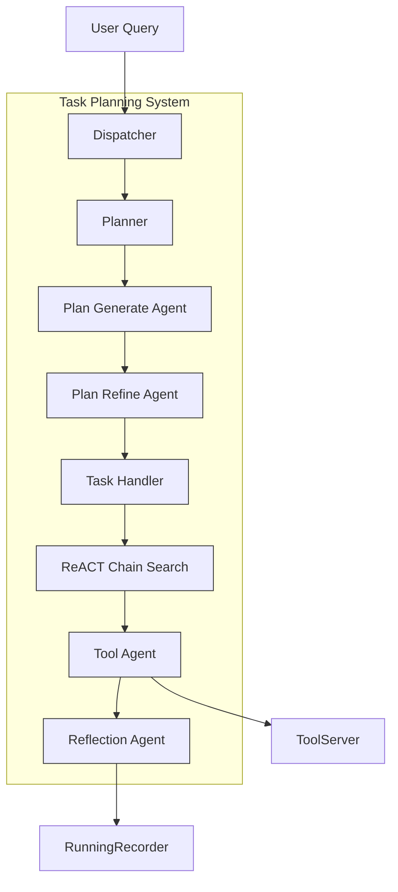
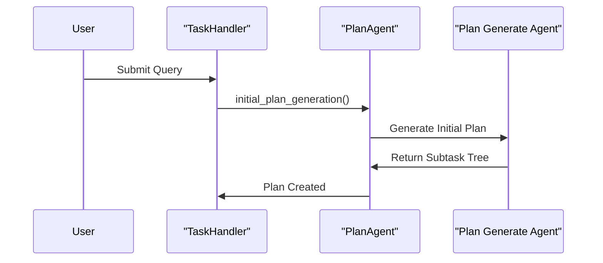
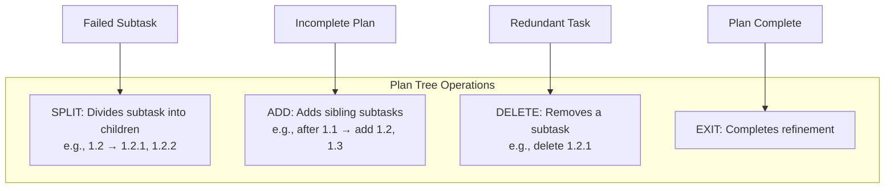
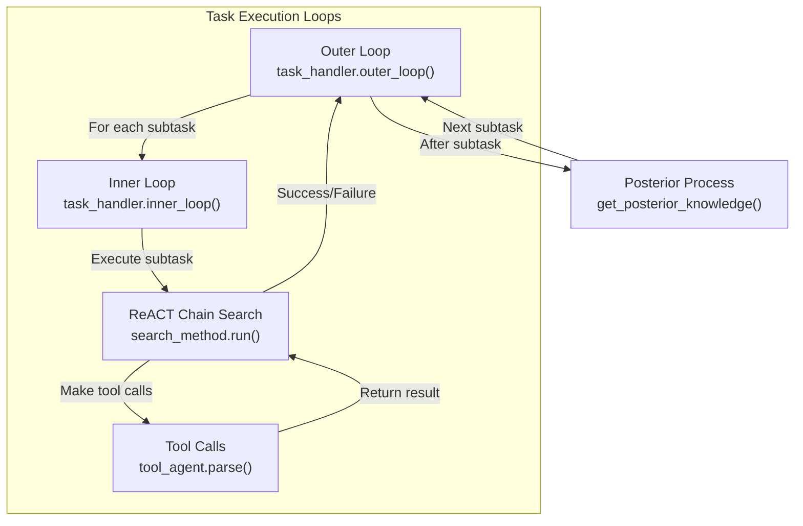
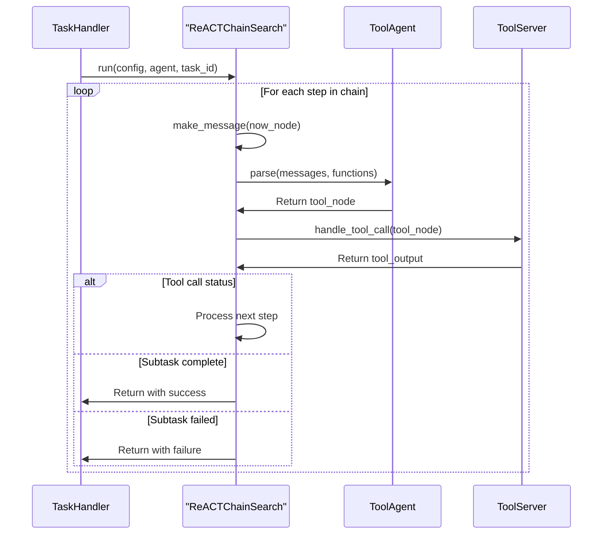
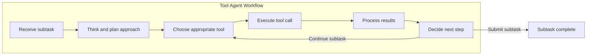
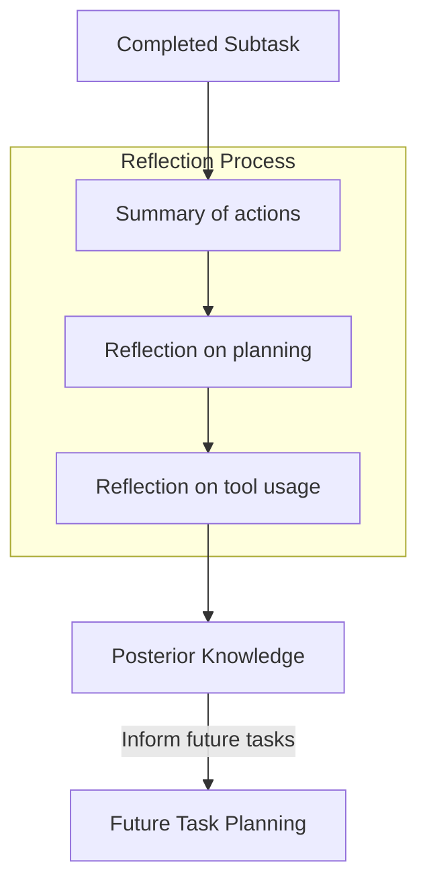
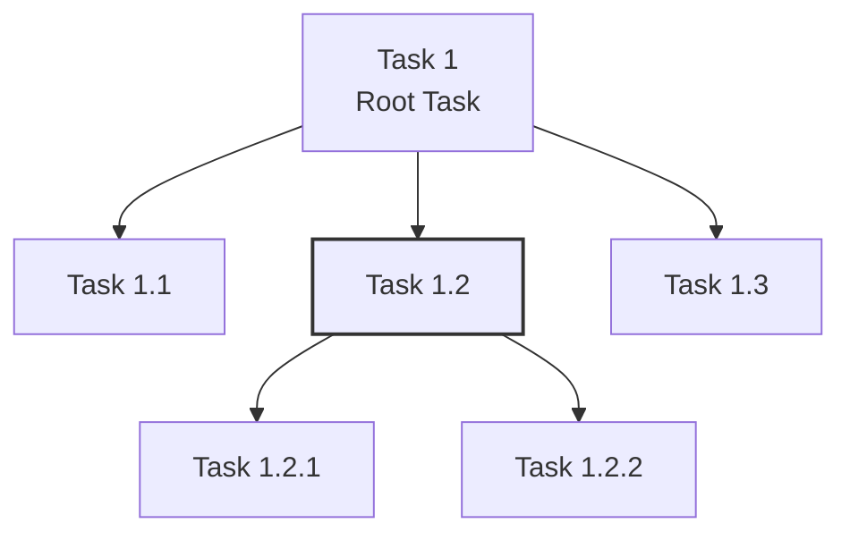
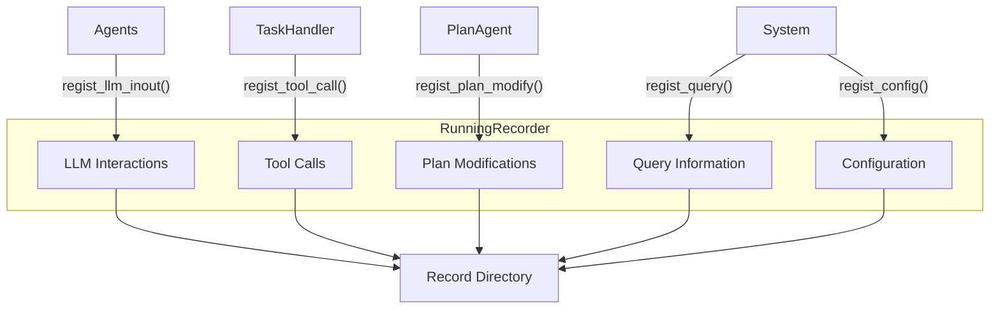

<!-- source: DeepWiki mcp.deepwiki.com · repo OpenBMB/XAgent · page 2.1 Task Planning System · fetched 2026-10-26 -->

# Task Planning System

<details>
<summary>Relevant source files</summary>

The following files were used as context for generating this wiki page:

- [XAgent/agent/dispatcher.py](XAgent/agent/dispatcher.py)
- [XAgent/agent/plan_generate_agent/prompt.py](XAgent/agent/plan_generate_agent/prompt.py)
- [XAgent/agent/plan_refine_agent/prompt.py](XAgent/agent/plan_refine_agent/prompt.py)
- [XAgent/agent/reflect_agent/prompt.py](XAgent/agent/reflect_agent/prompt.py)
- [XAgent/agent/tool_agent/prompt.py](XAgent/agent/tool_agent/prompt.py)
- [XAgent/agent/utils.py](XAgent/agent/utils.py)
- [XAgent/ai_functions/request/utils.py](XAgent/ai_functions/request/utils.py)
- [XAgent/inner_loop_search_algorithms/ReACT.py](XAgent/inner_loop_search_algorithms/ReACT.py)
- [XAgent/running_recorder.py](XAgent/running_recorder.py)
- [XAgent/vector_db.py](XAgent/vector_db.py)
- [XAgent/workflow/plan_exec.py](XAgent/workflow/plan_exec.py)
- [XAgent/workflow/task_handler.py](XAgent/workflow/task_handler.py)
- [XAgent/workflow/working_memory.py](XAgent/workflow/working_memory.py)
- [run.py](run.py)

</details>


The Task Planning System is a core component of XAgent that converts high-level user queries into executable plans. It breaks down complex tasks into manageable subtasks, coordinates their execution, and adapts plans based on execution results. This system serves as the cognitive engine that enables XAgent to approach problems methodically and solve them effectively.

For information about the tools used to execute the subtasks, see [Tool System](#2.2).

## System Overview

The Task Planning System consists of multiple interacting components that work together to create and execute plans. The system follows a hierarchical approach to task handling, first generating a high-level plan, then refining it as needed, and finally executing each subtask with appropriate tools.



Sources: [XAgent/workflow/task_handler.py](), [XAgent/agent/dispatcher.py]()), [XAgent/inner_loop_search_algorithms/ReACT.py]()

## Core Components and Workflow

### 1. Plan Generation

The plan generation phase breaks down the user's high-level task into a tree of subtasks. This is handled by the Plan Generate Agent.



Each subtask in the plan has a structured JSON format:

```
{
  "subtask name": string,
  "goal.goal": string,
  "goal.criticism": string,
  "milestones": list[string]
}
```

The Plan Generate Agent is designed to create efficient, non-redundant subtasks that collectively achieve the user's goal. It follows these key principles:
- Keep plans feasible and efficient
- Combine similar goals into single subtasks
- Avoid unnecessary complexity
- Utilize the capabilities of Large Language Models

Sources: [XAgent/agent/plan_generate_agent/prompt.py:1-41](), [XAgent/workflow/plan_exec.py:141-183]()

### 2. Plan Refinement

Plans can be refined when necessary, particularly after a subtask fails or when additional information becomes available. The Plan Refine Agent handles this process through several operations:

1. **Split**: Divide a complex subtask into smaller, more manageable subtasks
2. **Add**: Add new subtasks as siblings to existing ones
3. **Delete**: Remove unnecessary subtasks
4. **Exit**: Conclude the refinement process



The plan tree has configurable constraints:
- `max_plan_tree_width`: Maximum number of subtasks a parent task can have
- `max_plan_tree_depth`: Maximum levels of task hierarchy
- `max_plan_refine_chain_length`: Maximum number of refinement operations

Sources: [XAgent/agent/plan_refine_agent/prompt.py:1-58](), [XAgent/workflow/plan_exec.py:205-266]()

### 3. Task Execution via Inner and Outer Loops

The execution of plans is managed by the TaskHandler through an outer loop and inner loop pattern:



The outer loop (`TaskHandler.outer_loop`) manages the sequence of subtasks:
1. Gets the next subtask from the plan
2. Executes it using the inner loop
3. Processes the results
4. Refines the plan if needed
5. Repeats until all subtasks are complete

The inner loop (`TaskHandler.inner_loop`) handles individual subtask execution:
1. Dispatches an agent for the task
2. Creates a search method (ReACT Chain Search)
3. Executes the task
4. Records the results

Sources: [XAgent/workflow/task_handler.py:65-196](), [XAgent/workflow/task_handler.py:196-266](), [XAgent/inner_loop_search_algorithms/ReACT.py:56-114]()

### 4. ReACT Chain Search

The ReACT (Reasoning and Acting) Chain Search algorithm is used to execute individual subtasks. It implements a sequential approach:



Key constraints in ReACT Chain Search:
- `max_subtask_chain_length`: Maximum number of steps in a subtask chain
- It builds a tree of tool calls, with each node representing an action

Sources: [XAgent/inner_loop_search_algorithms/ReACT.py:56-114](), [XAgent/inner_loop_search_algorithms/ReACT.py:199-314]()

### 5. Tool Agent

The Tool Agent is responsible for executing tool calls to interact with the real world. It receives a subtask, thinks about how to approach it, and then executes appropriate tool calls.



The Tool Agent has access to various resources:
- Internet access for search and information gathering
- File system for reading and writing files
- Python notebook for code execution
- Shell environment for executing commands
- And other specialized tools

Sources: [XAgent/agent/tool_agent/prompt.py:1-59]()

### 6. Reflection and Learning

After a subtask is completed, the system performs reflection to learn from the experience:



The reflection process extracts three types of knowledge:
1. **Summary**: A concise description of what was done and achieved
2. **Plan Reflection**: Insights about the planning process that can improve future plans
3. **Tool Reflection**: Lessons about tool usage and effectiveness

This knowledge is stored and used to improve planning and execution in subsequent tasks.

Sources: [XAgent/agent/reflect_agent/prompt.py:1-27](), [XAgent/workflow/task_handler.py:268-300]()

## Data Structure: Plan Tree

Plans in XAgent are represented as tree structures, where each node is a subtask. The hierarchical structure allows for organized task decomposition and execution.



Task IDs follow a hierarchical numbering scheme (e.g., "1.2.1") that indicates the position in the tree. The system traverses this tree in inorder traversal to execute subtasks sequentially.

Key operations on the plan tree:
- `Plan.make_relation(parent, child)`: Establish parent-child relationship
- `Plan.pop_next_subtask(current)`: Get the next subtask to execute
- `Plan.get_remaining_subtask(current)`: Get all remaining subtasks
- `Plan.get_inorder_travel(plan)`: Get subtasks in execution order

Sources: [XAgent/workflow/plan_exec.py:18-34](), [XAgent/workflow/plan_exec.py:318-495]()

## Recording and Monitoring

The RunningRecorder keeps track of all operations performed during task execution:



The recorder creates a unique directory for each run with subdirectories for different types of data:
- LLM input/output pairs
- Tool server calls
- Plan refinements
- Task execution logs

This comprehensive recording enables debugging, reproducibility, and analysis of the system's performance.

Sources: [XAgent/running_recorder.py:34-93](), [XAgent/running_recorder.py:108-130](), [XAgent/running_recorder.py:201-224]()

## Configuration Parameters

The Task Planning System behavior can be customized through several configuration parameters:

| Parameter | Description | Default |
|-----------|-------------|---------|
| `max_plan_tree_width` | Maximum number of subtasks under a parent | 4 |
| `max_plan_tree_depth` | Maximum depth of the subtask hierarchy | 3 |
| `max_plan_refine_chain_length` | Maximum number of plan refinement operations | 4 |
| `max_subtask_chain_length` | Maximum steps in a subtask execution chain | 10 |
| `enable_ask_human_for_help` | Whether to allow asking humans for help | False |
| `max_retry_times` | Maximum attempts for failed subtasks | 3 |

These parameters can be set via command line arguments or in the configuration file.

Sources: [run.py:18-36]()

## Example Workflow

1. **User submits a query**: "Write a Python calculator"
2. **Plan Generate Agent creates a plan**:
   - Task 1: Define calculator requirements
   - Task 2: Implement basic arithmetic operations
   - Task 3: Create a user interface
   - Task 4: Test the calculator
3. **Task Handler processes each subtask**:
   - For Task 1: Defines the requirements using ReACT Chain Search
   - For Task 2: Implements the operations using the Tool Agent
   - If Task 2 fails: Plan Refine Agent might split it into smaller tasks
   - For Task 3: Creates the UI
   - For Task 4: Tests the calculator
4. **Reflection Agent learns from the process**
5. **Results are returned to the user**

Throughout this process, the Task Planning System adapts to challenges, refines plans as needed, and leverages appropriate tools to accomplish the user's goal.

## Integration with Other XAgent Components

The Task Planning System integrates with other XAgent components:

- **XAgent Core**: The Task Planning System is a central component of XAgent Core
- **ToolServer**: Tool Agent calls tools provided by ToolServer
- **Command Line Interface**: Users can submit tasks through the CLI
- **XAgentServer**: Web interface communicates with the Task Planning System through XAgentServer

This integration enables a seamless user experience while maintaining the structured, methodical approach to task execution.

Sources: [XAgent/agent/dispatcher.py:94-201](), [XAgent/workflow/task_handler.py:16-63]()

---

