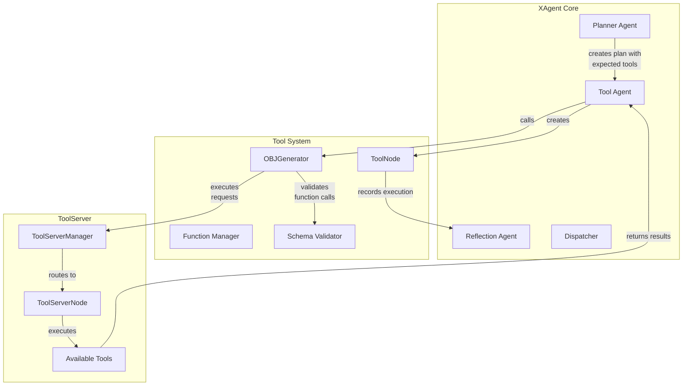
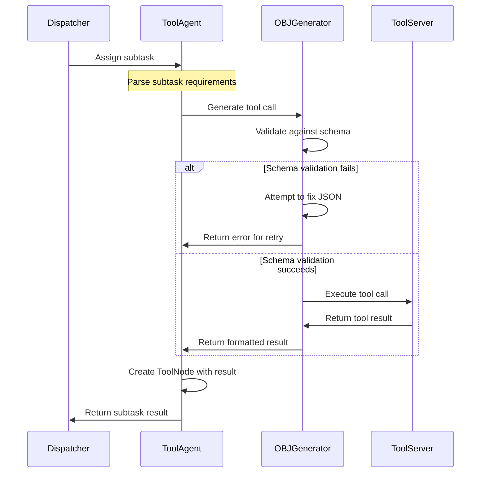
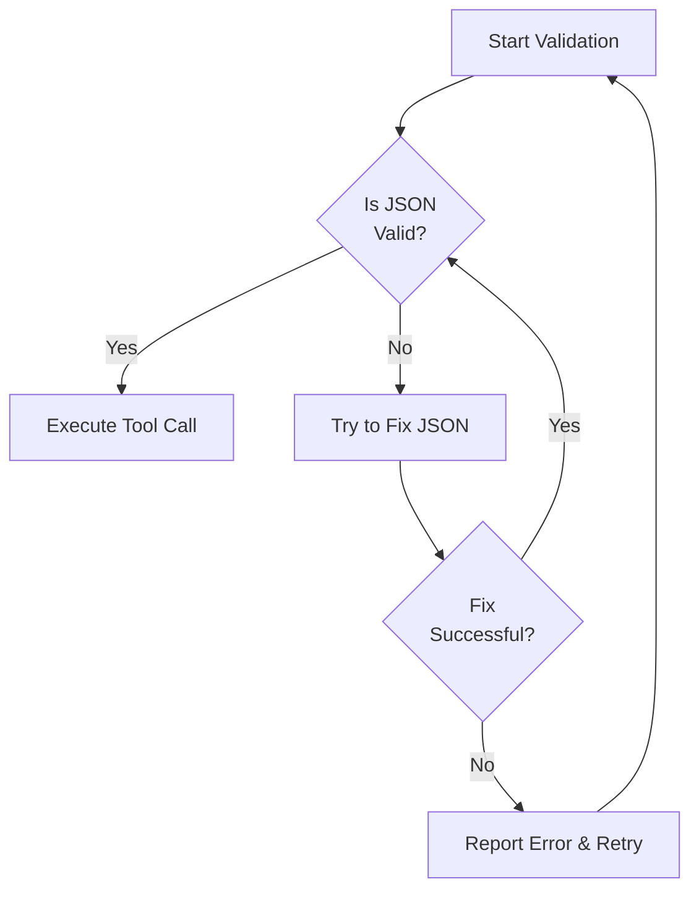
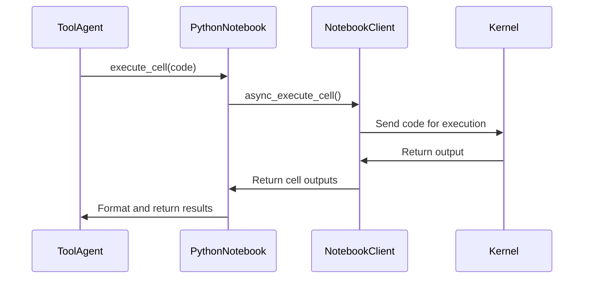
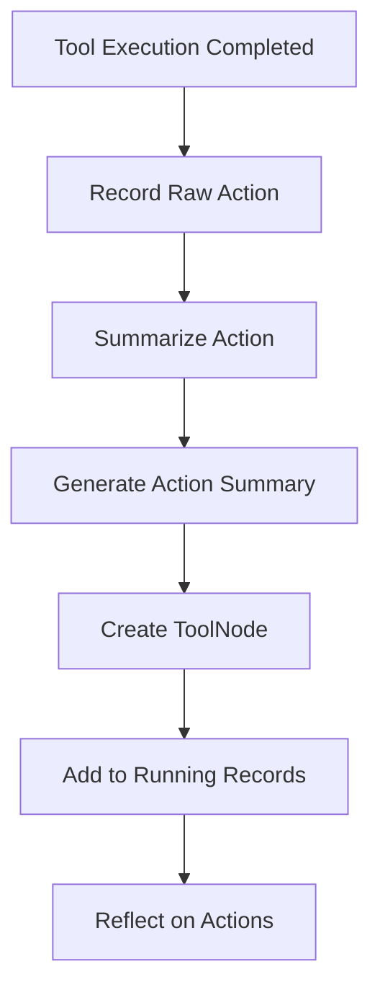
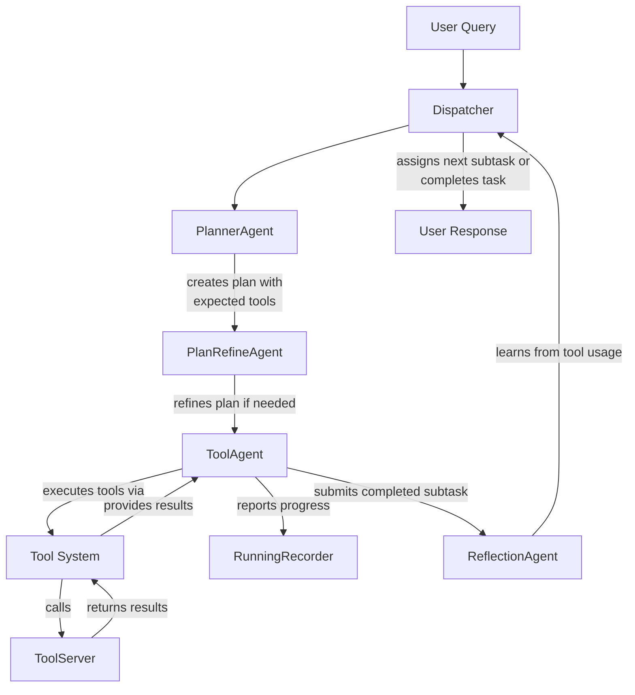
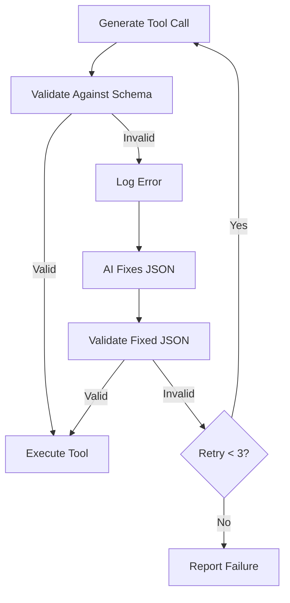

<!-- source: DeepWiki mcp.deepwiki.com · repo OpenBMB/XAgent · page 2.2 Tool System · fetched 2026-10-26 -->

# Tool System

<details>
<summary>Relevant source files</summary>

The following files were used as context for generating this wiki page:

- [ToolServer/ToolServerNode/core/envs/pycoding.py](ToolServer/ToolServerNode/core/envs/pycoding.py)
- [XAgent/agent/plan_generate_agent/prompt.py](XAgent/agent/plan_generate_agent/prompt.py)
- [XAgent/agent/plan_refine_agent/prompt.py](XAgent/agent/plan_refine_agent/prompt.py)
- [XAgent/agent/reflect_agent/prompt.py](XAgent/agent/reflect_agent/prompt.py)
- [XAgent/agent/summarize.py](XAgent/agent/summarize.py)
- [XAgent/agent/tool_agent/agent.py](XAgent/agent/tool_agent/agent.py)
- [XAgent/agent/tool_agent/prompt.py](XAgent/agent/tool_agent/prompt.py)
- [XAgent/ai_functions/pure_functions/task_manage_functions.yml](XAgent/ai_functions/pure_functions/task_manage_functions.yml)
- [XAgent/ai_functions/request/obj_generator.py](XAgent/ai_functions/request/obj_generator.py)
- [XAgent/ai_functions/request/utils.py](XAgent/ai_functions/request/utils.py)

</details>


The Tool System in XAgent provides a mechanism for autonomous agents to interact with external resources and perform actions in the world. This system enables agents to use specialized tools like file operations, Python code execution, web browsing, and shell commands to accomplish complex tasks. It serves as the bridge between the agent's reasoning capabilities and the ability to effect changes in the external environment.

For information about the specific tools available and their capabilities, see [Tool Types and Capabilities](#3.2). For details on how tool execution is managed in isolated environments, see [ToolServer Architecture](#3.1).

## Architecture Overview

The Tool System consists of several key components that work together to enable tool usage by agents:



Sources: [XAgent/agent/tool_agent/agent.py:16-175](), [XAgent/ai_functions/request/obj_generator.py:20-224]()

The Tool System's architecture enables:

1. **Tool Call Generation**: The ToolAgent decides which tool to use based on the current task
2. **Schema Validation**: The OBJGenerator validates tool calls against predefined schemas
3. **Tool Execution**: Valid tool calls are forwarded to the ToolServer for execution
4. **Result Processing**: Tool execution results are returned to the agent for further action

## Tool Agent

The Tool Agent is the primary component responsible for executing subtasks using appropriate tools. It interprets the plan created by the Planner Agent and translates high-level goals into specific tool calls.



Sources: [XAgent/agent/tool_agent/agent.py:27-175](), [XAgent/agent/tool_agent/prompt.py:1-96]()

The Tool Agent uses a specialized prompt that provides:
- Context about the current subtask
- Available operations (tool calling or subtask submission)
- Guidelines for tool usage
- Budget constraints (maximum number of tool calls)

## Tool Calls and Schema Validation

Tool calls in XAgent follow a structured format and undergo rigorous schema validation to ensure correctness.

### Function Call Structure

Tool calls are structured as function calls with the following format:

```
{
  "name": "tool_name",
  "arguments": {
    "param1": "value1",
    "param2": "value2",
    ...
  }
}
```

For the OpenAI request type, tool calls are wrapped in a `subtask_handle` function with a `tool_call` field:

```
{
  "name": "subtask_handle",
  "arguments": {
    "tool_call": {
      "tool_name": "tool_name",
      "tool_input": {
        "param1": "value1",
        "param2": "value2",
        ...
      }
    },
    "other_fields": {...}
  }
}
```

Sources: [XAgent/agent/tool_agent/agent.py:104-132]()

### Validation Process

The OBJGenerator class handles validation of tool calls against their schemas:

1. **Schema Retrieval**: The tool schema is retrieved based on the tool name
2. **JSON Validation**: The tool arguments are validated against the schema
3. **Error Handling**: If validation fails, the system attempts to fix the JSON
4. **Retry Mechanism**: If the fix fails, the error is reported and the call is retried



Sources: [XAgent/ai_functions/request/obj_generator.py:94-169]()

## Tool Types and Implementations

XAgent supports various types of tools that can be used to accomplish different tasks. Here's an overview of some key tool types:

| Tool Type | Description | Common Uses |
|-----------|-------------|-------------|
| FileSystemEnv | File operations (read/write/list) | Managing files and directories |
| PythonNotebook | Execute Python code in a notebook | Data analysis, testing code |
| ShellEnv | Execute shell commands | System operations, installations |
| WebBrowser | Browse the web and extract information | Research, information gathering |
| RapidAPI | Make API calls to external services | Data retrieval, integrations |

### Python Notebook Example

The Python Notebook tool provides a way to execute Python code within a Jupyter-like environment:



Sources: [ToolServer/ToolServerNode/core/envs/pycoding.py:16-181]()

## Tool Usage Workflow

The complete workflow of tool usage in XAgent involves several steps:

1. **Task Planning**: The Planner identifies which tools are needed for a task
2. **Subtask Assignment**: The Dispatcher assigns a subtask to the Tool Agent
3. **Tool Selection**: The Tool Agent selects the appropriate tool for the current step
4. **Tool Call**: The Tool Agent generates a tool call with the necessary parameters
5. **Validation**: The OBJGenerator validates the tool call against its schema
6. **Execution**: The validated tool call is sent to the ToolServer for execution
7. **Result Processing**: The tool execution result is returned to the Tool Agent
8. **Action Recording**: The action and its result are recorded as a ToolNode
9. **Reflection**: The Reflection Agent learns from the tool usage experience

### Action Summarization

After tool execution, actions are summarized to provide concise information about what was done:



Sources: [XAgent/agent/summarize.py:11-163](), [XAgent/agent/reflect_agent/prompt.py:1-43]()

## Integration with Other XAgent Components

The Tool System is tightly integrated with other components of XAgent:

1. **Planner Integration**: The Planner Agent includes expected tools in its subtask plans
2. **Tool Server Communication**: The Tool System communicates with the ToolServer to execute tools in isolated environments
3. **Task Recording**: All tool usage is recorded for later inspection and learning
4. **Reflection Learning**: The Reflection Agent learns from tool usage to improve future performance



Sources: [XAgent/agent/plan_generate_agent/prompt.py:1-55](), [XAgent/agent/plan_refine_agent/prompt.py:1-83](), [XAgent/agent/tool_agent/prompt.py:1-96]()

## Schema Validation and Error Recovery

One of the key strengths of XAgent's Tool System is its robust schema validation and error recovery mechanism.

### Schema Definition

Tools are defined with JSON schemas that specify:
- Required parameters
- Parameter types
- Parameter constraints
- Default values

### Error Recovery Process

When a tool call fails schema validation:

1. The error is logged
2. The broken JSON is sent to the AI model with the error message
3. The model attempts to fix the JSON to match the schema
4. The fixed JSON is validated again
5. If validation succeeds, the tool call proceeds
6. If validation fails again, the process retries up to 3 times



Sources: [XAgent/ai_functions/request/obj_generator.py:94-169](), [XAgent/agent/tool_agent/agent.py:104-132]()

## Conclusion

The Tool System is a critical component of XAgent that bridges the gap between agent reasoning and real-world actions. Through a structured approach to tool definition, validation, execution, and result processing, it enables autonomous agents to effectively use a wide range of tools to accomplish complex tasks.

The combination of robust schema validation, error recovery mechanisms, and integration with other XAgent components makes the Tool System both powerful and reliable, allowing agents to focus on high-level reasoning while ensuring that tool usage is correct and effective.

---

