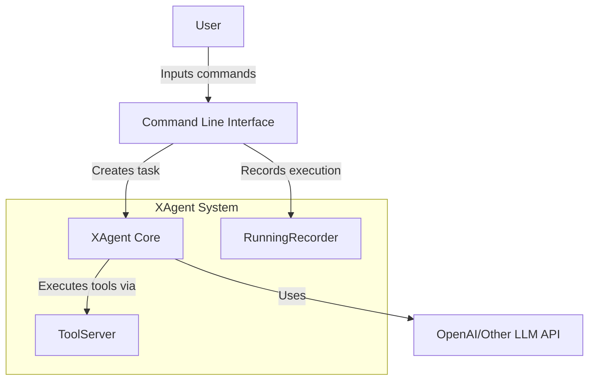
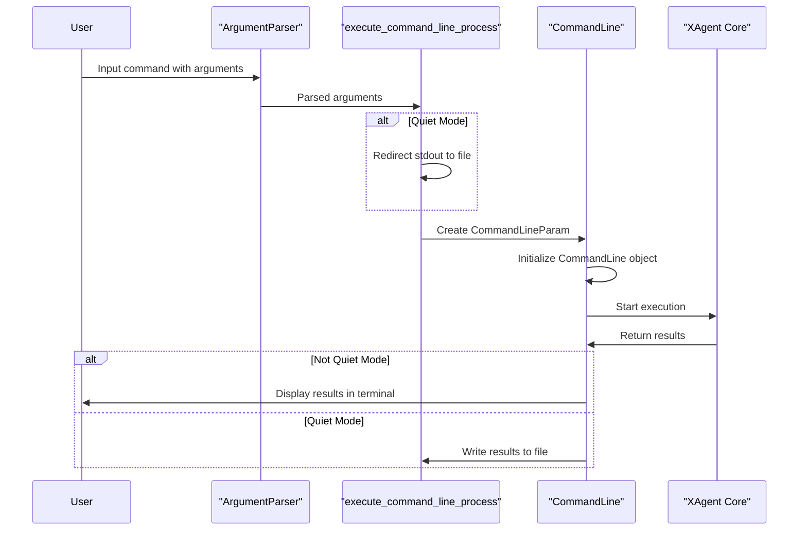

<!-- source: DeepWiki mcp.deepwiki.com · repo OpenBMB/XAgent · page 2.3 Command Line Interface · fetched 2026-10-26 -->

# Command Line Interface

<details>
<summary>Relevant source files</summary>

The following files were used as context for generating this wiki page:

- [XAgent/agent/utils.py](XAgent/agent/utils.py)
- [XAgent/running_recorder.py](XAgent/running_recorder.py)
- [XAgent/vector_db.py](XAgent/vector_db.py)
- [XAgent/workflow/plan_exec.py](XAgent/workflow/plan_exec.py)
- [run.py](run.py)

</details>


The Command Line Interface (CLI) provides a way to interact with XAgent directly from the terminal, bypassing the need for the web interface. This allows for programmatic interaction with XAgent, making it suitable for automation, scripting, and batch processing of tasks.

For information about the web-based interface, see [XAgentWeb](#5).

## 1. Overview



*Diagram: XAgent CLI Integration with Core Components*

The Command Line Interface provides a simple way to interact with XAgent Core directly. It processes user commands, initializes the XAgent system with the specified task and parameters, and manages the execution flow. The CLI integrates with the RunningRecorder to log all actions and results for later inspection.

Sources: [run.py:1-91]()

## 2. Command Line Arguments

XAgent's CLI accepts a variety of command line arguments to configure task execution:

| Argument | Required | Default | Description |
|----------|----------|---------|-------------|
| `--task` | Yes | N/A | The task description for XAgent to perform |
| `--upload-files` | No | None | List of files to upload for the task |
| `--model` | No | From config | Model identifier (e.g., "gpt-4") |
| `--record-dir` | No | From config | Directory to store execution logs |
| `--mode` | No | "auto" | Execution mode: "auto" or "manual" |
| `--quiet` | No | False | Run with minimal output, logging to file |
| `--max-subtask-chain-length` | No | From config | Maximum length of subtask chain |
| `--enable-ask-human-for-help` | No | False | Enable asking human for assistance |
| `--max-plan-refine-chain-length` | No | From config | Maximum plan refinement iterations |
| `--max-plan-tree-depth` | No | From config | Maximum depth of plan tree |
| `--max-plan-tree-width` | No | From config | Maximum width of plan tree |
| `--max-retry-times` | No | From config | Maximum number of retry attempts |
| `--config-file` | No | "assets/config.yml" | Path to configuration file |

Sources: [run.py:9-38]()

## 3. Execution Flow



*Diagram: CLI Command Execution Flow*

When executing a command through the XAgent CLI, the following process occurs:

1. Command line arguments are parsed using Python's `argparse` module
2. The parsed arguments are processed by `execute_command_line_process()`
3. If quiet mode is enabled, stdout is redirected to a file
4. A `CommandLineParam` object is created with the task and configuration
5. A `CommandLine` object is created and its `start()` method is called
6. XAgent Core processes the task and returns results
7. Results are displayed in the terminal or written to a file

Sources: [run.py:41-83]()

## 4. Usage Examples

### Basic Task Execution

To run a simple task:

```bash
python run.py --task "Find information about climate change and summarize it"
```

### Uploading Files for Processing

To upload files along with your task:

```bash
python run.py --task "Analyze this CSV data and create charts" --upload-files data.csv
```

### Using a Specific Model

To specify which LLM to use:

```bash
python run.py --task "Write a short story" --model "gpt-4"
```

### Running in Quiet Mode

To run with minimal output (results written to file):

```bash
python run.py --task "Analyze website performance" --quiet
```

### Using Manual Mode

To use manual mode with human confirmation for steps:

```bash
python run.py --task "Refactor this codebase" --mode "manual"
```

### Using a Custom Configuration File

To use a custom configuration:

```bash
python run.py --task "Create a database schema" --config-file "my_custom_config.yml"
```

Sources: [run.py:9-91]()

## 5. Quiet Mode and Logging

When running XAgent in quiet mode (`--quiet`), all console output is redirected to a log file instead of being displayed in the terminal. This is particularly useful for batch processing or when running XAgent as part of an automated pipeline.

The log file is created in the directory specified by the RunningRecorder's `record_root_dir`, with the filename "command_line.ansi". This file contains all the output that would normally be displayed in the terminal, including colored text (as ANSI escape sequences).

```python
# When quiet mode is enabled, output is redirected to a file
if quiet_mode:
    from XAgent.running_recorder import recorder
    record_file_path = os.path.join(recorder.record_root_dir, "command_line.ansi")
    with open(record_file_path, "w", encoding="utf-8") as file, redirect_stdout(file):
        start_command_line(args_dict)
else:
    start_command_line(args_dict)
```

Sources: [run.py:59-66](), [XAgent/running_recorder.py:50-61]()

## 6. Integration with RunningRecorder

The CLI is integrated with the RunningRecorder system, which captures all interactions and outputs during task execution. This includes:

- LLM input/output pairs
- Tool calls and responses
- Plan generations and refinements
- Task status updates

These records are stored in a structured directory hierarchy under the `record_root_dir`, which by default is set to "./running_records/" with a timestamp and UUID to ensure uniqueness.

The recording system creates the following directory structure:

```
running_records/
└── YYYY_MM_DD_HH_MM_SS_[UUID]/
    ├── LLM_inout_pair/           # Records of LLM interactions
    │   ├── 00000.json
    │   ├── 00001.json
    │   └── ...
    ├── tool_server_pair/         # Records of tool server interactions
    │   ├── 00000.json
    │   ├── 00001.json
    │   └── ...
    ├── [subtask_id]/             # Records for each subtask
    │   ├── plan_refine_00000.json
    │   ├── tool_00000.json
    │   └── ...
    ├── config.yml                # Configuration used for this run
    └── query.json                # The query/task that was executed
```

The recorded data can be used for:
- Debugging and troubleshooting
- Performance analysis
- Auditing of agent actions
- Reproducing results
- Regression testing

Sources: [XAgent/running_recorder.py:1-397]()

## 7. CommandLine and CommandLineParam Classes

The CLI functionality is primarily implemented through two classes:

1. `CommandLineParam` - A data class that holds the parameters for the command line execution:
   - `task`: The description of the task to perform
   - `upload_files`: List of files to upload for the task
   - `role`: The role XAgent should take (default: "Assistant")
   - `mode`: Execution mode (auto or manual)

2. `CommandLine` - The main class that manages the command line execution:
   - Initializes with a `CommandLineParam` object
   - Handles the actual execution through its `start()` method
   - Manages interaction with XAgent Core

```python
param = CommandLineParam(
    task=args_dict['task'],
    upload_files=args_dict.get('upload_files'),
    role="Assistant",
    mode=args_dict["mode"],
)
cmd = CommandLine(param)
cmd.start()
```

Sources: [run.py:76-83]()

## 8. Configuration Handling

The CLI uses a configuration system that combines:

1. Default settings from the configuration file (typically "assets/config.yml")
2. Command line arguments (which override the defaults)
3. Environment variables (CONFIG_FILE can point to a different config file)

This layered approach provides flexibility for different usage scenarios. The configuration handling works as follows:

1. The default config file path can be set via the `CONFIG_FILE` environment variable
2. This can be overridden by the `--config-file` command line argument
3. Individual settings can be overridden by specific command line arguments

When a configuration setting is not provided via command line, the system falls back to the value in the config file.

Sources: [run.py:35-58](), [run.py:87-91]()

## 9. Command Response Handling

When XAgent completes a task through the CLI, the response is processed using utilities like `get_command()` from the agent utilities module. This function parses the JSON response and extracts the command name and arguments:

```python
def get_command(response_json: Dict):
    """
    Parses the response and returns the command name and arguments.
    """
    # ... [implementation details]
    command_name = command["name"]
    arguments = command.get("args", {})
    return command_name, arguments
```

This pattern is used to extract structured information from the LLM responses, which can then be acted upon by the CLI.

Sources: [XAgent/agent/utils.py:4-49]()

---

