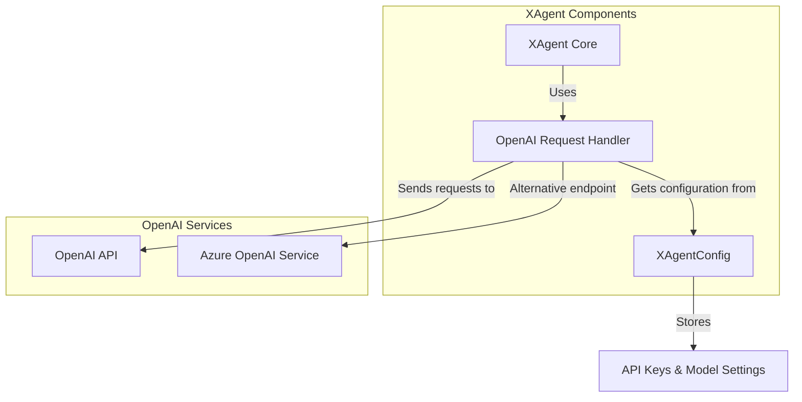
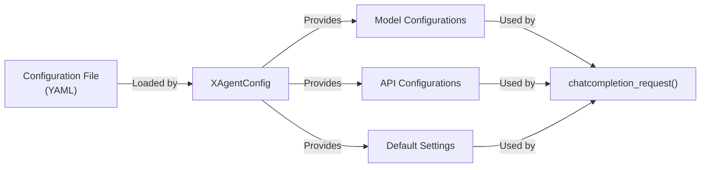
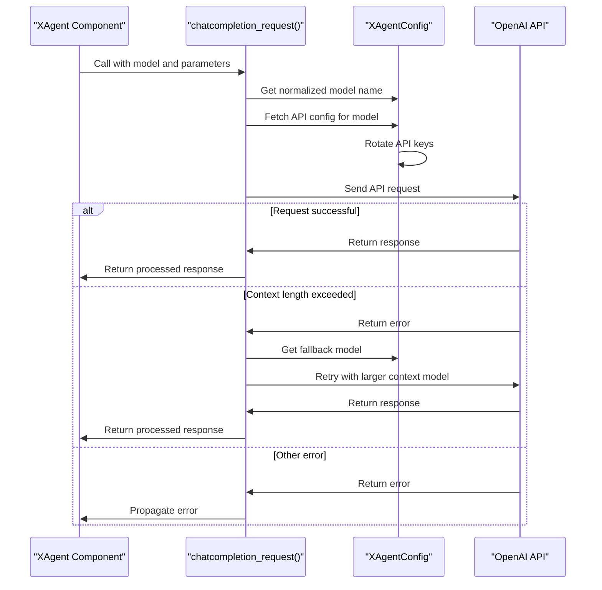
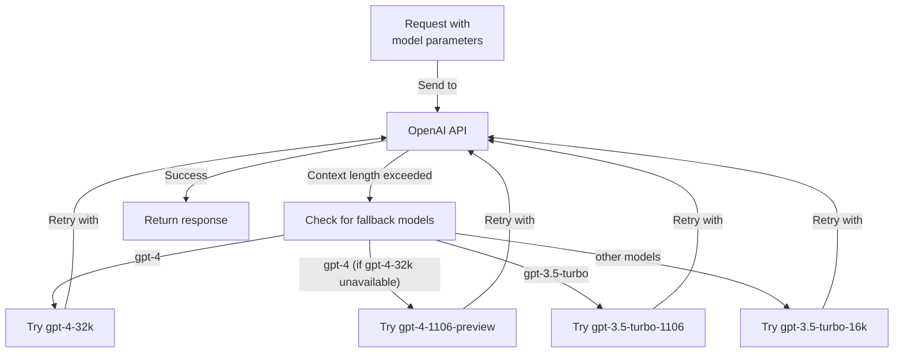
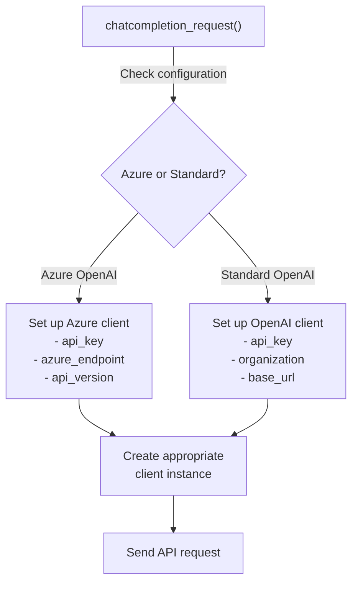

<!-- source: DeepWiki mcp.deepwiki.com · repo OpenBMB/XAgent · page 2.4 OpenAI Integration · fetched 2026-10-26 -->

# OpenAI Integration

<details>
<summary>Relevant source files</summary>

The following files were used as context for generating this wiki page:

- [XAgent/ai_functions/request/openai.py](XAgent/ai_functions/request/openai.py)
- [XAgent/config.py](XAgent/config.py)
- [assets/config.yml](assets/config.yml)
- [assets/gpt-3.5-turbo_config.yml](assets/gpt-3.5-turbo_config.yml)
- [assets/gpt4_config.yml](assets/gpt4_config.yml)

</details>


This document details how XAgent integrates with OpenAI's APIs to facilitate language model-based interactions. It covers configuration of API keys, model selection, request handling, and fallback strategies when dealing with context length limitations.

## 1. Integration Overview

XAgent integrates with OpenAI's API through a robust request handling system that supports both older (pre-1.0) and newer versions of the OpenAI Python library. The integration provides:

- Support for multiple OpenAI models (GPT-3.5, GPT-4, etc.)
- API key rotation and management
- Automatic fallback to larger context models when needed
- Configurable retry logic for API call failures
- Support for both standard OpenAI and Azure OpenAI endpoints



Sources: [XAgent/ai_functions/request/openai.py:1-214](), [XAgent/config.py:1-191]()

## 2. Configuration System

### 2.1 Model Configuration

XAgent uses YAML configuration files to define API keys, model preferences, and other settings. The configuration system supports multiple models with different parameter settings.



Sources: [XAgent/config.py:7-26](), [XAgent/config.py:124-126](), [assets/config.yml:1-59]()

### 2.2 API Key Configuration

API keys are configured in the YAML configuration files. The system supports multiple keys for each model type, enabling key rotation to distribute load and handle rate limits.

Example configuration structure:

```yaml
api_keys:
  gpt-3.5-turbo-16k:
    - api_key: sk-xxxxx
      organization: org-xxxxx
      model: gpt-3.5-turbo-16k
    - api_key: sk-xxxxx
      organization: org-xxxxxx
      model: gpt-3.5-turbo-16k
  gpt-4:    
    - api_key: sk-xxxxx
      organization: org-xxxxx
      model: gpt-4
```

For Azure OpenAI, the configuration includes additional Azure-specific parameters:

```yaml
api_keys:
  gpt-3.5-turbo-16k:
    - api_key: sk-xxxxx
      api_base: https://example.com
      api_type: azure
      api_version: 2023-07-01-preview
      engine: GPT-35-Turbo-16k
```

Sources: [assets/config.yml:1-26](), [assets/gpt4_config.yml:1-16](), [assets/gpt-3.5-turbo_config.yml:1-9]()

## 3. Request Handling Mechanism

XAgent employs a sophisticated request handling mechanism through the `chatcompletion_request` function, which manages interactions with OpenAI's API.



Sources: [XAgent/ai_functions/request/openai.py:26-94](), [XAgent/ai_functions/request/openai.py:106-211]()

### 3.1 Version Compatibility

The OpenAI request handler supports both older (pre-1.0) and newer versions of the OpenAI Python library. It includes version detection and appropriate error handling for each version.

For OpenAI version < 1.0:
- Uses `openai.ChatCompletion.create()`
- Handles `AuthenticationError`, `PermissionError`, `InvalidRequestError`

For OpenAI version >= 1.0:
- Uses `client.chat.completions.create()`
- Handles `AuthenticationError`, `PermissionDeniedError`, `BadRequestError`

Sources: [XAgent/ai_functions/request/openai.py:16-94](), [XAgent/ai_functions/request/openai.py:96-211]()

### 3.2 Retry Logic

The integration implements a robust retry mechanism using the `tenacity` library. It retries requests when encountering transient errors but raises exceptions for authentication or permission errors.

Key retry settings:
- Maximum retry attempts: Configured by `CONFIG.max_retry_times + 3`
- Retry wait strategy: Exponential backoff (61-293 seconds) after 3 immediate retries
- Non-retryable errors: Authentication, permission, and invalid request errors

Sources: [XAgent/ai_functions/request/openai.py:6-13](), [XAgent/ai_functions/request/openai.py:26-33](), [XAgent/ai_functions/request/openai.py:106-113]()

## 4. Context Length Management

XAgent automatically handles context length limitations by implementing a fallback strategy to models with larger context windows when needed.



Fallback Path Examples:
- `gpt-4` → `gpt-4-32k` → `gpt-4-1106-preview` → `gpt-3.5-turbo-16k`
- `gpt-3.5-turbo` → `gpt-3.5-turbo-1106` → `gpt-3.5-turbo-16k`

Sources: [XAgent/ai_functions/request/openai.py:64-92](), [XAgent/ai_functions/request/openai.py:176-209]()

## 5. Model Name Normalization

To handle various ways a model might be referenced, XAgent normalizes model names through the `get_model_name` function.

| Input Model Name | Normalized Model Name |
|------------------|----------------------|
| `gpt4` | `gpt-4` |
| `gpt4-32` | `gpt-4-32k` |
| `gpt-35-16k` | `gpt-3.5-turbo-16k` |
| `gpt-4-turbo` | `gpt-4-1106-preview` |

This normalization ensures that model references are consistent throughout the system, regardless of how they are specified in user input.

Sources: [XAgent/config.py:128-170]()

## 6. API Configuration Retrieval

The `get_apiconfig_by_model` function handles retrieving the appropriate API configuration for a given model and implements API key rotation:

1. Normalizes the model name
2. Retrieves the first API configuration for the model from `CONFIG.api_keys`
3. Rotates the API keys by moving the used key to the end of the list
4. Returns the API configuration for use in requests

This rotation mechanism helps distribute load across multiple API keys and ensures continued operation if one key reaches its rate limit.

Sources: [XAgent/config.py:173-190]()

## 7. Azure OpenAI Integration

XAgent supports both standard OpenAI API and Azure OpenAI endpoints through different configuration paths:



Key differences in Azure configuration:
- Requires `api_version` parameter
- Uses `engine` instead of `model` for model specification
- Uses `azure_endpoint` instead of `base_url`

Sources: [XAgent/ai_functions/request/openai.py:141-175](), [assets/config.yml:2-8]()

## 8. Configuration Options

The following table summarizes key configuration options for OpenAI integration:

| Configuration Option | Description | Example Value |
|----------------------|-------------|--------------|
| `default_request_type` | Default API provider type | `openai` |
| `default_completion_kwargs.model` | Default model to use | `gpt-4` |
| `default_completion_kwargs.temperature` | Temperature setting for generation | `0.2` |
| `default_completion_kwargs.request_timeout` | Timeout for API requests (seconds) | `60` |
| `max_retry_times` | Maximum number of retry attempts | `3` |

Sources: [assets/config.yml:28-33](), [assets/config.yml:42](), [assets/gpt4_config.yml:17-22](), [assets/gpt-3.5-turbo_config.yml:10-14]()

## 9. Error Handling

XAgent handles various error scenarios when interacting with OpenAI APIs:

1. Authentication errors - Immediately raised without retries
2. Permission errors - Immediately raised without retries
3. Invalid request errors - Immediately raised unless related to context length
4. Context length errors - Attempts fallback to larger context models
5. Transient errors - Retried with exponential backoff

Sources: [XAgent/ai_functions/request/openai.py:19-24](), [XAgent/ai_functions/request/openai.py:99-104](), [XAgent/ai_functions/request/openai.py:184-209]()

---

