<!-- source: DeepWiki mcp.deepwiki.com · repo OpenBMB/XAgent · page 2.5 Task Recording · fetched 2026-10-26 -->

# Task Recording

<details>
<summary>Relevant source files</summary>

The following files were used as context for generating this wiki page:

- [XAgent/agent/utils.py](XAgent/agent/utils.py)
- [XAgent/recorder.py](XAgent/recorder.py)
- [XAgent/running_recorder.py](XAgent/running_recorder.py)
- [XAgent/vector_db.py](XAgent/vector_db.py)
- [XAgent/workflow/plan_exec.py](XAgent/workflow/plan_exec.py)
- [XAgentServer/server.py](XAgentServer/server.py)
- [docker-compose.yml](docker-compose.yml)
- [run.py](run.py)

</details>


This documentation covers the task recording system within XAgent, which maintains a record of all interactions, operations, and decisions made during task execution. Task recording serves multiple purposes including debugging, result inspection, performance analysis, and caching to optimize repeated operations.

For information about the Web interface for viewing recorded tasks, see [XAgentWeb](#5).

## 1. Overview of Task Recording

The XAgent task recording system captures detailed information about task execution processes, including LLM queries, tool operations, plan refinements, and configuration details. This comprehensive recording enables post-execution analysis, debugging, and the optimization of future tasks through caching mechanisms.

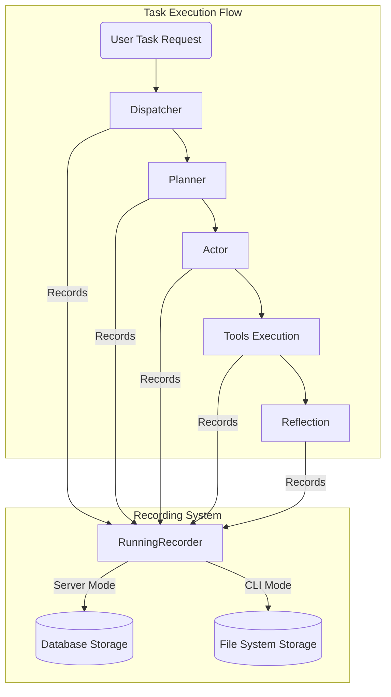

Sources: [XAgent/recorder.py:47-318](), [XAgent/running_recorder.py:34-396]()

## 2. Recording Components

XAgent employs two different implementations of the recording system depending on the execution mode:

1. **Server Mode Recorder** - Stores recordings in a MySQL database
2. **CLI Mode Recorder** - Stores recordings in the local file system

Both implementations provide similar functionality but differ in storage mechanisms and integration points.

### 2.1 Server Mode Recording

The server mode recorder (`RunningRecoder` class in `recorder.py`) integrates with XAgent's server architecture and stores all records in a MySQL database. This enables persistent storage and retrieval of execution details across different server instances.

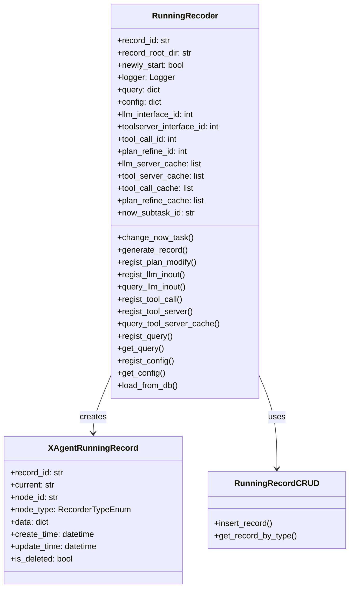

Sources: [XAgent/recorder.py:47-318](), [XAgentServer/server.py:20-109]()

### 2.2 CLI Mode Recording

The CLI mode recorder (`RunningRecoder` class in `running_recorder.py`) operates independently and stores all records in the local file system. This approach is suitable for standalone executions and offline analysis.

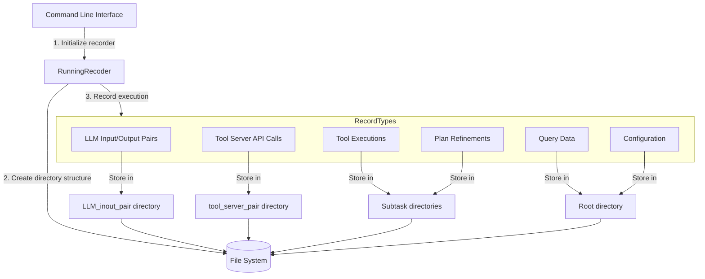

Sources: [XAgent/running_recorder.py:34-396](), [run.py:41-91]()

## 3. Recorded Data Types

The task recording system captures several types of data during execution:

### 3.1 LLM Interactions

Records all inputs sent to and outputs received from the language model:

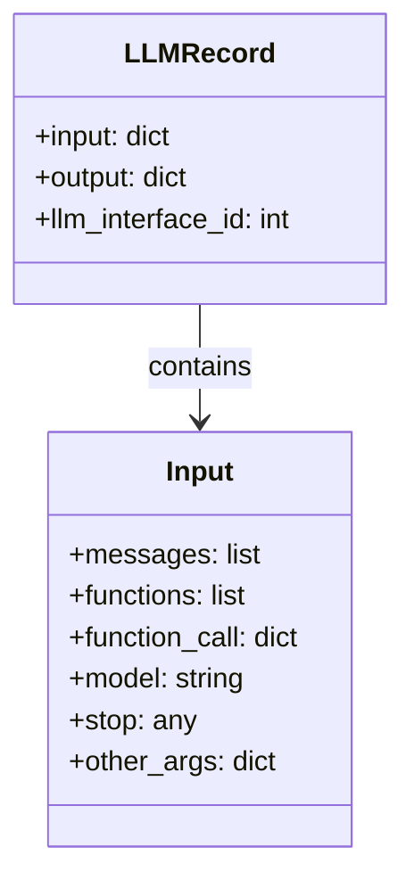

Sources: [XAgent/recorder.py:132-161](), [XAgent/running_recorder.py:130-159]()

### 3.2 Tool Interactions

Records all tool calls made during execution, including inputs, outputs, and status codes:

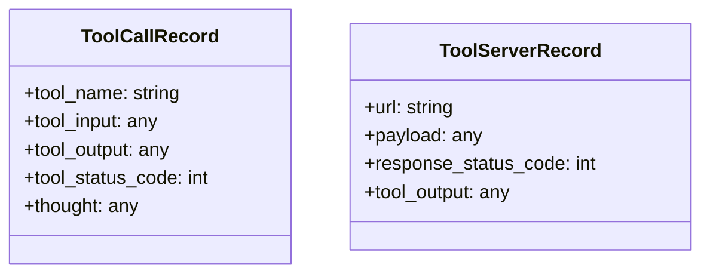

Sources: [XAgent/recorder.py:191-243](), [XAgent/running_recorder.py:201-245]()

### 3.3 Plan Refinements

Records all modifications made to the execution plan:

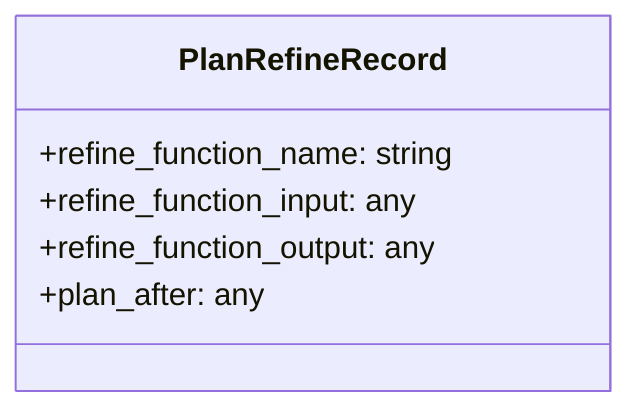

Sources: [XAgent/recorder.py:108-130](), [XAgent/running_recorder.py:108-129](), [XAgent/workflow/plan_exec.py:49-107]()

### 3.4 Configurations and Queries

Records the initial configuration and query that started the task:

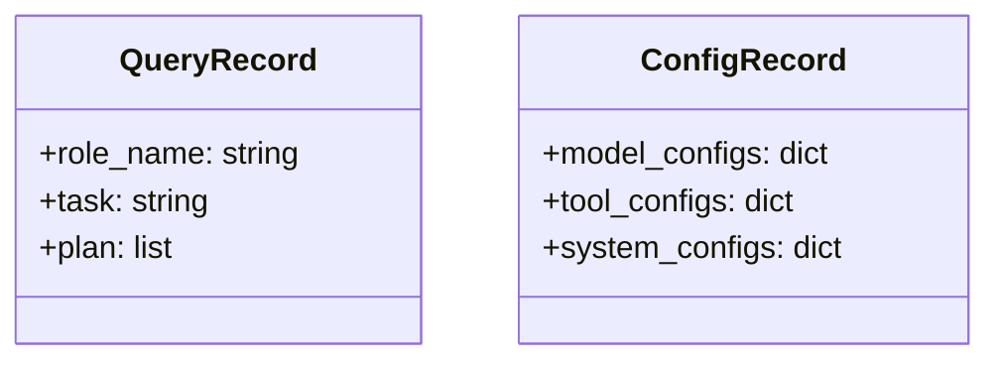

Sources: [XAgent/recorder.py:271-317](), [XAgent/running_recorder.py:279-324]()

## 4. Using the Task Recording System

The task recording system is integrated into XAgent's core components and operates automatically during task execution. However, there are several ways to interact with and leverage the recording system:

### 4.1 Command Line Options

When using the command line interface, you can specify recording options:

| Option | Description |
|--------|-------------|
| `--record-dir` | Directory to store execution logs |
| `--quiet` | Run in quiet mode, outputting to a file instead of the terminal |

Sources: [run.py:9-38]()

### 4.2 Caching and Performance Optimization

The recording system includes caching mechanisms that can improve performance by avoiding redundant operations:

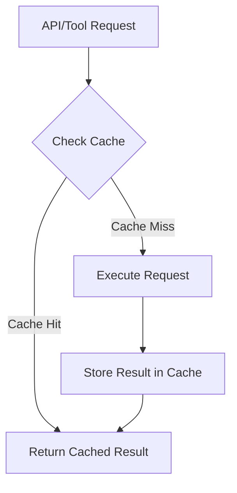

Sources: [XAgent/recorder.py:163-184](), [XAgent/recorder.py:245-269](), [XAgent/running_recorder.py:161-199](), [XAgent/running_recorder.py:247-276]()

### 4.3 Replaying Previous Executions

The recording system enables loading and replaying previous task executions:

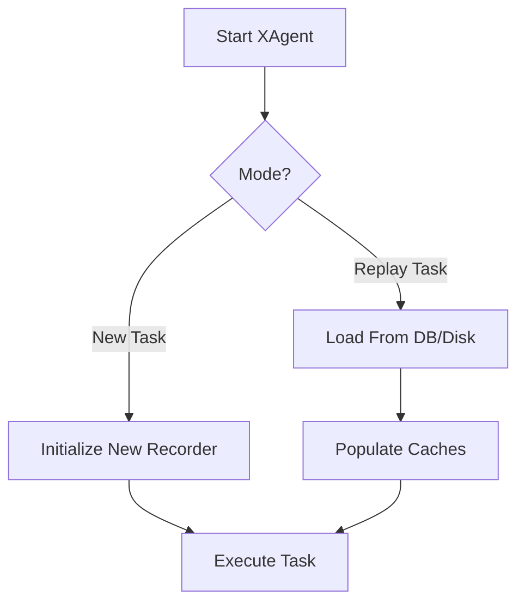

Sources: [XAgent/recorder.py:319-346](), [XAgent/running_recorder.py:338-395]()

## 5. Database Schema (Server Mode)

When using the server mode, task recordings are stored in the MySQL database according to the following schema:

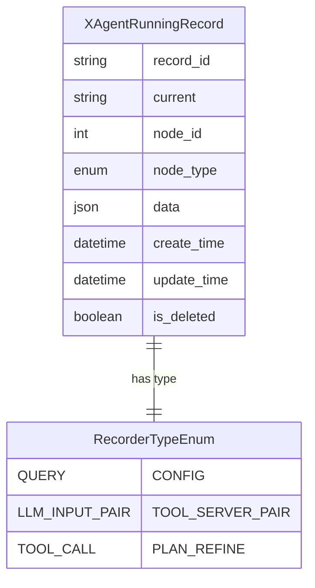

Sources: [docker-compose.yml:66-94](), [XAgent/recorder.py:96-105]()

## 6. File System Structure (CLI Mode)

When using the CLI mode, task recordings are organized in the file system as follows:

```
running_records/
└── TIMESTAMP_UUID/
    ├── config.yml              # Task configuration
    ├── query.json              # Initial task query
    ├── LLM_inout_pair/         # LLM interactions
    │   ├── 00000.json
    │   ├── 00001.json
    │   └── ...
    ├── tool_server_pair/       # Tool server API calls
    │   ├── 00000.json
    │   ├── 00001.json
    │   └── ...
    └── SUBTASK_ID/             # Subtask-specific recordings
        ├── tool_00000.json     # Tool calls
        ├── tool_00001.json
        ├── plan_refine_00000.json  # Plan refinements
        └── ...
```

Sources: [XAgent/running_recorder.py:50-76](), [XAgent/running_recorder.py:108-245]()

## 7. Integration with XAgent Core

The task recording system integrates with XAgent Core through a global recorder instance, which is accessed by various components during execution:

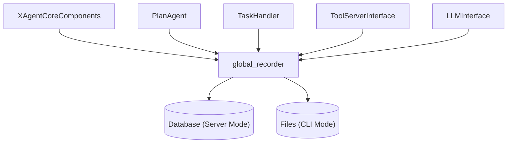

Sources: [XAgent/workflow/plan_exec.py:69-74](), [XAgentServer/server.py:26-109]()

## 8. Technical Implementation Details

### 8.1 Data Serialization

The recording system uses a utility function `dump_common_things()` to serialize various data types before storage:

| Data Type | Serialization Method |
|-----------|----------------------|
| Primitive types (str, int, float, bool) | Direct storage |
| Dictionaries | Recursive serialization of keys and values |
| Lists | Recursive serialization of elements |
| Custom objects | Call `to_json()` method if available |

Sources: [XAgent/recorder.py:19-29](), [XAgent/running_recorder.py:14-32]()

### 8.2 Record Type Enumeration

Records are categorized using the `RecorderTypeEnum` enumeration:

| Record Type | Description |
|-------------|-------------|
| QUERY | Initial task query data |
| CONFIG | Task configuration data |
| LLM_INPUT_PAIR | LLM input/output pairs |
| TOOL_SERVER_PAIR | Tool server API calls |
| TOOL_CALL | Tool executions |
| PLAN_REFINE | Plan refinements |

Sources: [XAgent/recorder.py:96-105](), [XAgentServer/enums/recorder_type.py]() (inferred)

## 9. Best Practices and Considerations

When working with the task recording system, consider the following:

1. **Storage Requirements**: Extensive recordings can consume significant disk space or database resources, especially for complex tasks.

2. **Performance Impact**: While the recording system is designed to be lightweight, it may have a small impact on performance during execution.

3. **Security Considerations**: Recordings may contain sensitive information (e.g., API keys, user data). The system automatically masks API keys, but be cautious with other sensitive data.

4. **Replay Limitations**: Not all aspects of a task execution can be perfectly replayed, especially those involving external systems or time-dependent operations.

5. **Debugging**: Task recordings are valuable debugging tools, providing insight into the decision-making process and execution flow.

Sources: [XAgent/recorder.py:87-88](), [XAgent/recorder.py:163-184]()

---

