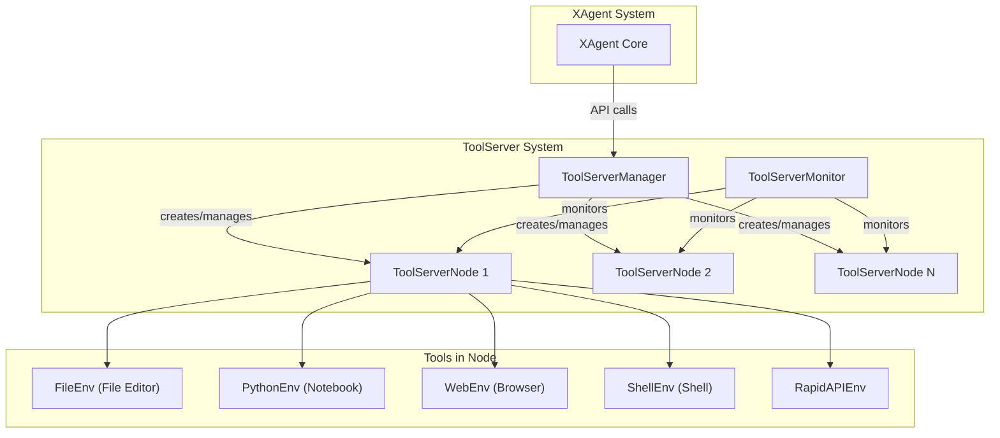
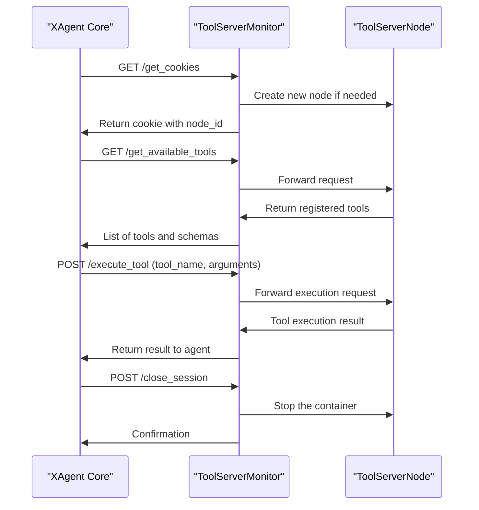
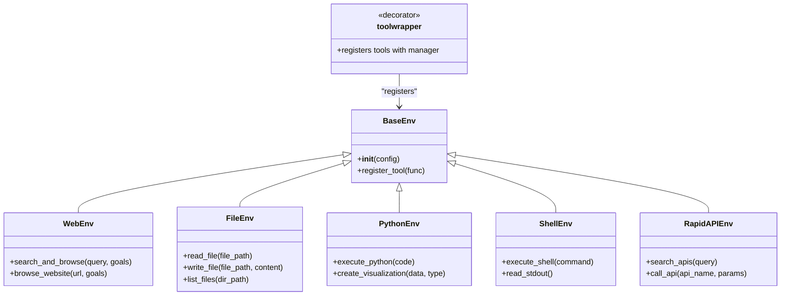
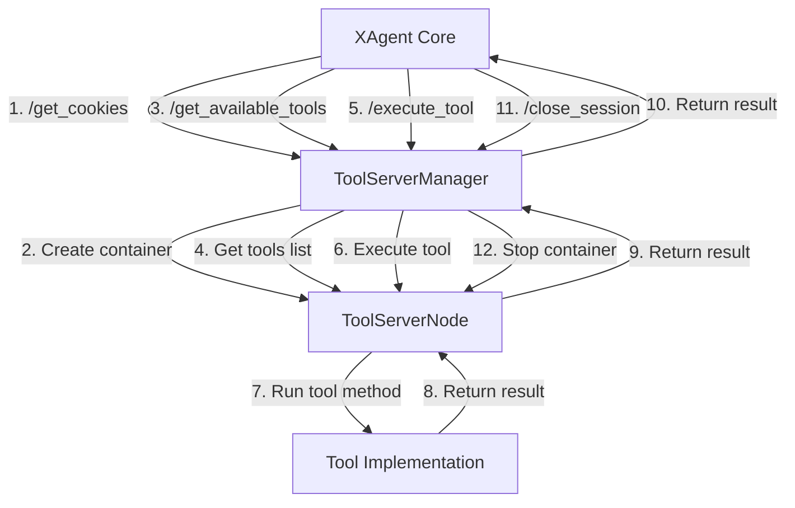
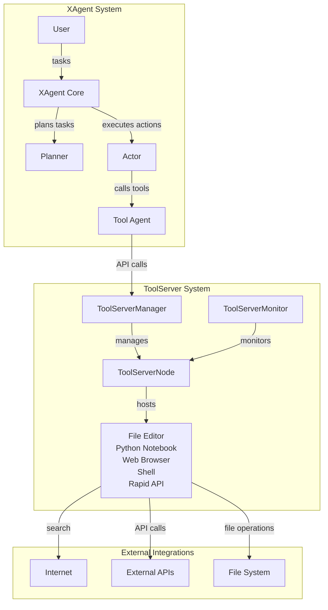

<!-- source: DeepWiki mcp.deepwiki.com · repo OpenBMB/XAgent · page 3 ToolServer · fetched 2026-10-26 -->

# ToolServer

<details>
<summary>Relevant source files</summary>

The following files were used as context for generating this wiki page:

- [README.md](README.md)
- [README_JA.md](README_JA.md)
- [README_ZH.md](README_ZH.md)
- [ToolServer/README.md](ToolServer/README.md)
- [ToolServer/README_ZH.md](ToolServer/README_ZH.md)
- [ToolServer/ToolServerNode/core/envs/web.py](ToolServer/ToolServerNode/core/envs/web.py)
- [XAgentGen/README.md](XAgentGen/README.md)

</details>


ToolServer is a component within the XAgent system that provides a safe, isolated environment for executing tools and operations. It serves as a crucial bridge between the agent's planning capabilities and real-world actions, offering a containerized environment where tools can be executed without risking the host system's security. For information about the XAgent Core that uses the ToolServer, see [XAgent Core](#2).

## Introduction

ToolServer is designed as a Docker-based system that hosts various tools like file editing, Python notebooks, web browsing, shell execution, and API calling. It provides a robust API that the XAgent system uses to discover and execute tools in a controlled environment. The system isolates tool execution in containers to ensure security while providing powerful capabilities.

### ToolServer Architecture Overview



Sources: [README.md:61-70](), [ToolServer/README.md:1-16]()

## System Components

ToolServer consists of three primary components that work together to provide tool execution capabilities:

### ToolServerManager

The ToolServerManager serves as the entry point for API requests from the XAgent Core. It's responsible for:
- Creating new ToolServerNode instances (Docker containers)
- Managing the lifecycle of these containers
- Routing tool execution requests to the appropriate node
- Providing an API for node interaction

### ToolServerMonitor

The ToolServerMonitor maintains system health by:
- Periodically checking the status of all ToolServerNode instances
- Detecting and removing non-responsive or malfunctioning nodes
- Cleaning up idle nodes after a configurable period of inactivity (default: 30 minutes)

### ToolServerNode

Each ToolServerNode is a Docker container that:
- Hosts the actual tool implementations
- Provides a safe execution environment for tools
- Isolates tool operations from the host system
- Exposes tools through a standardized interface

Sources: [ToolServer/README.md:4-9]()

### Component Interactions Sequence



Sources: [ToolServer/README.md:38-184]()

## Tool System

The ToolServer provides several built-in tools, each implementing different capabilities for the agent:

### Tool Registration System



Tools in ToolServer are implemented as environment classes that extend the `BaseEnv` class. Each environment provides methods that are registered as tools using the `toolwrapper` decorator.

Sources: [ToolServer/ToolServerNode/core/envs/web.py:1-126]()

### Available Tools

ToolServer provides five main tools:

1. **File Editor (FileEnv)**
   - Read, write, and modify files
   - List directory contents
   - Create and delete files and directories

2. **Python Notebook (PythonEnv)**
   - Execute Python code in a notebook environment
   - Create visualizations and charts
   - Perform data analysis and validation

3. **Web Browser (WebEnv)**
   - Search the internet using Bing API or DuckDuckGo (fallback)
   - Browse websites and extract content
   - Navigate links within web pages

4. **Shell (ShellEnv)**
   - Execute shell commands
   - Install software packages
   - Run and manage services

5. **Rapid API (RapidAPIEnv)**
   - Search for APIs from Rapid API
   - Call external APIs with parameters
   - Process API responses

Sources: [README.md:61-70](), [ToolServer/README.md:10-16]()

#### Example: WebEnv Implementation

The WebEnv class provides two primary methods:
- `search_and_browse`: Searches the web and browses the results
- `browse_website`: Extracts the content from a specific URL

The tool implements safety checks to prevent accessing local URLs and uses either the Bing API (if configured) or DuckDuckGo as a fallback for search functionality.

Sources: [ToolServer/ToolServerNode/core/envs/web.py:11-126]()

## API Documentation

ToolServer exposes a RESTful API for XAgent to interact with the tools:

### API Endpoints

| Endpoint | Method | Description |
|----------|--------|-------------|
| `/get_cookies` | GET | Returns a cookie with the node_id |
| `/get_available_tools` | GET | Lists all registered tools and schemas |
| `/retrieving_tools` | POST | Returns relevant tools for a question |
| `/get_json_schema_for_tools` | POST | Returns JSON schema for specific tools |
| `/get_json_schema_for_envs` | POST | Returns JSON schema for environments |
| `/execute_tool` | POST | Executes a specified tool with parameters |
| `/close_session` | POST | Stops the ToolServerNode container |
| `/release_session` | POST | Deletes the ToolServerNode container |

### Tool Execution Flow



Some tools, especially interactive ones like Shell, may return HTTP status code 450, indicating that further calls are required to complete the execution.

Sources: [ToolServer/README.md:38-184]()

## Configuration

ToolServer can be configured through several YAML files:

### Configuration Files

| File | Description |
|------|-------------|
| `assets/config/manager.yml` | ToolServerManager configuration |
| `assets/config/monitor.yml` | ToolServerMonitor configuration |
| `assets/config/node.yml` | ToolServerNode configuration |

### Key Configuration Options

- **Manager Configuration**
  - `node.privileged`: Whether nodes have privileged Docker access
  - Docker image settings and network configuration

- **Monitor Configuration**
  - `idling_close_minutes`: Time to wait before closing idle nodes (default: 30)

- **Node Configuration**
  - API keys for services (Bing, Rapid API)
  - Tool-specific settings

Sources: [ToolServer/README.md:18-25]()

## Building and Running ToolServer

ToolServer uses Docker Compose for easy deployment:

### Starting with Pre-built Images

```bash
docker compose up
```

### Building from Source

```bash
docker compose build
docker compose up
```

To run in the background, add the `-d` flag:

```bash
docker compose up -d
```

If the ToolServer needs to be updated, rebuild the images with:

```bash
docker compose pull
# or
docker compose build
```

Sources: [README.md:76-106](), [ToolServer/README.md:26-37]()

## Integration with XAgent

The ToolServer is a critical component in the XAgent system, providing the agent's tool execution capabilities:



When XAgent needs to execute a tool, the Tool Agent sends a request to the ToolServerManager, which routes the request to the appropriate ToolServerNode. The node executes the requested tool and returns the result, which is then processed by the XAgent Core to continue task execution.

Sources: [README.md:50-59]()

## Security Considerations

ToolServer enhances security through containerization:

1. **Isolation**: Tools run in isolated Docker containers, preventing them from affecting the host system
2. **URL Validation**: The WebEnv implements checks to prevent accessing local URLs
3. **Privileged Mode Control**: Can disable privileged mode to prevent Docker-in-Docker operations
4. **Session Management**: Nodes can be closed or released when no longer needed

Sources: [ToolServer/ToolServerNode/core/envs/web.py:27-46](), [ToolServer/README.md:18-25]()

## Conclusion

ToolServer provides a secure and extensible platform for tool execution within the XAgent system. By containerizing tools and providing a standardized API, it enables the autonomous agent to perform a wide range of tasks while maintaining system security. The modular design makes it easy to add new tools and capabilities, allowing the system to grow and adapt to new requirements.

---

