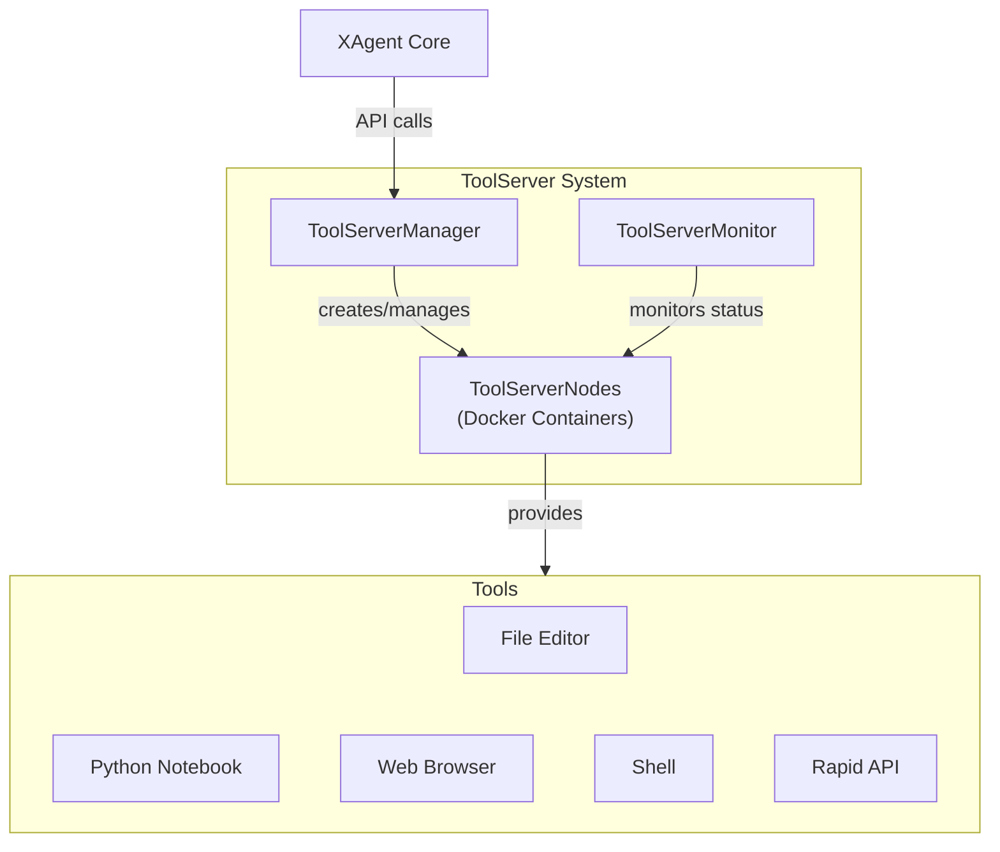
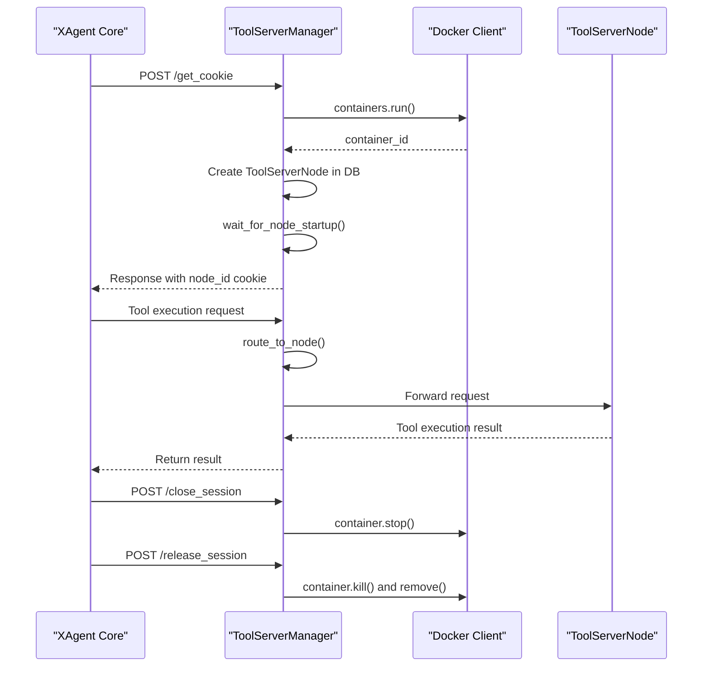
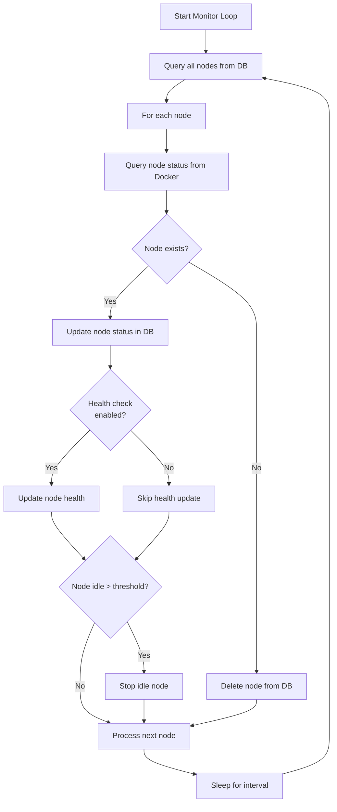
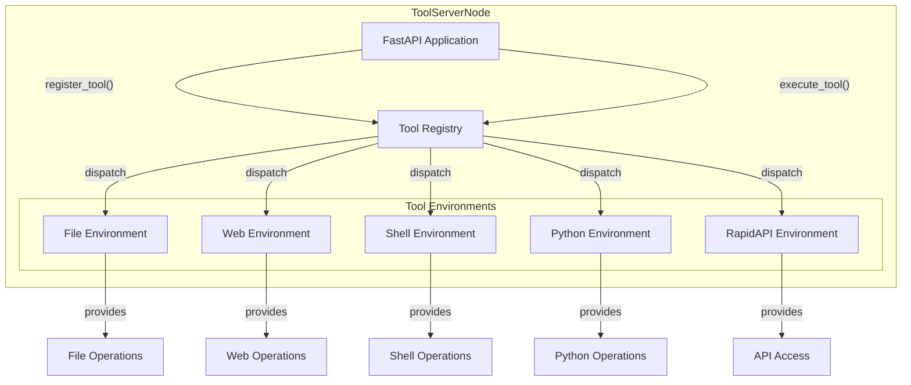
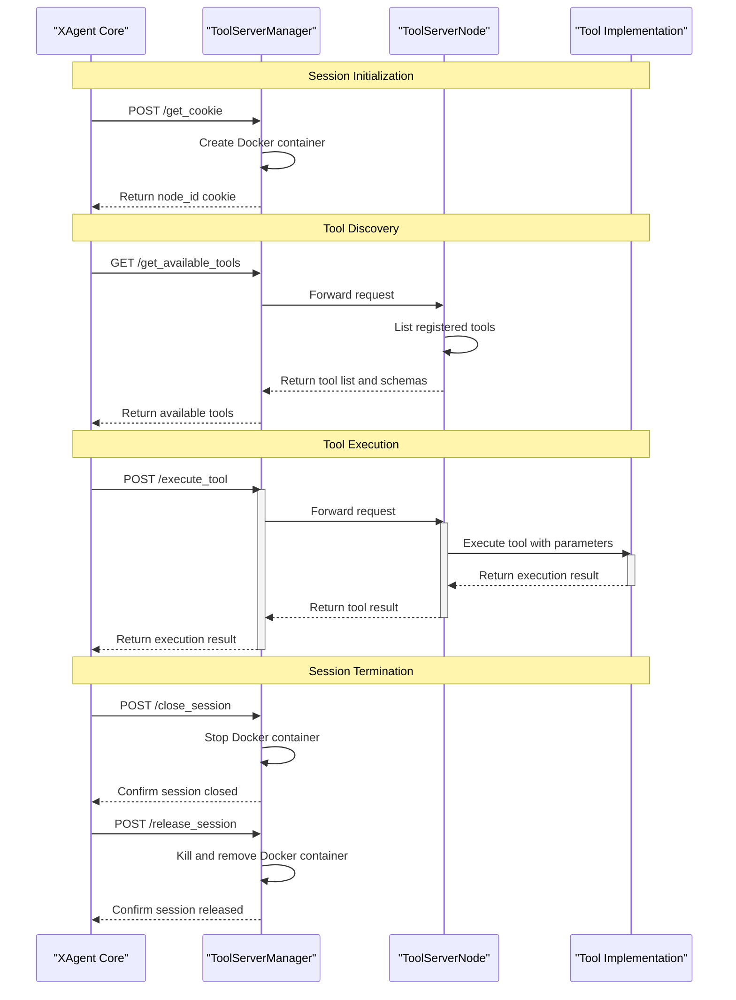
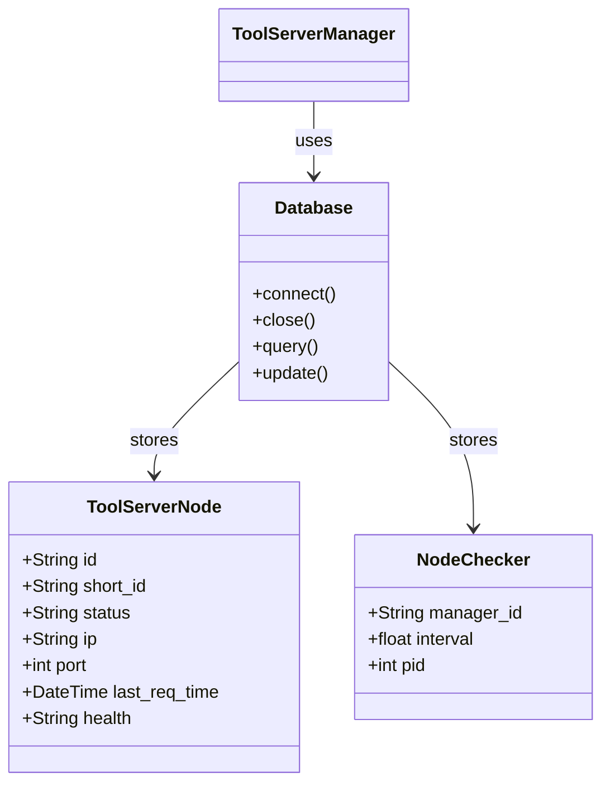
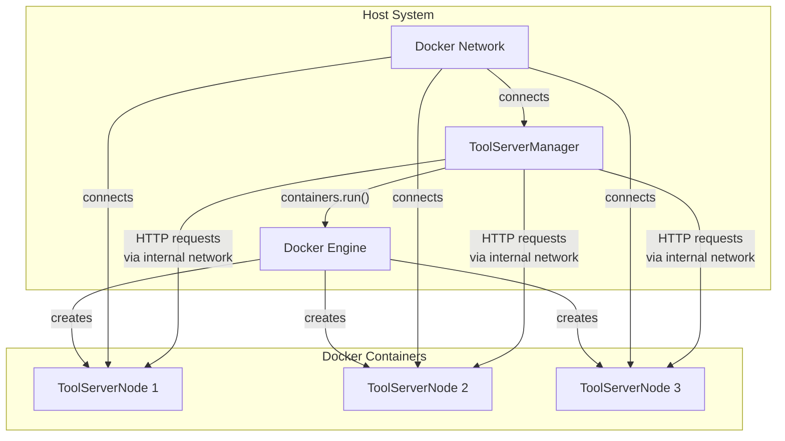
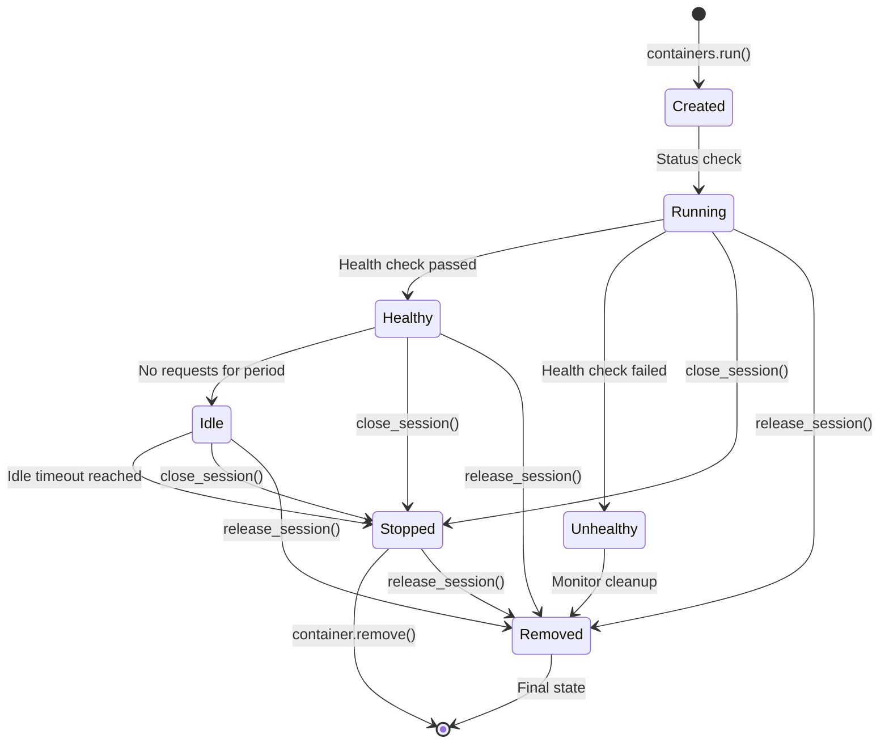
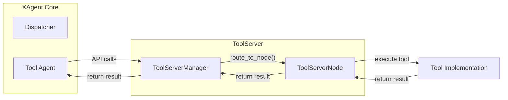

<!-- source: DeepWiki mcp.deepwiki.com · repo OpenBMB/XAgent · page 3.1 ToolServer Architecture · fetched 2026-10-26 -->

# ToolServer Architecture

Relevant source files

The following files were used as context for generating this wiki page:

- [ToolServer/README.md](ToolServer/README.md)
- [ToolServer/README_ZH.md](ToolServer/README_ZH.md)
- [ToolServer/ToolServerManager/main.py](ToolServer/ToolServerManager/main.py)
- [ToolServer/ToolServerManager/node_checker.py](ToolServer/ToolServerManager/node_checker.py)
- [ToolServer/ToolServerNode/core/envs/web.py](ToolServer/ToolServerNode/core/envs/web.py)

This document describes the architecture of ToolServer, a critical component in the XAgent system that provides a safe and controlled environment for executing various tools required by the agent. For information about the specific tools provided by ToolServer, see [Tool Types and Capabilities](#3.2). For details on managing ToolServer instances, see [ToolServer Management](#3.3).

## Overview

ToolServer enables XAgent to execute external operations safely by providing containerized environments for tool execution. The architecture uses Docker containers to isolate tool execution, preventing potential security risks while allowing XAgent to access powerful capabilities like web browsing, file editing, and executing shell commands.

Sources: [ToolServer/README.md:2-9]()

## Components

The ToolServer system consists of three primary components that work together to provide tool execution capabilities to XAgent.

### ToolServerManager

ToolServerManager is responsible for creating and managing ToolServerNode instances. Implemented as a FastAPI application, it handles requests from XAgent Core, creates Docker containers for tool execution, and routes requests to the appropriate node.

Key functionality provided by ToolServerManager:

1. **Node Creation**: Creates new ToolServerNode Docker containers when a session is initiated
2. **Request Routing**: Routes tool execution requests to the appropriate node
3. **Session Management**: Handles reconnecting, closing, and releasing of sessions

Sources: [ToolServer/ToolServerManager/main.py:16-229]()

### ToolServerMonitor

ToolServerMonitor is responsible for monitoring the status of ToolServerNode instances. It periodically checks each node's status, updates the database with the current state, and manages idle nodes.

The monitor continually runs this check cycle, ensuring that:

1. Nodes that no longer exist in Docker are removed from the database
2. Node status (running, stopped, etc.) is kept up-to-date in the database
3. Node health status is updated if health checking is enabled
4. Idle nodes are automatically stopped after a configurable timeout period

Sources: [ToolServer/ToolServerManager/node_checker.py:11-69]()

### ToolServerNode

ToolServerNode instances are Docker containers that provide the actual tool execution environment. Each node hosts a variety of tools that XAgent can use to accomplish tasks.

Each ToolServerNode provides endpoints for:

1. Listing available tools
2. Retrieving tool schemas
3. Executing tools with parameters
4. Getting environment information

Sources: [ToolServer/README.md:9-16](), [ToolServer/ToolServerNode/core/envs/web.py:11-126]()

## Communication Flow

The communication between XAgent Core and the tools happens through a multi-stage process involving the ToolServerManager and ToolServerNodes.

Sources: [ToolServer/ToolServerManager/main.py:107-226](), [ToolServer/README.md:38-186]()

## Database and State Management

ToolServer uses a database (MongoDB via Beanie ODM) to track the state of all node instances and provide persistence across restarts.

Key database entities:

1. **ToolServerNode**: Represents a Docker container providing tool execution capabilities
   - Tracks container ID, status, IP address, port, and health status
   - Records last request time for idle detection
   
2. **NodeChecker**: Tracks monitoring process information
   - Stores manager ID, checking interval, and process ID

Sources: [ToolServer/ToolServerManager/main.py:26-28](), [ToolServer/ToolServerManager/main.py:134-142]()

## Docker Integration

ToolServer uses Docker extensively to provide isolated environments for tool execution.

The Docker integration provides several benefits:

1. **Isolation**: Each tool execution environment is isolated, preventing cross-contamination
2. **Resource Control**: Docker allows limiting CPU, memory, and other resources
3. **Security**: Container isolation prevents security risks from affecting the host system
4. **Statelessness**: Containers can be destroyed and recreated easily, ensuring clean environments

Sources: [ToolServer/ToolServerManager/main.py:127-130](), [ToolServer/README.md:3]()

## API Endpoints

The ToolServerManager provides several key API endpoints for managing ToolServerNode instances and executing tools.

| Endpoint | Method | Purpose | Description |
|----------|--------|---------|-------------|
| `/get_cookie` | POST | Create node | Creates a new ToolServerNode and returns its ID as a cookie |
| `/reconnect_session` | POST | Restart node | Restarts an existing ToolServerNode |
| `/close_session` | POST | Stop node | Stops a ToolServerNode but keeps its state |
| `/release_session` | POST | Delete node | Terminates and removes a ToolServerNode |
| `/alive` | GET | Health check | Simple endpoint to verify service is running |
| Tool paths | GET/POST | Tool execution | Routes tool execution requests to the appropriate node |

The ToolServerNode instances typically provide these endpoints:

| Endpoint | Method | Purpose | Description |
|----------|--------|---------|-------------|
| `/get_available_tools` | GET | Tool discovery | Lists all available tools and their schemas |
| `/retrieving_tools` | POST | Tool search | Finds tools relevant to a specific question |
| `/get_json_schema_for_tools` | POST | Schema retrieval | Gets detailed schemas for specific tools |
| `/get_json_schema_for_envs` | POST | Environment info | Gets information about tool environments |
| `/execute_tool` | POST | Tool execution | Executes a tool with specified parameters |

Sources: [ToolServer/README.md:39-154](), [ToolServer/ToolServerManager/main.py:65-269]()

## Monitoring and Lifecycle Management

ToolServer includes built-in monitoring capabilities to ensure nodes are functioning correctly and to manage their lifecycle.

Key lifecycle events:

1. **Creation**: Node is created via Docker container
2. **Health Checking**: Node's health is periodically verified
3. **Idle Detection**: Nodes with no activity are marked as idle
4. **Automatic Stopping**: Idle nodes are automatically stopped after a timeout
5. **Explicit Management**: Nodes can be restarted, stopped, or removed via API calls

Sources: [ToolServer/ToolServerManager/node_checker.py:11-55](), [ToolServer/ToolServerManager/main.py:182-226]()

## Integration with XAgent Core

The ToolServer is integrated with XAgent Core through an API-based approach, where XAgent Core makes HTTP requests to the ToolServerManager to access tools.

The integration flow typically follows these steps:

1. XAgent Core initializes a session by requesting a cookie with a node ID
2. XAgent discovers available tools by querying the ToolServer
3. When a tool needs to be executed, XAgent makes a request to the ToolServer with the tool name and parameters
4. ToolServer routes the request to the appropriate node, executes the tool, and returns the result
5. When the task is complete, XAgent releases the session

Sources: [ToolServer/README.md:3-9]()

## Security Considerations

ToolServer is designed with security in mind, providing several layers of protection:

1. **Container Isolation**: Each ToolServerNode runs in its own Docker container, isolating it from the host system and other nodes
2. **URL Validation**: The Web Environment validates URLs to prevent accessing local resources
3. **Resource Limitations**: Docker containers can be configured with resource limits to prevent denial-of-service attacks
4. **Automatic Cleanup**: Idle nodes are automatically stopped and removed to prevent resource exhaustion
5. **Session Management**: Each client gets its own isolated environment, preventing cross-session interference

Sources: [ToolServer/ToolServerNode/core/envs/web.py:27-46](), [ToolServer/ToolServerManager/main.py:127-130]()

## Configuration Options

ToolServer provides several configuration options to customize its behavior:

| Configuration | Purpose | Description |
|--------------|---------|-------------|
| `node.health_check` | Enable/disable health checking | Determines whether to perform health checks on nodes |
| `node.health_check_interval` | Health check frequency | Time between health checks in seconds |
| `node.creation_wait_seconds` | Node startup timeout | Maximum time to wait for a node to start |
| `node.idling_close_minutes` | Idle timeout | Time after which idle nodes are stopped |
| `node.privileged` | Container privileges | Whether containers have elevated privileges |
| `node.device_requests` | Hardware access | Configures access to special hardware (e.g., GPUs) |
| `builtin_monitor` | Enable/disable monitoring | Controls whether the built-in monitor is active |
| `redirect_to_node_path` | API routing | Configures which paths should be routed to nodes |

Sources: [ToolServer/README.md:18-24](), [ToolServer/ToolServerManager/main.py:31-45]()

---

