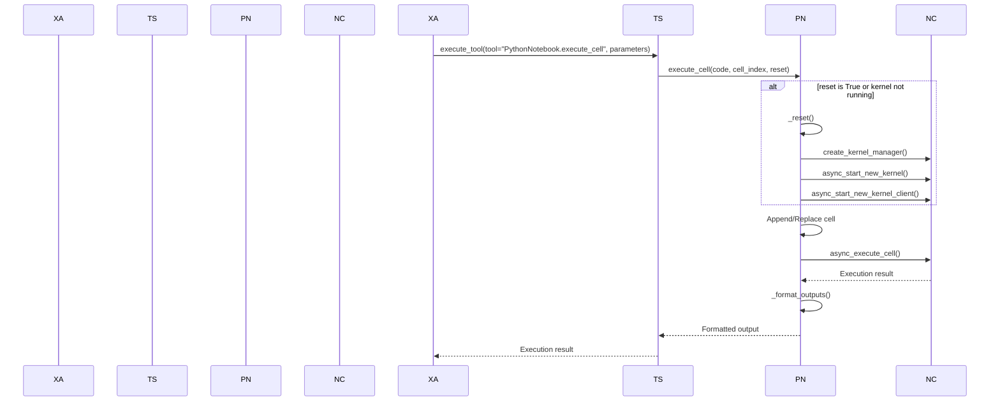
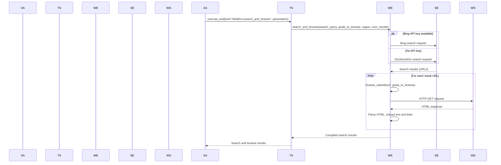
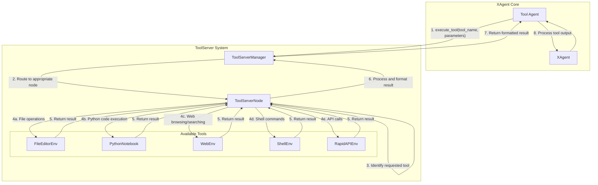
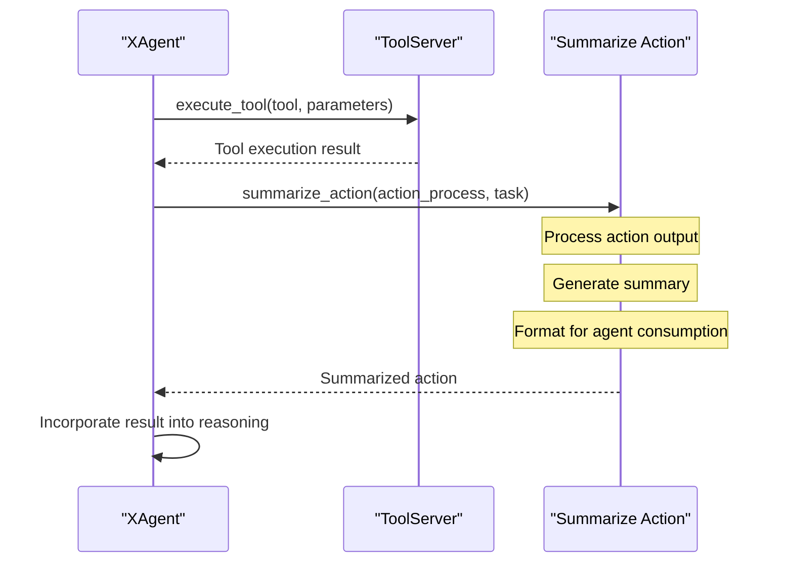

<!-- source: DeepWiki mcp.deepwiki.com · repo OpenBMB/XAgent · page 3.2 Tool Types and Capabilities · fetched 2026-10-26 -->

# Tool Types and Capabilities

<details>
<summary>Relevant source files</summary>

The following files were used as context for generating this wiki page:

- [ToolServer/README.md](ToolServer/README.md)
- [ToolServer/README_ZH.md](ToolServer/README_ZH.md)
- [ToolServer/ToolServerNode/core/envs/pycoding.py](ToolServer/ToolServerNode/core/envs/pycoding.py)
- [ToolServer/ToolServerNode/core/envs/web.py](ToolServer/ToolServerNode/core/envs/web.py)
- [XAgent/agent/summarize.py](XAgent/agent/summarize.py)
- [XAgent/ai_functions/pure_functions/task_manage_functions.yml](XAgent/ai_functions/pure_functions/task_manage_functions.yml)

</details>


This document describes the different types of tools available in the ToolServer component of XAgent and their capabilities. The ToolServer provides a safe, isolated environment for executing tools that extend XAgent's abilities to interact with the external world. For details on the overall ToolServer architecture, see [ToolServer Architecture](#3.1), and for information about managing ToolServer instances, refer to [ToolServer Management](#3.3).

## Tool Overview

ToolServer currently provides five primary tool types, each designed to handle specific interaction patterns:

| Tool Type | Description | Primary Capabilities |
|-----------|-------------|---------------------|
| File Editor | Text editing tool | Write, read, and modify files |
| Python Notebook | Interactive Python environment | Run code, validate ideas, create visualizations |
| Web Browser | Web interaction interface | Search online, visit webpages, extract information |
| Shell | Command-line interface | Execute shell commands, install programs, host services |
| Rapid API | API interaction tool | Retrieve and call APIs from Rapid API hub |

Sources: [ToolServer/README.md:10-15]()

## Tool Architecture

The tools in ToolServer follow a consistent architecture pattern, with each tool implemented as an environment class that extends the `BaseEnv` class and is registered with the `toolwrapper` decorator.

```mermaid
classDiagram
    direction TB
    
    class "BaseEnv" {
        +__init__(config)
    }
    
    class "PythonNotebook" {
        +execute_cell(code, cell_index, reset)
        +print_notebook()
    }
    
    class "WebEnv" {
        +search_and_browse(search_query, goals_to_browse, region, num_results)
        +browse_website(url, goals_to_browse)
    }
    
    class "FileEditorEnv" {
        +write_file(filepath, content)
        +read_file(filepath)
        +list_files(directory)
    }
    
    class "ShellEnv" {
        +execute_command(command)
        +read_stdout()
    }
    
    class "RapidAPIEnv" {
        +retrieve_apis(query)
        +call_api(api_name, parameters)
    }
    
    "BaseEnv" <|-- "PythonNotebook"
    "BaseEnv" <|-- "WebEnv"
    "BaseEnv" <|-- "FileEditorEnv"
    "BaseEnv" <|-- "ShellEnv"
    "BaseEnv" <|-- "RapidAPIEnv"
```

Sources: [ToolServer/ToolServerNode/core/envs/pycoding.py:16-17](), [ToolServer/ToolServerNode/core/envs/web.py:12-14]()

## Detailed Tool Descriptions

### File Editor

The File Editor provides capabilities for working with files in the ToolServer environment. It allows agents to read, write, and modify text files.

Key capabilities:
- Creating new text files
- Reading existing file content
- Modifying file content
- Listing directories and files

Sources: [ToolServer/README.md:11]()

### Python Notebook

The Python Notebook provides an interactive environment for executing Python code, similar to Jupyter notebooks. This enables agents to test ideas, validate algorithms, and generate visualizations.



Key capabilities:
- Creating and executing Python code cells
- Maintaining persistent notebook state between calls
- Supporting kernel reset when needed
- Saving notebook outputs (text and binary data like images)
- Displaying formatted outputs, including error tracebacks

Example usage:
```python
# First cell: basic calculation
execute_cell(code='print(2 + 2)')  # Output: 4

# Second cell: creating a variable
execute_cell(code='x = [1, 2, 3]\nprint(x)')  # Output: [1, 2, 3]

# Third cell: using previously defined variable
execute_cell(code='print(sum(x))')  # Output: 6
```

Sources: [ToolServer/ToolServerNode/core/envs/pycoding.py:16-181]()

### Web Browser

The Web Browser provides capabilities for interacting with web content. It enables agents to search the web, visit websites, and extract information from webpages.



Key capabilities:
- Performing web searches using either Bing API or DuckDuckGo
- Browsing specific URLs to extract text content
- Extracting and formatting links from webpages
- Processing HTTP redirects
- Configurable user-agent and region settings

Security features:
- URL validation to prevent access to local resources
- HTTP client with configurable timeouts

Sources: [ToolServer/ToolServerNode/core/envs/web.py:12-126]()

### Shell

The Shell provides a command-line interface for executing system commands. This allows agents to run shell commands, install software, and interact with the host system.

Key capabilities:
- Executing arbitrary shell commands
- Reading command outputs
- Managing running processes
- Installing software packages
- Hosting services or running server applications

Security note: The Shell tool runs in a containerized environment to isolate it from the host system.

Sources: [ToolServer/README.md:14]()

### Rapid API

The Rapid API tool provides access to a wide range of third-party APIs through the Rapid API hub. This enables agents to leverage external services and data sources.

Key capabilities:
- Retrieving API information based on queries
- Calling APIs with appropriate parameters
- Processing API responses
- Access to hundreds of APIs across various domains

Sources: [ToolServer/README.md:15]()

## Tool Execution Flow

When XAgent needs to use a tool, it follows a specific flow to interact with the ToolServer system:



Sources: [ToolServer/README.md:5-9](), [ToolServer/README.md:158-180]()

## Tool Discoverability and Selection

XAgent can discover and select appropriate tools through several methods provided by the ToolServer API:

1. **Tool Listing**: Get a complete list of available tools with their schemas:
   ```
   GET /get_available_tools
   ```

2. **Tool Retrieval**: Find relevant tools for a specific question:
   ```
   POST /retrieving_tools
   {
     "question": "How do I create a visualization?",
     "top_k": 3
   }
   ```

3. **Schema Retrieval**: Get JSON schemas for specific tools:
   ```
   POST /get_json_schema_for_tools
   {
     "tools": ["PythonNotebook.execute_cell", "WebEnv.browse_website"]
   }
   ```

These capabilities allow XAgent to dynamically discover and use the appropriate tools for different tasks, enhancing its flexibility and problem-solving capabilities.

Sources: [ToolServer/README.md:43-130]()

## Tool Integration with XAgent

Tools are integrated with XAgent through the tool agent system. When XAgent needs to perform a specific operation, it:

1. Selects an appropriate tool based on the task requirements
2. Constructs the tool call with appropriate parameters
3. Executes the tool via the ToolServer
4. Processes and summarizes the tool output

The action summarization system in XAgent helps process tool outputs for better integration into the agent's workflow:



Sources: [XAgent/agent/summarize.py:11-163]()

## Tool Extension

The modular design of the ToolServer allows for easy extension with new tools. New tools can be added by creating a new environment class that extends the `BaseEnv` class and registering it with the `toolwrapper` decorator.

This extensibility enables XAgent to continuously evolve with new capabilities as needed for different use cases.

Sources: [ToolServer/README.md:16]()

---

