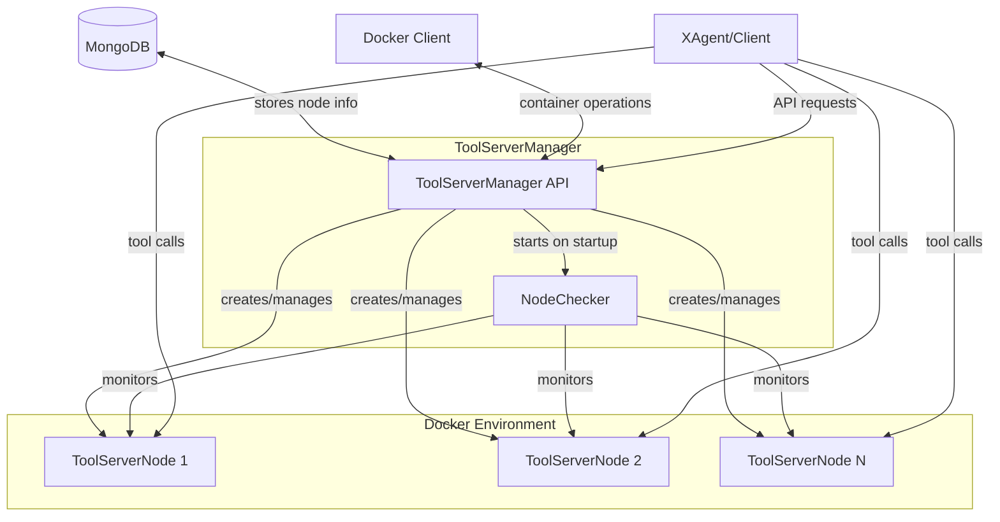
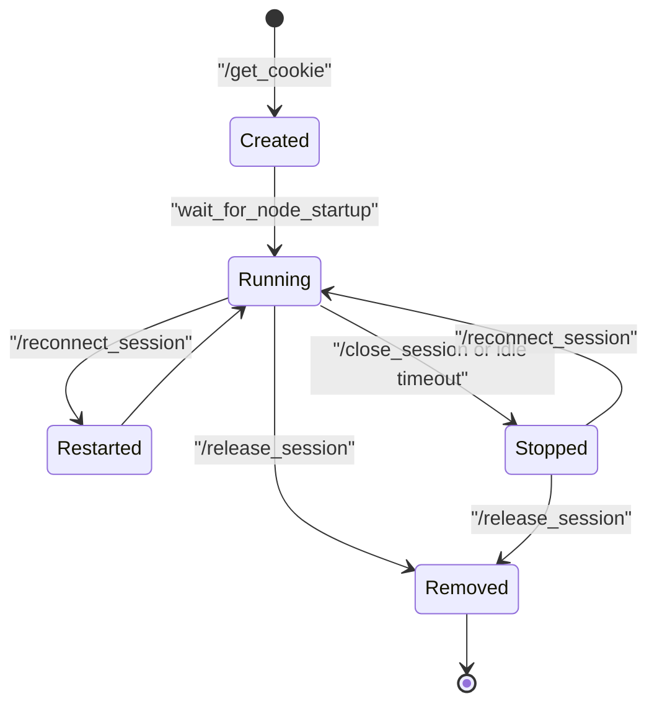
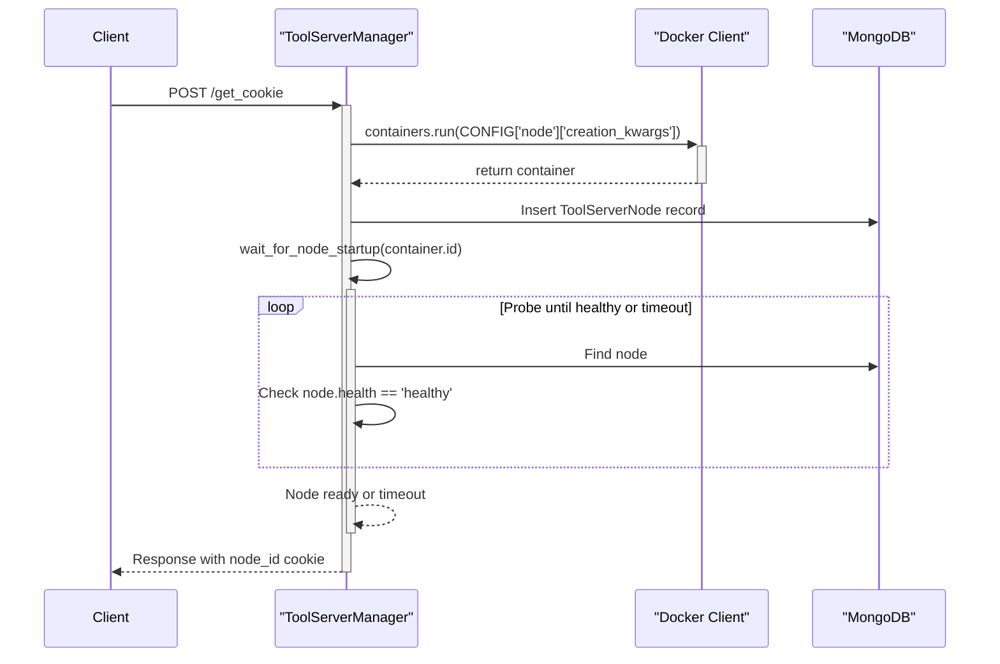
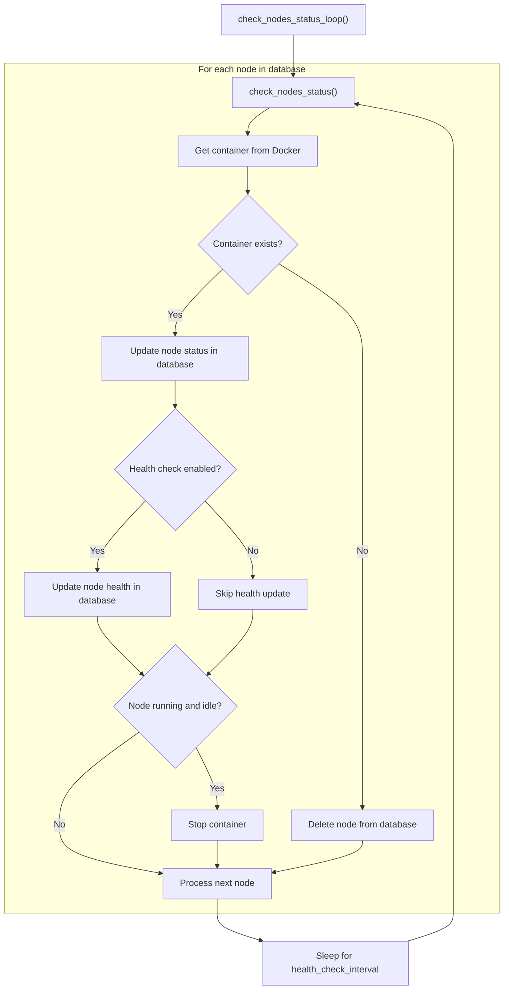
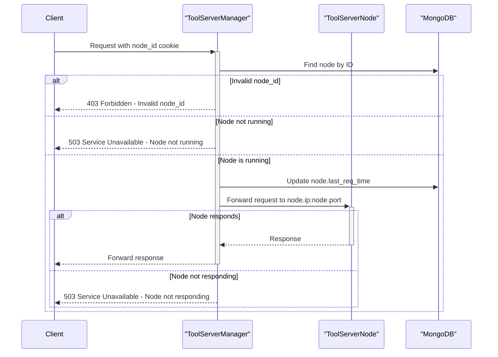

<!-- source: DeepWiki mcp.deepwiki.com · repo OpenBMB/XAgent · page 3.3 ToolServer Management · fetched 2026-10-26 -->

# ToolServer Management

<details>
<summary>Relevant source files</summary>

The following files were used as context for generating this wiki page:

- [ToolServer/ToolServerManager/main.py](ToolServer/ToolServerManager/main.py)
- [ToolServer/ToolServerManager/models.py](ToolServer/ToolServerManager/models.py)
- [ToolServer/ToolServerManager/node_checker.py](ToolServer/ToolServerManager/node_checker.py)
- [ToolServer/ToolServerManager/requirements.txt](ToolServer/ToolServerManager/requirements.txt)

</details>


This document details the mechanisms and procedures for managing ToolServer instances within the XAgent system. It covers the creation, monitoring, health-checking, and lifecycle management of ToolServer nodes, which are Docker containers that provide isolated environments for tool execution. For information about the overall ToolServer architecture, see [ToolServer Architecture](#3.1). For details about the specific tools available within ToolServer, see [Tool Types and Capabilities](#3.2).

## 1. ToolServer Management Components

The ToolServer management system consists of three primary components that work together to create, monitor, and maintain tool execution environments.



Sources: [ToolServer/ToolServerManager/main.py:10-45](), [ToolServer/ToolServerManager/node_checker.py:10-69]()

### 1.1 ToolServerManager

The ToolServerManager is a FastAPI application that serves as the central control point for managing ToolServer nodes. It provides endpoints for:

- Creating new nodes (`/get_cookie`)
- Reconnecting to existing nodes (`/reconnect_session`)
- Closing nodes (`/close_session`)
- Releasing nodes (`/release_session`)
- Routing API calls to specific nodes

It interacts with Docker to create, start, stop, and remove containers, and maintains node metadata in a database.

### 1.2 NodeChecker

The NodeChecker (also called ToolServerMonitor) is responsible for continuously monitoring the status of all ToolServer nodes. It:

- Verifies node existence in Docker
- Updates node status and health information in the database
- Automatically stops idle nodes based on configured timeout values
- Runs as an asynchronous task within the ToolServerManager

### 1.3 ToolServerNode

A ToolServerNode is a Docker container that provides a controlled environment for executing tools. Each node has:

- A unique identifier (Docker container ID)
- Status information (running, stopped, etc.)
- Health status
- Network information (IP address and port)
- Timestamp of the last request

## 2. ToolServerNode Lifecycle Management

ToolServer nodes go through a defined lifecycle from creation to removal. The ToolServerManager provides APIs to control this lifecycle.



Sources: [ToolServer/ToolServerManager/main.py:75-106](), [ToolServer/ToolServerManager/main.py:108-226]()

### 2.1 Node Creation

Nodes are created via the `/get_cookie` endpoint, which:

1. Creates a Docker container using configured parameters
2. Records node information in the database
3. Waits for the node to become ready
4. Returns the node ID as a cookie to the client



Sources: [ToolServer/ToolServerManager/main.py:108-150](), [ToolServer/ToolServerManager/main.py:75-106]()

### 2.2 Node Reconnection

If a node is stopped or needs to be restarted, the `/reconnect_session` endpoint handles this by:

1. Retrieving node information from the database
2. Restarting the Docker container
3. Waiting for the node to become ready again

Sources: [ToolServer/ToolServerManager/main.py:152-179]()

### 2.3 Node Closure

When a node is no longer needed but may be reused later, it can be stopped via the `/close_session` endpoint, which:

1. Retrieves node information from the database
2. Stops the Docker container if it's running

Sources: [ToolServer/ToolServerManager/main.py:181-200]()

### 2.4 Node Release

When a node is completely finished with and should be removed, the `/release_session` endpoint:

1. Retrieves node information from the database
2. Kills the Docker container if it's still running
3. Removes the Docker container

Sources: [ToolServer/ToolServerManager/main.py:202-226]()

## 3. Node Monitoring and Health Checking

The NodeChecker continuously monitors all ToolServer nodes to maintain accurate status information and perform cleanup operations.



Sources: [ToolServer/ToolServerManager/node_checker.py:11-68]()

### 3.1 Node Status Checking

The NodeChecker performs the following status checks:

1. Verifies each node in the database exists in Docker
2. Updates node status based on Docker container state
3. If health checking is enabled, updates node health status
4. Checks for idle nodes and stops them based on configured timeout

```python
# Pseudocode for idle node detection
if node_status == "running":
    if current_time - node.last_req_time >= CONFIG['node']['idling_close_minutes']:
        container.stop()
```

Sources: [ToolServer/ToolServerManager/node_checker.py:11-55]()

### 3.2 Automatic Health Monitoring

When configured, the system can use Docker's built-in health checking to monitor node health:

1. The `health_check` configuration option enables health monitoring
2. Node health status is updated in the database during status checks
3. Health status is used to determine if a node is ready during startup

This provides a robust mechanism for ensuring nodes are operational before routing requests to them.

Sources: [ToolServer/ToolServerManager/node_checker.py:42-46](), [ToolServer/ToolServerManager/main.py:97-102]()

## 4. Request Routing to Nodes

The ToolServerManager acts as a proxy, routing requests to the appropriate ToolServerNode based on the `node_id` cookie.



Sources: [ToolServer/ToolServerManager/main.py:228-269]()

The routing process involves:

1. Validating the node ID from the cookie
2. Checking that the node is running
3. Updating the last request time in the database
4. Forwarding the request to the node
5. Capturing and forwarding the response back to the client

This proxy mechanism allows clients to maintain a connection to a specific ToolServerNode while the ToolServerManager handles the underlying container management.

## 5. Configuration Parameters

The ToolServer management system is configured through several parameters that control node creation, monitoring, and lifecycle management.

| Parameter | Description | Default |
|-----------|-------------|---------|
| `builtin_monitor` | Enable/disable the built-in node monitor | `true` |
| `node.health_check` | Enable/disable Docker health checks | Varies |
| `node.health_check_interval` | Interval between health checks (seconds) | `1` |
| `node.creation_wait_seconds` | Maximum time to wait for node startup | Varies |
| `node.idling_close_minutes` | Minutes of inactivity before node is stopped | Varies |
| `node.creation_kwargs` | Docker container creation parameters | Varies |
| `node.device_requests` | Device requests for Docker containers (e.g., GPU) | Varies |
| `node.port` | Port for ToolServerNode | `31942` |

Sources: [ToolServer/ToolServerManager/main.py:31-45](), [ToolServer/ToolServerManager/main.py:127-141](), [ToolServer/ToolServerManager/node_checker.py:52-54]()

## 6. Dependencies and Requirements

The ToolServerManager has several dependencies required for operation:

- FastAPI: Web framework for the API
- Uvicorn: ASGI server for running FastAPI
- Docker: Python client for Docker API
- HTTPX: HTTP client for making requests to nodes
- Beanie: MongoDB ODM for Python
- Motor: MongoDB driver for Python
- Psutil: Library for process and system monitoring

Sources: [ToolServer/ToolServerManager/requirements.txt:1-9]()

These dependencies enable the ToolServerManager to create and manage Docker containers, handle HTTP requests, store data in MongoDB, and monitor system resources.

---

