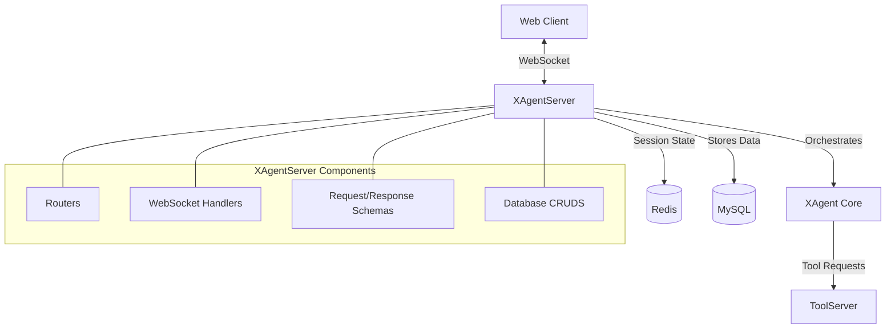
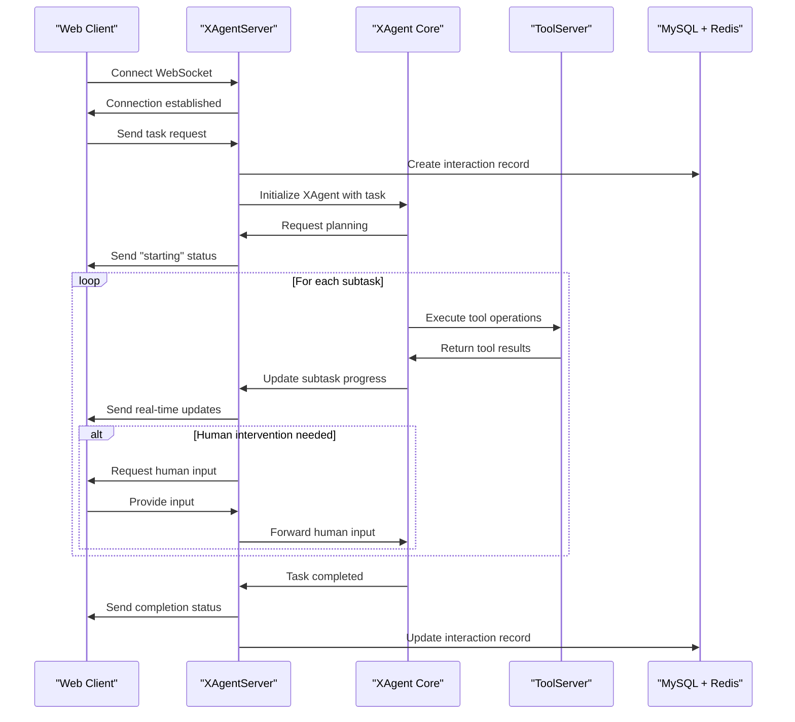
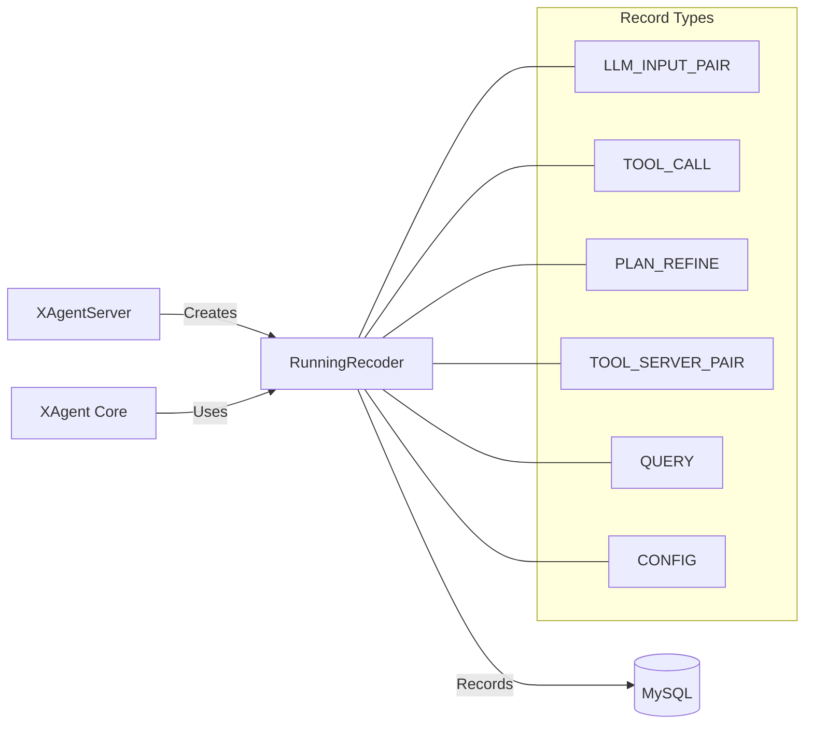
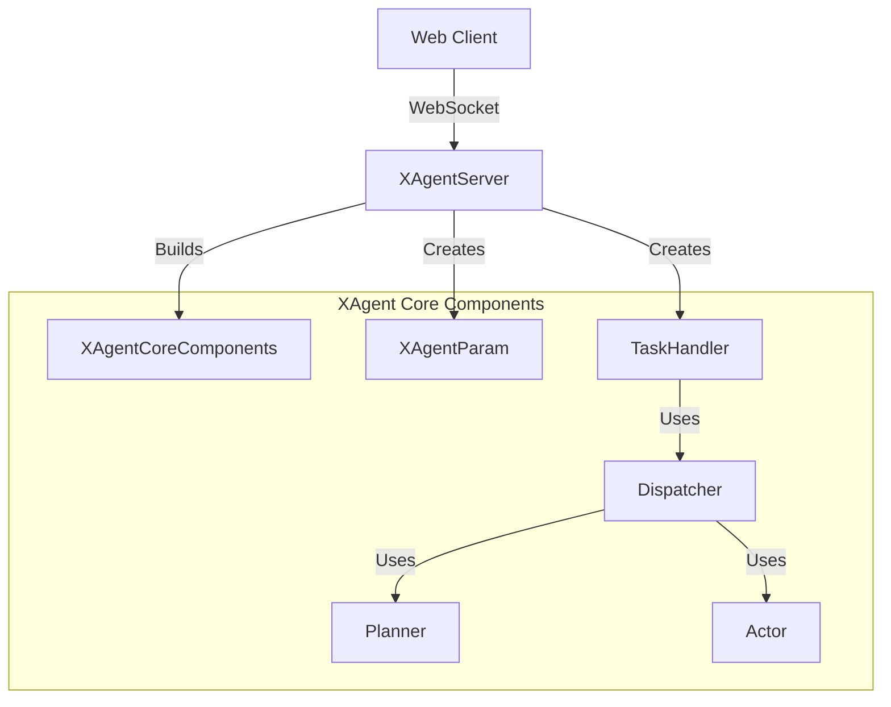

<!-- source: DeepWiki mcp.deepwiki.com · repo OpenBMB/XAgent · page 4 XAgentServer · fetched 2026-10-26 -->

# XAgentServer

Relevant source files

The following files were used as context for generating this wiki page:

- [XAgent/recorder.py](XAgent/recorder.py)
- [XAgentServer/README.md](XAgentServer/README.md)
- [XAgentServer/README_zh.md](XAgentServer/README_zh.md)
- [XAgentServer/database/change/change_desc.sql](XAgentServer/database/change/change_desc.sql)
- [XAgentServer/server.py](XAgentServer/server.py)
- [docker-compose.yml](docker-compose.yml)

XAgentServer is a crucial component in the XAgent system that serves as the bridge between the web interface (XAgentWeb) and the XAgent Core. It provides a communication layer that allows users to interact with the autonomous agent system through a web-based interface. XAgentServer handles WebSocket connections, manages sessions, and orchestrates the execution of tasks by the underlying XAgent Core system.

For information about the core agent system that XAgentServer communicates with, see [XAgent Core](#2).

## 1. Purpose and Functionality

XAgentServer serves several key purposes:

1. **Frontend-Backend Bridge**: Acts as an intermediary between the web frontend (XAgentWeb) and the core XAgent system
2. **WebSocket Communication**: Manages real-time bidirectional communication with clients
3. **Task Orchestration**: Coordinates task execution by the XAgent Core
4. **Session Management**: Maintains user sessions using Redis
5. **Data Persistence**: Stores interaction data in MySQL database
6. **File Handling**: Manages file uploads and transfers them to the appropriate workspaces

Sources:
- [XAgentServer/README.md:1-19]()
- [XAgentServer/server.py:1-24]()

## 2. System Architecture

XAgentServer is built on FastAPI, a modern web framework for Python. It uses WebSocket for long-connection communication services and integrates with Redis for state management and MySQL for data persistence.

### 2.1 Component Overview

Sources:
- [XAgentServer/README.md:24-28]()
- [XAgentServer/README.md:30-51]()
- [docker-compose.yml:43-64]()

### 2.2 Directory Structure

XAgentServer is organized into the following key directories:

| Directory | Purpose |
|-----------|---------|
| application/core | Core configuration files |
| application/cruds | Database operations (Create, Read, Update, Delete) |
| application/routers | FastAPI route definitions |
| application/schemas | Request and response data structures |
| application/websockets | WebSocket communication framework |
| database | Database models and connection handling |
| enums | Enumeration type definitions |
| exts | Extensions and utilities |
| loggers | Logging functionality |
| models | Business module definitions |

Sources:
- [XAgentServer/README.md:30-51]()

## 3. Communication Flow

XAgentServer communicates with clients via WebSocket connections, which allow real-time bidirectional communication. This enables XAgentServer to send continuous updates to the client as the agent works on tasks.

Sources:
- [XAgentServer/server.py:27-109]()
- [XAgentServer/README.md:1-3]()

## 4. Server Implementation

The core of XAgentServer is implemented in the `XAgentServer` class, which handles the interaction between clients and the XAgent Core system.

### 4.1 Core Server Class

The `XAgentServer` class provides the main functionality for handling client requests and orchestrating the XAgent Core system. The key method is `interact()`, which:

1. Receives a task from the client
2. Initializes the XAgent Core with the task parameters
3. Handles file uploads
4. Starts the task execution process
5. Manages the communication back to the client

Sources:
- [XAgentServer/server.py:20-109]()

### 4.2 Task Execution Flow

When a task is received, XAgentServer follows this process:

1. Receives an `XAgentInteraction` object containing task parameters
2. Creates an `XAgentParam` object with the user's query
3. Builds XAgent Core components with the parameters
4. Transfers any uploaded files to the workspace
5. Starts the task handler to execute the task
6. Returns results and updates to the client in real-time

Sources:
- [XAgentServer/server.py:27-109]()

## 5. Database Integration

XAgentServer uses two primary data stores:

1. **MySQL**: For persistent storage of interaction data
2. **Redis**: For session state management

### 5.1 MySQL Integration

MySQL stores interaction records, user data, and task information. The database schema includes tables for:

- Interactions: Records of user interactions with XAgent
- Users: User account information
- Tasks: Task details and status
- Running records: Detailed execution logs

The database operations are handled through SQLAlchemy ORM using CRUD (Create, Read, Update, Delete) operations defined in the application/cruds directory.

Sources:
- [XAgentServer/README.md:24-28]()
- [XAgentServer/database/change/change_desc.sql:1-4]()
- [docker-compose.yml:66-84]()
- [XAgent/recorder.py:18-346]()

### 5.2 Redis Integration

Redis is used for managing session state and caching. It provides:

- Fast access to session data
- Temporary storage for intermediate results
- State management for long-running tasks

Sources:
- [docker-compose.yml:85-94]()
- [XAgentServer/README.md:12-17]()

## 6. Recording System

XAgentServer includes a comprehensive recording system that tracks all aspects of task execution. This is implemented through the `RunningRecoder` class, which:

1. Records all LLM interactions
2. Tracks tool calls and their results
3. Maintains a record of the planning process
4. Logs query and configuration information

Sources:
- [XAgent/recorder.py:48-346]()

## 7. Deployment

XAgentServer can be deployed using Docker and docker-compose. The docker-compose configuration specifies:

1. The XAgentServer container
2. Dependencies on MySQL and Redis
3. Volume mounts for persistent storage
4. Network configuration
5. Environment variables

A typical deployment will involve starting the XAgentServer, MySQL, and Redis services using docker-compose, then starting the nginx service within the XAgentServer container to serve the frontend.

Sources:
- [docker-compose.yml:43-64]()
- [XAgentServer/README.md:53-69]()

## 8. Using XAgentServer

After deployment, users can access the XAgentServer frontend by visiting http://localhost:5173 in a web browser. The system provides:

1. A login interface with default credentials (Guest/xagent)
2. A playground interface for interacting with XAgent
3. Real-time updates as the agent works on tasks
4. File upload and management capabilities

Sources:
- [XAgentServer/README.md:70-79]()

## 9. Integration with XAgent Core

XAgentServer integrates with XAgent Core through the `interact` method, which:

1. Creates an `XAgentParam` object with the user's query
2. Builds the XAgent Core components
3. Transfers any uploaded files to the workspace
4. Starts the task handler to execute the task

This integration allows XAgentServer to orchestrate the XAgent Core system while maintaining a clean separation of concerns.

Sources:
- [XAgentServer/server.py:27-109]()

## Summary

XAgentServer is a critical component in the XAgent ecosystem, providing the communication layer between the web interface and the core agent system. It handles WebSocket connections, manages sessions, orchestrates task execution, and records all interactions for later analysis. By using FastAPI, Redis, and MySQL, it provides a robust and scalable platform for users to interact with the autonomous agent system.

---

