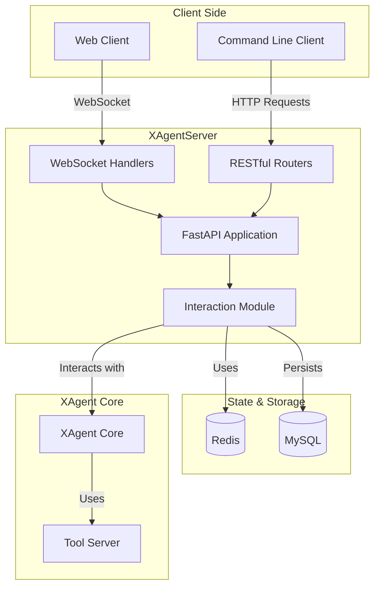
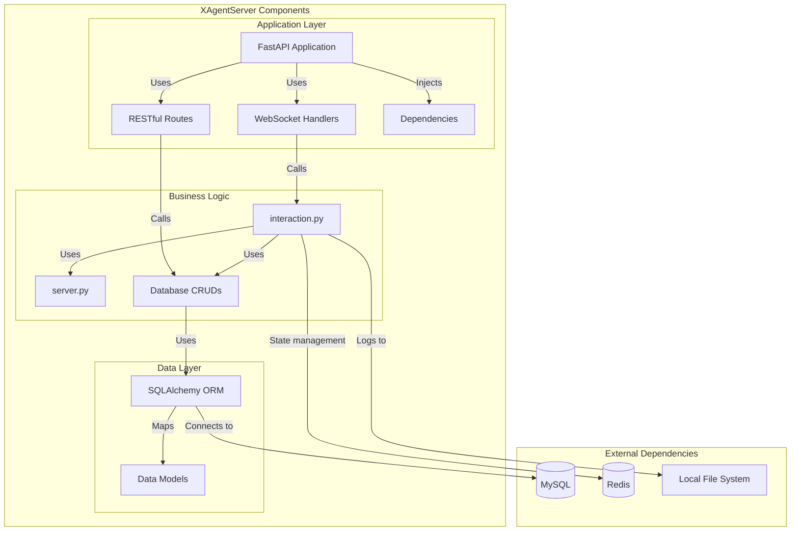
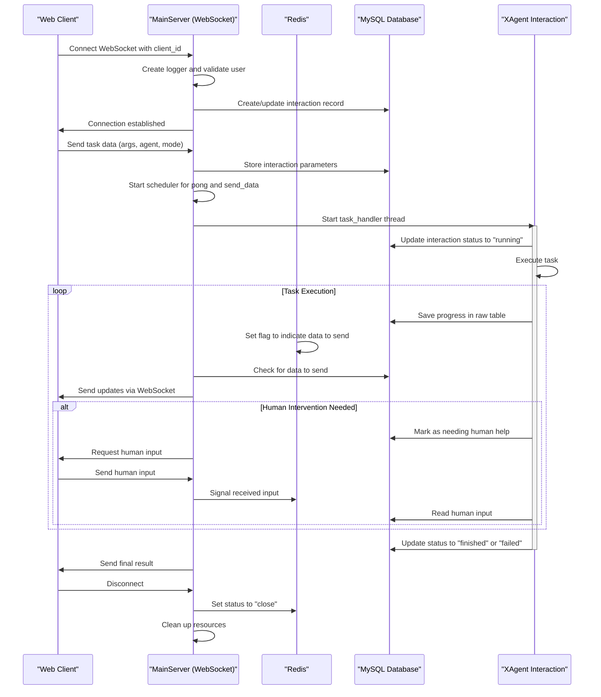
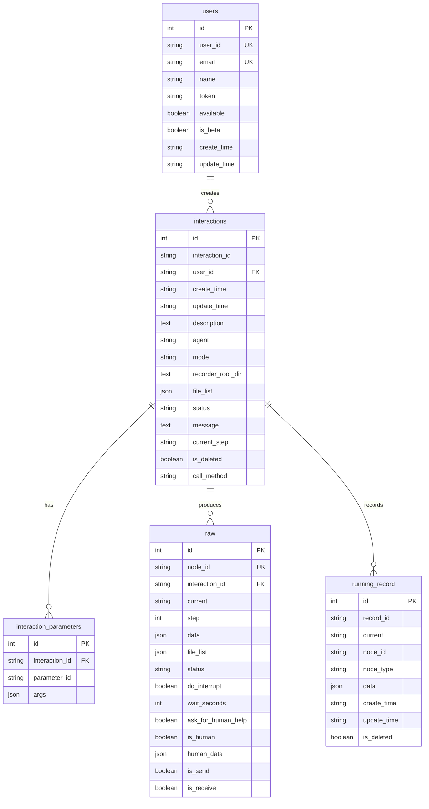
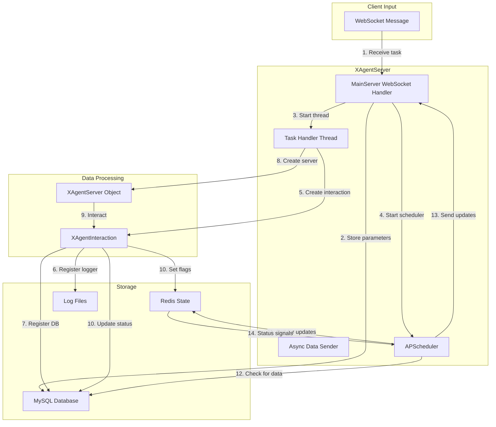
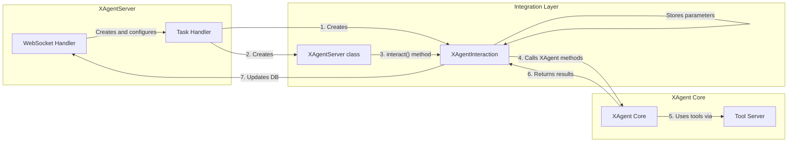
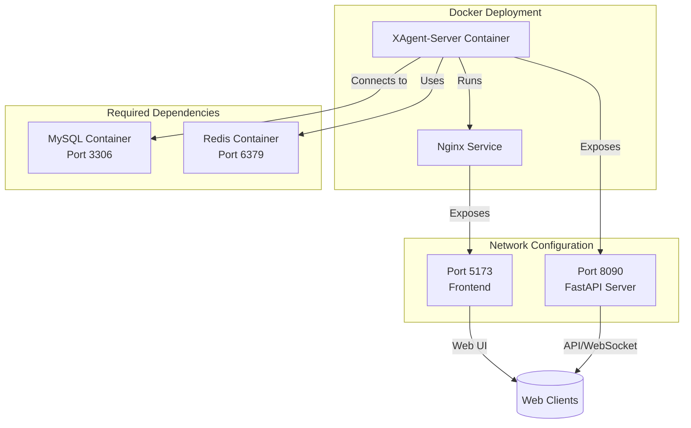
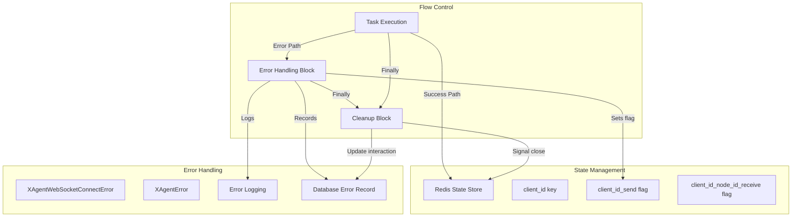

<!-- source: DeepWiki mcp.deepwiki.com · repo OpenBMB/XAgent · page 4.1 Server Architecture · fetched 2026-10-26 -->

# Server Architecture

Relevant source files

The following files were used as context for generating this wiki page:

- [XAgentServer/README.md](XAgentServer/README.md)
- [XAgentServer/README_zh.md](XAgentServer/README_zh.md)
- [XAgentServer/application/websockets/base.py](XAgentServer/application/websockets/base.py)
- [XAgentServer/database/change/change_desc.sql](XAgentServer/database/change/change_desc.sql)
- [XAgentServer/database/models.py](XAgentServer/database/models.py)
- [XAgentServer/database/sql/create_mysql_table.sql](XAgentServer/database/sql/create_mysql_table.sql)

This document describes the architecture of the XAgentServer component, which serves as the communication layer between clients and the XAgent Core system. XAgentServer provides WebSocket connections for real-time interaction with XAgent while handling data persistence, state management, and client communication.

For information about WebSocket communication protocols and message formats, see [WebSocket Interface](#4.2). For details about database integration, see [Database Integration](#4.3).

## Overview

XAgentServer is built using FastAPI as the web framework and provides a WebSocket-based communication channel with essential RESTful APIs for auxiliary operations. It serves as the bridge between the user interfaces (like XAgentWeb) and the XAgent Core system.

Sources:
- [XAgentServer/README.md:24-28]()
- [XAgentServer/README.md:30-49]()
- [XAgentServer/application/websockets/base.py:1-20]()

## Key Components

The XAgentServer is organized into several key components:

### Application Layer

The application layer contains the core FastAPI application and includes:

1. **Core Configuration** - Basic settings and environment variables
2. **Routers** - FastAPI route handlers for HTTP endpoints
3. **WebSockets** - WebSocket handlers for real-time communication
4. **CRUDs** - Database operations for interactions, users, etc.
5. **Schemas** - Request and response data models

### Communication Layer

The communication layer is primarily WebSocket-based, allowing for bidirectional communication between the client and server:

1. **WebSocket Server** - Handles client connections and messages
2. **Task Handler** - Processes client requests in a separate thread
3. **Data Sender** - Sends updates to clients asynchronously

### Data Persistence Layer

XAgentServer uses several technologies for data storage and state management:

1. **MySQL Database** - Stores interaction data, user information, etc.
2. **Redis** - Manages the state of ongoing interactions
3. **Local Storage** - Stores interaction logs and files

Sources:
- [XAgentServer/README.md:30-49]()
- [XAgentServer/application/websockets/base.py:69-81]()

## WebSocket Communication Flow

The WebSocket server is the primary means of communication with clients. The main class `MainServer` extends `WebSocketEndpoint` and handles connections, message receiving, and task execution.

Sources:
- [XAgentServer/application/websockets/base.py:81-126]()
- [XAgentServer/application/websockets/base.py:283-337]()
- [XAgentServer/application/websockets/base.py:338-389]()

## Database Schema

XAgentServer uses MySQL for data persistence with several key tables. The database schema is designed to support the stateful nature of agent interactions and user management.

### Core Tables

Sources:
- [XAgentServer/database/sql/create_mysql_table.sql:28-138]()
- [XAgentServer/database/models.py:6-138]()

## Data Flow Architecture

The data flow in XAgentServer involves multiple components communicating with each other to handle user interactions with XAgent.

Sources:
- [XAgentServer/application/websockets/base.py:206-281]()
- [XAgentServer/application/websockets/base.py:344-389]()

## Server Integration with XAgent Core

XAgentServer integrates with XAgent Core through the `interaction.py` module, which serves as the bridge between the server and the agent system.

Sources:
- [XAgentServer/application/websockets/base.py:283-325]()
- [XAgentServer/README.md:24-28]()

## Deployment Configuration

XAgentServer is designed to be deployed using Docker, with configurations for service dependencies and networking.

Sources:
- [XAgentServer/README.md:5-17]()
- [XAgentServer/README.md:53-67]()

## Component Directory Structure

XAgentServer has a well-organized directory structure that separates different concerns:

| Directory | Purpose |
|-----------|---------|
| `application/core` | Core configuration files |
| `application/cruds` | Database CRUD operations |
| `application/routers` | FastAPI route definitions |
| `application/schemas` | Request/response schemas |
| `application/websockets` | WebSocket handlers |
| `database` | Database connection and models |
| `enums` | Enumeration types |
| `exts` | Extensions and utilities |
| `loggers` | Logging configuration |
| `models` | Business model definitions |
| `dockerfiles` | Docker build files |

Sources:
- [XAgentServer/README.md:30-49]()
- [XAgentServer/README_zh.md:31-51]()

## Error Handling and State Management

XAgentServer implements robust error handling and state management to maintain system integrity during interactions.

Sources:
- [XAgentServer/application/websockets/base.py:81-125]()
- [XAgentServer/application/websockets/base.py:325-337]()

---

