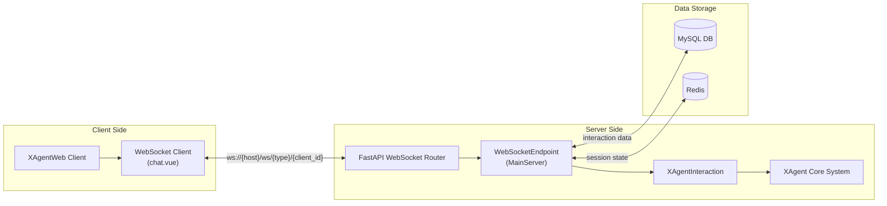
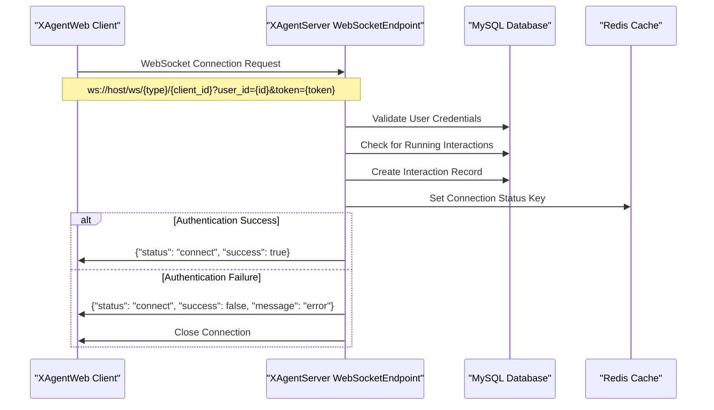
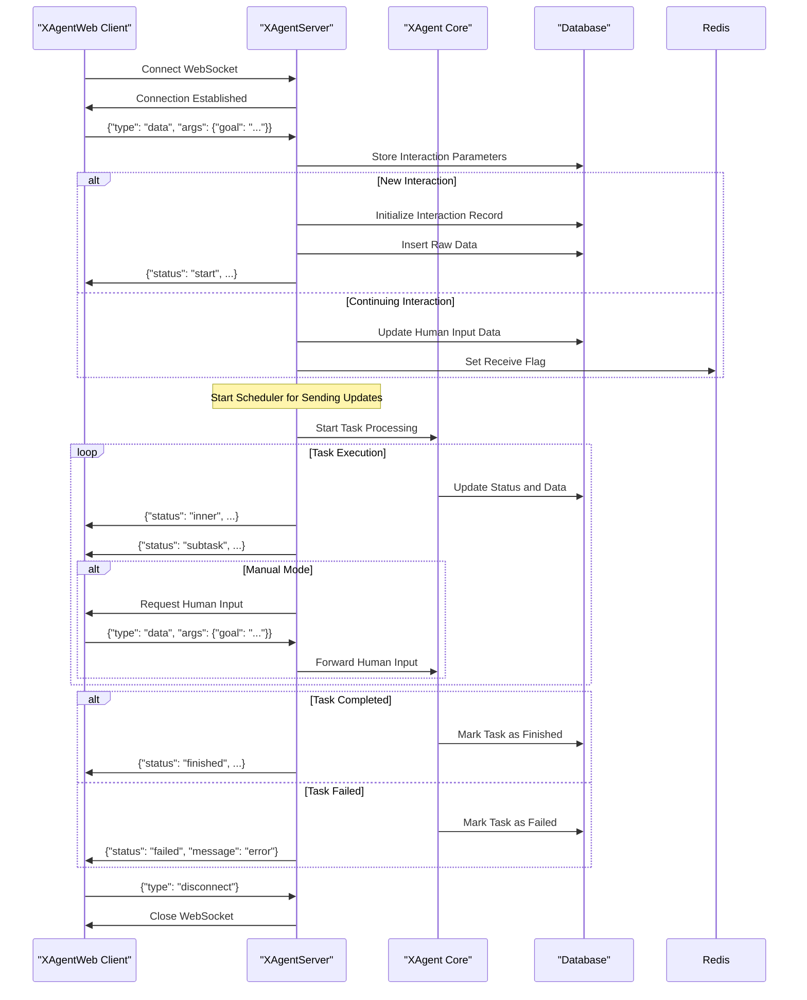
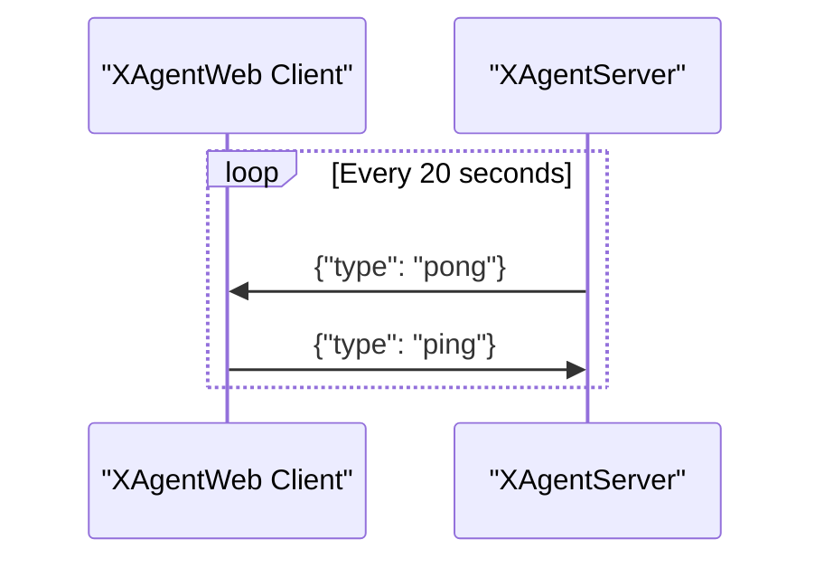
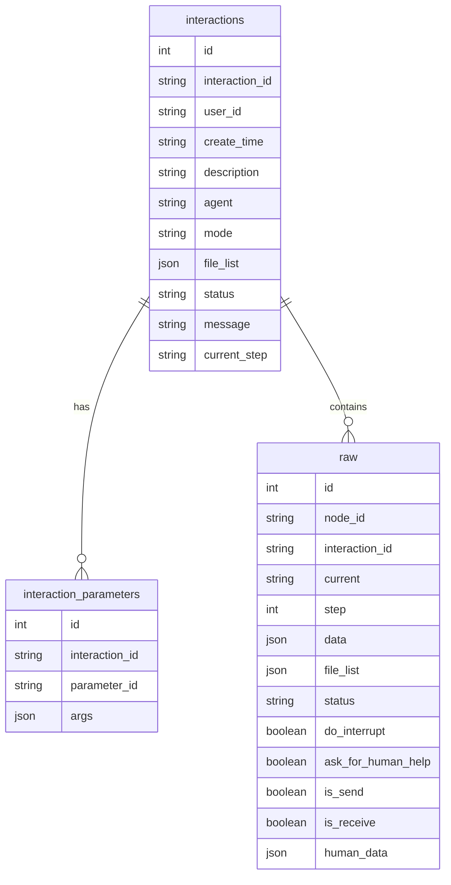

<!-- source: DeepWiki mcp.deepwiki.com · repo OpenBMB/XAgent · page 4.2 WebSocket Interface · fetched 2026-10-26 -->

# WebSocket Interface

<details>
<summary>Relevant source files</summary>

The following files were used as context for generating this wiki page:

- [XAgentServer/application/websockets/base.py](XAgentServer/application/websockets/base.py)
- [XAgentServer/database/models.py](XAgentServer/database/models.py)
- [XAgentServer/database/sql/create_mysql_table.sql](XAgentServer/database/sql/create_mysql_table.sql)
- [XAgentWeb/src/views/playground/chat.vue](XAgentWeb/src/views/playground/chat.vue)
- [XAgentWeb/vite.config.ts](XAgentWeb/vite.config.ts)

</details>


This page documents the WebSocket interface in XAgent, which provides real-time bidirectional communication between the XAgentWeb frontend and the XAgentServer backend. The WebSocket interface allows clients to send task requests, receive execution updates, and interact with the autonomous agent system as tasks are processed.

For information about the overall XAgentServer architecture, see [Server Architecture](#4.1).

## WebSocket Connection Architecture

The WebSocket interface connects the client (XAgentWeb) and server (XAgentServer) components, enabling real-time updates during task execution by XAgent Core.



Sources: [XAgentServer/application/websockets/base.py:56-410](), [XAgentWeb/src/views/playground/chat.vue:232-481]()

## WebSocket Connection Types

XAgent supports four types of WebSocket connections based on the interaction mode:

| Connection Type | WebSocket Path | Purpose |
|----------------|---------------|---------|
| New Talk | `/ws/base/{client_id}` | Start a new task with XAgent |
| Playback | `/ws/replay/{client_id}` | Replay a previously executed task |
| Recorder | `/ws/recorder/{client_id}` | Replay a recorded interaction |
| Shared Task | `/ws/share/{client_id}` | Run a task shared by another user |

The `client_id` is a unique identifier for the interaction, and each connection type follows a specific protocol for data exchange.

Sources: [XAgentWeb/src/views/playground/chat.vue:240-245](), [XAgentServer/application/websockets/base.py:56]()

## WebSocket Connection Establishment

The following diagram shows the WebSocket connection establishment process:



Sources: [XAgentServer/application/websockets/base.py:126-192](), [XAgentWeb/src/views/playground/chat.vue:413-457]()

## WebSocket Message Protocol

### Client to Server Messages

Messages sent from the client to the server follow this structure:

```json
{
  "type": "data|ping|disconnect|connect",
  "args": {
    "goal": "Task description or user input"
  },
  "agent": "agent_name",
  "mode": "auto|manual",
  "file_list": [],
  "node_id": "optional_node_id"
}
```

Key fields:
- `type`: Message type (data, ping, disconnect, connect)
- `args`: Task parameters including the goal
- `agent`: Agent type to use (if applicable)
- `mode`: Execution mode (auto or manual)
- `file_list`: List of uploaded files for the task
- `node_id`: Optional ID for specific node responses

Sources: [XAgentWeb/src/views/playground/chat.vue:414-434](), [XAgentServer/application/websockets/base.py:206-270]()

### Server to Client Messages

Messages sent from the server to the client follow this structure:

```json
{
  "status": "connect|start|inner|subtask_submit|refinement|subtask|finished|failed|pong",
  "success": true,
  "message": "Status message",
  "data": {},
  "current": "current_step",
  "node_id": "node_id",
  "workspace_file_list": []
}
```

Key fields:
- `status`: Current status of the task execution
- `success`: Whether the operation was successful
- `message`: Descriptive message about the status
- `data`: Detailed data about the current step
- `current`: Current execution step
- `node_id`: ID of the current node
- `workspace_file_list`: List of files in the workspace

Sources: [XAgentServer/application/websockets/base.py:368-376](), [XAgentWeb/src/views/playground/chat.vue:334-410]()

## WebSocket Message Flow

The communication flow between the client and server during task execution:



Sources: [XAgentServer/application/websockets/base.py:206-270](), [XAgentServer/application/websockets/base.py:344-390](), [XAgentWeb/src/views/playground/chat.vue:334-410]()

## WebSocket Connection Management

### Ping/Pong Mechanism

The WebSocket connection implements a ping/pong mechanism to keep the connection alive:

1. The server sends a pong message every 20 seconds
2. The client responds with a ping message
3. This prevents the connection from timing out



Sources: [XAgentServer/application/websockets/base.py:338-342](), [XAgentWeb/src/views/playground/chat.vue:354-356]()

### Error Handling

The WebSocket interface includes error handling to manage various failure scenarios:

1. **Authentication Failures**: If user authentication fails, the server sends an error message and closes the connection
2. **Task Execution Failures**: If the task execution fails, the server sends a "failed" status with an error message
3. **Connection Errors**: Client-side connection errors are handled with appropriate UI feedback
4. **Disconnections**: If the client disconnects, the server cleans up resources and marks the interaction as closed

Sources: [XAgentServer/application/websockets/base.py:173-185](), [XAgentWeb/src/views/playground/chat.vue:343-352]()

## Database Integration

The WebSocket interface interacts with several database tables to persist interaction data:



The `interactions` table stores the main interaction metadata, `interaction_parameters` stores the task parameters, and `raw` stores the detailed execution data with step-by-step updates.

Sources: [XAgentServer/database/sql/create_mysql_table.sql:29-88](), [XAgentServer/database/models.py:25-115]()

## Redis State Management

Redis is used to manage the WebSocket connection state and synchronize data between the WebSocket handler and the task execution thread:

1. **Connection Status**: Redis stores the connection status using the key `{client_id}`
2. **Send Flags**: Redis sets `{client_id}_send` when there is data to be sent to the client
3. **Receive Flags**: Redis sets `{client_id}_{node_id}_receive` when data is received from the client
4. **Scheduler Coordination**: The WebSocket handler checks Redis flags to determine what data to send

Sources: [XAgentServer/application/websockets/base.py:92-124](), [XAgentServer/application/websockets/base.py:348-389]()

## Client-Side Implementation

The client-side WebSocket implementation is in the `chat.vue` component of XAgentWeb. Key components include:

1. **Connection Management**: Establishing and maintaining WebSocket connections
2. **Message Handling**: Processing messages from the server and updating the UI
3. **Task Control**: Sending commands to control task execution
4. **Mode Support**: Supporting different interaction modes (auto/manual)
5. **UI Updates**: Updating the UI based on task progress

Sources: [XAgentWeb/src/views/playground/chat.vue:232-481]()

## Server-Side Implementation

The server-side WebSocket implementation is in the `MainServer` class in `base.py`. Key components include:

1. **Connection Handling**: Accepting and validating connections
2. **Message Processing**: Processing client messages and updating the interaction state
3. **Task Execution**: Running XAgent tasks in separate threads
4. **Data Sending**: Sending task updates to the client
5. **State Management**: Managing interaction state using Redis and the database

Sources: [XAgentServer/application/websockets/base.py:57-390]()

## Proxy Configuration

For production deployments, the WebSocket connections are typically proxied through the web server. The Vite development server includes proxy configuration to forward WebSocket connections:

```javascript
server: {
  proxy: {
    '/api': {
      target: loadEnv(mode, process.cwd()).VITE_BACKEND_URL,
      changeOrigin: true,
      rewrite: (path) => path.replace(/\/api/, ''),
    },
    '/workspace': {
      target: loadEnv(mode, process.cwd()).VITE_BACKEND_URL,
      changeOrigin: true
    },
  },
}
```

Sources: [XAgentWeb/vite.config.ts:62-74]()

This configuration ensures that WebSocket connections from the web client are correctly routed to the XAgentServer backend.

---

