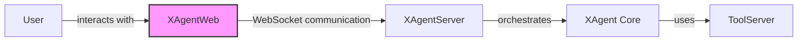
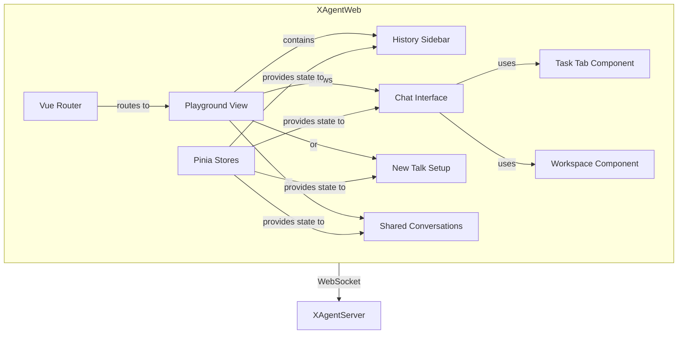
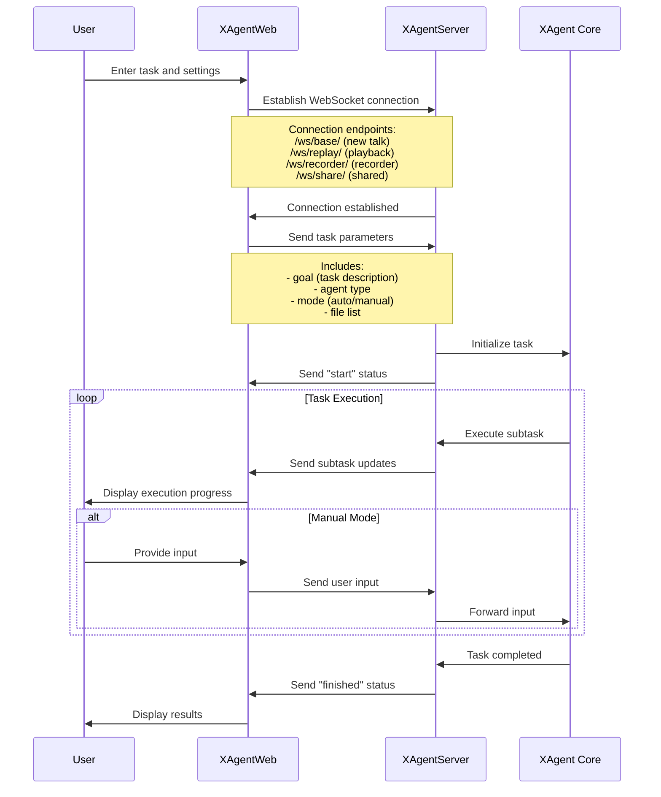
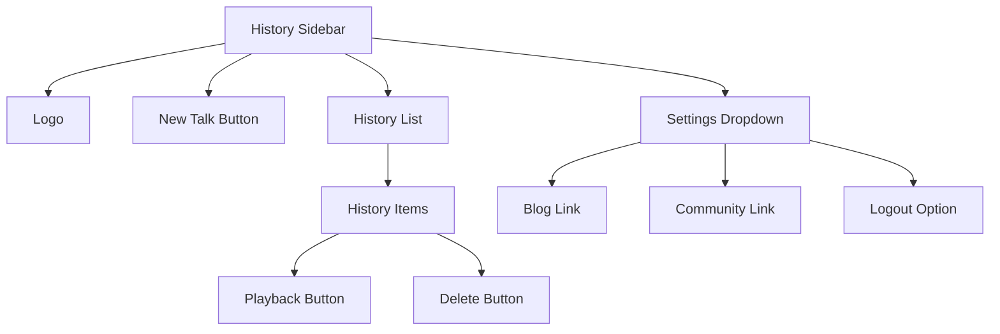
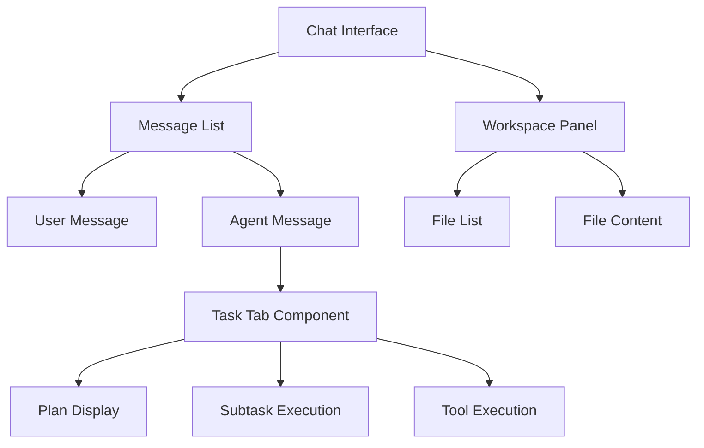
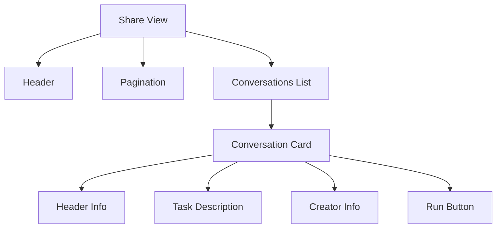

<!-- source: DeepWiki mcp.deepwiki.com · repo OpenBMB/XAgent · page 5 XAgentWeb · fetched 2026-10-26 -->

# XAgentWeb

Relevant source files

The following files were used as context for generating this wiki page:

- [XAgentWeb/src/views/playground/chat.vue](XAgentWeb/src/views/playground/chat.vue)
- [XAgentWeb/src/views/playground/components/HistorySidebar.vue](XAgentWeb/src/views/playground/components/HistorySidebar.vue)
- [XAgentWeb/src/views/playground/index.vue](XAgentWeb/src/views/playground/index.vue)
- [XAgentWeb/src/views/playground/share.vue](XAgentWeb/src/views/playground/share.vue)
- [XAgentWeb/vite.config.ts](XAgentWeb/vite.config.ts)

XAgentWeb is the web-based user interface component of the XAgent system, providing a user-friendly way to interact with the autonomous agent capabilities. It serves as the frontend application that communicates with XAgentServer via WebSockets to execute tasks, manage files, and display agent interactions.

For information about the server component that XAgentWeb communicates with, see [XAgentServer](#4).

## Architecture Overview

XAgentWeb is built using Vue.js, with Vite as the build tool. It follows a component-based architecture with central state management using Pinia stores.

### Position in XAgent Ecosystem

Sources: [XAgentWeb/vite.config.ts:1-94]()

### Component Architecture

Sources: [XAgentWeb/src/views/playground/chat.vue:1-847](), [XAgentWeb/src/views/playground/components/HistorySidebar.vue:1-598](), [XAgentWeb/src/views/playground/index.vue:1-139]()

## WebSocket Communication

XAgentWeb communicates with XAgentServer via WebSockets, which enable real-time communication and updates during task execution.

### WebSocket Connection Flow

Sources: [XAgentWeb/src/views/playground/chat.vue:231-511]()

### WebSocket Message Handling

The WebSocket communication is managed in the chat component, which handles various message types:

1. **Connection Messages**:
   - `connect`: Initializes the connection
   - `ping`/`pong`: Keeps connection alive

2. **Task Status Messages**:
   - `start`: Task initialization
   - `inner`: Inner node execution
   - `subtask_submit`: Submitting subtask results
   - `refinement`: Task refinement
   - `subtask`: Next subtask execution
   - `finished`: Task completion
   - `failed`: Task failure

3. **Workspace Messages**:
   - File list updates
   - Node ID updates

Sources: [XAgentWeb/src/views/playground/chat.vue:333-411]()

## User Interface Components

XAgentWeb provides several key interface components for interacting with the XAgent system.

### Main Layout

The main layout consists of:

1. History sidebar (left)
2. Main content area (center)
3. Input/workspace area (bottom)

Each area serves a specific purpose in facilitating user interaction with the agent.

Sources: [XAgentWeb/src/views/playground/chat.vue:1-51](), [XAgentWeb/src/views/playground/components/HistorySidebar.vue:1-147]()

### History Sidebar

The history sidebar displays previous conversations and provides navigation options:

The sidebar provides:
- Creation of new conversations
- Access to conversation history
- Playback of previous conversations
- Account and system settings

Sources: [XAgentWeb/src/views/playground/components/HistorySidebar.vue:1-147]()

### Chat Interface

The chat interface displays the conversation between the user and XAgent:

The chat interface includes:
- User messages
- Agent responses
- Task execution display
- Workspace file management

Sources: [XAgentWeb/src/views/playground/chat.vue:1-51](), [XAgentWeb/src/views/playground/chat.vue:51-84]()

## Task Execution Modes

XAgentWeb supports several task execution modes:

| Mode | Description | WebSocket Endpoint |
|------|-------------|-------------------|
| New Talk | Starting a new conversation | `/ws/base/` |
| Playback | Replaying a previous conversation | `/ws/replay/` |
| Recorder | Recording a conversation | `/ws/recorder/` |
| Shared | Running a shared conversation | `/ws/share/` |

Each mode follows a different initialization process but uses the same underlying WebSocket communication protocol.

### Auto vs. Manual Mode

XAgentWeb supports two execution modes:
- **Auto Mode**: The agent executes the entire task automatically
- **Manual Mode**: The user must approve each subtask execution

The mode is selected during task configuration and affects how the task is executed.

Sources: [XAgentWeb/src/views/playground/chat.vue:213-225](), [XAgentWeb/src/views/playground/index.vue:26-42]()

## Workspace Integration

XAgentWeb includes a workspace panel for managing files:

1. **File Upload**: Users can upload files to be used by the agent
2. **File Management**: Files can be viewed and managed in the workspace panel
3. **File List**: The agent can access and modify workspace files

The workspace is collapsed by default but can be expanded to view and manage files.

Sources: [XAgentWeb/src/views/playground/chat.vue:51-84](), [XAgentWeb/src/views/playground/index.vue:1-15]()

## Community Features

XAgentWeb includes features for community interaction:

### Shared Conversations

The share view displays conversations shared by community members:

Users can:
- Browse shared conversations
- View conversation details
- Run shared conversations

Sources: [XAgentWeb/src/views/playground/share.vue:1-461]()

## Technical Implementation

### State Management

XAgentWeb uses Pinia stores for state management:

1. **TaskStore**: Manages task execution state
2. **ConfigStore**: Manages configuration settings
3. **HistoryTalkStore**: Manages conversation history
4. **UserStore**: Manages user information

Stores provide centralized state management for components.

Sources: [XAgentWeb/src/views/playground/chat.vue:100-104](), [XAgentWeb/src/views/playground/components/HistorySidebar.vue:162-166]()

### Build Configuration

XAgentWeb uses Vite as the build tool with the following configuration:

- Vue plugin for Vue components
- React plugin for React components
- Auto-import for Vue components
- Element Plus UI library
- Icon resolver for icons
- HTML plugin for HTML generation
- Proxy configuration for API requests

The build process is optimized for production with minification and compression.

Sources: [XAgentWeb/vite.config.ts:1-94]()

## API Integration

XAgentWeb communicates with the backend API through:

1. **WebSocket**: For real-time communication during task execution
2. **HTTP API**: For user authentication, history management, and file operations

API endpoints include:
- User authentication
- Conversation history retrieval
- File management
- Shared conversations

The backend URL is configured in the environment variables and used for API requests.

Sources: [XAgentWeb/vite.config.ts:62-73](), [XAgentWeb/src/views/playground/chat.vue:234-238]()

---

