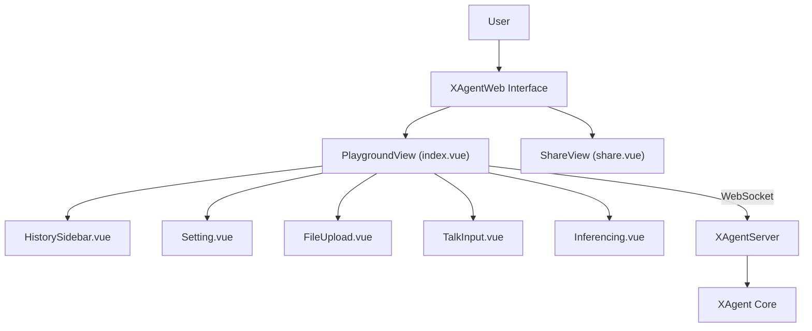
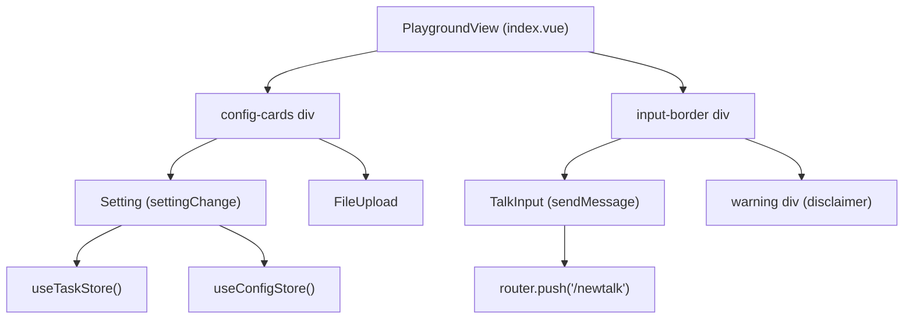
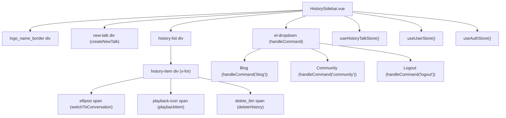
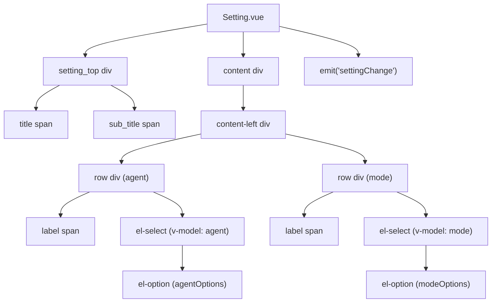
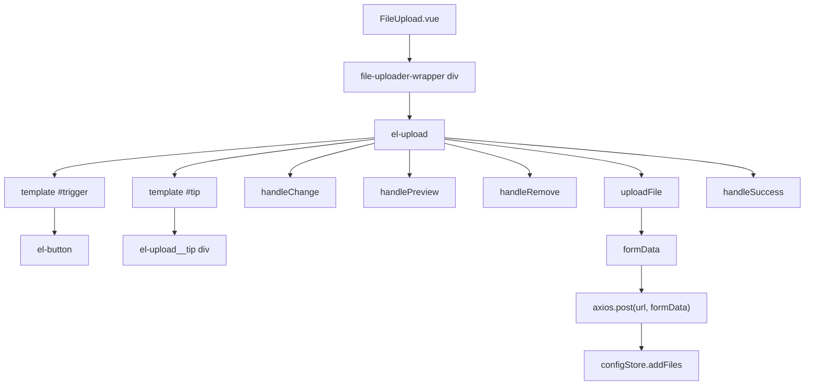
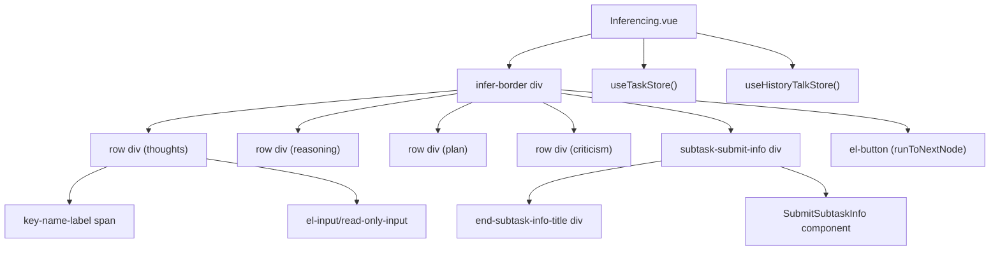
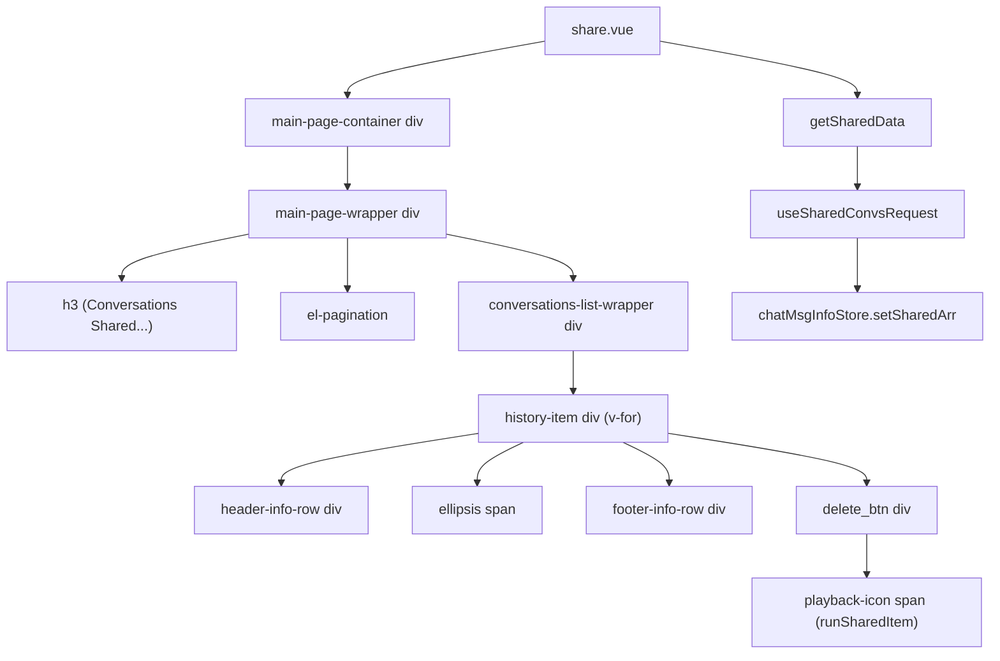
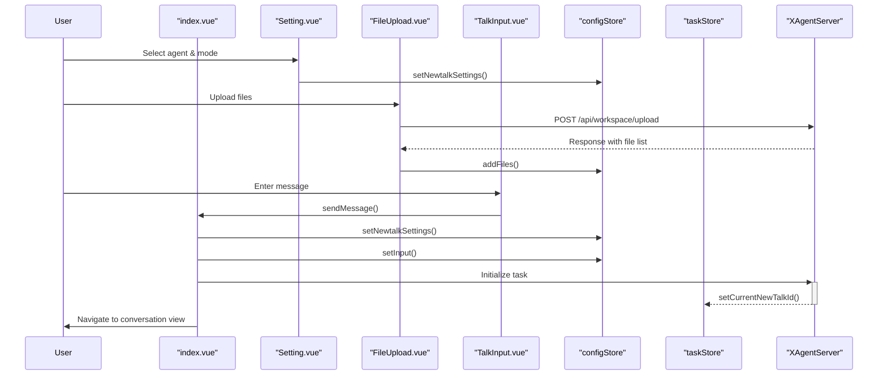
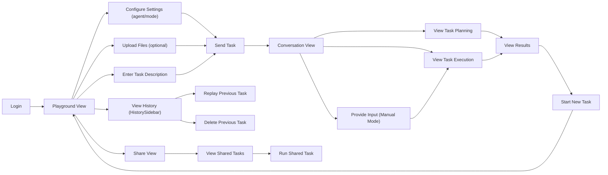

<!-- source: DeepWiki mcp.deepwiki.com · repo OpenBMB/XAgent · page 5.1 User Interface Components · fetched 2026-10-26 -->

# User Interface Components

Relevant source files

The following files were used as context for generating this wiki page:

- [XAgentWeb/README.md](XAgentWeb/README.md)
- [XAgentWeb/package.json](XAgentWeb/package.json)
- [XAgentWeb/src/views/playground/components/FileUpload.vue](XAgentWeb/src/views/playground/components/FileUpload.vue)
- [XAgentWeb/src/views/playground/components/HistorySidebar.vue](XAgentWeb/src/views/playground/components/HistorySidebar.vue)
- [XAgentWeb/src/views/playground/components/Inferencing.vue](XAgentWeb/src/views/playground/components/Inferencing.vue)
- [XAgentWeb/src/views/playground/components/Setting.vue](XAgentWeb/src/views/playground/components/Setting.vue)
- [XAgentWeb/src/views/playground/index.vue](XAgentWeb/src/views/playground/index.vue)
- [XAgentWeb/src/views/playground/share.vue](XAgentWeb/src/views/playground/share.vue)

This page documents the user interface components of XAgentWeb, the web frontend for the XAgent system. XAgentWeb provides a browser-based interface for users to interact with XAgent, configure settings, upload files, and view task execution progress. For information about WebSocket communication with the server, see [WebSocket Interface](#4.2).

## Overview of XAgentWeb Architecture

XAgentWeb is built using Vue.js and communicates with XAgentServer via WebSockets. The interface consists of several key components that work together to provide a cohesive user experience.

Sources: [XAgentWeb/src/views/playground/index.vue:1-138](), [XAgentWeb/src/views/playground/components/HistorySidebar.vue:1-597](), [XAgentWeb/src/views/playground/components/FileUpload.vue:1-203](), [XAgentWeb/src/views/playground/components/Setting.vue:1-302](), [XAgentWeb/src/views/playground/components/Inferencing.vue:1-354](), [XAgentWeb/src/views/playground/share.vue:1-460]()

## Main View Components

### Playground View

The Playground view (`index.vue`) is the main interface where users interact with XAgent. It organizes the various UI components and handles their interactions.

The Playground view:
- Imports and renders Setting, FileUpload, and TalkInput components
- Manages task configuration through the `settingChange` method
- Initializes chat preparation via the `useInitChatPreparation` API call
- Handles message sending with validation through the `sendMessage` method
- Routes to the actual conversation view upon sending a valid message

Sources: [XAgentWeb/src/views/playground/index.vue:1-138]()

### History Sidebar

The History Sidebar (`HistorySidebar.vue`) displays past conversations and provides navigation and management functions.

The History Sidebar:
- Displays the XAgent logo and a "New Talk" button
- Lists previous conversations with playback and delete options
- Provides a settings dropdown with links to blog, community, and logout option
- Fetches conversation history via the `queryHistoryData` method and `useHistoryListRequest` API call

Sources: [XAgentWeb/src/views/playground/components/HistorySidebar.vue:1-597]()

### Setting Component

The Setting component (`Setting.vue`) allows users to configure agent parameters before starting a conversation.

The Setting component:
- Displays a title and subtitle
- Provides dropdowns to select an agent (currently only "XAgent" option)
- Provides mode selection (Auto or Manual)
- Emits a `settingChange` event whenever settings are updated
- Uses the Vue.js `watchEffect` function to monitor changes

Sources: [XAgentWeb/src/views/playground/components/Setting.vue:1-302]()

### File Upload Component

The FileUpload component (`FileUpload.vue`) enables users to upload files for processing by the agent.

The FileUpload component:
- Provides a file upload button with Element Plus `el-upload` component
- Supports multiple file formats (.txt, .pdf, .doc, .docx, .xls, .xlsx, .ppt, .pptx, .png, .jpeg, .gif, .py, .zip)
- Limits uploads to 5 files of up to 1MB each
- Handles file validation, upload, removal, and preview
- Uses axios to send files to the server via POST request
- Updates the config store with uploaded files

Sources: [XAgentWeb/src/views/playground/components/FileUpload.vue:1-203]()

### Inferencing Component

The Inferencing component (`Inferencing.vue`) displays the agent's thinking process during task execution.

The Inferencing component:
- Displays the agent's thoughts, reasoning, plan, and criticism
- Shows tools being used by the agent
- Provides a RUN button in manual mode to proceed to the next step
- Allows editing of the agent's thoughts in manual mode
- Emits events to coordinate with other components

Sources: [XAgentWeb/src/views/playground/components/Inferencing.vue:1-354]()

### Share View

The Share view (`share.vue`) displays conversations shared by the community.

The Share view:
- Displays a grid of conversations shared by the community
- Shows agent/mode information, conversation goal, and creator
- Provides a playback button to view shared conversations
- Includes pagination for navigating through shared conversations
- Fetches shared conversations via the `getSharedData` method and `useSharedConvsRequest` API call

Sources: [XAgentWeb/src/views/playground/share.vue:1-460]()

## State Management and Data Flow

XAgentWeb uses Vue.js stores to manage application state across components. Key stores include:

- `userStore`: Manages user information
- `authStore`: Handles authentication state
- `historyTalkStore`: Manages conversation history
- `taskStore`: Tracks current task execution
- `configStore`: Stores configuration settings

The data flow in XAgentWeb follows these general steps:

1. User configures agent settings (agent type and mode)
2. User optionally uploads files for processing
3. User enters a task description or message
4. The application sends the configuration, files, and message to XAgentServer
5. XAgentServer processes the task and returns results
6. Results are displayed to the user through the conversation view

Sources: [XAgentWeb/src/views/playground/index.vue:25-52](), [XAgentWeb/src/views/playground/components/FileUpload.vue:88-132](), [XAgentWeb/src/views/playground/components/Setting.vue:165-173]()

## Component Dependency Table

The following table shows the dependencies between XAgentWeb components:

| Component | Dependencies | Stores Used |
|-----------|--------------|------------|
| `index.vue` (Playground) | Setting, FileUpload, TalkInput | taskStore, configStore |
| `HistorySidebar.vue` | ElMessage, ElMessageBox | userStore, authStore, historyTalkStore |
| `Setting.vue` | ElSelect, ElOption | none |
| `FileUpload.vue` | ElUpload, ElButton, ElMessage | configStore, userStore |
| `Inferencing.vue` | ModalInfo, ElMessage, SubmitSubtaskInfo | historyTalkStore, taskStore |
| `share.vue` | ElPagination, ElSkeleton, ElMessage | userStore, historyTalkStore |

Sources: [XAgentWeb/package.json:11-36]()

## User Interaction Flow

The following diagram illustrates the typical user interaction flow through the XAgentWeb interface:

Sources: [XAgentWeb/src/views/playground/index.vue:57-88](), [XAgentWeb/src/views/playground/components/HistorySidebar.vue:173-252](), [XAgentWeb/src/views/playground/share.vue:99-106]()

## Summary

XAgentWeb provides a comprehensive user interface for interacting with the XAgent system. Its components enable users to configure agents, upload files, send tasks, and view execution progress. The UI is designed to be intuitive while providing access to the powerful capabilities of XAgent.

For information about how XAgentWeb communicates with XAgentServer, see [WebSocket Interface](#4.2). For details on file management in the web interface, see [File Upload and Management](#5.5).

---

