<!-- source: DeepWiki mcp.deepwiki.com · repo OpenBMB/XAgent · page 5.2 Chat Interface · fetched 2026-10-26 -->

# Chat Interface

Relevant source files

The following files were used as context for generating this wiki page:

- [XAgentWeb/index.html](XAgentWeb/index.html)
- [XAgentWeb/src/composables/useApi.ts](XAgentWeb/src/composables/useApi.ts)
- [XAgentWeb/src/router/index.ts](XAgentWeb/src/router/index.ts)
- [XAgentWeb/src/store/modules/config.ts](XAgentWeb/src/store/modules/config.ts)
- [XAgentWeb/src/views/playground/chat.vue](XAgentWeb/src/views/playground/chat.vue)
- [XAgentWeb/src/views/playground/components/SubmitSubtaskInfo.vue](XAgentWeb/src/views/playground/components/SubmitSubtaskInfo.vue)
- [XAgentWeb/src/views/playground/components/WorkSpace.vue](XAgentWeb/src/views/playground/components/WorkSpace.vue)
- [XAgentWeb/vite.config.ts](XAgentWeb/vite.config.ts)

This document explains the chat interface component of XAgentWeb, which provides the interactive user interface for communicating with the XAgent autonomous agent system. The chat interface handles WebSocket communication with XAgentServer, displays agent responses, and visualizes task execution progress.

For details about the broader web interface, see [User Interface Components](#5.1). For information about task management specifically, see [Task Management](#5.4).

## 1. Architecture Overview

The chat interface is a key component of XAgentWeb that establishes WebSocket connections with XAgentServer to facilitate real-time communication between users and the XAgent system. It displays both user messages and agent responses, while providing mechanisms for monitoring task execution progress and interacting with generated files.

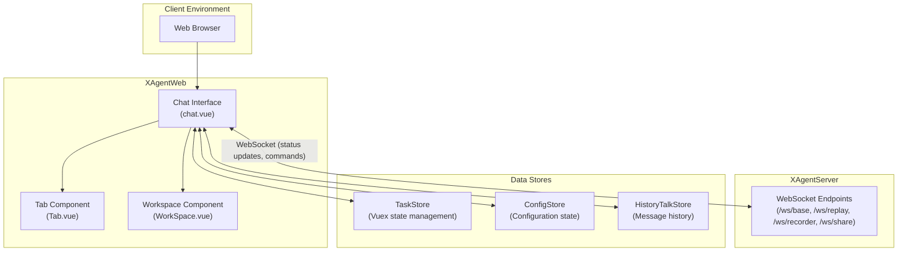

Sources: [XAgentWeb/src/views/playground/chat.vue:87-131](), [XAgentWeb/src/router/index.ts:89-98]()

## 2. WebSocket Communication

The chat interface establishes different types of WebSocket connections depending on the interaction mode. The connection is used to send task specifications to the server and receive real-time updates about task execution.

### 2.1. Connection Types

The chat interface supports four types of WebSocket connections, each corresponding to a different interaction mode:

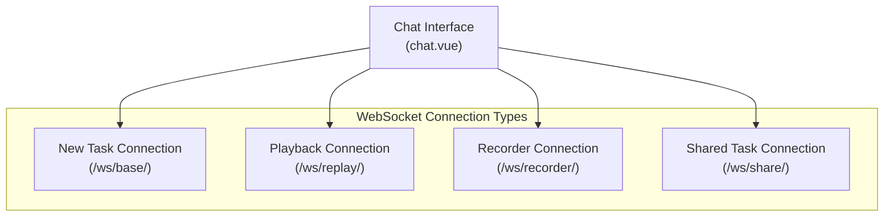

Sources: [XAgentWeb/src/views/playground/chat.vue:240-245](), [XAgentWeb/src/views/playground/chat.vue:458-482]()

### 2.2. WebSocket Message Flow

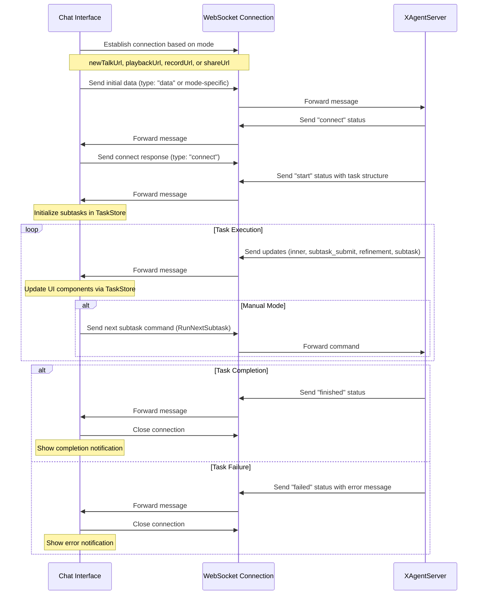

Sources: [XAgentWeb/src/views/playground/chat.vue:333-410](), [XAgentWeb/src/views/playground/chat.vue:425-456]()

## 3. UI Components

The chat interface consists of several key UI components that work together to display the conversation and task execution progress.

### 3.1. Component Structure

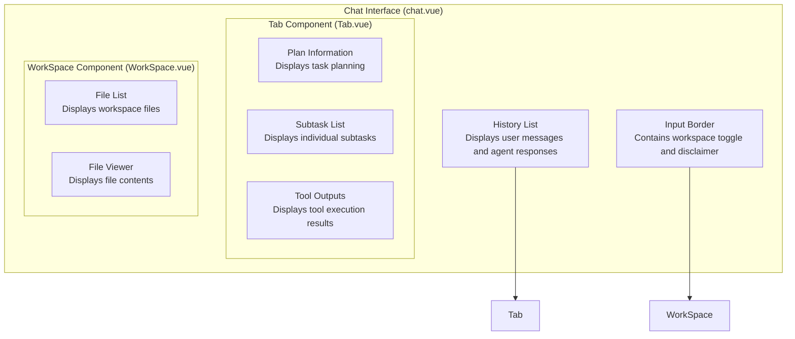

Sources: [XAgentWeb/src/views/playground/chat.vue:1-84](), [XAgentWeb/src/views/playground/components/WorkSpace.vue:1-49]()

### 3.2. Message Display

The chat interface displays two types of messages:

1. **User Messages**: Displayed with a user avatar and the message content in a white bubble
2. **Agent Responses**: Displayed with the XAgent logo and containing the Tab component that shows task execution details

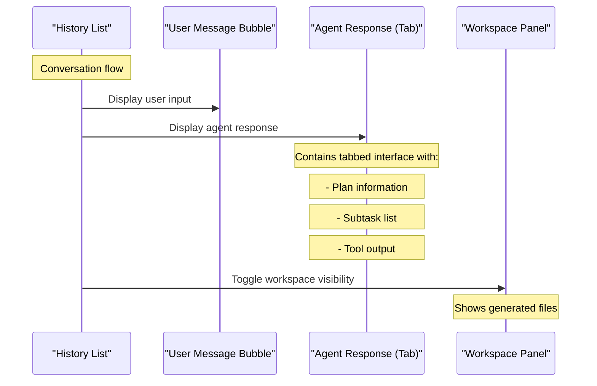

Sources: [XAgentWeb/src/views/playground/chat.vue:9-47]()

## 4. Interaction Modes

The chat interface supports four different interaction modes, each with its own behavior and WebSocket connection type.

### 4.1. Mode Overview

| Mode | Description | WebSocket Endpoint | Auto Mode |
|------|-------------|-------------------|-----------|
| new | Creates a new task | /ws/base/ | Configurable |
| playback | Replays a previous task | /ws/replay/ | Always auto |
| recorder | Plays a recorded task | /ws/recorder/ | Always auto |
| runshared | Runs a shared task | /ws/share/ | Always auto |

Sources: [XAgentWeb/src/views/playground/chat.vue:213-217](), [XAgentWeb/src/views/playground/chat.vue:458-482]()

### 4.2. Mode Selection and Initialization

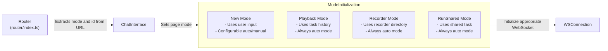

Sources: [XAgentWeb/src/views/playground/chat.vue:114-146](), [XAgentWeb/src/views/playground/chat.vue:213-225]()

## 5. Message Processing

The chat interface processes different types of WebSocket messages to update the UI and task state.

### 5.1. Message Types and Handling

```mermaid
flowchart TD
    WSMessage["WebSocket Message"] --> MessageHandler["wsMessageHandler()\nProcesses incoming messages"]
    
    MessageHandler --> |"status: start"| InitializeSubtasks["taskStore.initializeSubtasks()\nInitializes task structure"]
    MessageHandler --> |"status: inner"| AddInner["taskStore.addInner()\nAdds inner execution node"]
    MessageHandler --> |"status: subtask_submit"| AddLastInner["taskStore.addLastInner()\nAdds final inner node"]
    MessageHandler --> |"status: refinement"| AddRefinement["taskStore.addRefinementInfo()\nAdds plan refinement info"]
    MessageHandler --> |"status: subtask"| NextSubtask["taskStore.nextsubtask()\nAdvances to next subtask"]
    MessageHandler --> |"status: finished"| HandleFinished["handleTaskCompletelyFinished()\nCompletes task and shows notification"]
    MessageHandler --> |"status: failed"| HandleFailed["handleConnectFailNotification()\nShows error message"]
    MessageHandler --> |"status: connect"| SendConnectResponse["sendConnectResponse()\nSends connection acknowledgment"]
    
    MessageHandler --> |"workspace_file_list property"| UpdateWorkspace["taskStore.setWorkspaceFiles()\nUpdates workspace files"]
    MessageHandler --> |"node_id property"| UpdateNodeId["taskStore.setLastStepId()\nUpdates last step ID"]
```

Sources: [XAgentWeb/src/views/playground/chat.vue:333-410]()

### 5.2. Task Control Flow

In manual mode, the user can control task execution by triggering the next subtask or inner node:

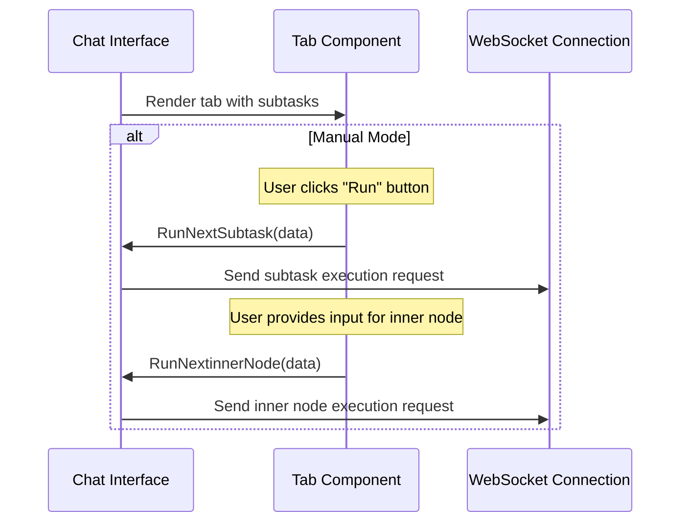

Sources: [XAgentWeb/src/views/playground/chat.vue:486-510]()

## 6. Workspace Integration

The chat interface includes a workspace panel that displays files generated during task execution. This panel can be toggled on and off by the user.

### 6.1. Workspace UI Components

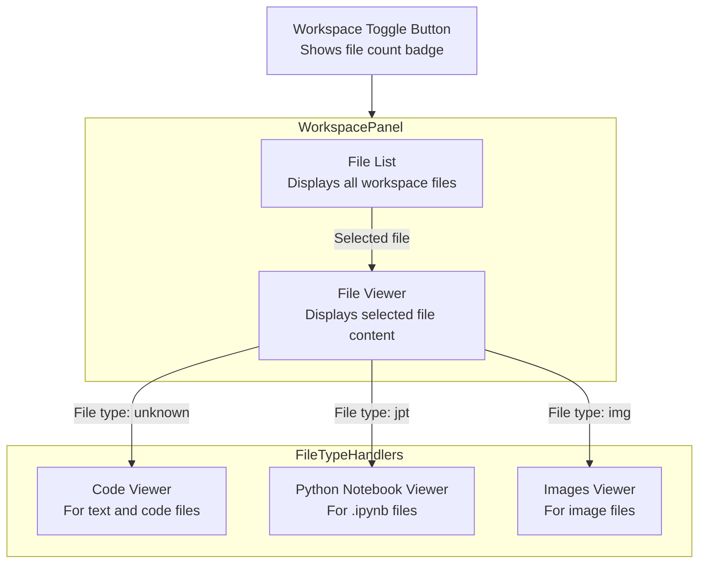

Sources: [XAgentWeb/src/views/playground/chat.vue:51-83](), [XAgentWeb/src/views/playground/components/WorkSpace.vue:1-49]()

### 6.2. File Loading Process

When a user selects a file from the workspace file list, the system fetches the file content from the server and displays it in the appropriate viewer based on the file type.

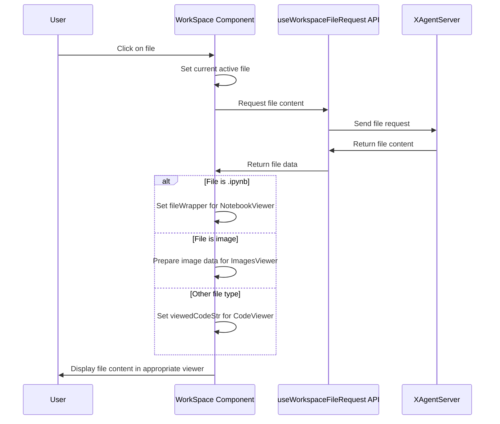

Sources: [XAgentWeb/src/views/playground/components/WorkSpace.vue:87-111](), [XAgentWeb/src/composables/useApi.ts:98-100]()

## 7. Connection Management

The chat interface carefully manages WebSocket connections to ensure proper communication with the server and prevent resource leaks.

### 7.1. Connection Lifecycle

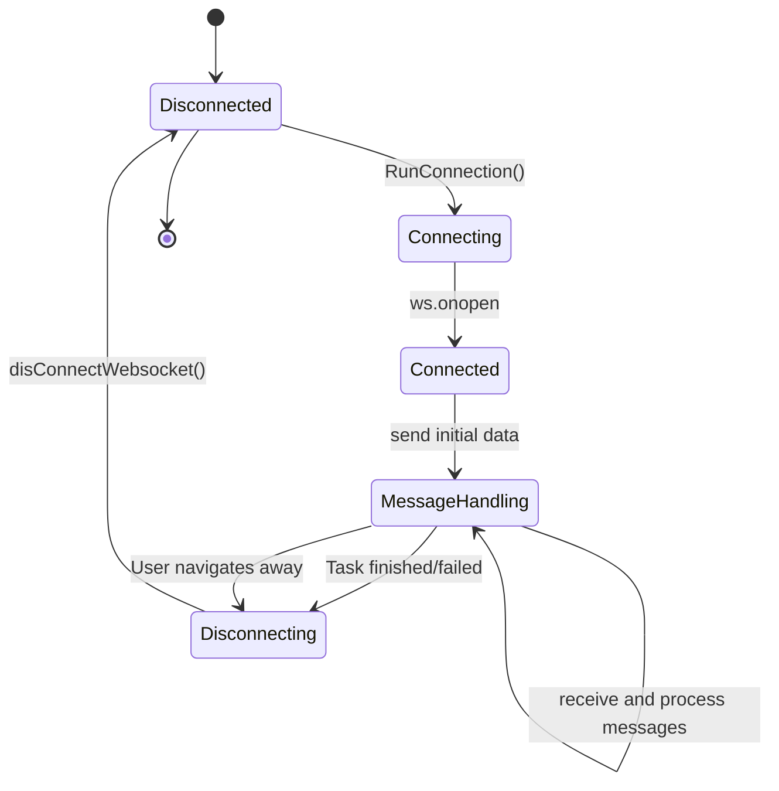

Sources: [XAgentWeb/src/views/playground/chat.vue:458-483](), [XAgentWeb/src/views/playground/chat.vue:294-298]()

### 7.2. Connection Keep-Alive

To maintain long-running WebSocket connections, the chat interface implements a ping/pong mechanism:

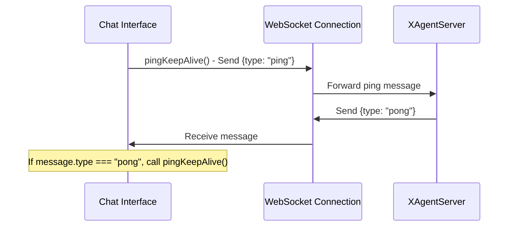

Sources: [XAgentWeb/src/views/playground/chat.vue:310-312](), [XAgentWeb/src/views/playground/chat.vue:354-356]()

## 8. Error Handling

The chat interface includes robust error handling to address various failure scenarios in the WebSocket communication.

### 8.1. Error Types and Responses

| Error Type | Handling |
|------------|----------|
| Connection establishment failure | Display error message and redirect to playground |
| Server-side task failure | Display error message with details and disconnect |
| Invalid response format | Log error and continue |
| WebSocket error events | Log error and possibly reset state |

Sources: [XAgentWeb/src/views/playground/chat.vue:279-290](), [XAgentWeb/src/views/playground/chat.vue:344-352]()

## 9. Integration with Router

The chat interface integrates with Vue Router to handle different URL patterns for various modes of operation.

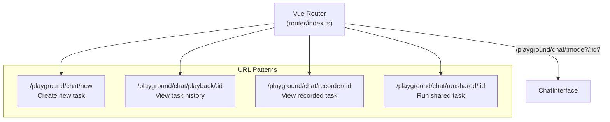

Sources: [XAgentWeb/src/router/index.ts:92-98](), [XAgentWeb/src/views/playground/chat.vue:114-140]()

## 10. State Management

The chat interface uses several Vuex stores to manage state across the application:

### 10.1. Store Integration

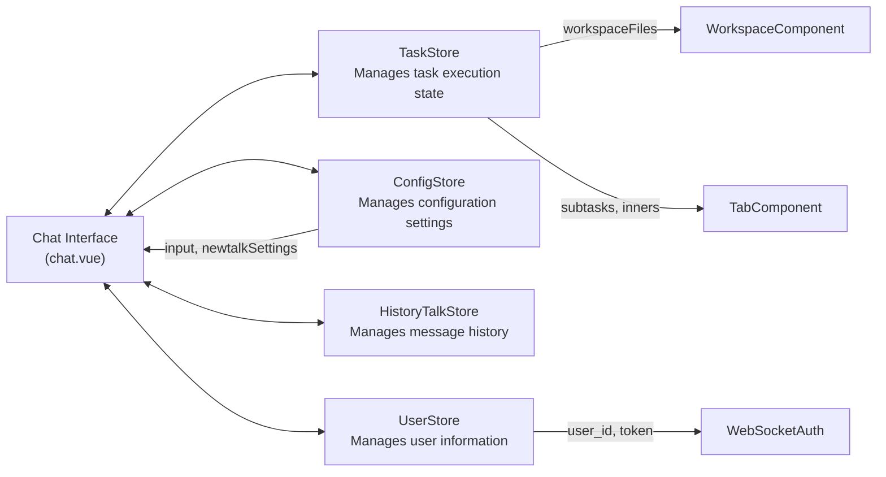

Sources: [XAgentWeb/src/views/playground/chat.vue:102-104](), [XAgentWeb/src/store/modules/config.ts:13-63]()

This comprehensive documentation of the Chat Interface provides a technical understanding of how users interact with the XAgent system through the web interface, how real-time communication is managed via WebSockets, and how task execution is visualized and controlled.

---

