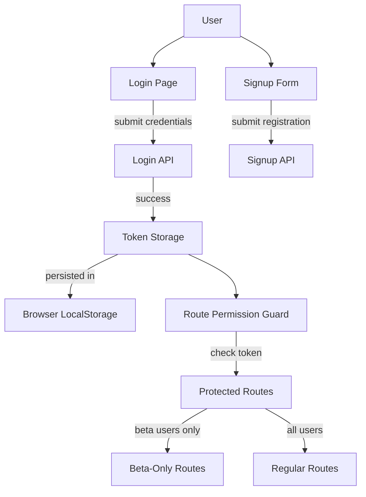
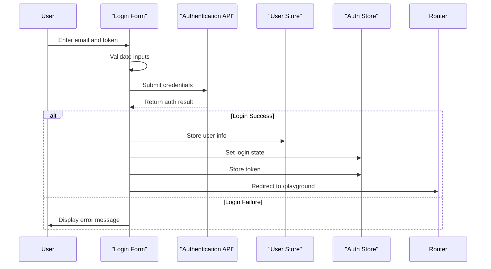
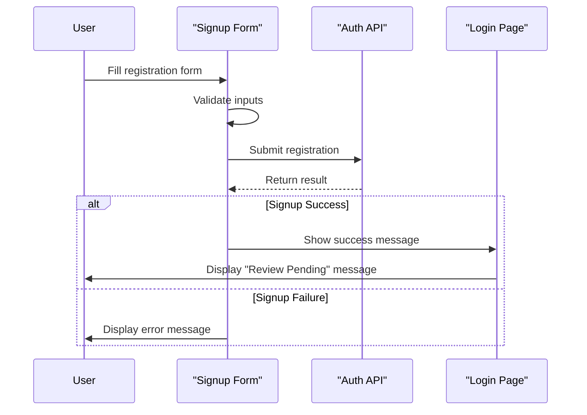
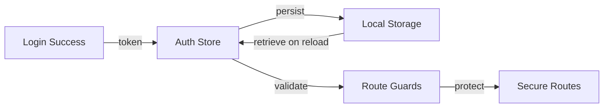
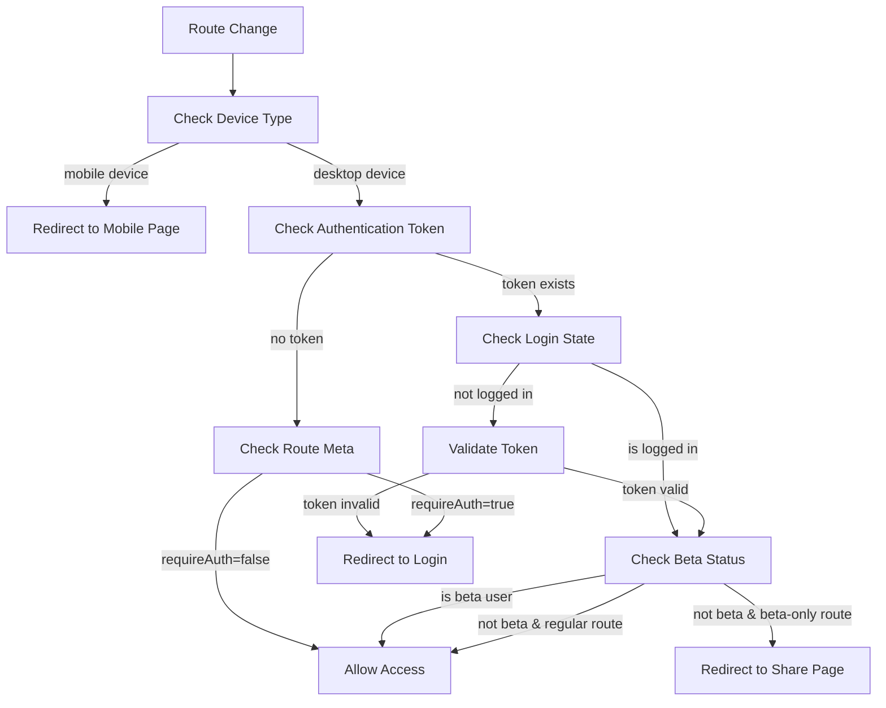

<!-- source: DeepWiki mcp.deepwiki.com · repo OpenBMB/XAgent · page 5.3 Authentication · fetched 2026-10-26 -->

# Authentication

<details>
<summary>Relevant source files</summary>

The following files were used as context for generating this wiki page:

- [.gitignore](.gitignore)
- [XAgentWeb/.gitignore](XAgentWeb/.gitignore)
- [XAgentWeb/components.d.ts](XAgentWeb/components.d.ts)
- [XAgentWeb/src/components/Business/Feedback/index.vue](XAgentWeb/src/components/Business/Feedback/index.vue)
- [XAgentWeb/src/router/guard/permission.ts](XAgentWeb/src/router/guard/permission.ts)
- [XAgentWeb/src/store/modules/user.ts](XAgentWeb/src/store/modules/user.ts)
- [XAgentWeb/src/utils/throttle.ts](XAgentWeb/src/utils/throttle.ts)
- [XAgentWeb/src/views/exception/mobile.vue](XAgentWeb/src/views/exception/mobile.vue)
- [XAgentWeb/src/views/login/component/ApplyForm.vue](XAgentWeb/src/views/login/component/ApplyForm.vue)
- [XAgentWeb/src/views/login/login.vue](XAgentWeb/src/views/login/login.vue)
- [XAgentWeb/types/talk-type.ts](XAgentWeb/types/talk-type.ts)
- [XAgentWeb/types/user.ts](XAgentWeb/types/user.ts)

</details>


This document details the authentication system within XAgentWeb, covering the login/signup flows, token management, and route protection mechanisms. For information about task management via the web interface, see [Task Management](#5.4).

## Overview

XAgentWeb implements a simple email and token-based authentication system. The core authentication functionality consists of a login page, registration mechanism, persistent token storage, and route guards that restrict access to protected routes. The system distinguishes between regular users and beta users, with some routes exclusively accessible to beta users.



Sources: [XAgentWeb/src/views/login/login.vue](), [XAgentWeb/src/router/guard/permission.ts]()

## Authentication Flow

### Login Process

When a user attempts to log in, they provide an email address and token. The login component calls the API to validate these credentials, and upon successful authentication, stores the user information and token in the user and authentication stores.



The login form is implemented in [XAgentWeb/src/views/login/login.vue:264-282](), with the form submission logic:

```javascript
const submit = async () => {
  // Validate inputs
  // ...
  
  const param = {
    email: loginForm.email,
    token: loginForm.token,
  }

  const res: any = await useLoginRequest(param);
  
  if (res?.success || res?.message === 'success') {
    userStore.setUserInfo(res?.data)
    authStore.setLoginState(true)
    authStore.setLoginToken(res?.data?.token)

    router.push({ path: '/playground' })
  } else {
    // Handle error
  }
}
```

Sources: [XAgentWeb/src/views/login/login.vue:238-282]()

### Registration Process

The registration process allows new users to sign up by providing personal and professional information. After submission, the system awaits approval before granting full access.



The registration form collects the following information:
- Name
- Company/College name
- Industry
- Position
- Email (company or school email)

Sources: [XAgentWeb/src/views/login/component/ApplyForm.vue:7-89](), [XAgentWeb/src/views/login/component/ApplyForm.vue:180-206]()

## Token Management

Authentication tokens are stored in both the AuthStore and local browser storage to maintain session persistence across page reloads. The token is used by route guards to verify authentication status.



Sources: [XAgentWeb/src/store/modules/user.ts:34-37](), [XAgentWeb/src/router/guard/permission.ts:24]()

## Route Protection

The permission guard in the router checks the authentication status before allowing access to protected routes. It handles several scenarios:

1. Mobile device detection and redirection
2. Authentication status verification
3. Beta user status verification for accessing restricted features

For protected routes, the guard checks the user's authentication status and redirects unauthenticated users to the login page. For beta-only features, it checks if the current user has beta access and redirects non-beta users accordingly.



Key logic from the route guard:

```javascript
// Check if token exists
const isLogin = authStore.getLoginState
const token = authStore.getToken
const isBetaUser = userInfo?.is_beta === true;

if (token) {
  if (isLogin) {
    // Handle routes based on beta status
  } else {
    // Validate token and handle results
    const loginState = await authStore.checkAuthAction()
  }
} else {
  // Redirect to login for protected routes
  to.path === '/login' ? next() : next('/login')
}
```

Sources: [XAgentWeb/src/router/guard/permission.ts:5-63]()

## User Types and Access Levels

XAgent distinguishes between two types of users:

| User Type | Access Level | Routes Available |
|-----------|--------------|------------------|
| Beta User | Full access  | All routes including `/playground` |
| Regular User | Limited access | Only non-beta routes like `/share` |

The distinction is made based on the `is_beta` flag in the user information object:

```typescript
export interface UserInfo {
  // Other fields...
  is_beta?: boolean
}
```

Sources: [XAgentWeb/types/user.ts:6-25](), [XAgentWeb/src/router/guard/permission.ts:26-36]()

## Implementation Details

### Local Storage for Persistence

User information and authentication tokens are stored in the browser's local storage to maintain session state across page reloads. The user store provides methods to manage this state:

```typescript
// Store user info
setUserInfo(val: UserInfo) {
  this.userInfo = val
  useSetLocalCache<UserInfo>(val, USER_INFO)
}

// Clear user info
clearUserInfo() {
  useClearLocalCache(USER_INFO)
  this.userInfo = null
}
```

Sources: [XAgentWeb/src/store/modules/user.ts:34-41]()

### Guest Account

The system provides a default guest account for development or testing purposes:

```typescript
const DEFAULT_ACCOUNT = 'Guest'
const DEFAULT_PSWD = 'xagent'
```

This is used as the default value in the login form.

Sources: [XAgentWeb/src/views/login/login.vue:131-138]()

## Security Considerations

The authentication system in XAgentWeb is relatively simple and designed primarily for access control rather than high security. Some security considerations:

1. Token-based authentication without apparent expiration
2. Email validation during registration
3. Route-based access control with beta/non-beta user distinction
4. No visible password reset functionality
5. Simple email and token form without multi-factor authentication

For production environments, additional security measures might be considered, such as token expiration, CSRF protection, and more robust user validation.

Sources: [XAgentWeb/src/views/login/login.vue](), [XAgentWeb/src/router/guard/permission.ts]()

---

