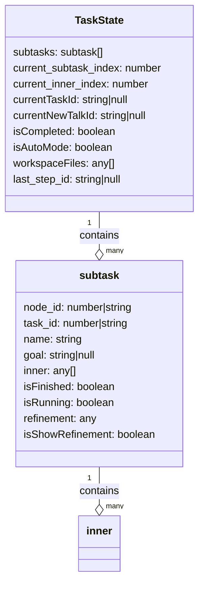
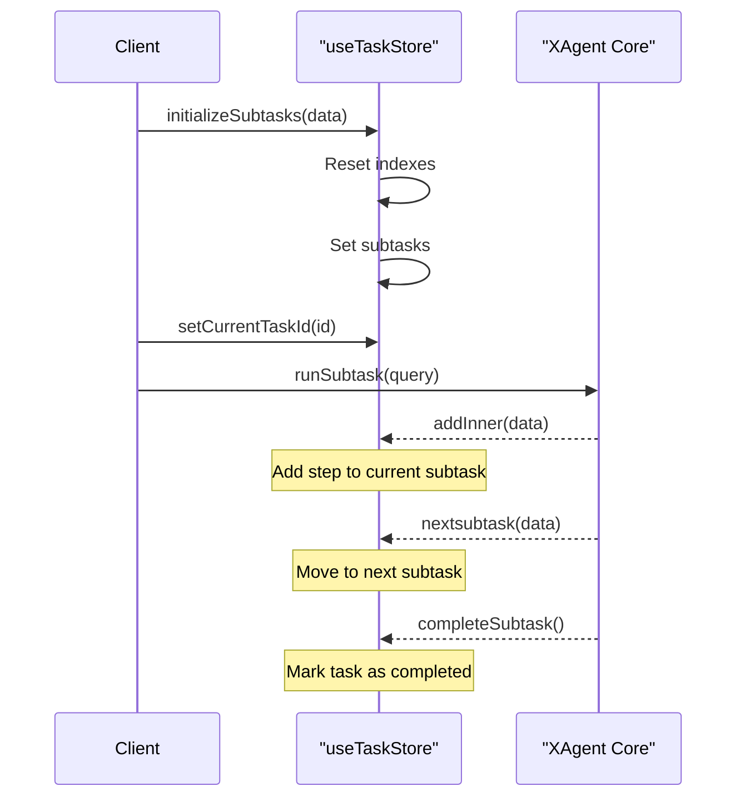
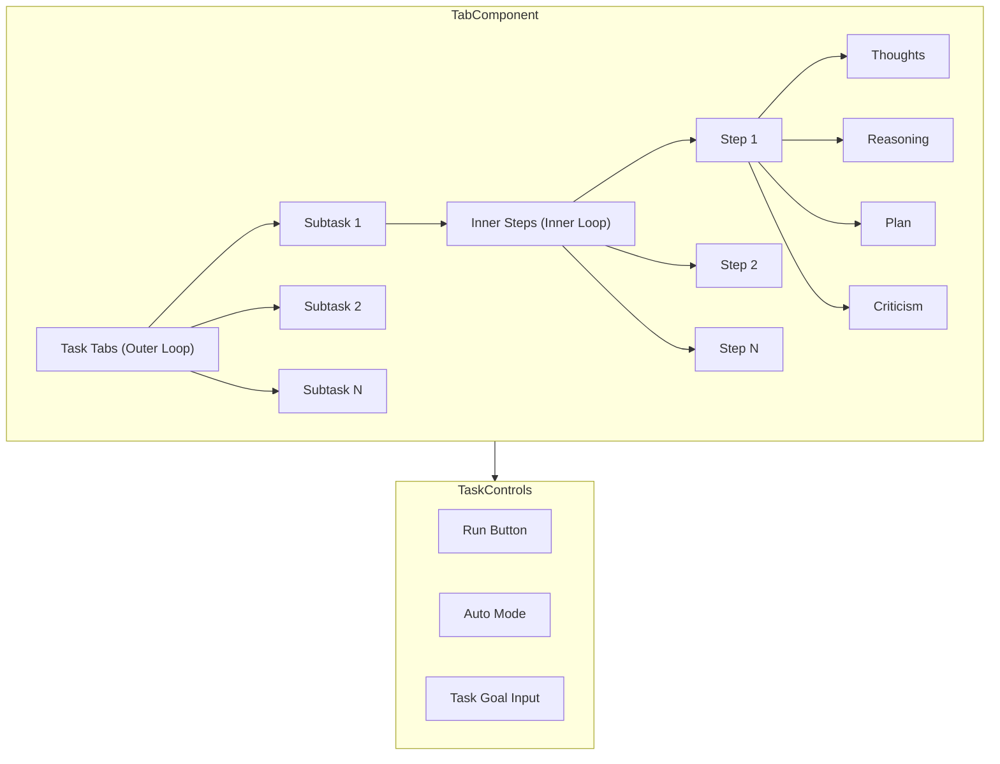
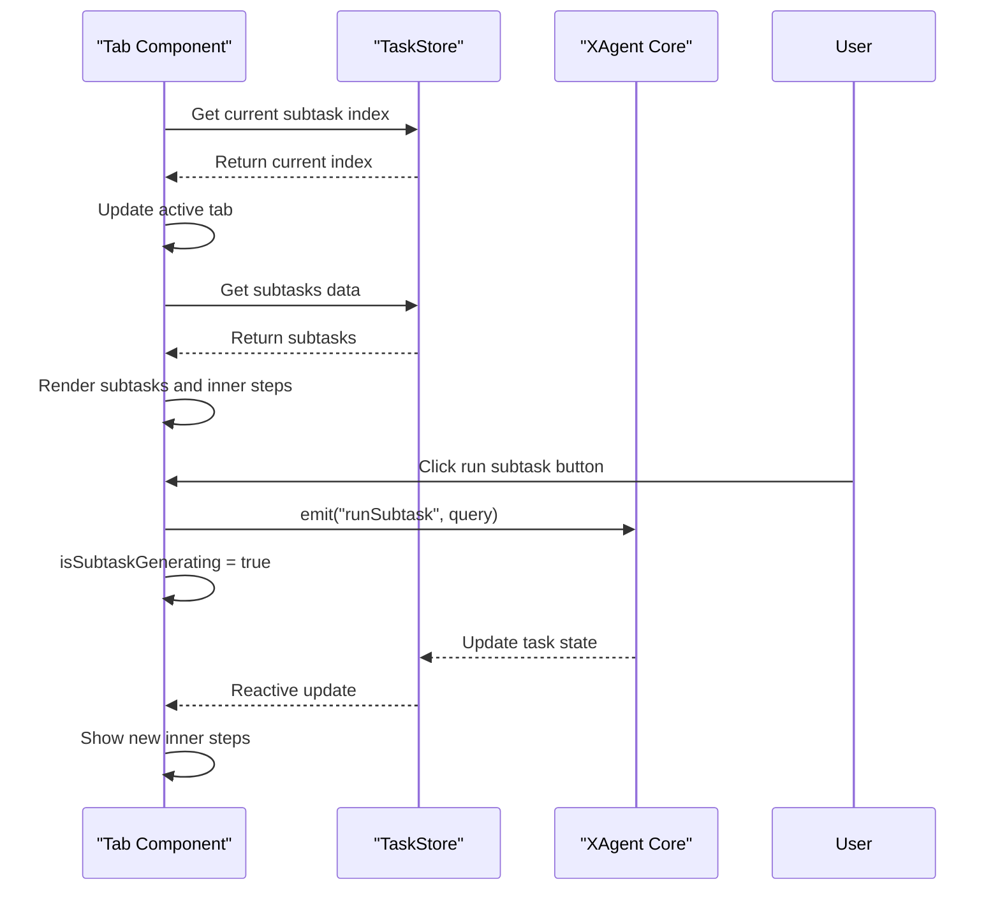
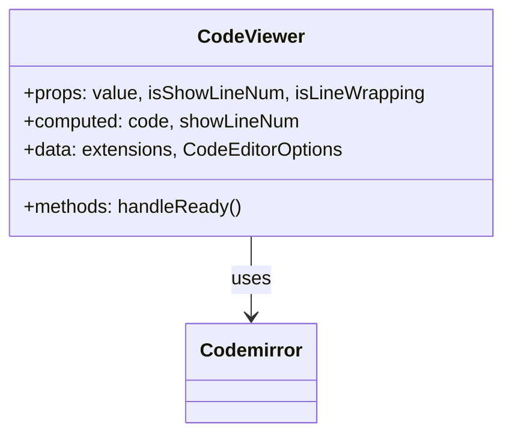
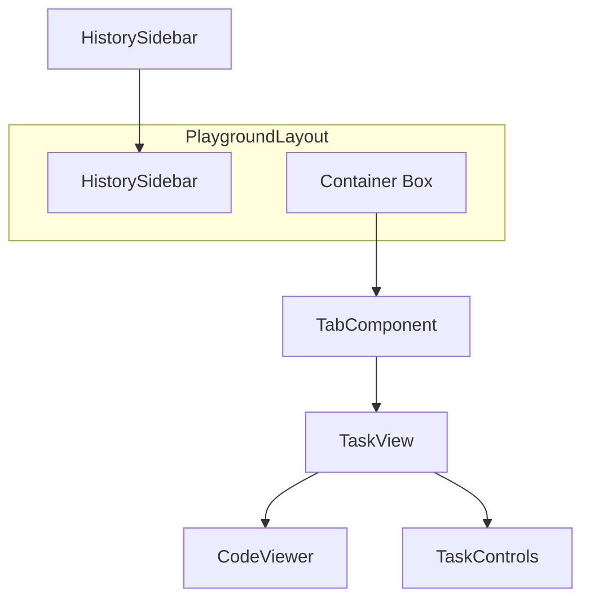

<!-- source: DeepWiki mcp.deepwiki.com · repo OpenBMB/XAgent · page 5.4 Task Management · fetched 2026-10-26 -->

# Task Management

<details>
<summary>Relevant source files</summary>

The following files were used as context for generating this wiki page:

- [XAgentWeb/src/store/modules/task.ts](XAgentWeb/src/store/modules/task.ts)
- [XAgentWeb/src/views/playground/components/CodeViewer.vue](XAgentWeb/src/views/playground/components/CodeViewer.vue)
- [XAgentWeb/src/views/playground/components/Tab.vue](XAgentWeb/src/views/playground/components/Tab.vue)
- [XAgentWeb/src/views/playground/layout.vue](XAgentWeb/src/views/playground/layout.vue)

</details>


This page documents how tasks are managed within the XAgentWeb interface of the XAgent system. It covers the core task data structure, state management, and UI components that allow users to create, monitor, and interact with tasks as they are processed by the autonomous agent system.

For information about the web interface components in general, see [User Interface Components](#5.1), and for details about authentication flow, see [Authentication](#5.3).

## Task Data Structure

The Task Management system in XAgentWeb uses a hierarchical structure to represent and track tasks. The core data model is defined in the task store:



Sources: [XAgentWeb/src/store/modules/task.ts:1-24]()

### Task State Management

The task state is managed through a Pinia store called `useTaskStore`, which maintains the current state of tasks and provides methods for manipulating this state. The store handles:

- The collection of subtasks
- Current indexes for tracking active subtask and inner step
- Task completion status
- Auto/manual execution mode
- Workspace files related to tasks

```mermaid
flowchart LR
    subgraph "TaskStore State"
        A["subtasks[]"] --> B["current_subtask_index"]
        A --> C["current_inner_index"]
        A --> D["isCompleted"]
        A --> E["isAutoMode"]
        A --> F["workspaceFiles[]"]
    end
    
    subgraph "Identifiers"
        G["currentTaskId"]
        H["currentNewTalkId"]
        I["last_step_id"]
    end
    
    TaskStore --> "TaskStore State"
    TaskStore --> "Identifiers"
```

Sources: [XAgentWeb/src/store/modules/task.ts:26-40]()

## Task Management Operations

The task store provides several actions for managing the task lifecycle:

### Task Initialization and Progression



Sources: [XAgentWeb/src/store/modules/task.ts:41-133]()

### Task Refinement and Reset

The store provides methods to handle task refinement and state reset:

1. `addRefinementInfo` - Adds refinement data to the current subtask
2. `setTaskRefineInfoArray` - Sets refinement information for multiple subtasks
3. `reset` - Clears all task state and resets to initial values

### Workspace File Management

Tasks can generate and manipulate files that are tracked in the task state:

1. `addWorkspaceFiles` - Adds a new file to the workspace
2. `setWorkspaceFiles` - Sets the complete list of workspace files

Sources: [XAgentWeb/src/store/modules/task.ts:134-175]()

## Task UI Components

### Tab Interface

The primary UI component for task management is the Tab interface, which displays subtasks as tabs and their inner steps as collapsible sections:



The Tab interface allows users to:
- View all subtasks in a hierarchical structure
- See completion status with visual indicators
- Input goals for subtasks
- Run specific subtasks manually
- View task refinement information

Sources: [XAgentWeb/src/views/playground/components/Tab.vue:1-163](), [XAgentWeb/src/views/playground/components/Tab.vue:164-396]()

### Task Execution Controls

The Tab component provides controls for task execution:

1. Task execution in manual or automatic mode
2. Ability to run individual subtasks
3. Collapse/expand inner steps
4. View task completion status

The component watches for changes in the current subtask index and inner index to update the UI accordingly:



Sources: [XAgentWeb/src/views/playground/components/Tab.vue:196-242](), [XAgentWeb/src/views/playground/components/Tab.vue:313-367]()

### Code Viewing

The CodeViewer component is used to display code generated or manipulated during task execution:



The CodeViewer provides:
- Syntax highlighting for Python code
- Line numbering (optional)
- Line wrapping (optional)
- Dark theme support

Sources: [XAgentWeb/src/views/playground/components/CodeViewer.vue:1-86]()

## Integration with Playground Layout

The task management UI is integrated into the playground layout, which provides the overall structure for the XAgentWeb interface:



The layout provides a consistent structure with:
- A sidebar for browsing task history
- The main container for displaying and interacting with tasks

Sources: [XAgentWeb/src/views/playground/layout.vue:1-59]()

## Task Lifecycle

The full lifecycle of a task in the XAgentWeb interface follows this pattern:

```mermaid
stateDiagram-v2
    [*] --> "Task Creation"
    "Task Creation" --> "Initial Planning"
    "Initial Planning" --> "Subtask Generation"
    
    "Subtask Generation" --> "Subtask Execution"
    "Subtask Execution" --> "Inner Step Execution"
    
    "Inner Step Execution" --> "Tool Usage"
    "Tool Usage" --> "Inner Step Execution"
    
    "Inner Step Execution" --> "Subtask Completion"
    "Subtask Completion" --> "Subtask Refinement"
    "Subtask Refinement" --> "Next Subtask"
    "Next Subtask" --> "Subtask Execution"
    
    "Next Subtask" --> "Task Completion"
    "Task Completion" --> [*]
```

This lifecycle is managed through the task store actions and reflected in the UI components, providing users with a clear view of task progress and the ability to intervene when necessary.

Sources: [XAgentWeb/src/store/modules/task.ts:41-133](), [XAgentWeb/src/views/playground/components/Tab.vue:313-367]()

## Summary

The Task Management system in XAgentWeb provides a comprehensive interface for tracking and interacting with autonomous agent tasks. Through a combination of state management and UI components, users can:

1. Create new tasks with specific goals
2. Monitor the execution of tasks through subtasks and inner steps
3. View detailed information about each step including thoughts, reasoning, and plans
4. Run tasks in automatic or manual mode
5. View and manage files generated during task execution

The system is designed to make the complex processes of the XAgent autonomous system transparent and accessible to users, allowing for both observation and intervention as needed.

---

