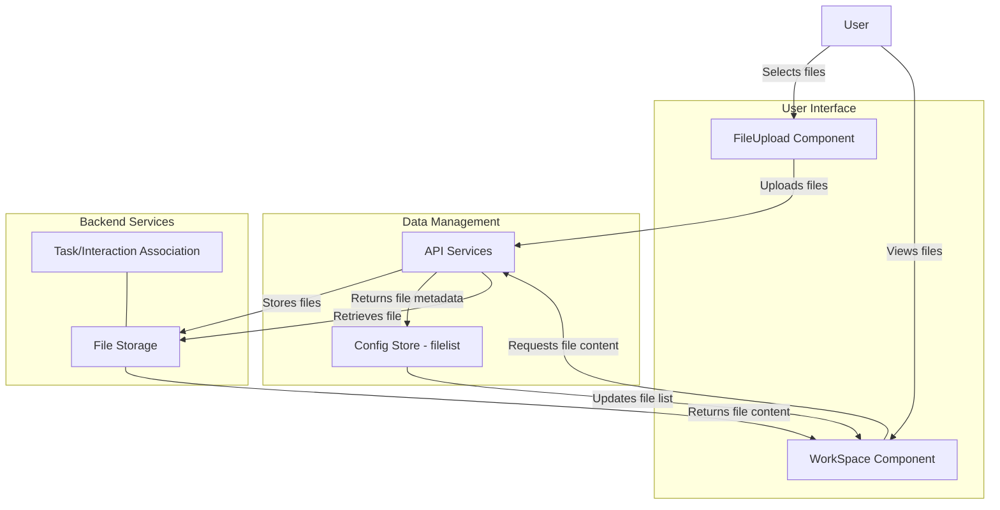
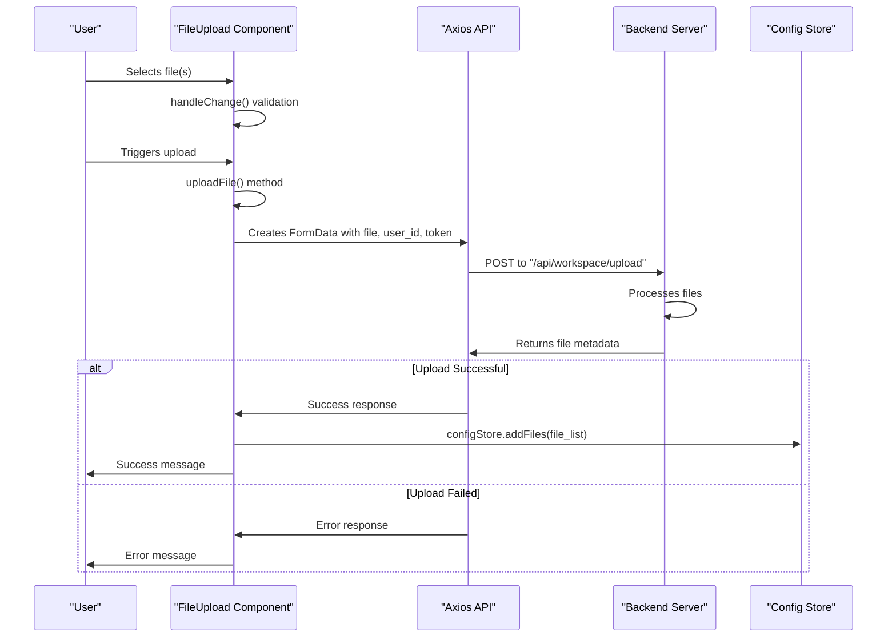
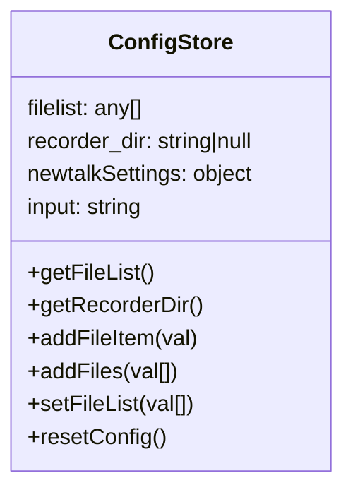
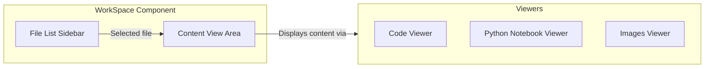

<!-- source: DeepWiki mcp.deepwiki.com · repo OpenBMB/XAgent · page 5.5 File Upload and Management · fetched 2026-10-26 -->

# File Upload and Management

<details>
<summary>Relevant source files</summary>

The following files were used as context for generating this wiki page:

- [XAgentWeb/README.md](XAgentWeb/README.md)
- [XAgentWeb/index.html](XAgentWeb/index.html)
- [XAgentWeb/package.json](XAgentWeb/package.json)
- [XAgentWeb/src/composables/useApi.ts](XAgentWeb/src/composables/useApi.ts)
- [XAgentWeb/src/router/index.ts](XAgentWeb/src/router/index.ts)
- [XAgentWeb/src/store/modules/config.ts](XAgentWeb/src/store/modules/config.ts)
- [XAgentWeb/src/views/playground/components/FileUpload.vue](XAgentWeb/src/views/playground/components/FileUpload.vue)
- [XAgentWeb/src/views/playground/components/Inferencing.vue](XAgentWeb/src/views/playground/components/Inferencing.vue)
- [XAgentWeb/src/views/playground/components/Setting.vue](XAgentWeb/src/views/playground/components/Setting.vue)
- [XAgentWeb/src/views/playground/components/SubmitSubtaskInfo.vue](XAgentWeb/src/views/playground/components/SubmitSubtaskInfo.vue)
- [XAgentWeb/src/views/playground/components/WorkSpace.vue](XAgentWeb/src/views/playground/components/WorkSpace.vue)

</details>


## Purpose and Scope

This document describes the file upload and management system in XAgent's web interface. It covers how files are uploaded by users, stored in the system, and displayed in the workspace. This documentation focuses on client-side implementations of file upload features and their integration with the backend services.

## Overview

The file upload and management system allows users to upload files that can be used by XAgent during task execution. The system enforces file type restrictions, size limits, and integrates with the user authentication system to maintain file ownership.



Sources:
- [XAgentWeb/src/views/playground/components/FileUpload.vue:1-204]()
- [XAgentWeb/src/views/playground/components/WorkSpace.vue:1-208]()
- [XAgentWeb/src/store/modules/config.ts:1-64]()

## File Upload Component

The file upload functionality is implemented as a dedicated Vue component that provides an intuitive interface for users to upload files.

### Component Implementation

The file upload component is built using Element Plus's upload component with customized styling and behavior. It includes:

- Upload button with icon
- File list display
- Informational tips about file constraints
- Success/error message handling



Sources:
- [XAgentWeb/src/views/playground/components/FileUpload.vue:3-32]()
- [XAgentWeb/src/views/playground/components/FileUpload.vue:91-133]()

### Upload Constraints

The file upload system enforces several constraints to ensure compatibility with the XAgent system:

| Constraint | Value |
|------------|-------|
| Maximum files | 5 files |
| Maximum file size | 1MB per file |
| Supported formats | .txt, .pdf, .doc, .docx, .xls, .xlsx, .ppt, .pptx, .png, .jpeg, .gif, .py, .zip |

The constraints are enforced through:
1. UI limitations (limit prop in upload component)
2. File type validation through the accept attribute
3. User-friendly error messages

Sources:
- [XAgentWeb/src/views/playground/components/FileUpload.vue:3-15]()
- [XAgentWeb/src/views/playground/components/FileUpload.vue:26-30]()

## File Storage and Management

### Config Store Implementation

The system maintains file metadata in the Config Store, which provides an interface for managing the file list:



Sources:
- [XAgentWeb/src/store/modules/config.ts:1-64]()

### Upload Process

The upload process involves several steps:

1. File selection by the user
2. Creation of FormData containing:
   - File data
   - User ID
   - Authentication token
3. POST request to `/api/workspace/upload`
4. Processing of server response
5. On success: update of the file list in the Config Store
6. Display of success/error message

Sources:
- [XAgentWeb/src/views/playground/components/FileUpload.vue:91-133]()

## Workspace File Display

The workspace component provides a file explorer-like interface for viewing and managing uploaded files.

### Workspace Layout



Sources:
- [XAgentWeb/src/views/playground/components/WorkSpace.vue:1-49]()

### File Content Retrieval

When a user selects a file in the workspace:

1. The system sends a request to `/api/workspace/file`
2. The request includes:
   - User ID
   - Authentication token
   - Interaction ID (task ID)
   - File name
3. The server returns the file content
4. The appropriate viewer is chosen based on file type:
   - Code files: Code viewer with syntax highlighting
   - Notebook files (.ipynb): Notebook viewer
   - Image files (.png, .jpg, etc.): Image viewer

Sources:
- [XAgentWeb/src/views/playground/components/WorkSpace.vue:87-111]()
- [XAgentWeb/src/composables/useApi.ts:98-100]()

### File Type Handling

The system intelligently detects file types and renders them with appropriate viewers:

| File Type Category | Extensions | Viewer Component |
|--------------------|------------|------------------|
| Code/Text | .txt, .py, .pdf, .doc, .docx, etc. | CodeViewer |
| Jupyter Notebook | .ipynb | PythonNotebookViewer |
| Images | .png, .jpg, .jpeg, .gif, .bmp | ImagesViewer |

Sources:
- [XAgentWeb/src/views/playground/components/WorkSpace.vue:71-80]()
- [XAgentWeb/src/views/playground/components/WorkSpace.vue:32-46]()

## API Integration

The file system integrates with two main API endpoints:

### File Upload API

```
Endpoint: /api/workspace/upload
Method: POST
Content-Type: multipart/form-data
Parameters:
  - files: File object(s)
  - user_id: User identification
  - token: Authentication token
```

Sources:
- [XAgentWeb/src/views/playground/components/FileUpload.vue:52-104]()

### File Retrieval API

```
Endpoint: /api/workspace/file
Method: POST
Parameters:
  - user_id: User identification
  - token: Authentication token
  - interaction_id: Task/Interaction ID
  - file_name: Name of file to retrieve
```

Sources:
- [XAgentWeb/src/views/playground/components/WorkSpace.vue:91-97]()
- [XAgentWeb/src/composables/useApi.ts:98-100]()

## Integration with Task Execution

Files uploaded through the system are available to XAgent during task execution. The file-task association is maintained through the interaction_id parameter, ensuring that each task has access to its relevant files.

### Task Output File Display

In addition to user-uploaded files, XAgent can generate files during task execution, such as:

- Code files
- Images
- Jupyter notebooks

These files are displayed in the same workspace component but are created during task execution rather than through explicit file upload.

Sources:
- [XAgentWeb/src/views/playground/components/SubmitSubtaskInfo.vue:62-64]()
- [XAgentWeb/src/views/playground/components/WorkSpace.vue:87-111]()

## Security Considerations

The file upload system implements several security measures:

1. **Authentication**: All file operations require user_id and token
2. **File type restrictions**: Only specific file types are allowed
3. **Size limitations**: 1MB maximum per file
4. **File isolation**: Files are associated with specific interactions/users

Sources:
- [XAgentWeb/src/views/playground/components/FileUpload.vue:93-102]()
- [XAgentWeb/src/views/playground/components/FileUpload.vue:3-15]()

---

