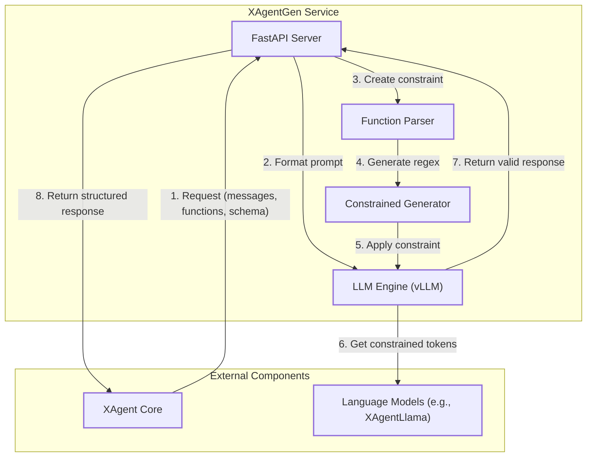
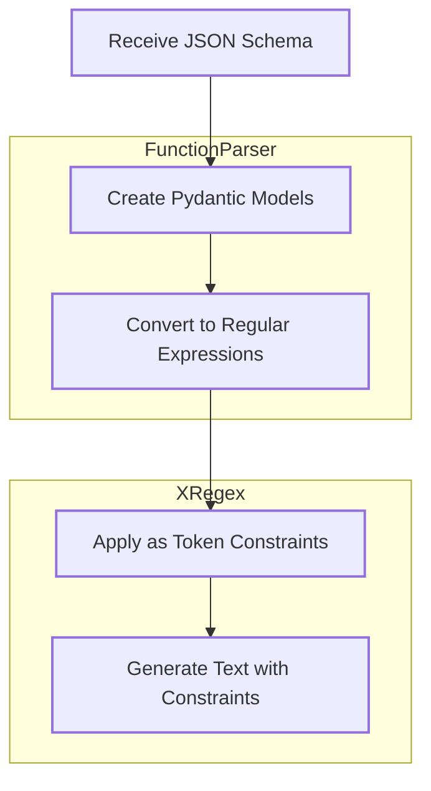
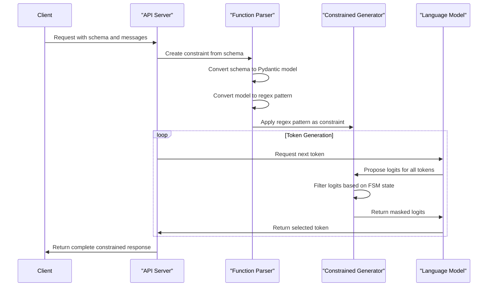
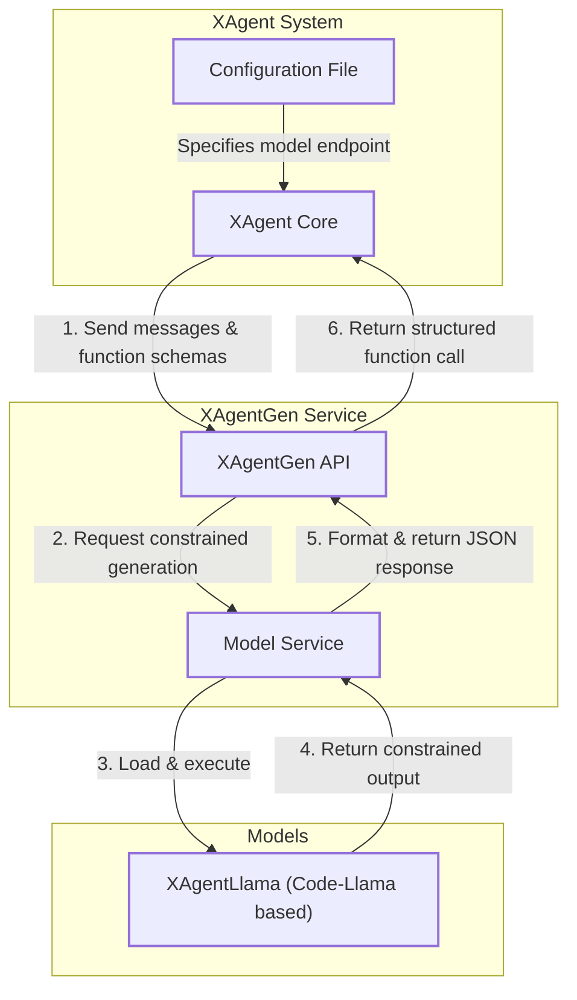

<!-- source: DeepWiki mcp.deepwiki.com · repo OpenBMB/XAgent · page 6 XAgentGen · fetched 2026-10-26 -->

# XAgentGen

<details>
<summary>Relevant source files</summary>

The following files were used as context for generating this wiki page:

- [README.md](README.md)
- [README_JA.md](README_JA.md)
- [README_ZH.md](README_ZH.md)
- [XAgentGen/README.md](XAgentGen/README.md)
- [XAgentGen/app.py](XAgentGen/app.py)
- [XAgentGen/xgen/models/__init__.py](XAgentGen/xgen/models/__init__.py)
- [XAgentGen/xgen/models/transformers.py](XAgentGen/xgen/models/transformers.py)
- [XAgentGen/xgen/parser/function_parser.py](XAgentGen/xgen/parser/function_parser.py)
- [XAgentGen/xgen/text/generate/__init__.py](XAgentGen/xgen/text/generate/__init__.py)
- [XAgentGen/xgen/text/generate/regex.py](XAgentGen/xgen/text/generate/regex.py)

</details>


XAgentGen is a component of the XAgent system that implements guided generation of customized models to support XAgent's functionality. It allows language models to generate function calls with complex JSON schemas, similar to OpenAI's function calling feature, but for locally hosted models. This page provides a technical overview of XAgentGen's architecture, its model generation capabilities, and integration with the XAgent system.

## 1. Overview

XAgentGen enables constrained text generation, specifically targeting function calls that must adhere to predefined JSON schemas. It achieves this by transforming JSON schemas into regular expressions that guide the token generation process, ensuring the model outputs valid JSON conforming to the schema.

Sources: [XAgentGen/README.md:1-9](). [XAgentGen/README.md:42-48]()

## 2. System Architecture

XAgentGen operates as a standalone service within the XAgent ecosystem. It exposes a chat completions API endpoint that accepts messages, functions, and function call specifications, then returns constrained responses that adhere to the specified schemas.



Diagram: XAgentGen System Architecture

Sources: [XAgentGen/app.py:1-31](), [XAgentGen/app.py:86-170]()

XAgentGen consists of the following components:

1. **FastAPI Server**: Provides a RESTful API interface with a `/chat/completions` endpoint that mimics OpenAI's API structure.
2. **vLLM Engine**: Handles the efficient execution of language models with support for tensor parallelism and GPU optimization.
3. **Function Parser**: Converts JSON schemas into Pydantic models and regular expressions.
4. **Constrained Generator**: Uses regular expressions to guide the model's token generation process.

## 3. Model Generation Process

The core functionality of XAgentGen is transforming JSON schemas into constraints that guide the token generation process. This process involves several steps:



Diagram: XAgentGen Model Generation Process

Sources: [XAgentGen/xgen/parser/function_parser.py:36-372](), [XAgentGen/xgen/text/generate/regex.py:19-78]()

### 3.1 JSON Schema to Pydantic Models

XAgentGen uses Pydantic to create runtime validation models from JSON schemas. The `FunctionParser` class:

1. Converts JSON Schema types to Python types
2. Creates dynamic Pydantic models for function calls and arguments
3. Handles complex nested objects, arrays, and enums

The parsing process supports various JSON Schema features including:
- Required and optional properties
- Nested objects and arrays
- Enumerations
- Type constraints (minimum, maximum, regex patterns)
- Multi-type properties (union types)

Sources: [XAgentGen/xgen/parser/function_parser.py:72-238]()

### 3.2 Pydantic Models to Regex Patterns

Once Pydantic models are created, they are converted to regular expressions that can constrain the token generation:

1. Models are converted to JSON Schema representation
2. JSON Schemas are transformed into regular expressions
3. Regular expressions are compiled into finite state machines (FSMs)
4. FSMs are determinized and indexed for the tokenizer's vocabulary

This process enables token-by-token generation that adheres to the structure defined by the JSON schema.

Sources: [XAgentGen/xgen/parser/function_parser.py:289-301](), [XAgentGen/xgen/text/generate/regex.py:19-62]()

### 3.3 Constrained Token Generation

The constrained generation process:

1. Creates a logits processor that applies constraints to the model's output distribution
2. At each generation step, the FSM determines which tokens are valid continuations
3. Invalid tokens have their logits set to negative infinity, effectively preventing their selection
4. The model generates tokens only from the valid set, ensuring adherence to the schema



Diagram: XAgentGen Constrained Token Generation Flow

Sources: [XAgentGen/app.py:92-152](), [XAgentGen/xgen/models/transformers.py:33-71]()

## 4. Integration with XAgent

XAgentGen is designed to be easily integrated with XAgent. The service provides an API endpoint compatible with OpenAI's chat completions API, allowing XAgent to use it as a drop-in replacement.



Diagram: XAgentGen Integration with XAgent

Sources: [XAgentGen/README.md:42-48](), [XAgentGen/app.py:86-170]()

### 4.1 Configuration

To use XAgentGen with XAgent:

1. A custom configuration file (e.g., `assets/xagentllama.yml`) specifies the XAgentGen endpoint
2. XAgent is configured to use this endpoint instead of OpenAI's API
3. Function schemas are passed to XAgentGen in the same format as they would be to OpenAI

Sources: [XAgentGen/README.md:44-48]()

### 4.2 Docker Deployment

XAgentGen is deployed as a Docker container:

1. The container includes the XAgentGen service and its dependencies
2. It requires CUDA for GPU acceleration
3. It connects to the same Docker network as ToolServer
4. The service listens on port 13520 by default
5. Model files are mounted from the host system

Sources: [XAgentGen/README.md:16-38]()

## 5. Supported Models

Currently, XAgentGen supports the following models:

- **XAgentLlama**: The official model of XAgent, based on Code-Llama
  - Available on [Hugging Face](https://huggingface.co/collections/XAgentTeam/xagentllm-655ae4091c419bb072940e74)
  - Specialized for function calling with constrained output

Sources: [XAgentGen/README.md:6-8]()

## 6. Example Usage

To use XAgentGen with XAgent:

1. Set up the XAgentGen service by pulling or building the Docker image
2. Mount a model directory containing the XAgentLlama model
3. Run XAgent with the custom configuration file

Example command:

```bash
python run.py --task "find all the prime numbers <=100" --config-file "assets/xagentllama.yml"
```

Sources: [XAgentGen/README.md:46-48]()

## Summary

XAgentGen is a specialized component that enables XAgent to use locally hosted models with function calling capabilities. By constraining the token generation process, it ensures the model produces structured outputs that conform to predefined JSON schemas. This allows XAgent to operate with open-source models while maintaining compatibility with the function-calling pattern established by commercial APIs like OpenAI.

---

