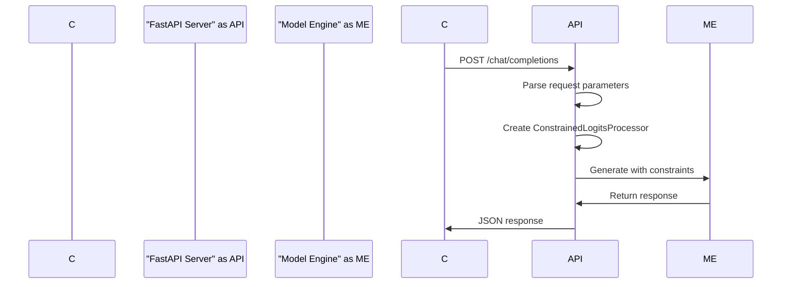
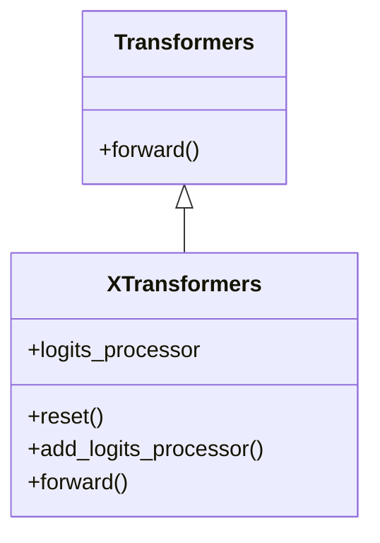

<!-- source: DeepWiki mcp.deepwiki.com · repo OpenBMB/XAgent · page 6.1 Model Generation · fetched 2026-10-26 -->

# Model Generation

<details>
<summary>Relevant source files</summary>

The following files were used as context for generating this wiki page:

- [XAgentGen/app.py](XAgentGen/app.py)
- [XAgentGen/xgen/models/__init__.py](XAgentGen/xgen/models/__init__.py)
- [XAgentGen/xgen/models/transformers.py](XAgentGen/xgen/models/transformers.py)
- [XAgentGen/xgen/parser/function_parser.py](XAgentGen/xgen/parser/function_parser.py)
- [XAgentGen/xgen/text/generate/__init__.py](XAgentGen/xgen/text/generate/__init__.py)
- [XAgentGen/xgen/text/generate/regex.py](XAgentGen/xgen/text/generate/regex.py)

</details>


## Purpose and Scope

This document provides a technical explanation of the Model Generation system in XAgentGen, a component of the XAgent architecture that enables constrained text generation. XAgentGen serves to create customized language model outputs that conform to specific formats and structures, especially for generating valid JSON responses according to defined schemas and function signatures.

For information about how XAgentGen integrates with the broader XAgent system, see [Integration with XAgent](#6.2).

## Overview

XAgentGen implements constrained text generation by using regular expressions to guide the language model's output, ensuring it follows specified patterns and structures. This is particularly useful for enforcing JSON schema compliance when generating structured data like function calls and arguments.

```mermaid
flowchart LR
    subgraph "Client"
        "ClientRequest"
    end
    
    subgraph "XAgentGen"
        "App" --> "FunctionParser"
        "FunctionParser" --> "RegexGenerator"
        "RegexGenerator" --> "ConstrainedLogitsProcessor"
        "ConstrainedLogitsProcessor" --> "TransformerModel"
    end
    
    "ClientRequest" --> "App"
    "TransformerModel" --> "ConstrainedResponse"
    
    "ConstrainedResponse" --> "Client"
```

Sources: [XAgentGen/app.py:90-170](), [XAgentGen/xgen/parser/function_parser.py:36-371]()

## Key Components

### FastAPI Server

XAgentGen exposes its functionality through a FastAPI server, which handles JSON requests for model generation with constrained outputs.



Sources: [XAgentGen/app.py:23-31](), [XAgentGen/app.py:91-170]()

### Function Parser

The `FunctionParser` class converts JSON schemas and function descriptions into Pydantic models, which are then used to generate regex patterns for constrained output.

```mermaid
flowchart TD
    subgraph "FunctionParser"
        "create_all_functions_model" --> "add_function_model"
        "add_function_model" --> "create_object_model"
        "create_object_model" --> "add_property"
        "models_to_regex" --> "build_regex_from_object"
    end
    
    "JSONSchema" --> "create_all_functions_model"
    "build_regex_from_object" --> "RegexPattern"
```

Sources: [XAgentGen/xgen/parser/function_parser.py:36-371]()

### Constrained Logits Processor

The `ConstrainedLogitsProcessor` applies masks to the model's logits (token probabilities) to ensure that only tokens that follow the regex pattern have non-zero probability, effectively constraining the model's output.

```mermaid
flowchart LR
    subgraph "ConstrainedLogitsProcessor"
        "TokenIds" --> "RegexFSM"
        "RegexFSM" --> "MaskedLogits"
    end
    
    "ModelLogits" --> "TokenIds"
    "MaskedLogits" --> "NextTokenSelection"
```

Sources: [XAgentGen/app.py:68-84](), [XAgentGen/xgen/models/transformers.py:33-71]()

### XTransformers Model

The `XTransformers` class extends the base Transformers model with additional logits processing capabilities, enabling constrained text generation.



Sources: [XAgentGen/xgen/models/transformers.py:33-71]()

## Regex-Based Generation

XAgentGen uses a regex-based approach to constrain the model's output, which is implemented through the `XRegex` class and the `multi_regex` function.

```mermaid
flowchart TD
    subgraph "RegexGeneration"
        "RegexPatterns" --> "FSM[Finite State Machine]"
        "FSM[Finite State Machine]" --> "TokenConstraints"
        "TokenConstraints" --> "ConstrainedGeneration"
    end
```

Sources: [XAgentGen/xgen/text/generate/regex.py:19-78]()

## API Interface

### Chat Completions Endpoint

The primary endpoint for interacting with XAgentGen is `/chat/completions`, which accepts JSON requests with the following structure:

| Parameter | Type | Description |
|-----------|------|-------------|
| model | string | Model identifier (should be "agentllama" or "xagentllm") |
| messages | array | Conversation history |
| arguments | object | Extra arguments schema |
| functions | array | Function definitions |
| function_call | object | Function call specification |
| temperature | float | Sampling temperature |
| top_p | float | Top-p sampling parameter |
| frequency_penalty | float | Frequency penalty |
| presence_penalty | float | Presence penalty |
| repetition_penalty | float | Repetition penalty |
| max_tokens | integer | Maximum number of tokens to generate |

Sources: [XAgentGen/app.py:91-170]()

### Request Processing Flow

```mermaid
flowchart TD
    "Request" --> "ParseJSON"
    "ParseJSON" --> "FormatPrompt"
    "FormatPrompt" --> "CreateLogitsProcessor"
    "CreateLogitsProcessor" --> "SetSamplingParams"
    "SetSamplingParams" --> "TokenizePrompt"
    "TokenizePrompt" --> "GenerateResponse"
    "GenerateResponse" --> "ProcessOutput"
    "ProcessOutput" --> "ReturnJSON"
```

Sources: [XAgentGen/app.py:91-170]()

## Constrained Generation Process

1. **Schema Parsing**: Convert JSON schemas into Pydantic models
2. **Regex Generation**: Create regex patterns from the Pydantic models
3. **FSM Construction**: Build finite state machines from the regex patterns
4. **Token Mapping**: Map FSM states to allowed tokens
5. **Logits Processing**: Apply masks to model logits based on the token mapping
6. **Text Generation**: Generate text using the constrained token selection

Sources: [XAgentGen/xgen/parser/function_parser.py:270-352](), [XAgentGen/xgen/text/generate/regex.py:19-78]()

## Usage Example

When a client wants to generate a JSON response that conforms to a specific schema:

1. The client sends a request to the `/chat/completions` endpoint with the schema
2. The server creates a `ConstrainedLogitsProcessor` with the schema
3. The processor converts the schema to regex patterns
4. The model generates text, constrained by the regex patterns
5. The server returns the constrained text to the client

Sources: [XAgentGen/app.py:91-170]()

## Model Initialization and Configuration

XAgentGen uses vLLM (a high-performance inference engine) to load and run the language model:

```mermaid
flowchart LR
    "ModelPath" --> "AsyncEngineArgs"
    "AsyncEngineArgs" --> "AsyncLLMEngine"
    "AsyncLLMEngine" --> "Tokenizer"
    "AsyncLLMEngine" --> "InferenceEngine"
```

Sources: [XAgentGen/app.py:40-65]()

## Performance Considerations

The `XRegex` class implements caching of the finite state machines to improve performance for repeated calls with the same regex patterns:

```python
pstate_to_vocab_path_cache = TTLCache(maxsize=20, ttl=3600)
```

This cache stores the compiled FSMs, states to token maps, and empty token IDs for up to 20 different regex patterns, with a time-to-live of 1 hour.

Sources: [XAgentGen/xgen/text/generate/regex.py:13-56]()

---

