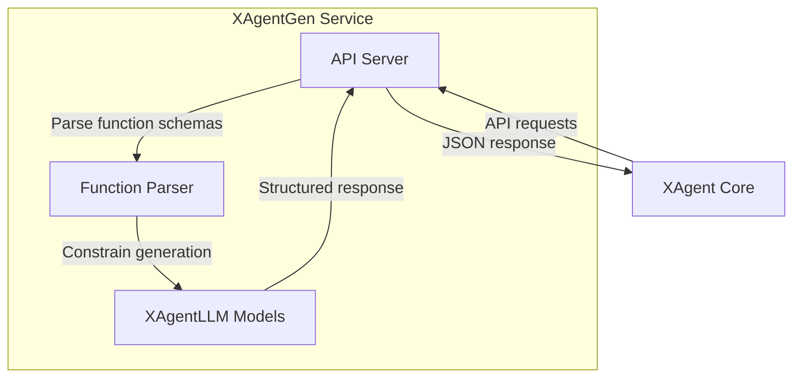
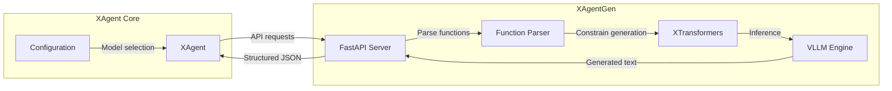
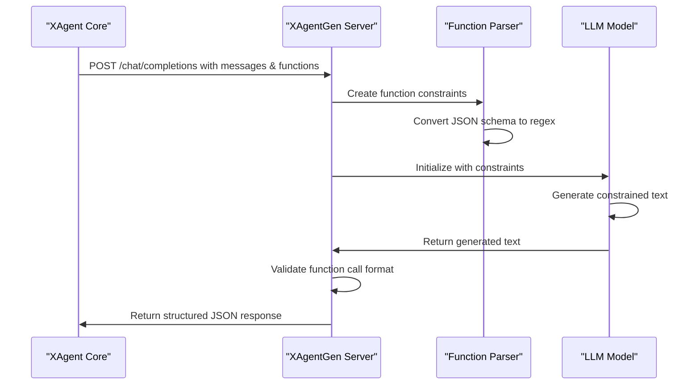
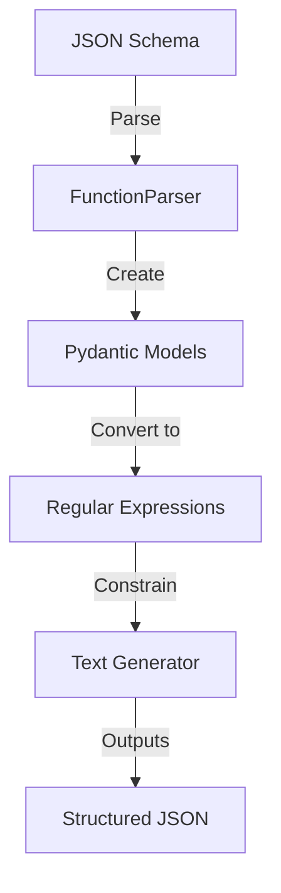
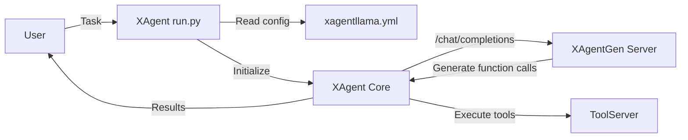

<!-- source: DeepWiki mcp.deepwiki.com · repo OpenBMB/XAgent · page 6.2 Integration with XAgent · fetched 2026-10-26 -->

# Integration with XAgent

<details>
<summary>Relevant source files</summary>

The following files were used as context for generating this wiki page:

- [README.md](README.md)
- [README_JA.md](README_JA.md)
- [README_ZH.md](README_ZH.md)
- [XAgentGen/README.md](XAgentGen/README.md)
- [XAgentGen/app.py](XAgentGen/app.py)
- [XAgentGen/xgen/models/__init__.py](XAgentGen/xgen/models/__init__.py)
- [XAgentGen/xgen/models/transformers.py](XAgentGen/xgen/models/transformers.py)
- [XAgentGen/xgen/parser/function_parser.py](XAgentGen/xgen/parser/function_parser.py)
- [XAgentGen/xgen/text/generate/__init__.py](XAgentGen/xgen/text/generate/__init__.py)
- [XAgentGen/xgen/text/generate/regex.py](XAgentGen/xgen/text/generate/regex.py)

</details>


This document details how XAgentGen integrates with XAgent Core, enabling the use of custom trained language models for autonomous agent operations. XAgentGen provides function-constrained text generation capabilities that can be used as an alternative to external APIs like OpenAI's. For information about the model generation aspects of XAgentGen, see [Model Generation](#6.1).

## 1. XAgentGen Overview

XAgentGen implements guided generation of customized models that support XAgent's operation. Its primary capability is allowing models to generate structured function calls with complex JSON schemas, similar to OpenAI's function calling API. This enables XAgent to use open-source or custom-trained models while maintaining structured output formats required by the agent system.

The component runs as a separate service that exposes an API endpoint similar to OpenAI's `/chat/completions` interface, making it a drop-in replacement in the XAgent architecture.



Sources: [XAgentGen/README.md:1-49](), [XAgentGen/app.py:1-34]()

## 2. Integration Architecture

XAgentGen is designed as a separate service that can be run alongside XAgent Core. The integration is implemented through an API interface that mimics the OpenAI API structure, allowing XAgent to interact with XAgentGen models using the same patterns it uses for external models.

### 2.1 System Components



Sources: [XAgentGen/app.py:1-170](), [XAgentGen/xgen/parser/function_parser.py:1-371]()

### 2.2 Communication Flow

The communication between XAgent and XAgentGen follows this sequence:



Sources: [XAgentGen/app.py:85-170](), [XAgentGen/xgen/parser/function_parser.py:239-345]()

## 3. API Interface

XAgentGen exposes a FastAPI server with endpoints that mimic the OpenAI API structure, making it compatible with existing XAgent code that uses the OpenAI client.

### 3.1 Endpoints

| Endpoint | Method | Description |
|----------|--------|-------------|
| `/chat/health` | POST | Health check endpoint |
| `/chat/completions` | POST | Main endpoint for generating text completions |

Sources: [XAgentGen/app.py:85-91](), [XAgentGen/app.py:92-170]()

### 3.2 Request Format

The request to the `/chat/completions` endpoint follows this structure:

```
{
  "model": "xagentllm",
  "messages": [
    {"role": "system", "content": "..."},
    {"role": "user", "content": "..."},
    {"role": "assistant", "content": "..."}
  ],
  "functions": [
    {
      "name": "function_name",
      "parameters": {
        "type": "object",
        "properties": {
          "param1": {"type": "string"},
          "param2": {"type": "integer"}
        },
        "required": ["param1"]
      }
    }
  ],
  "function_call": {"name": "function_name"},
  "arguments": {...},
  "temperature": 0.8,
  "top_p": 1.0,
  "max_tokens": 4000
}
```

Sources: [XAgentGen/app.py:92-117]()

### 3.3 Response Format

The response from the API follows this structure:

```
{
  "model": "xagentllm",
  "usage": {
    "prompt_tokens": 123,
    "completion_tokens": 456,
    "total_tokens": 579
  },
  "choices": [
    {
      "message": {
        "content": "{\"name\":\"function_name\",\"arguments\":{\"param1\":\"value\",\"param2\":42}}"
      },
      "finish_reason": "stop",
      "index": 0
    }
  ]
}
```

Sources: [XAgentGen/app.py:143-169]()

## 4. Function Calling Mechanism

A key feature of XAgentGen is its ability to generate text that conforms to a specified JSON schema, similar to OpenAI's function calling capability. This is implemented through a function parsing and constraint system.

### 4.1 Function Parsing Process



Sources: [XAgentGen/xgen/parser/function_parser.py:36-268](), [XAgentGen/xgen/parser/function_parser.py:289-300]()

### 4.2 Function Schema Processing

1. The `FunctionParser` class takes JSON schemas for functions and converts them to Pydantic models
2. These models are then converted to regular expressions that constrain the output space
3. The `ConstrainedLogitsProcessor` applies these constraints during text generation
4. The resulting text is guaranteed to conform to the specified schema

Sources: [XAgentGen/app.py:68-84](), [XAgentGen/xgen/text/generate/regex.py:19-78]()

## 5. Configuration for XAgent

To use XAgentGen with XAgent Core, you need to configure XAgent to use the custom model instead of the default OpenAI models.

### 5.1 Configuration File

XAgent provides a sample configuration file (`assets/xagentllama.yml`) for using XAgentGen. The key aspects of this configuration include:

1. Setting the model type to the custom model
2. Providing the endpoint URL for the XAgentGen server
3. Configuring generation parameters

Sources: [XAgentGen/README.md:42-48]()

### 5.2 Docker Network Configuration

XAgentGen and XAgent must be on the same Docker network to communicate efficiently. When running XAgentGen, it should be started with the `--network tool-server-network` parameter to join XAgent's network.

Sources: [XAgentGen/README.md:35-38]()

## 6. Usage Example

### 6.1 Starting XAgentGen Service

To use XAgentGen with XAgent:

1. Start the XAgentGen Docker container:
```bash
docker run -it -p 13520:13520 --network tool-server-network -v /host/model/path:/model:rw --gpus all --ipc=host xagentteam/xagentgen:latest python app.py --model-path /model --port 13520
```

2. Run XAgent with the custom configuration:
```bash
python run.py --task "find all the prime numbers <=100" --config-file "assets/xagentllama.yml"
```

Sources: [XAgentGen/README.md:35-48]()

### 6.2 Integration Flow



Sources: [README.md:42-54](), [XAgentGen/README.md:42-48]()

## 7. Technical Implementation Details

### 7.1 Constrained Text Generation

The core technical innovation in XAgentGen is its constrained text generation system:

1. JSON schemas are converted to Pydantic models for validation
2. Models are then converted to regular expressions via the `build_regex_from_object` function
3. The `XRegex` and `multi_regex` classes create finite state machines from these regular expressions
4. The `ConstrainedLogitsProcessor` applies these constraints during text generation by masking invalid next tokens

This ensures that the model output always conforms to the specified schema structure, enabling reliable function calling.

Sources: [XAgentGen/xgen/parser/function_parser.py:289-300](), [XAgentGen/xgen/text/generate/regex.py:19-78](), [XAgentGen/app.py:68-84]()

### 7.2 Model Implementation

XAgentGen extends the standard Transformers library with the `XTransformers` class that adds support for:

1. Custom logits processors for constrained generation
2. Token counting for usage statistics
3. Integration with VLLM for efficient inference

Sources: [XAgentGen/xgen/models/transformers.py:33-71]()

## 8. Advantages of XAgentGen Integration

Using XAgentGen with XAgent provides several advantages:

1. **Independence from external APIs**: Reduces reliance on proprietary APIs like OpenAI
2. **Cost reduction**: Eliminates API usage costs for high-volume scenarios
3. **Customization**: Allows training specialized models for specific domains
4. **Privacy**: Keeps sensitive information within your infrastructure
5. **Compatibility**: Maintains the same function calling interface as OpenAI

This integration represents an important step toward making XAgent more self-contained and customizable for different deployment scenarios.

Sources: [XAgentGen/README.md:1-49]()

---

