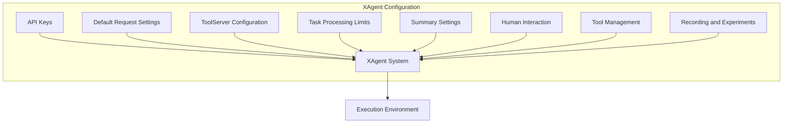
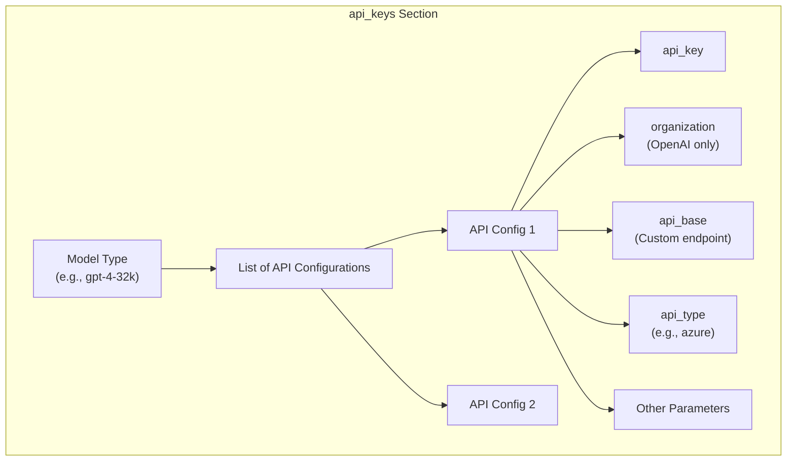
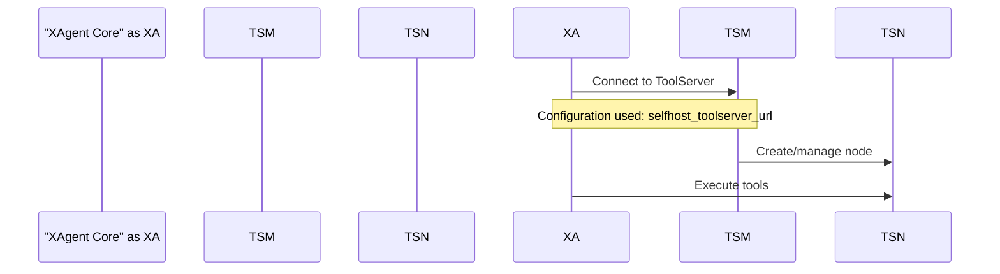
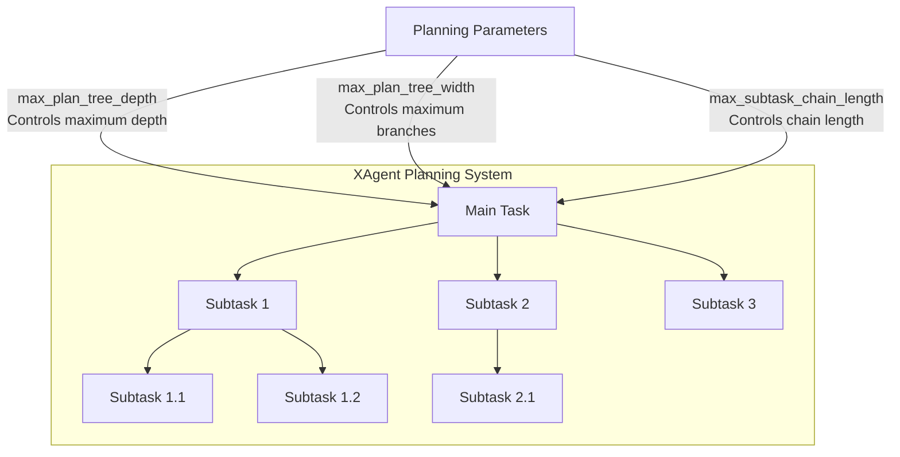
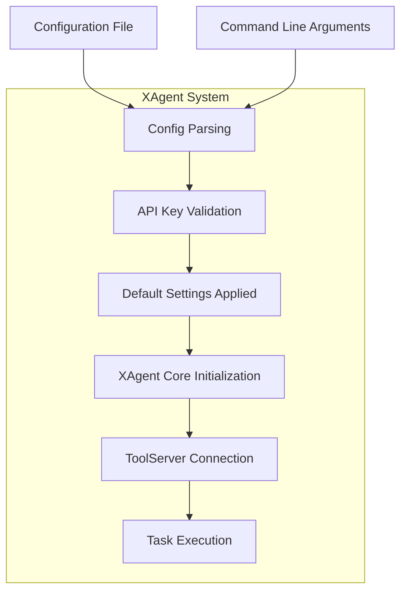

<!-- source: DeepWiki mcp.deepwiki.com · repo OpenBMB/XAgent · page 7 Configuration Reference · fetched 2026-10-26 -->

# Configuration Reference

<details>
<summary>Relevant source files</summary>

The following files were used as context for generating this wiki page:

- [README.md](README.md)
- [README_JA.md](README_JA.md)
- [README_ZH.md](README_ZH.md)
- [XAgentGen/README.md](XAgentGen/README.md)
- [assets/config.yml](assets/config.yml)
- [assets/gpt-3.5-turbo_config.yml](assets/gpt-3.5-turbo_config.yml)
- [assets/gpt4_config.yml](assets/gpt4_config.yml)

</details>


## Overview

This document provides a comprehensive reference for all configuration options available in XAgent. The configuration file controls aspects like API access, model parameters, tool server settings, task processing limits, and various experimental features.

For installation instructions, see [Installation and Setup](#1.2).

Sources: [README.md:113-120]()

## Configuration File Location and Format

XAgent uses YAML format for configuration files. The primary configuration file is located at `assets/config.yml`. There are also model-specific configuration templates available such as:

- `assets/gpt4_config.yml` - Optimized for GPT-4
- `assets/gpt-3.5-turbo_config.yml` - Optimized for GPT-3.5-Turbo
- `assets/xagentllama.yml` - For using XAgentGen with custom models

To use a specific configuration file, specify it with the `--config-file` argument when running XAgent:

```bash
python run.py --task "your task here" --config-file "assets/config.yml"
```

Sources: [README.md:126-128](), [assets/config.yml](), [assets/gpt4_config.yml](), [assets/gpt-3.5-turbo_config.yml]()

## Configuration Structure

The following diagram shows the main sections of the XAgent configuration file:



Sources: [assets/config.yml]()

## API Keys Configuration

This section defines the API keys for language models that XAgent can use. Multiple keys can be provided for each model type for fallback and load balancing.

### Structure



### Example Configuration

```yaml
api_keys:
  gpt-3.5-turbo-16k:
    - api_key: sk-xxxxx
      api_base: https://example.com
      api_type: azure
      api_version: 2023-07-01-preview
      engine: GPT-35-Turbo-16k
    - api_key: sk-xxxxx
      organization: org-xxxxxx
      model: gpt-3.5-turbo-16k
  gpt-4:    
    - api_key: sk-xxxxx
      organization: org-xxxxx
      model: gpt-4
  gpt-4-32k:
    - api_key: sk-xxxxx
      organization: org-xxxxx
      model: gpt-4-32k
```

### Supported Parameters

Each API configuration can include:

- **OpenAI-specific parameters:**
  - `api_key`: Your OpenAI API key
  - `organization`: Your OpenAI organization ID
  - `model`: The specific model identifier

- **Azure OpenAI-specific parameters:**
  - `api_key`: Your Azure OpenAI API key
  - `api_base`: The base URL for your Azure OpenAI resource
  - `api_type`: Set to "azure"
  - `api_version`: Azure API version (e.g., "2023-07-01-preview")
  - `engine`: The deployment name in Azure

- **Any additional parameters supported by the underlying API client**

Note: At least one `gpt-3.5-turbo-16k` API key should be provided as a backup model, even if using GPT-4 as the primary model.

Sources: [assets/config.yml:1-25](), [README.md:117-122]()

## Default Request Configuration

This section controls the default behavior of model requests.

```yaml
default_request_type: openai  # or xagent
default_completion_kwargs:
  model: gpt-4-32k
  temperature: 0.2
  request_timeout: 60
```

- `default_request_type`: Specifies the API type to use (options: "openai" or "xagent")
- `default_completion_kwargs`: Default parameters for completion requests:
  - `model`: The default model to use
  - `temperature`: Controls randomness (0-1, lower is more deterministic)
  - `request_timeout`: Timeout for API requests in seconds

Sources: [assets/config.yml:28-32](), [assets/gpt4_config.yml:17-21](), [assets/gpt-3.5-turbo_config.yml:10-14]()

## Summary Configuration

Controls how XAgent summarizes information during task execution.

```yaml
enable_summary: true
summary:
  single_action_max_length: 2048
  max_return_length: 12384
```

- `enable_summary`: Whether to enable summarization (true/false)
- `summary`: Summarization parameters:
  - `single_action_max_length`: Maximum length of a single action to summarize
  - `max_return_length`: Maximum length of summarized content

Sources: [assets/config.yml:34-37](), [assets/gpt4_config.yml:23-26](), [assets/gpt-3.5-turbo_config.yml:16-19]()

## ToolServer Configuration

ToolServer provides the environment where XAgent executes tools. This section configures how XAgent connects to ToolServer.

```yaml
use_selfhost_toolserver: true
selfhost_toolserver_url: http://localhost:8080
```

- `use_selfhost_toolserver`: Whether to use a self-hosted ToolServer (true/false)
- `selfhost_toolserver_url`: The URL where ToolServer is running

The following diagram shows how XAgent connects to ToolServer:



Sources: [assets/config.yml:39-40](), [assets/gpt4_config.yml:28-29](), [assets/gpt-3.5-turbo_config.yml:21-22](), [README.md:76-96]()

## Task Processing Configuration

Controls how XAgent approaches task planning and execution with parameters that limit various aspects of the process.

```yaml
max_retry_times: 5
max_subtask_chain_length: 15
max_plan_refine_chain_length: 3
max_plan_tree_depth: 3
max_plan_tree_width: 5
max_plan_length: 8192
```

- `max_retry_times`: Maximum number of retries when a task fails
- `max_subtask_chain_length`: Maximum number of subtasks in a chain
- `max_plan_refine_chain_length`: Maximum iterations of plan refinement
- `max_plan_tree_depth`: Maximum depth of the planning tree
- `max_plan_tree_width`: Maximum width (branching factor) of the planning tree
- `max_plan_length`: Maximum token length of a plan

The planning structure is illustrated in this diagram:



Sources: [assets/config.yml:42-47](), [assets/gpt4_config.yml:31-36](), [assets/gpt-3.5-turbo_config.yml:24-29]()

## RapidAPI Configuration

Controls the integration with RapidAPI for accessing external API tools.

```yaml
rapidapi_retrieve_tool_count: 0
```

- `rapidapi_retrieve_tool_count`: Number of tools to retrieve from RapidAPI
  - Set to 0 to disable RapidAPI integration
  - Higher values allow XAgent to access more external API tools

Sources: [assets/config.yml:49](), [assets/gpt4_config.yml:38](), [assets/gpt-3.5-turbo_config.yml:31](), [README.md:68-69]()

## Human Interaction Configuration

Controls whether and how XAgent can request human assistance.

```yaml
enable_ask_human_for_help: False
```

- `enable_ask_human_for_help`: Whether XAgent can ask for human assistance (true/false)

When enabled, XAgent can pause execution and request human input to overcome obstacles.

Sources: [assets/config.yml:51](), [assets/gpt4_config.yml:40](), [assets/gpt-3.5-turbo_config.yml:33](), [README.md:48]()

## Tool Management Configuration

Controls which tools are available to XAgent.

```yaml
tool_blacklist:
  - FileSystemEnv_print_filesys_struture
```

- `tool_blacklist`: List of tools that XAgent is not allowed to use

Sources: [assets/config.yml:53-54](), [assets/gpt4_config.yml:42-43](), [assets/gpt-3.5-turbo_config.yml:34-36]()

## Record Directory Configuration

Controls how XAgent records its execution for analysis and debugging.

```yaml
record_dir:
```

- `record_dir`: Directory where execution records are stored
  - Leave empty to disable recording
  - Set to a valid path to save execution records

Execution records contain all intermediate steps, including task statuses, LLM input-output pairs, and tool usage. Sensitive information such as API keys is automatically removed from records.

Sources: [assets/config.yml:56](), [assets/gpt4_config.yml:45](), [assets/gpt-3.5-turbo_config.yml:38](), [README.md:135-137]()

## Experiment Configuration

Controls experimental features in XAgent.

```yaml
experiment:
  redo_action: false
```

- `experiment`: Container for experimental settings
  - `redo_action`: Whether to enable the redo action feature (true/false)

Sources: [assets/config.yml:58-59](), [assets/gpt4_config.yml:47-48](), [assets/gpt-3.5-turbo_config.yml:40-41]()

## XAgentGen Integration

XAgentGen is a component that enables the use of custom models with XAgent. It requires additional configuration.

### Using XAgentGen

1. Set up the XAgentGen service (see [XAgentGen README](XAgentGen/README.md))
2. Use the XAgentLlama configuration:

```bash
python run.py --task "your task here" --config-file "assets/xagentllama.yml"
```

The `xagentllama.yml` configuration specifies how to connect to the XAgentGen service.

Sources: [XAgentGen/README.md:1-48]()

## Recommended Configurations

XAgent provides different configuration templates optimized for specific use cases:

| Configuration | Use Case | Notes |
|---------------|----------|-------|
| `config.yml` | Production use | Default configuration with GPT-4-32k |
| `gpt4_config.yml` | Standard use | For GPT-4 with modest context window |
| `gpt-3.5-turbo_config.yml` | Budget use | For GPT-3.5-Turbo-16k |
| `xagentllama.yml` | Custom models | For using with XAgentGen |

While XAgent can work with different models, we recommend:
- GPT-4-32k for best performance
- GPT-4 for most standard tasks
- GPT-3.5-Turbo-16k as a minimum requirement backup

XAgent is not recommended to run with standard GPT-3.5-Turbo due to its limited context length.

Sources: [README.md:117-122]()

## Configuration Application Workflow

The following diagram illustrates how configuration settings are applied during XAgent initialization:



Sources: [README.md:126-137]()

---

