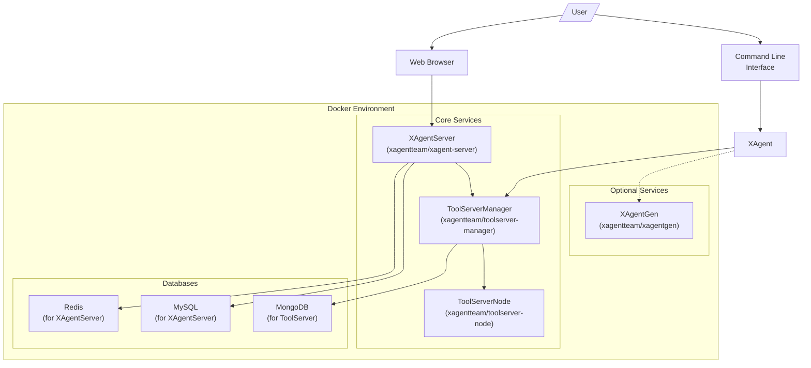
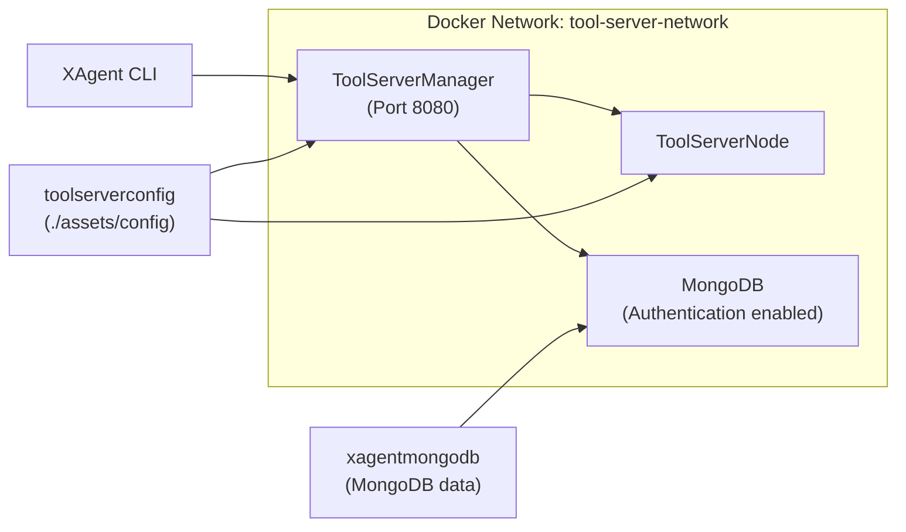
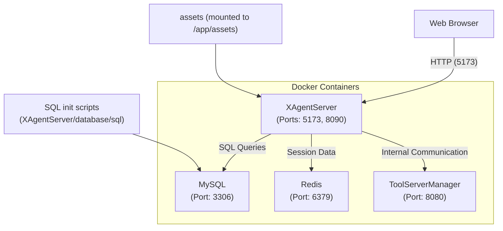
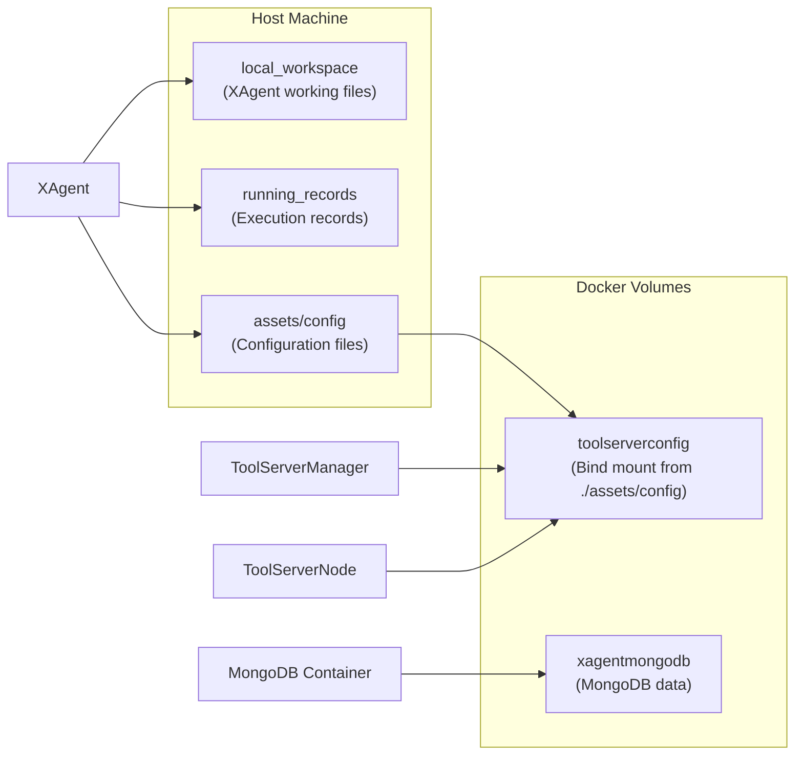

<!-- source: DeepWiki mcp.deepwiki.com · repo OpenBMB/XAgent · page 8 Deployment · fetched 2026-10-26 -->

# Deployment

<details>
<summary>Relevant source files</summary>

The following files were used as context for generating this wiki page:

- [README.md](README.md)
- [README_JA.md](README_JA.md)
- [README_ZH.md](README_ZH.md)
- [XAgent/recorder.py](XAgent/recorder.py)
- [XAgentGen/README.md](XAgentGen/README.md)
- [XAgentServer/server.py](XAgentServer/server.py)
- [docker-compose.yml](docker-compose.yml)

</details>


This page provides a comprehensive guide to deploying XAgent in various environments. It covers the deployment architecture, requirements, setup procedures, and configuration options. For information about XAgent's architecture and functionality, see [Architecture](#1.1), and for installation instructions without deployment details, see [Installation and Setup](#1.2).

## Deployment Architecture

XAgent consists of several components that work together to provide its functionality. When deploying XAgent, you'll need to set up these components and configure them properly.



Sources: [docker-compose.yml:1-111](), [README.md:72-146]()

## Prerequisites

Before deploying XAgent, ensure you have the following prerequisites:

1. **Docker and Docker Compose**: Required for containerization
2. **Python 3.10 or higher**: For running XAgent CLI
3. **OpenAI API Key**: At least one key is required for accessing OpenAI services
4. **Hardware Requirements**:
   - Minimum 8GB RAM
   - 10GB free disk space
   - For XAgentGen (optional): NVIDIA GPU with CUDA support

Sources: [README.md:77-80](), [README.md:110-123](), [XAgentGen/README.md:12-14]()

## Basic Deployment

The basic deployment includes the ToolServer components and allows interaction via the command line interface.

### Setting up ToolServer

ToolServer is where XAgent's actions take place. It provides a safe environment for running tools.

1. Create a docker-compose.yml file with the following contents (or use the one provided with XAgent):

```
# See docker-compose.yml for the complete configuration
```

2. Start the ToolServer containers:

```bash
docker compose up
```

Alternatively, to build the images from local sources:

```bash
docker compose build
docker compose up
```

To run the containers in the background:

```bash
docker compose up -d
```

### Container Structure

The ToolServer deployment consists of the following containers:



Sources: [docker-compose.yml:4-41](), [README.md:76-96]()

### Running XAgent with CLI

After setting up ToolServer, you can run XAgent using the command line interface:

1. Install Python requirements:

```bash
pip install -r requirements.txt
```

2. Configure XAgent in `assets/config.yml`. At minimum, provide one OpenAI API key.

3. Run XAgent:

```bash
python run.py --task "your task here" --config-file "assets/config.yml"
```

You can use the `--upload-files` parameter to select initial files for XAgent.

Sources: [README.md:107-136]()

## Full Deployment with Web Interface

The full deployment includes XAgentServer, which provides a web interface for interacting with XAgent.

### Setting up XAgentServer

XAgentServer requires MySQL and Redis for database and session management:

1. Ensure the full docker-compose.yml is used, which includes XAgentServer, MySQL, and Redis.

2. Start all services:

```bash
docker compose up -d
```

### Accessing the Web Interface

After deploying XAgentServer:

1. Navigate to `http://localhost:5173` in your web browser.

2. Log in using the default credentials:
   - Username: `guest`
   - Password: `xagent`



Sources: [docker-compose.yml:43-94](), [README.md:143-146](), [XAgentServer/server.py:1-110]()

## Optional: Deploying with XAgentGen

XAgentGen implements guided generation of customized models to support XAgent. This is optional and requires a GPU.

### Prerequisites for XAgentGen

- NVIDIA GPU
- NVIDIA CUDA Container Toolkit installed

### Deploying XAgentGen

1. Pull the pre-built docker image (recommended):

```bash
docker pull xagentteam/xagentgen:latest
```

Or build it yourself:

```bash
docker build -f dockerfiles/XAgentGen/Dockerfile -t xagentteam/xagentgen .
```

2. Run the XAgentGen container:

```bash
docker run -it -p 13520:13520 --network tool-server-network -v /host/model/path:/model:rw --gpus all --ipc=host xagentteam/xagentgen:latest python app.py --model-path /model --port 13520
```

Replace `/host/model/path` with the path to your model directory.

3. Configure XAgent to use the customized model:

```bash
python run.py --task "your task here" --config-file "assets/xagentllama.yml"
```

Sources: [XAgentGen/README.md:1-49]()

## Configuration Options

XAgent offers several configuration options to customize its behavior.

### Environment Variables

The following environment variables can be set in the `.env` file:

- `DB_USERNAME`: MongoDB username
- `DB_PASSWORD`: MongoDB password
- `DB_COLLECTION`: MongoDB collection name
- `CONFIG_FILE`: Path to the configuration file for XAgentServer

### Configuration Files

The main configuration file is `assets/config.yml`, which contains settings for XAgent:

- API keys for OpenAI
- Model configurations
- Human feedback settings
- Workspace configurations

For XAgentGen, a sample configuration file is available at `assets/xagentllama.yml`.

Sources: [docker-compose.yml:15-19](), [README.md:115-123]()

## Data and Workspace

When running XAgent, several directories are used for data storage:

1. **local_workspace**: Contains files generated by XAgent during execution
2. **running_records**: Contains execution records, including intermediate steps, task statuses, and LLM input-output pairs
3. **toolserverconfig**: Docker volume that contains configuration for the ToolServer



Sources: [docker-compose.yml:98-106](), [README.md:129-136](), [XAgent/recorder.py:1-347]()

## Troubleshooting

### Common Issues

1. **Docker Service Not Starting**:
   - Check if Docker is running: `docker info`
   - Ensure you have enough disk space: `df -h`

2. **ToolServer Connection Issues**:
   - Verify the ToolServerManager is running: `docker ps | grep ToolServerManager`
   - Check ToolServerManager logs: `docker logs $(docker ps -q --filter name=ToolServerManager)`

3. **XAgentServer Not Accessible**:
   - Check if the container is running: `docker ps | grep XAgent-Server`
   - Verify port mapping: `docker port XAgent-Server`
   - Check if the required ports (5173, 8090) are not already in use

4. **XAgentGen GPU Issues**:
   - Verify CUDA is properly installed: `nvidia-smi`
   - Ensure Docker has GPU access: `docker run --gpus all nvidia/cuda:11.0-base nvidia-smi`

### Updating XAgent

To update XAgent components:

1. Pull the latest images:
```bash
docker compose pull
```

2. Or rebuild the images:
```bash
docker compose build
```

3. Restart the services:
```bash
docker compose down
docker compose up -d
```

Sources: [README.md:98-108]()

## Security Considerations

When deploying XAgent, consider the following security aspects:

1. **API Keys**: OpenAI API keys in the configuration should be kept secure
2. **Database Authentication**: Ensure strong passwords for MongoDB, MySQL, and Redis
3. **Web Access**: Consider using a reverse proxy with HTTPS for production deployments
4. **Container Isolation**: ToolServerNode provides isolation for executed code

Sources: [docker-compose.yml:67-90](), [README.md:115-123]()

---

