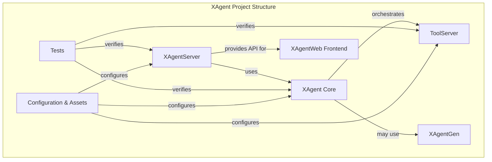
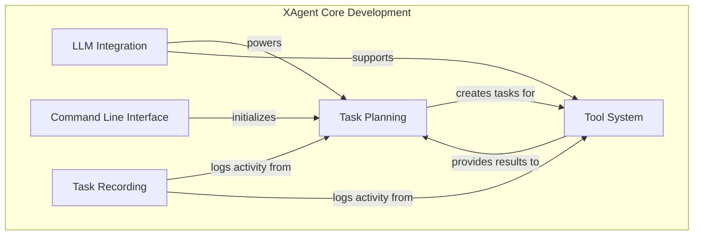
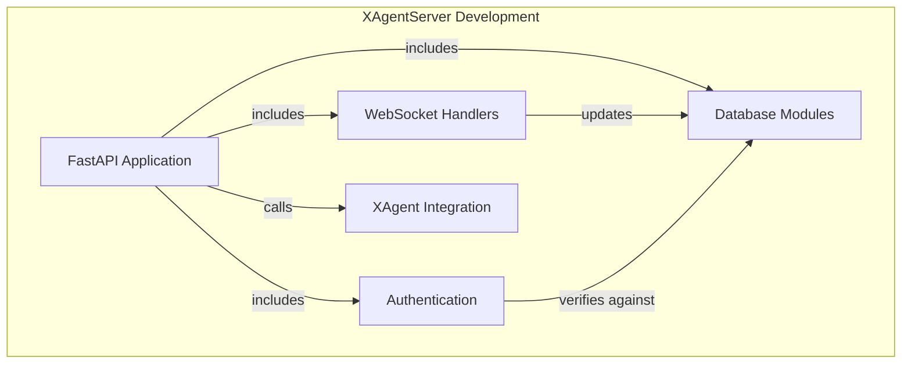
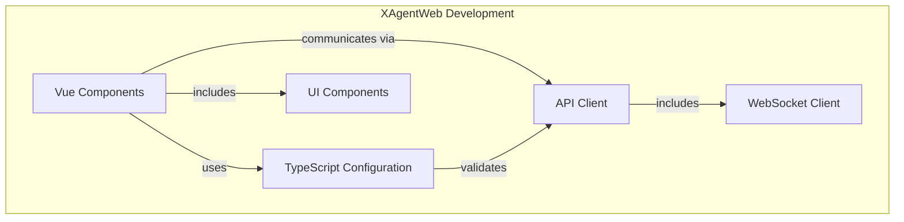
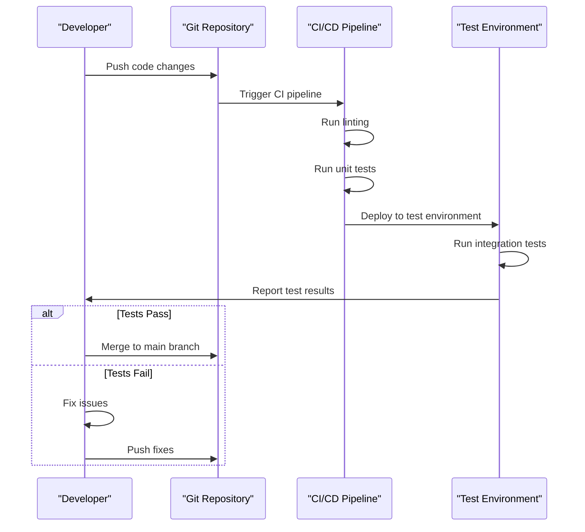

<!-- source: DeepWiki mcp.deepwiki.com · repo OpenBMB/XAgent · page 9 Developer Guide · fetched 2026-10-26 -->

# Developer Guide

<details>
<summary>Relevant source files</summary>

The following files were used as context for generating this wiki page:

- [.gitignore](.gitignore)
- [XAgentWeb/.gitignore](XAgentWeb/.gitignore)
- [XAgentWeb/components.d.ts](XAgentWeb/components.d.ts)
- [XAgentWeb/src/App.vue](XAgentWeb/src/App.vue)
- [XAgentWeb/src/components/Business/Feedback/index.vue](XAgentWeb/src/components/Business/Feedback/index.vue)
- [XAgentWeb/src/views/login/component/ApplyForm.vue](XAgentWeb/src/views/login/component/ApplyForm.vue)
- [XAgentWeb/tsconfig.json](XAgentWeb/tsconfig.json)
- [XAgentWeb/tsconfig.node.json](XAgentWeb/tsconfig.node.json)
- [requirements.txt](requirements.txt)
- [start_server.py](start_server.py)
- [tests/__init__.py](tests/__init__.py)
- [tests/test_1106_model_openai.py](tests/test_1106_model_openai.py)
- [tests/test_model_alias.py](tests/test_model_alias.py)
- [tests/test_run.py](tests/test_run.py)

</details>


This guide provides essential information for developers who want to contribute to the XAgent project. It covers development environment setup, project structure, coding standards, testing procedures, and component-specific guidelines. For user installation and usage instructions, please see [Installation and Setup](#1.2).

## Development Environment Setup

To set up a development environment for XAgent, follow these steps:

1. **Clone the repository**:
   ```bash
   git clone https://github.com/OpenBMB/XAgent.git
   cd XAgent
   ```

2. **Install Python dependencies**:
   ```bash
   pip install -r requirements.txt
   ```

3. **Set up the web frontend** (if working on XAgentWeb):
   ```bash
   cd XAgentWeb
   npm install
   ```

4. **Create or edit configuration files**:
   Create appropriate configuration files by copying the examples:
   ```bash
   cp assets/config.example.yml assets/config.yml
   ```

5. **Install development tools**:
   ```bash
   pip install pytest
   ```

### Development Dependencies

The main Python dependencies required for development include:

| Category | Dependencies |
| --- | --- |
| Web Framework | fastapi, uvicorn, websockets |
| Data Processing | pydantic, jsonschema, orjson, PyYAML, json5 |
| Database | sqlalchemy, redis, pymysql |
| AI/LLM | openai, tiktoken, tenacity |
| Testing | pytest |
| UI/Display | termcolor, tqdm, Markdown, Pillow |
| Utilities | python-dotenv, requests, regex, colorama |

Sources: [requirements.txt:1-31]()

## Project Structure

XAgent is organized into several main components that work together to provide autonomous agent functionality.



Sources: [.gitignore:1-43]()

### Key Directories

| Directory | Purpose |
| --- | --- |
| `XAgent/` | Core XAgent functionality |
| `ToolServer/` | Tool execution environment |
| `XAgentServer/` | Backend server for web interface |
| `XAgentWeb/` | Web frontend |
| `XAgentGen/` | Custom model generation |
| `tests/` | Test files |
| `assets/` | Configuration files |
| `local_workspace/` | Local workspace for agent operations |

## Component Development Guidelines

### XAgent Core Development

The XAgent Core contains the main logic for the autonomous agent system. When developing for this component, focus on:

1. Task planning system
2. Tool system integration
3. LLM integration
4. Command line interface



Sources: [tests/test_1106_model_openai.py:1-49](), [tests/test_model_alias.py:1-53]()

#### Testing XAgent Core

To test XAgent Core functionality, use the pytest framework. Test files should be placed in the `tests/` directory.

Example of testing command line functionality:

```python
# Test the command line argument parser
def test_parse_args(mock_argv):
    args = parse_args()
    assert args.task == "example_task"
    assert args.upload_files == ["file1", "file2"]
    assert args.model == "model1"
```

Sources: [tests/test_run.py:1-59]()

#### OpenAI Integration Testing

Testing the integration with OpenAI APIs is important for ensuring model compatibility:

```python
# Test compatibility with different OpenAI model versions
def test_model_alias():
    # Mock OpenAI client and responses
    with mock.patch("openai.OpenAI") as mock_openai:
        # Set up mock
        # Test functionality
        # Verify results
```

Sources: [tests/test_1106_model_openai.py:8-48](), [tests/test_model_alias.py:8-48]()

### ToolServer Development

When developing for the ToolServer component, consider:

1. Docker container integration
2. Tool implementation
3. Security considerations
4. Resource management

### XAgentServer Development

The XAgentServer handles client-server communication and coordinates between the web interface and XAgent Core:

1. FastAPI endpoint development
2. WebSocket communication
3. Database integration (MySQL and Redis)
4. Authentication and session management



Sources: [start_server.py:1-13]()

### XAgentWeb Development

For frontend development in XAgentWeb:

1. Vue.js component development
2. TypeScript configuration
3. WebSocket client implementation
4. UI/UX considerations



Sources: [XAgentWeb/tsconfig.json:1-28](), [XAgentWeb/tsconfig.node.json:1-13](), [XAgentWeb/src/App.vue:1-40](), [XAgentWeb/components.d.ts:1-45]()

#### TypeScript Configuration

TypeScript is configured to provide type safety for the web frontend:

```typescript
// TypeScript configuration for Vue components
{
  "compilerOptions": {
    "target": "ESNext",
    "module": "ESNext",
    "strict": true,
    "jsx": "preserve",
    // Additional configuration...
  },
  "include": ["src/**/*.ts", "src/**/*.d.ts", "src/**/*.tsx", "src/**/*.vue"]
}
```

Sources: [XAgentWeb/tsconfig.json:1-27]()

#### Vue Components

The web interface is built using Vue.js components:

```vue
// Basic App component structure
<script setup lang="ts"></script>

<template><router-view /></template>

<style>
#app {
  width: 100%;
  height: 100%;
  overflow: hidden;
}
</style>
```

Sources: [XAgentWeb/src/App.vue:1-40]()

## Testing Guidelines

XAgent uses pytest for testing. Here are key guidelines for writing tests:

1. **Unit Tests**: Write tests for individual functions and classes
2. **Integration Tests**: Test interaction between components
3. **Mock External Services**: Use mock objects for external services like OpenAI

```python
# Example of testing with mocks
@patch('run.CommandLine')
def test_start_command_line(mock_command_line, mock_argv):
    args = parse_args()
    start_command_line(vars(args))
    
    called_args, _ = mock_command_line.call_args
    called_param = called_args[0]
    assert called_param.task == args.task
```

Sources: [tests/test_run.py:44-58]()

### Running Tests

To run tests:

```bash
# Run all tests
pytest

# Run specific test file
pytest tests/test_run.py

# Run with verbosity
pytest -v
```

## Contributing Workflow

1. **Fork the repository** on GitHub
2. **Create a feature branch** from main
   ```bash
   git checkout -b feature/your-feature-name
   ```
3. **Make your changes** and commit with descriptive messages
4. **Write tests** for new functionality
5. **Submit a pull request** to the main repository

### Code Style

- Follow PEP 8 for Python code
- Use descriptive variable and function names
- Document functions and classes with docstrings
- For TypeScript code, follow the configured linting rules

## Troubleshooting Development Issues

### Common Issues

1. **Dependencies**:
   - Ensure all dependencies are installed with the correct versions
   - Check for conflicts between packages

2. **Configuration**:
   - Verify that configuration files exist and have the correct format
   - Check API keys and other credentials

3. **Docker Issues**:
   - For ToolServer, verify Docker is installed and running
   - Check container permissions and network settings

4. **Testing**:
   - Use mocks for external services to avoid rate limits or network issues
   - Isolate tests to prevent side effects

## System Integration

When making changes that span multiple components, consider the following integration diagram:



Sources: [tests/__init__.py:1]()

## Conclusion

This developer guide provides an overview of the XAgent development process. For more detailed information on specific components, refer to the corresponding sections in this wiki:

- [XAgent Core](#2)
- [ToolServer](#3)
- [XAgentServer](#4)
- [XAgentWeb](#5)
- [XAgentGen](#6)

Remember that XAgent is an evolving project, and contributions that improve functionality, performance, and documentation are always welcome.