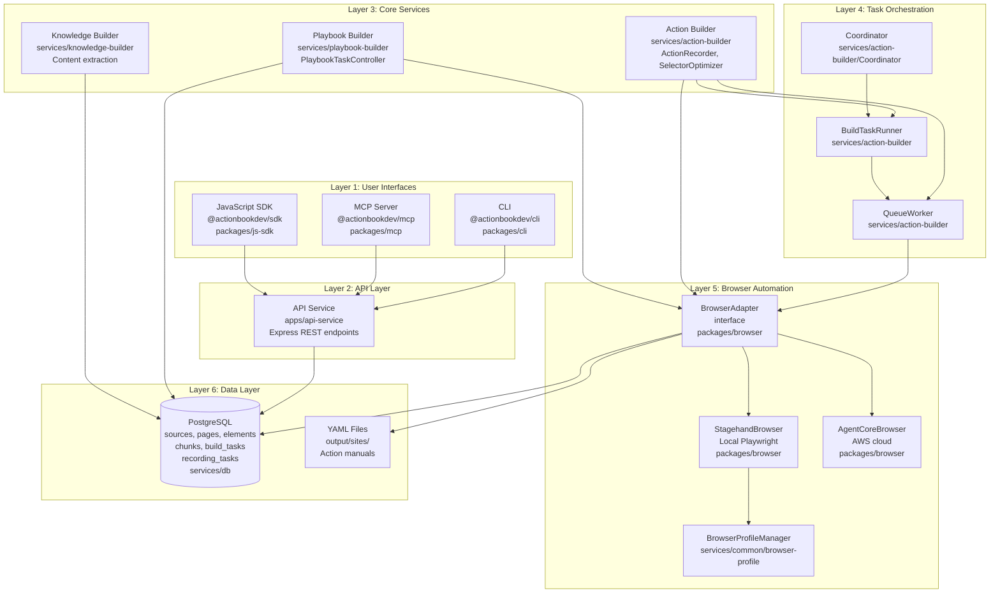
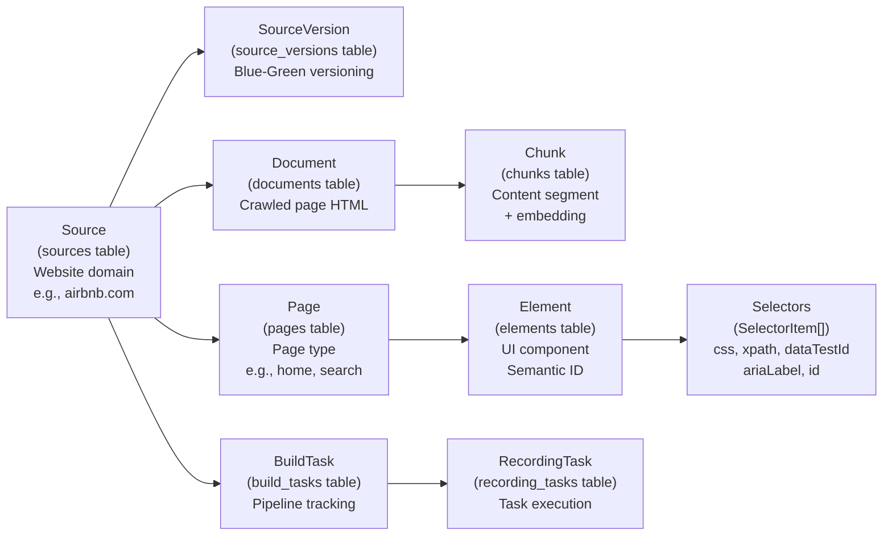
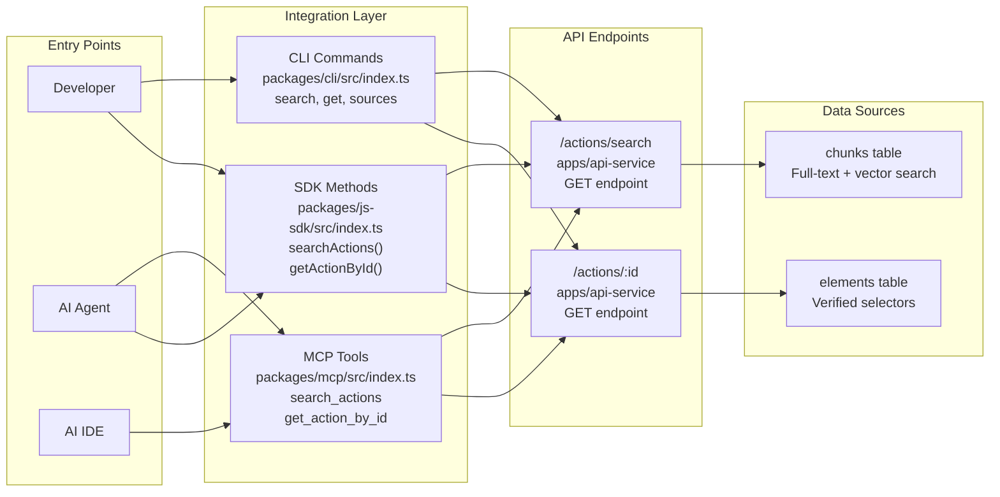
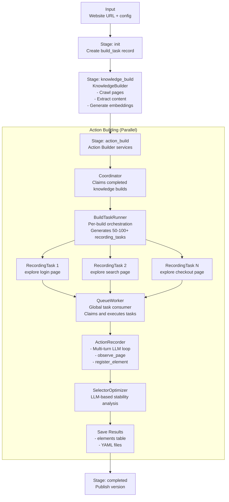

<!-- source: DeepWiki mcp.deepwiki.com · repo actionbook/actionbook · page 1 Overview · fetched 2026-10-26 -->

# Overview

<details>
<summary>Relevant source files</summary>

The following files were used as context for generating this wiki page:

- [.prettierignore](.prettierignore)
- [.prettierrc.json](.prettierrc.json)
- [CLAUDE.md](CLAUDE.md)
- [README.md](README.md)
- [services/action-builder/scripts/login.ts](services/action-builder/scripts/login.ts)
- [services/action-builder/src/optimizer/SelectorOptimizer.ts](services/action-builder/src/optimizer/SelectorOptimizer.ts)
- [services/common/browser-profile/package.json](services/common/browser-profile/package.json)
- [services/common/browser-profile/src/BrowserProfileManager.ts](services/common/browser-profile/src/BrowserProfileManager.ts)

</details>


## Purpose and Scope

This document provides a high-level introduction to Actionbook, explaining what it is, its core value proposition, and the major architectural components that comprise the system. This overview is intended to orient new developers and users to the codebase structure before diving into specific subsystems.

For specific user-facing integration methods, see [User Interfaces](#2). For detailed service implementation, see [Core Services](#3). For browser automation specifics, see [Browser Automation Layer](#4).

**Sources:** [README.md:1-745](), [CLAUDE.md:1-209]()

## What is Actionbook

Actionbook is a platform that provides AI agents with verified, up-to-date action manuals for website interaction. Instead of agents repeatedly parsing full HTML pages to discover interactive elements, Actionbook pre-builds structured "action manuals" containing verified DOM selectors, allowed operations, and page metadata for websites.

The system operates on a simple principle: **crawl once, use many times**. Actionbook's build pipeline discovers and documents website capabilities, storing them in both a PostgreSQL database (for fast search and retrieval) and YAML files (for human-readable output). AI agents and automation scripts can then query this pre-built knowledge base to obtain reliable selectors without the overhead of page analysis.

**Key characteristics:**
- **Query-focused**: Agents query for action manuals; execution happens in agent's own browser
- **Multi-modal search**: Combines full-text and vector similarity for accurate retrieval
- **Versioned**: Supports Blue-Green deployment of action manual versions
- **Framework-agnostic**: Works with any LLM provider (OpenAI, Anthropic, Gemini, Bedrock)

**Sources:** [README.md:9-48](), [CLAUDE.md:8-11]()

## Core Value Proposition

Actionbook addresses four critical problems in browser automation:

| Problem | Without Actionbook | With Actionbook |
|---------|-------------------|-----------------|
| **Execution Speed** | Agents parse full HTML to find elements | 10x faster using pre-computed action manuals |
| **Token Cost** | Entire DOM trees sent to LLM | 100x token savings with concise JSON definitions |
| **Brittleness** | Hardcoded selectors break on UI updates | Resilient: manuals updated independently of agent code |
| **Hallucinations** | LLMs guess at complex, unstructured DOMs | Reduced: agents receive verified selectors |

The fundamental efficiency gain comes from separating **discovery** (expensive, done once) from **execution** (cheap, done many times). The build pipeline invests time using AI-powered browser automation to discover and validate selectors, then all subsequent agent runs can leverage this work instantly.

**Sources:** [README.md:29-48]()

## System Architecture

The following diagram shows the major architectural layers and how they interact:

### High-Level Component Architecture



**Layer responsibilities:**
1. **User Interfaces**: Entry points for developers and AI agents
2. **API Layer**: REST endpoints for search and retrieval operations
3. **Core Services**: Build pipeline services for discovering and documenting websites
4. **Task Orchestration**: Concurrent build task management and execution
5. **Browser Automation**: Unified browser interface with local and cloud implementations
6. **Data Layer**: Persistent storage with hybrid search capabilities

**Sources:** [README.md:1-745](), [CLAUDE.md:29-56](), Diagram 1 from system architecture overview

## Domain Model Hierarchy

Actionbook organizes website information in a hierarchical structure:



**Key entities:**
- **Source**: Website domain with metadata, health score, tags [services/db]()
- **SourceVersion**: Version management for Blue-Green deployments [services/db]()
- **Page**: Functional page type (home, search, login) with URL patterns [services/db]()
- **Element**: Interactive UI component with semantic identifier [services/db]()
- **Selectors**: Multiple selector types with priority and confidence scores [services/db]()
- **Chunk**: Embedded content segments for vector search [services/db]()

**ActionId format**: `site/{domain}/page/{pageType}/element/{semanticId}`

Example: `site/airbnb.com/page/home/element/search-button`

**Sources:** [CLAUDE.md:14-26](), [CLAUDE.md:44-49](), Diagram 5 from system architecture overview

## Integration Methods

Actionbook provides three integration methods, each optimized for different use cases:

### Integration Method Comparison

| Method | Best For | Package | Entry Point |
|--------|----------|---------|-------------|
| **CLI** | AI agents, command-line automation, quick testing | `@actionbookdev/cli` | `actionbook` command |
| **MCP Server** | AI IDEs (Cursor, Claude Code, VS Code, etc.) | `@actionbookdev/mcp` | MCP protocol integration |
| **JavaScript SDK** | Custom agents, programmatic integration, LLM frameworks | `@actionbookdev/sdk` | `Actionbook` class |

### User Interaction Flow



**Common workflow:**
1. Query for actions: `search_actions("airbnb search")`
2. Review results with descriptions and IDs
3. Get detailed action: `get_action_by_id("site/airbnb.com/page/home/element/search-button")`
4. Extract selectors: Use `css`, `dataTestId`, `ariaLabel`, or `xpath` from response
5. Execute in browser: Use selectors in Playwright, Puppeteer, Selenium, etc.

**Sources:** [README.md:84-661](), [CLAUDE.md:43-56](), Diagram 2 from system architecture overview

## Key Components Overview

### User-Facing Packages

**CLI (`@actionbookdev/cli`)**: Command-line interface providing search, retrieval, and browser automation commands. Wraps the API Service and includes an integrated browser automation tool. [packages/cli]()

**MCP Server (`@actionbookdev/mcp`)**: Model Context Protocol server enabling AI IDEs to access Actionbook via standardized tools. Exposes `search_actions` and `get_action_by_id` tools. [packages/mcp]()

**JavaScript SDK (`@actionbookdev/sdk`)**: Core TypeScript library with type definitions and API client. Provides methods with attached tool definitions for easy LLM framework integration. [packages/js-sdk]()

For detailed usage, see [User Interfaces](#2).

### Core Services

**API Service (`apps/api-service`)**: Express-based REST API providing search and retrieval endpoints. Implements hybrid search (full-text + vector similarity) using PostgreSQL indexes. [apps/api-service]()

**Action Builder (`services/action-builder`)**: Main recording service that discovers UI elements and generates action manuals. Uses AI-powered browser automation with multi-turn LLM loops. Includes `ActionRecorder`, `SelectorOptimizer`, `Coordinator`, `BuildTaskRunner`, and `QueueWorker`. [services/action-builder]()

**Playbook Builder (`services/playbook-builder`)**: Generates human-readable documentation for websites by discovering page types and capabilities. Operates alongside Action Builder. [services/playbook-builder]()

**Knowledge Builder (`services/knowledge-builder`)**: Crawls websites to extract and embed content for search. Generates the `chunks` table with embeddings for vector similarity search. [services/knowledge-builder]()

For detailed service architecture, see [Core Services](#3).

### Browser Automation

**BrowserAdapter Interface (`packages/browser`)**: Abstract interface defining unified browser operations. Implementations can be local (Playwright) or cloud-based (AWS). [packages/browser]()

**StagehandBrowser**: Local implementation using Playwright and Stagehand SDK. Supports multiple LLM providers (OpenRouter, OpenAI, Anthropic, Bedrock). [packages/browser]()

**AgentCoreBrowser**: Cloud implementation using AWS AgentCore and Bedrock Claude. [packages/browser]()

**BrowserProfileManager (`services/common/browser-profile`)**: Manages persistent browser profiles for login state. Enables "login once, reuse many times" workflow. [services/common/browser-profile/src/BrowserProfileManager.ts:1-239]()

For browser automation details, see [Browser Automation Layer](#4).

### Data Layer

**Database (`services/db`)**: PostgreSQL schema with Drizzle ORM. Includes specialized indexes:
- **GIN index** on `chunks.content` for full-text search
- **HNSW index** on `chunks.embedding` for vector similarity
- **Composite indexes** on foreign keys for efficient joins

**YAML Output (`output/sites/`)**: Human-readable action manuals in YAML format, organized by site and version. Provides offline access and version control.

For database details, see [Data Layer](#5).

**Sources:** [CLAUDE.md:29-40](), [README.md:702-729](), Diagram 6 from system architecture overview

## Build Pipeline Overview

The build pipeline operates in three stages to transform a website URL into searchable action manuals:



**Stage progression:**
1. **init**: Create `build_task` record with pending status
2. **knowledge_build**: Crawl and document pages, generate embeddings
3. **action_build**: Discover and record UI elements with verified selectors
4. **completed**: Publish version, make available for queries

**Concurrency model:**
- **One Coordinator**: Polls database for completed knowledge builds, spawns BuildTaskRunners
- **Multiple BuildTaskRunners**: One per build, generates recording tasks
- **Global QueueWorker Pool**: Claims and executes recording tasks across all builds
- **Heartbeat monitoring**: 5-second intervals with 15-minute stale detection
- **Retry logic**: Max 3 attempts per recording task

For detailed pipeline mechanics, see [Task Execution Pipeline](#3.2.1).

**Sources:** [services/action-builder](), Diagram 3 from system architecture overview

## Technology Stack

### Core Technologies

| Category | Technology | Usage |
|----------|-----------|-------|
| **Language** | TypeScript 5.x | Entire codebase |
| **Runtime** | Node.js 18+ (20+ recommended) | All services |
| **Package Manager** | pnpm | Monorepo management |
| **Build System** | Turborepo | Parallel builds, caching |
| **Database** | PostgreSQL | Primary data store |
| **ORM** | Drizzle ORM | Type-safe database access |

### Browser Automation

| Technology | Usage |
|-----------|-------|
| **Playwright** | Local browser automation via StagehandBrowser |
| **Stagehand SDK** | AI-powered browser operations (`@browserbasehq/stagehand`) |
| **AWS AgentCore** | Cloud-based browser service |

### AI/LLM Integration

| Technology | Usage |
|-----------|-------|
| **Vercel AI SDK** | LLM framework abstraction (`ai`, `@ai-sdk/*`) |
| **OpenRouter** | Multi-model LLM gateway |
| **OpenAI** | GPT models (gpt-4o, gpt-4o-mini) |
| **Anthropic** | Claude models (claude-3-5-haiku, claude-sonnet) |
| **AWS Bedrock** | Claude models in AWS |

### API and Protocols

| Technology | Usage |
|-----------|-------|
| **Express** | REST API server (apps/api-service) |
| **MCP Protocol** | Model Context Protocol for AI IDE integration (`@modelcontextprotocol/sdk`) |
| **Zod** | Schema validation and type inference |

### Database Features

- **Full-text search**: PostgreSQL `ts_vector` with GIN indexes
- **Vector search**: pgvector extension with HNSW indexes
- **Hybrid search**: Combines full-text and vector similarity with RRF (Reciprocal Rank Fusion)
- **Serverless support**: Neon serverless PostgreSQL driver (`@neondatabase/serverless`)

**Sources:** [CLAUDE.md:59-65](), [README.md:702-729](), [package.json files in packages/]()

## Monorepo Structure

The codebase is organized as a pnpm workspace with Turborepo orchestration:

```
actionbook/
├── packages/              # Published npm packages
│   ├── js-sdk/           # @actionbookdev/sdk - Core types and API client
│   ├── mcp/              # @actionbookdev/mcp - MCP Server
│   ├── cli/              # @actionbookdev/cli - Command-line interface
│   ├── tools-ai-sdk/     # @actionbookdev/tools-ai-sdk - Vercel AI SDK integration
│   └── browser/          # @actionbookdev/browser - Browser adapter implementations
├── apps/
│   └── api-service/      # REST API server
├── services/
│   ├── action-builder/   # Action recording service
│   ├── playbook-builder/ # Documentation generation service
│   ├── knowledge-builder/# Content crawling and embedding service
│   ├── db/               # @actionbookdev/db - Database schema and migrations
│   └── common/
│       └── browser-profile/ # @actionbookdev/browser-profile - Login state management
├── playground/           # Example projects and demos
└── eval/                 # Evaluation framework
```

**Package dependency principle:** Published packages (`js-sdk`, `mcp`, `cli`) have no dependencies on internal services. Services depend on published packages and common libraries.

For detailed monorepo information, see [Development Guide](#8).

**Sources:** [CLAUDE.md:29-40](), [README.md:702-729]()

---

