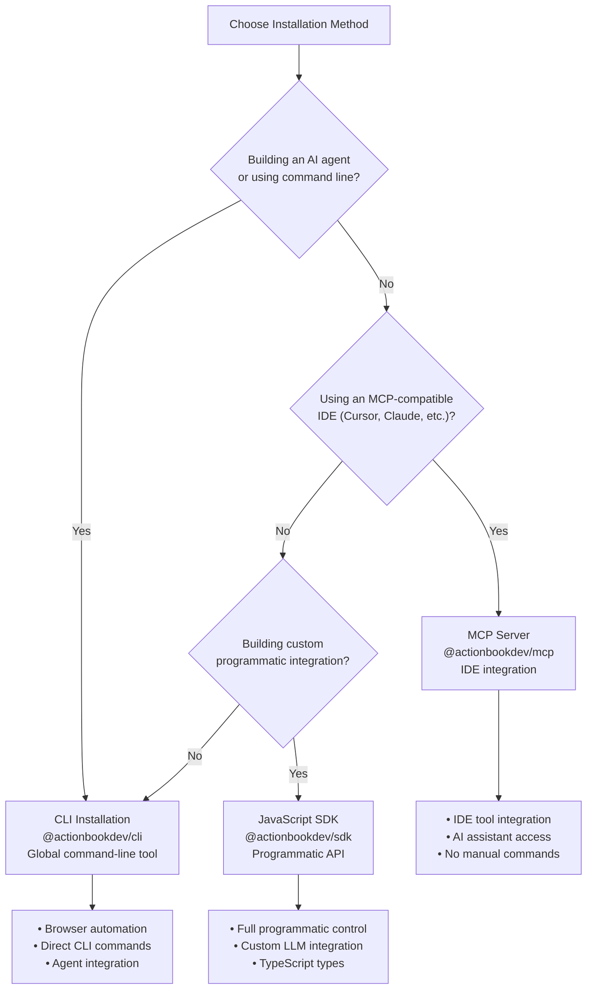
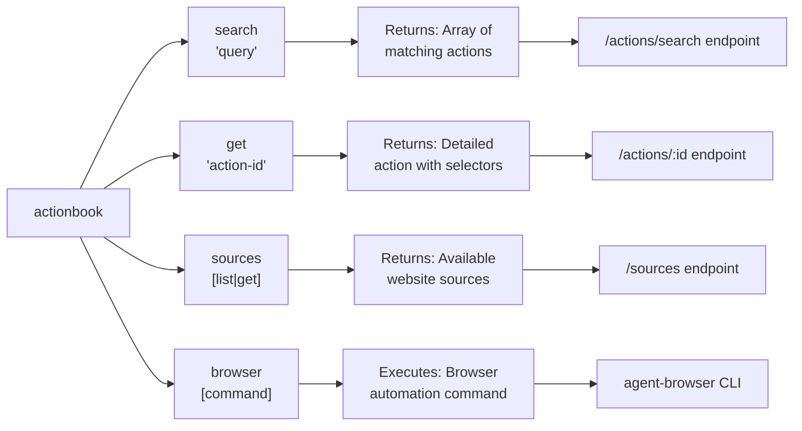
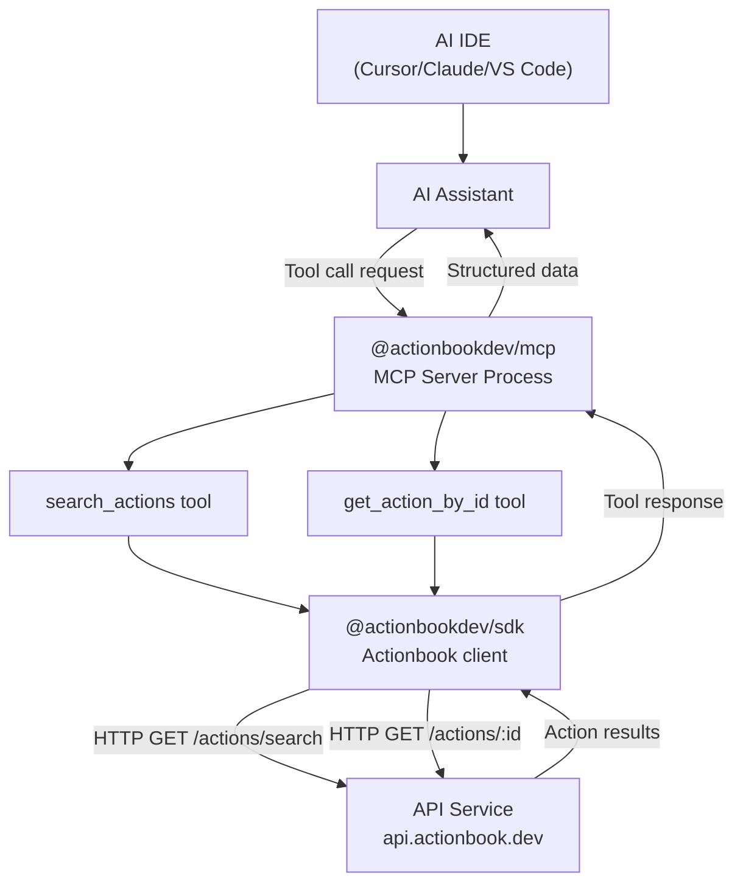
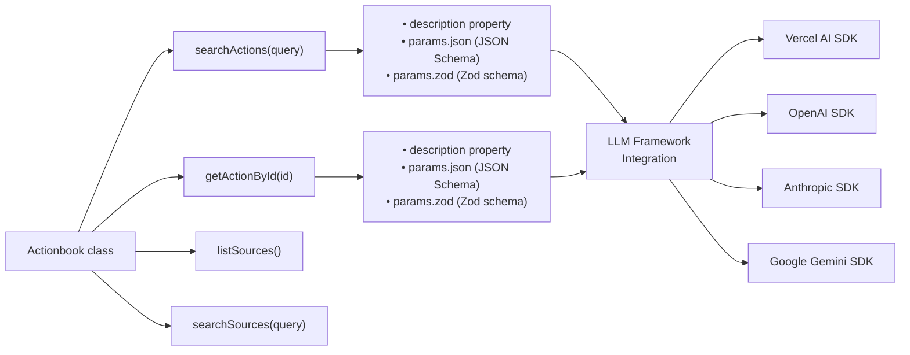

<!-- source: DeepWiki mcp.deepwiki.com · repo actionbook/actionbook · page 1.1 Getting Started · fetched 2026-10-26 -->

# Getting Started

<details>
<summary>Relevant source files</summary>

The following files were used as context for generating this wiki page:

- [LICENSE](LICENSE)
- [README.md](README.md)
- [packages/cli/package.json](packages/cli/package.json)
- [packages/js-sdk/package.json](packages/js-sdk/package.json)
- [packages/mcp/package.json](packages/mcp/package.json)

</details>


This guide covers the installation and initial setup of Actionbook, providing step-by-step instructions for all three integration methods: CLI, MCP Server, and JavaScript SDK. By the end of this guide, you will have Actionbook installed and will have executed your first action manual search.

For detailed information about individual installation methods and their features, see [User Interfaces](#2). For architecture details, see [Architecture Overview](#1.2).

---

## Prerequisites

Before installing Actionbook, ensure your environment meets the following requirements:

| Requirement | Minimum Version | Recommended | Verification Command |
|-------------|----------------|-------------|---------------------|
| Node.js | v18.0.0 | v20+ | `node --version` |
| npm | 9+ (included with Node.js) | 10+ | `npm --version` |
| pnpm | 8+ (optional, for SDK) | 10+ | `pnpm --version` |

**Current Status:** Actionbook is in open beta. No API key is required for any integration method.

**Sources:** [README.md:94-102]()

---

## Installation Method Selection

Actionbook provides three integration methods. Choose based on your use case:



**Sources:** [README.md:86-93](), [README.md:106-661]()

---

## Option 1: CLI Installation

The CLI (`@actionbookdev/cli`) is the recommended method for most users and provides direct access to all Actionbook features.

### Installation Steps

**Step 1: Install the CLI globally**

```bash
npm install -g @actionbookdev/cli
```

**Step 2: Install Chromium for browser automation**

```bash
actionbook browser install
```

This command installs Chromium via the `agent-browser` dependency, enabling browser automation commands.

**Sources:** [README.md:106-115](), [packages/cli/package.json:27-30]()

### Core CLI Commands

The CLI provides the following command structure:



**Sources:** [README.md:117-130](), [packages/cli/package.json:27-30]()

### First Commands to Try

**1. Search for action manuals**

```bash
actionbook search "airbnb search"
```

Returns a list of action manuals matching the query. Each result includes an `id`, `title`, `description`, and relevance score.

**2. Get detailed action information**

```bash
actionbook get "site/airbnb.com/page/home/element/search-button"
```

Returns complete action details including:
- DOM selectors (`css`, `xpath`, `dataTestId`, `ariaLabel`)
- Element metadata (type, module, page context)
- Step-by-step instructions

**3. List available sources**

```bash
actionbook sources
```

Returns all indexed websites in the Actionbook database.

**Sources:** [README.md:117-130]()

---

## Option 2: MCP Server Installation

The MCP Server (`@actionbookdev/mcp`) integrates Actionbook into Model Context Protocol-compatible IDEs, allowing AI assistants to access action manuals as tools.

### Supported IDEs

| IDE | Configuration Method | Config File Location |
|-----|---------------------|---------------------|
| Cursor | Settings → MCP → Add global server | GUI configuration |
| Claude Desktop | Edit config file | `claude_desktop_config.json` |
| VS Code | Edit settings.json | `.vscode/settings.json` |
| Windsurf | Edit config file | `~/.codeium/windsurf/mcp_config.json` |
| Zed | Edit settings.json | Zed settings |

**Sources:** [README.md:134-424]()

### Standard Configuration Format

All MCP-compatible IDEs use this configuration structure:

```json
{
  "mcpServers": {
    "actionbook": {
      "command": "npx",
      "args": ["-y", "@actionbookdev/mcp@latest"]
    }
  }
}
```

The `-y` flag ensures `npx` automatically installs/updates the package without prompting.

**Alternative: Using Bun**

```json
{
  "mcpServers": {
    "actionbook": {
      "command": "bunx",
      "args": ["@actionbookdev/mcp@latest"]
    }
  }
}
```

**Sources:** [README.md:145-154](), [README.md:391-403]()

### MCP Tool Flow



**Sources:** [packages/mcp/package.json:31-36](), [README.md:674-689]()

---

## Option 3: JavaScript SDK Installation

The JavaScript SDK (`@actionbookdev/sdk`) provides programmatic access to Actionbook for custom agent implementations.

### Installation

```bash
# npm
npm install @actionbookdev/sdk

# pnpm
pnpm add @actionbookdev/sdk

# yarn
yarn add @actionbookdev/sdk

# bun
bun add @actionbookdev/sdk
```

**Sources:** [README.md:433-446]()

### Basic Usage Pattern

```typescript
import { Actionbook } from '@actionbookdev/sdk'

// Initialize client (no API key required in open beta)
const actionbook = new Actionbook()

// Search for actions
const results = await actionbook.searchActions('airbnb search')
console.log(`Found ${results.length} actions`)

// Get specific action
const action = await actionbook.getActionById(results[0].id)

// Access selectors with fallback priority
const selector = action.selectors.css || 
                 action.selectors.dataTestId || 
                 action.selectors.ariaLabel

console.log('Selector:', selector)
```

**Sources:** [README.md:448-470]()

### SDK Method Structure



Each method exposes metadata for LLM tool integration. See [JavaScript SDK](#2.3) for complete integration examples.

**Sources:** [README.md:472-489](), [README.md:491-629]()

---

## Verification Steps

After installation, verify your setup with these commands:

### CLI Verification

```bash
# Check CLI version
actionbook --version

# Test search functionality
actionbook search "google login"

# Verify browser installation
actionbook browser --help
```

**Expected output for search:** JSON array of action manuals with `id`, `title`, `description`, and `score` fields.

### MCP Verification

1. Restart your IDE after adding the MCP configuration
2. Open a new chat with your AI assistant
3. Ask: "Use Actionbook to search for LinkedIn login actions"
4. The assistant should invoke the `search_actions` tool

**Expected behavior:** The IDE's tool execution panel should show the MCP server responding with action results.

### SDK Verification

Create a test script:

```typescript
import { Actionbook } from '@actionbookdev/sdk'

const actionbook = new Actionbook()
const results = await actionbook.searchActions('github search')
console.log('Connected! Found', results.length, 'actions')
```

Run with:
```bash
node --loader tsx test-actionbook.ts
# or
npx tsx test-actionbook.ts
```

**Expected output:** `Connected! Found [number] actions`

**Sources:** [README.md:117-130](), [README.md:448-470]()

---

## Common First Tasks

### Task 1: Find and Use a Specific Element Selector

**Use Case:** You need to automate clicking the "Sign In" button on GitHub.

**CLI Workflow:**

```bash
# Step 1: Search for the action
actionbook search "github sign in button"

# Step 2: Get the action details (use ID from search results)
actionbook get "site/github.com/page/home/element/signin-button"

# Step 3: Use the selector with browser automation
actionbook browser open github.com
actionbook browser click '[data-test-id="sign-in"]'
```

**SDK Workflow:**

```typescript
const actionbook = new Actionbook()

// Search for the action
const results = await actionbook.searchActions('github sign in button')

// Get detailed action info
const action = await actionbook.getActionById(results[0].id)

// Use with your browser automation library
await page.click(action.selectors.css)
```

**Sources:** [README.md:117-130](), [README.md:448-470]()

### Task 2: Explore Available Websites

```bash
# List all indexed sources
actionbook sources

# Search for a specific source
actionbook sources get airbnb.com
```

This returns metadata about the website including:
- Indexed pages
- Last update timestamp
- Available action count

**Sources:** [README.md:117-130]()

### Task 3: Integrate with AI Agent Frameworks

For Stagehand integration:

```typescript
import { Actionbook } from '@actionbookdev/sdk'
import { tool } from 'ai'

const actionbook = new Actionbook()

const agent = stagehand.agent({
  model: 'openai/gpt-4o',
  tools: {
    searchActions: tool({
      description: actionbook.searchActions.description,
      inputSchema: actionbook.searchActions.params.zod,
      execute: async ({ query }) => actionbook.searchActions(query),
    }),
    getActionById: tool({
      description: actionbook.getActionById.description,
      inputSchema: actionbook.getActionById.params.zod,
      execute: async ({ id }) => actionbook.getActionById(id),
    }),
  },
})
```

For detailed framework integrations, see [JavaScript SDK](#2.3).

**Sources:** [README.md:631-659]()

---

## Browser Automation Commands

The CLI includes `agent-browser` wrapper commands for direct browser automation. These commands operate on the currently open browser instance.

### Available Commands

| Command | Description | Example |
|---------|-------------|---------|
| `install` | Install Chromium browser | `actionbook browser install` |
| `open` | Open URL in browser | `actionbook browser open airbnb.com` |
| `click` | Click element by selector | `actionbook browser click '[data-test="btn"]'` |
| `fill` | Fill input field | `actionbook browser fill 'input[name="q"]' 'search term'` |
| `type` | Type text into element | `actionbook browser type 'textarea' 'message'` |
| `screenshot` | Capture screenshot | `actionbook browser screenshot` |
| `close` | Close browser | `actionbook browser close` |

**Complete Example:**

```bash
# Install browser
actionbook browser install

# Open Airbnb
actionbook browser open airbnb.com

# Search for a location
actionbook browser fill 'input[name="location"]' 'Tokyo'
actionbook browser click '[data-testid="search-button"]'

# Take screenshot
actionbook browser screenshot
```

For detailed browser automation documentation, see [Browser Automation Commands](#2.1.1).

**Sources:** [README.md:113-114](), [README.md:126-130](), [packages/cli/package.json:28]()

---

## Next Steps

After completing this guide, explore these resources:

1. **[CLI Reference](#2.1)** - Complete command documentation and options
2. **[MCP Server](#2.2)** - IDE-specific configuration and troubleshooting
3. **[JavaScript SDK](#2.3)** - Advanced integration patterns and TypeScript types
4. **[Architecture Overview](#1.2)** - Understand how Actionbook components interact
5. **[Available Tools](#2.4)** - Explore tool definitions and parameters

### Community Resources

- **GitHub Repository:** https://github.com/actionbook/actionbook
- **Discord Community:** https://discord.gg/7sKKp7XQ2d
- **X/Twitter:** https://x.com/ActionbookHQ
- **Website:** https://actionbook.dev

**Sources:** [README.md:690-700]()

---

## Troubleshooting Common Issues

### Issue: `actionbook: command not found` after global install

**Solution:** Ensure npm global bin directory is in your PATH:

```bash
# Check npm global bin path
npm config get prefix

# Add to PATH (example for bash/zsh)
export PATH="$(npm config get prefix)/bin:$PATH"
```

### Issue: Browser install fails

**Solution:** The browser installation uses Playwright's Chromium. Ensure you have sufficient disk space (~300MB) and run:

```bash
# Clear cache and reinstall
rm -rf ~/.cache/ms-playwright
actionbook browser install
```

### Issue: MCP server not appearing in IDE

**Solution:**
1. Verify JSON configuration syntax is correct
2. Restart the IDE completely (not just reload window)
3. Check IDE logs for MCP connection errors
4. Ensure Node.js >= 18 is in your system PATH

### Issue: SDK import errors

**Solution:** Ensure you're using ESM imports and have proper TypeScript configuration:

```json
// tsconfig.json
{
  "compilerOptions": {
    "module": "ESNext",
    "moduleResolution": "node"
  }
}
```

**Sources:** [README.md:94-102](), [packages/cli/package.json:38-40](), [packages/mcp/package.json:44-46]()

---

