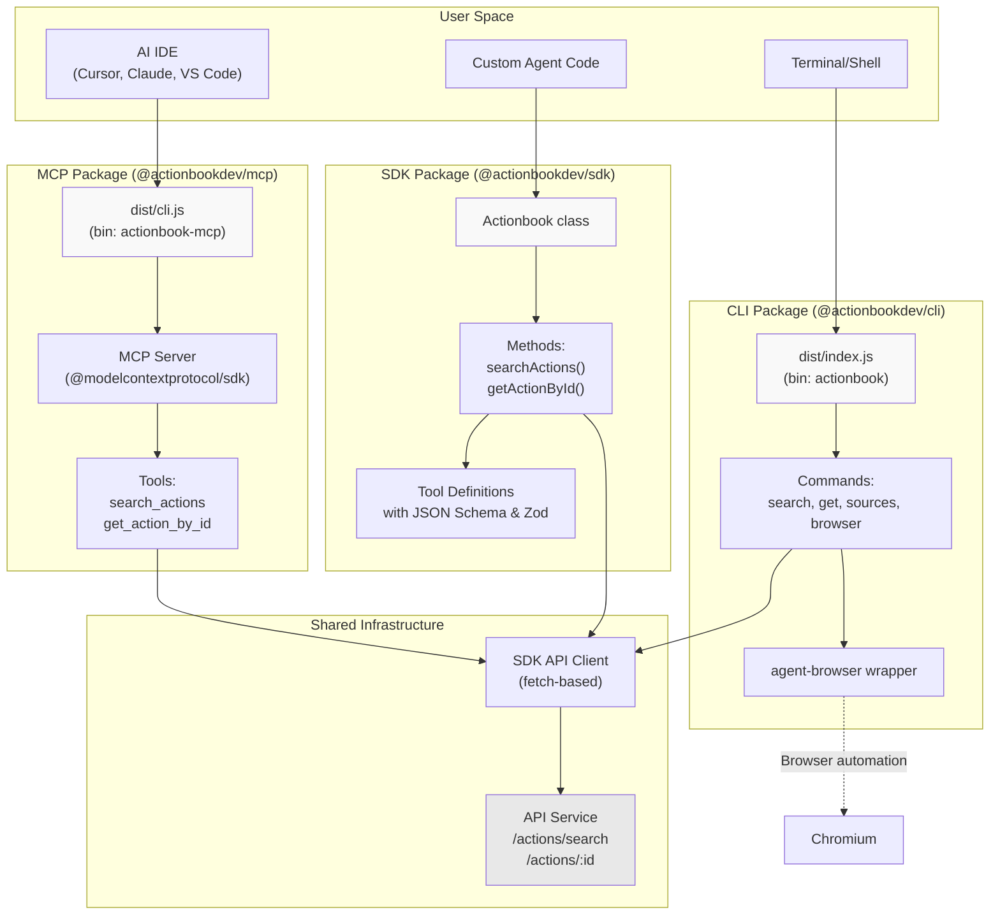
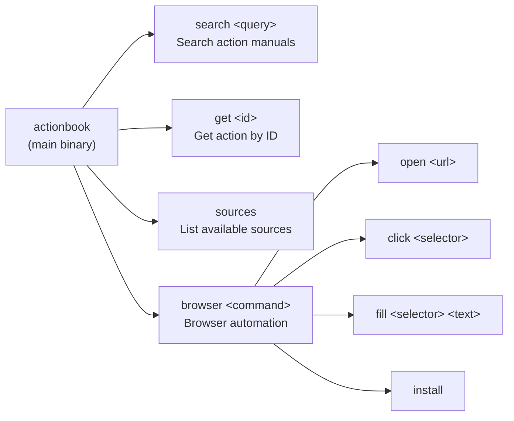
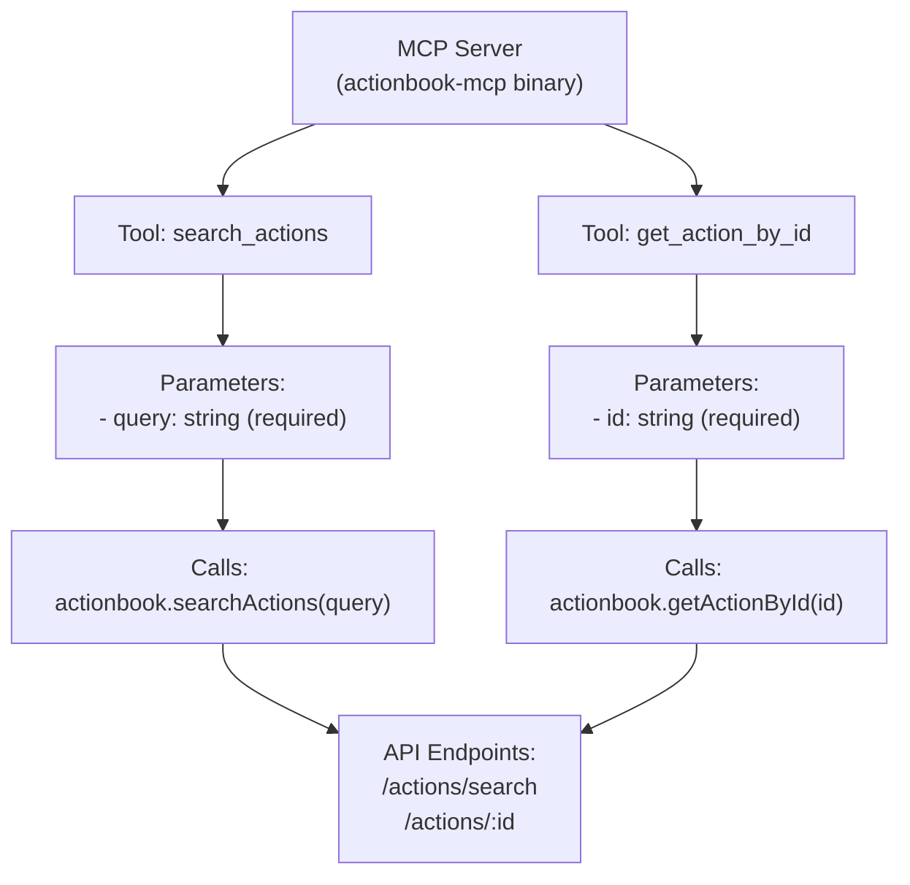
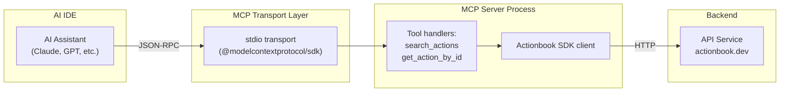
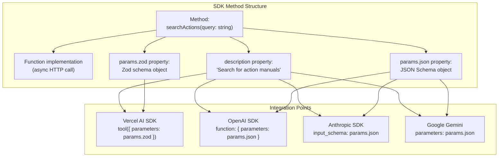
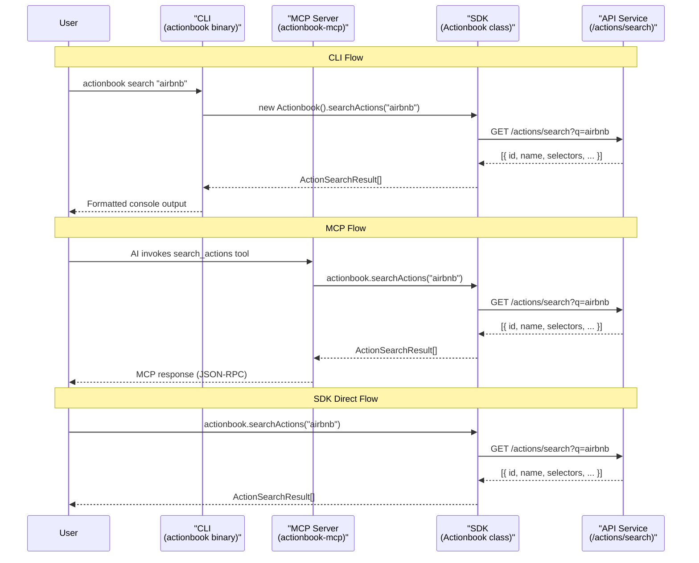
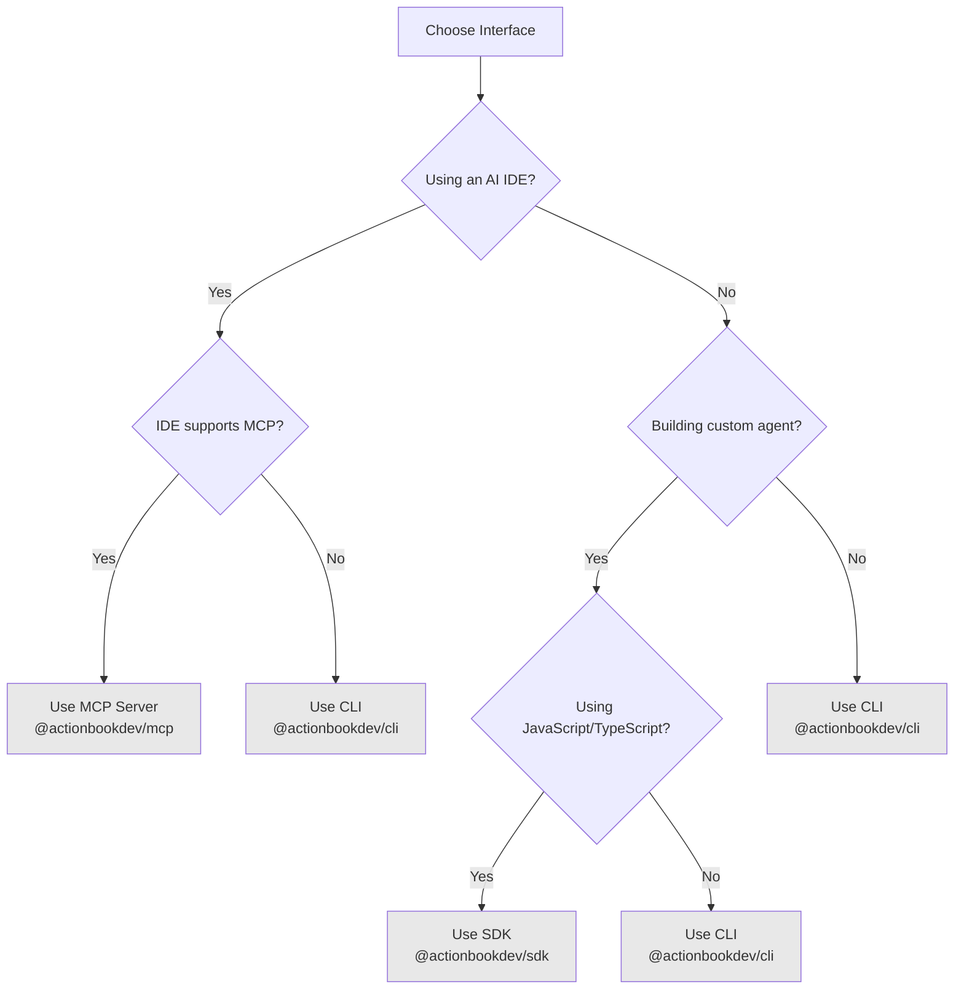

<!-- source: DeepWiki mcp.deepwiki.com · repo actionbook/actionbook · page 2 User Interfaces · fetched 2026-10-26 -->

# User Interfaces

<details>
<summary>Relevant source files</summary>

The following files were used as context for generating this wiki page:

- [LICENSE](LICENSE)
- [README.md](README.md)
- [packages/cli/package.json](packages/cli/package.json)
- [packages/js-sdk/package.json](packages/js-sdk/package.json)
- [packages/mcp/package.json](packages/mcp/package.json)

</details>


## Purpose and Scope

This document describes the three user-facing interfaces for consuming Actionbook data: the CLI (Command Line Interface), MCP Server (Model Context Protocol), and JavaScript SDK. These interfaces provide different ways to search action manuals, retrieve element selectors, and integrate with AI agents and automation frameworks.

For information about the backend API service that these interfaces consume, see [API Service](#3.1). For details on browser automation commands available through the CLI, see [Browser Automation Commands](#2.1.1). For SDK integration patterns with specific LLM frameworks, see [JavaScript SDK](#2.3).

## Overview

Actionbook provides three distinct interfaces that share a common backend but serve different use cases:

| Interface | Package | Primary Use Case | Target Users |
|-----------|---------|------------------|--------------|
| **CLI** | `@actionbookdev/cli` | Command-line automation, AI agent tool execution | Developers, AI agents using shell commands |
| **MCP Server** | `@actionbookdev/mcp` | IDE integration, AI assistant tools | Claude Code, Cursor, VS Code users |
| **JavaScript SDK** | `@actionbookdev/sdk` | Programmatic integration, custom agents | JavaScript/TypeScript developers |

All three interfaces communicate with the same REST API endpoints for action search and retrieval. The CLI also includes browser automation capabilities via the `agent-browser` package.

**Sources:** [README.md:86-93](), [packages/cli/package.json:1-10](), [packages/mcp/package.json:1-16](), [packages/js-sdk/package.json:1-12]()

## Interface Architecture

The following diagram illustrates how each interface connects to the underlying systems:



**Sources:** [README.md:86-93](), [packages/cli/package.json:9-11](), [packages/mcp/package.json:14-16](), [packages/js-sdk/package.json:6-12]()

## CLI (Command Line Interface)

The CLI is implemented in the `@actionbookdev/cli` package and provides command-line access to Actionbook functionality. The entry point is [packages/cli/dist/index.js](), which is exposed as the `actionbook` binary.

### Command Structure



**Sources:** [README.md:117-130](), [packages/cli/package.json:26-30]()

### Dependencies

The CLI package has three key dependencies:

| Dependency | Version | Purpose |
|------------|---------|---------|
| `@actionbookdev/sdk` | workspace:* | API client for search/get operations |
| `agent-browser` | ^0.8.3 | Browser automation via Chromium |
| `commander` | ^12.1.0 | Command-line argument parsing |
| `chalk` | ^5.3.0 | Terminal output formatting |

The CLI internally uses the SDK's `Actionbook` class to communicate with the API service. Browser commands are delegated to the `agent-browser` package, which provides a Chromium-based automation interface.

**Sources:** [packages/cli/package.json:26-31]()

## MCP Server

The MCP Server is implemented in the `@actionbookdev/mcp` package and exposes Actionbook functionality through the Model Context Protocol. The entry point is [packages/mcp/dist/cli.js](), exposed as the `actionbook-mcp` binary.

### Tool Definitions

The MCP server exposes two tools that AI assistants can invoke:



**Sources:** [README.md:677-688](), [packages/mcp/package.json:31-36]()

### IDE Integration Configuration

The MCP server is designed to be invoked via `npx` for zero-installation integration. The configuration format varies by IDE but follows a common pattern:

```json
{
  "mcpServers": {
    "actionbook": {
      "command": "npx",
      "args": ["-y", "@actionbookdev/mcp@latest"]
    }
  }
}
```

This configuration is compatible with:
- Cursor (`Settings` → `Cursor Settings` → `MCP`)
- Claude Desktop (`claude_desktop_config.json`)
- Windsurf (`~/.codeium/windsurf/mcp_config.json`)
- VS Code (settings JSON)
- Cline, Zed, JetBrains IDEs, and others

**Sources:** [README.md:138-260](), [packages/mcp/package.json:14-16]()

### MCP Protocol Integration



**Sources:** [packages/mcp/package.json:31-36]()

## JavaScript SDK

The JavaScript SDK is implemented in the `@actionbookdev/sdk` package and provides programmatic access to Actionbook functionality. It serves as the foundation for both the CLI and MCP server implementations.

### SDK Core API

The primary class is `Actionbook`, which exposes methods with attached metadata for LLM integration:

```typescript
class Actionbook {
  searchActions(query: string): Promise<ActionSearchResult[]>
  getActionById(id: string): Promise<Action>
  listSources(): Promise<Source[]>
  searchSources(query: string): Promise<Source[]>
}
```

Each method includes:
- `description`: String describing the tool's purpose
- `params.json`: JSON Schema for parameters
- `params.zod`: Zod schema for parameters

**Sources:** [README.md:450-489](), [packages/js-sdk/package.json:1-12]()

### Tool Definition Structure



**Sources:** [README.md:473-489](), [packages/js-sdk/package.json:27-29]()

### SDK Dependencies

The SDK has minimal dependencies to maintain broad compatibility:

| Dependency | Version | Purpose |
|------------|---------|---------|
| `zod` | ^3.25.6 | Schema validation and Zod parameter definitions |
| `zod-to-json-schema` | ^3.22.5 | Converting Zod schemas to JSON Schema format |

The SDK uses only standard `fetch` for HTTP requests, avoiding framework-specific clients.

**Sources:** [packages/js-sdk/package.json:27-29]()

### Framework Integration Patterns

The SDK is designed for integration with multiple LLM frameworks. The following table shows the mapping between SDK exports and framework-specific tool definitions:

| Framework | Tool Definition | Uses `description` | Uses `params.zod` | Uses `params.json` |
|-----------|----------------|-------------------|-------------------|-------------------|
| Vercel AI SDK | `tool()` | ✓ | ✓ | |
| OpenAI SDK | `ChatCompletionTool` | ✓ | | ✓ |
| Anthropic SDK | `Tool` | ✓ | | ✓ |
| Google Gemini | `FunctionDeclaration` | ✓ | | ✓ |
| Stagehand | `tool()` | ✓ | ✓ | |

**Sources:** [README.md:493-659]()

## Interface Communication Flow

The following diagram shows how data flows from user interaction through the interfaces to the API service:



**Sources:** [README.md:117-130](), [README.md:450-470](), [README.md:677-688]()

## Installation Methods

Each interface has a different installation and execution pattern:

### CLI Installation

```bash
# Global installation
npm install -g @actionbookdev/cli

# Direct execution (no installation)
npx @actionbookdev/cli search "query"

# Verify installation
actionbook --version
```

The CLI requires browser installation for automation features:
```bash
actionbook browser install
```

### MCP Server Installation

The MCP server is typically invoked via `npx` without explicit installation:

```bash
# Direct invocation
npx -y @actionbookdev/mcp@latest

# Via IDE configuration (automatic invocation)
# See IDE-specific configuration in [README.md:138-424]()
```

### SDK Installation

```bash
# npm
npm install @actionbookdev/sdk

# pnpm
pnpm add @actionbookdev/sdk

# yarn
yarn add @actionbookdev/sdk

# bun
bun add @actionbookdev/sdk
```

**Sources:** [README.md:106-116](), [README.md:134-424](), [README.md:429-446]()

## Common Type Definitions

All three interfaces work with the same type definitions, which are exported from the SDK package:

| Type | Purpose | Key Fields |
|------|---------|-----------|
| `ActionSearchResult` | Search result items | `id`, `name`, `description`, `site`, `score` |
| `Action` | Complete action details | `id`, `name`, `selectors`, `allowMethod`, `pageContext` |
| `Selectors` | Element selector collection | `css`, `xpath`, `id`, `dataTestId`, `ariaLabel` |
| `Source` | Website source information | `id`, `url`, `name`, `status` |

These types are defined in the SDK and shared across all interfaces. For detailed type definitions, see [Data Models and Types](#7).

**Sources:** [packages/js-sdk/package.json:6-12]()

## Environment Configuration

### CLI Environment Variables

The CLI reads the following environment variables:

```bash
ACTIONBOOK_API_URL=https://actionbook.dev  # API endpoint (optional)
```

### MCP Server Environment Variables

The MCP server supports the same environment variables as the CLI. These can be set in IDE configuration:

```json
{
  "mcpServers": {
    "actionbook": {
      "command": "npx",
      "args": ["-y", "@actionbookdev/mcp@latest"],
      "env": {
        "ACTIONBOOK_API_URL": "https://actionbook.dev"
      }
    }
  }
}
```

### SDK Configuration

The SDK `Actionbook` class accepts configuration in its constructor:

```typescript
const actionbook = new Actionbook({
  baseURL: 'https://actionbook.dev',  // Optional, defaults to public API
  apiKey: undefined                    // Optional, not required during open beta
})
```

**Sources:** [README.md:102](), [README.md:304-315]()

## Selecting the Right Interface

Use this decision tree to choose the appropriate interface:



**Sources:** [README.md:86-93]()

---

