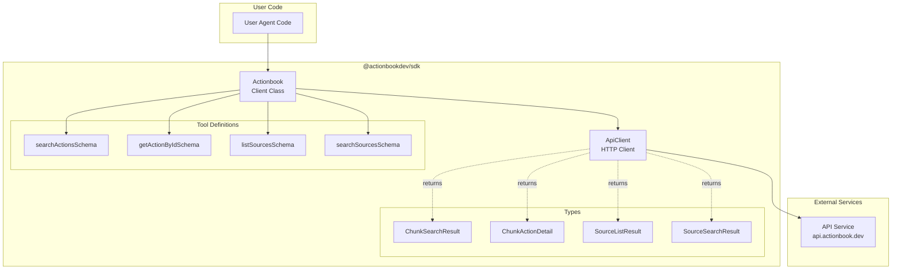
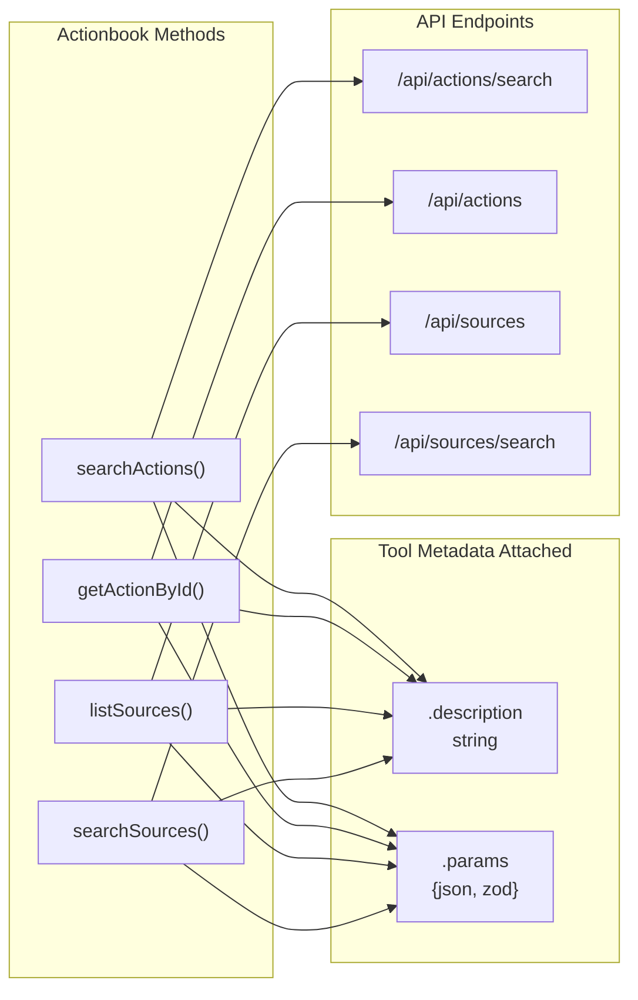
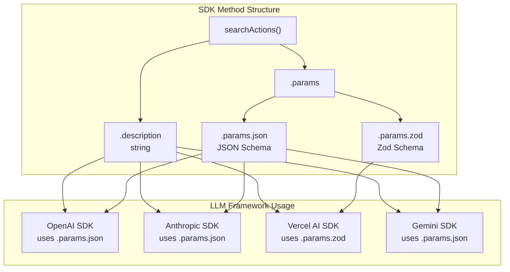
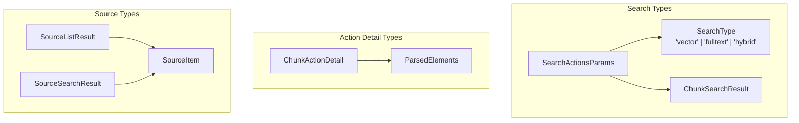
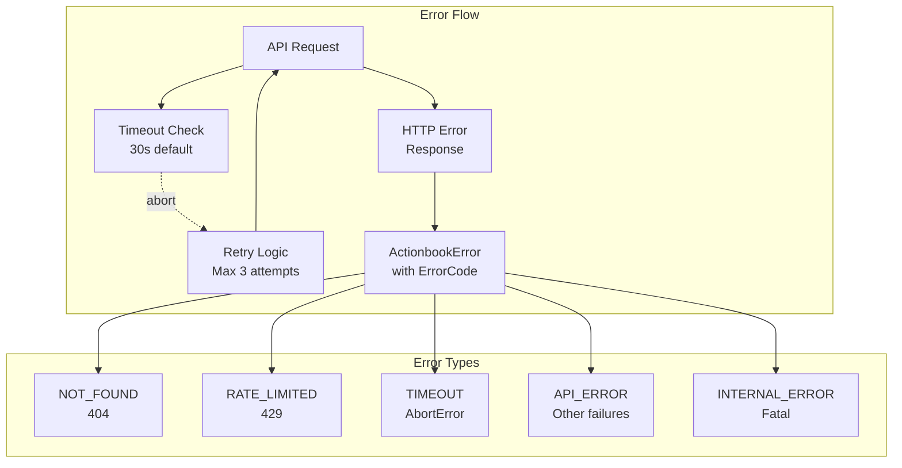

<!-- source: DeepWiki mcp.deepwiki.com · repo actionbook/actionbook · page 2.3 JavaScript SDK · fetched 2026-10-26 -->

# JavaScript SDK

<details>
<summary>Relevant source files</summary>

The following files were used as context for generating this wiki page:

- [README.md](README.md)
- [packages/js-sdk/src/api-client.ts](packages/js-sdk/src/api-client.ts)
- [packages/js-sdk/src/client.ts](packages/js-sdk/src/client.ts)
- [packages/js-sdk/src/tool-defs.ts](packages/js-sdk/src/tool-defs.ts)
- [packages/js-sdk/src/types.ts](packages/js-sdk/src/types.ts)

</details>


## Purpose and Scope

The JavaScript SDK (`@actionbookdev/sdk`) provides programmatic access to the Actionbook API for building custom AI agents and browser automation tools. The SDK enables developers to search for action manuals, retrieve DOM selectors, and integrate Actionbook capabilities into any LLM framework.

This page covers SDK installation, client initialization, API methods, tool definitions, and integration patterns. For CLI usage, see [CLI](#2.1). For MCP Server integration, see [MCP Server](#2.2). For API endpoint specifications, see [API Service](#3.1).

**Sources:** [README.md:428-446](), [packages/js-sdk/src/client.ts:120-140]()

---

## Installation

The SDK is published as `@actionbookdev/sdk` on npm and supports all major package managers:

```bash
# npm
npm install @actionbookdev/sdk

# pnpm
pnpm add @actionbookdev/sdk

# yarn
yarn add @actionbookdev/sdk

# bun
bun add @actionbookdev/sdk
```

**Requirements:**
- Node.js >= 18.0.0
- TypeScript 5.0+ (for type definitions)

**Sources:** [README.md:434-446]()

---

## Client Architecture

The SDK consists of two primary classes: `Actionbook` (user-facing client) and `ApiClient` (internal HTTP client).



**Key Classes:**

| Class | Purpose | Location |
|-------|---------|----------|
| `Actionbook` | Main SDK client with tool-decorated methods | [packages/js-sdk/src/client.ts:141-235]() |
| `ApiClient` | HTTP client with retry logic and timeout handling | [packages/js-sdk/src/api-client.ts:53-188]() |

**Sources:** [packages/js-sdk/src/client.ts:141-235](), [packages/js-sdk/src/api-client.ts:53-175]()

---

## Client Initialization

The `Actionbook` class accepts optional configuration for API authentication, base URL, timeouts, and custom fetch implementations.

```typescript
import { Actionbook } from '@actionbookdev/sdk'

// Default configuration (no API key required during open beta)
const actionbook = new Actionbook()

// With custom options
const actionbook = new Actionbook({
  apiKey: 'YOUR_API_KEY',              // Optional, falls back to ACTIONBOOK_API_KEY env var
  baseUrl: 'https://api.actionbook.dev', // Optional, default shown
  timeoutMs: 30000,                     // Optional, default: 30 seconds
  fetch: customFetchFn,                 // Optional, for proxy support
})
```

**Configuration Options:**

| Option | Type | Default | Description |
|--------|------|---------|-------------|
| `apiKey` | `string` | `process.env.ACTIONBOOK_API_KEY` | API key for authentication |
| `baseUrl` | `string` | `https://api.actionbook.dev` | Base URL for API requests |
| `timeoutMs` | `number` | `30000` | Request timeout in milliseconds |
| `fetch` | `FetchFunction` | `globalThis.fetch` | Custom fetch implementation |

**Environment Variables:**
- `ACTIONBOOK_API_KEY` - Automatically used if `apiKey` option is not provided

**Sources:** [packages/js-sdk/src/client.ts:95-118](), [packages/js-sdk/src/client.ts:156-165](), [packages/js-sdk/src/api-client.ts:17-38]()

---

## API Methods

The SDK provides four primary methods, each with overloaded signatures for flexibility and attached tool definitions for LLM integration.



**Sources:** [packages/js-sdk/src/client.ts:144-154](), [packages/js-sdk/src/tool-defs.ts:60-237]()

### searchActions()

Searches for action manuals using hybrid search (full-text + vector similarity).

**Signatures:**
```typescript
// Simple string query
searchActions(query: string): Promise<ChunkSearchResult>

// Full options object
searchActions(options: SearchActionsInput): Promise<ChunkSearchResult>
```

**Parameters:**

| Parameter | Type | Required | Default | Description |
|-----------|------|----------|---------|-------------|
| `query` | `string` | Yes | - | Search keyword (e.g., "airbnb search", "login button") |
| `type` | `"vector" \| "fulltext" \| "hybrid"` | No | `"hybrid"` | Search algorithm type |
| `limit` | `number` | No | `5` | Max results (1-100) |
| `sourceIds` | `string` | No | - | Comma-separated source IDs to filter |
| `minScore` | `number` | No | - | Minimum similarity score (0-1) |

**Return Type:** `ChunkSearchResult` containing action IDs, content previews, and relevance scores.

**Example:**
```typescript
// Simple query
const results = await actionbook.searchActions('airbnb search')

// With options
const results = await actionbook.searchActions({
  query: 'login button',
  type: 'hybrid',
  limit: 10,
  sourceIds: '1,2',
  minScore: 0.7
})
```

**Sources:** [packages/js-sdk/src/client.ts:42-51](), [packages/js-sdk/src/client.ts:168-189](), [packages/js-sdk/src/tool-defs.ts:64-112]()

### getActionById()

Retrieves complete action details including DOM selectors and element metadata.

**Signatures:**
```typescript
// ID string
getActionById(id: string): Promise<ChunkActionDetail>

// Options object
getActionById(options: GetActionByIdInput): Promise<ChunkActionDetail>
```

**Parameters:**

| Parameter | Type | Required | Description |
|-----------|------|----------|-------------|
| `id` | `string` | Yes | Action ID (full URL or fuzzy domain match) |

**Action ID Formats:**
- Full URL: `https://example.com/docs/page`
- Domain + path: `example.com/docs/page`
- Domain only: `releases.rs`
- With chunk: `https://example.com/page#chunk-1`

**Return Type:** `ChunkActionDetail` containing full content, parsed elements, selectors, and document metadata.

**Example:**
```typescript
// Full URL
const action = await actionbook.getActionById('https://docs.airbnb.com/search')

// Fuzzy match
const action = await actionbook.getActionById('docs.airbnb.com/search')

// Access selectors
const elements = JSON.parse(action.elements || '{}')
const selector = elements['search-button']?.css_selector
```

**Sources:** [packages/js-sdk/src/client.ts:56-65](), [packages/js-sdk/src/client.ts:192-203](), [packages/js-sdk/src/tool-defs.ts:118-154]()

### listSources()

Lists all available sources (websites) in the Actionbook database.

**Signatures:**
```typescript
// Default limit (50)
listSources(): Promise<SourceListResult>

// Custom limit
listSources(options: ListSourcesInput): Promise<SourceListResult>
```

**Parameters:**

| Parameter | Type | Required | Default | Description |
|-----------|------|----------|---------|-------------|
| `limit` | `number` | No | `50` | Max sources (1-200) |

**Return Type:** `SourceListResult` containing source IDs, names, URLs, descriptions, and tags.

**Example:**
```typescript
// List all sources
const sources = await actionbook.listSources()

// Limited list
const sources = await actionbook.listSources({ limit: 100 })

// Access source data
sources.results.forEach(source => {
  console.log(`${source.name} (${source.domain})`)
})
```

**Sources:** [packages/js-sdk/src/client.ts:70-79](), [packages/js-sdk/src/client.ts:206-215](), [packages/js-sdk/src/tool-defs.ts:160-186]()

### searchSources()

Searches sources by keyword across name, description, domain, URL, and tags.

**Signatures:**
```typescript
// Simple string query
searchSources(query: string): Promise<SourceSearchResult>

// Full options object
searchSources(options: SearchSourcesInput): Promise<SourceSearchResult>
```

**Parameters:**

| Parameter | Type | Required | Default | Description |
|-----------|------|----------|---------|-------------|
| `query` | `string` | Yes | - | Search keyword |
| `limit` | `number` | No | `10` | Max results (1-100) |

**Return Type:** `SourceSearchResult` containing matching sources.

**Example:**
```typescript
// Simple query
const sources = await actionbook.searchSources('airbnb')

// With limit
const sources = await actionbook.searchSources({
  query: 'e-commerce',
  limit: 20
})
```

**Sources:** [packages/js-sdk/src/client.ts:84-93](), [packages/js-sdk/src/client.ts:218-233](), [packages/js-sdk/src/tool-defs.ts:192-237]()

---

## Tool Definition System

Each SDK method has attached `.description` and `.params` properties for seamless LLM tool integration. This design eliminates boilerplate when connecting Actionbook to AI frameworks.



**Tool Metadata Structure:**

| Property | Type | Purpose |
|----------|------|---------|
| `.description` | `string` | Human-readable description for LLM |
| `.params.json` | `Record<string, unknown>` | JSON Schema for OpenAI, Anthropic, Gemini |
| `.params.zod` | `z.ZodTypeAny` | Zod schema for Vercel AI SDK |

**Example:**
```typescript
import { Actionbook } from '@actionbookdev/sdk'

const actionbook = new Actionbook()

// Access tool metadata
console.log(actionbook.searchActions.description)
// "Search for action manuals by keyword..."

console.log(actionbook.searchActions.params.json)
// { type: "object", properties: { query: {...}, ... }, required: ["query"] }

console.log(actionbook.searchActions.params.zod)
// ZodObject { ... }
```

**Implementation Details:**

The tool definition system is implemented through:
1. `ToolParams<T>` interface providing dual schema formats [packages/js-sdk/src/tool-defs.ts:8-13]()
2. `createParams()` function generating both JSON Schema and Zod schemas [packages/js-sdk/src/tool-defs.ts:41-46]()
3. Method decoration in `Actionbook` constructor [packages/js-sdk/src/client.ts:186-189]()

**Sources:** [packages/js-sdk/src/tool-defs.ts:1-46](), [packages/js-sdk/src/client.ts:28-37](), [packages/js-sdk/src/client.ts:186-189]()

---

## LLM Framework Integration

The SDK integrates with all major LLM frameworks through its tool definition system. Examples below demonstrate integration patterns.

### Vercel AI SDK

Uses Zod schemas via `.params.zod`:

```typescript
import { Actionbook } from '@actionbookdev/sdk'
import { generateText, tool } from 'ai'
import { openai } from '@ai-sdk/openai'

const actionbook = new Actionbook()

const { text } = await generateText({
  model: openai('gpt-4o'),
  tools: {
    searchActions: tool({
      description: actionbook.searchActions.description,
      parameters: actionbook.searchActions.params.zod,
      execute: async ({ query }) => actionbook.searchActions(query),
    }),
    getActionById: tool({
      description: actionbook.getActionById.description,
      parameters: actionbook.getActionById.params.zod,
      execute: async ({ id }) => actionbook.getActionById(id),
    }),
  },
  maxSteps: 5,
  prompt: 'Search for LinkedIn message actions',
})
```

**Sources:** [README.md:496-520]()

### OpenAI SDK

Uses JSON Schema via `.params.json`:

```typescript
import { Actionbook } from '@actionbookdev/sdk'
import OpenAI from 'openai'

const actionbook = new Actionbook()
const openai = new OpenAI()

const tools: OpenAI.ChatCompletionTool[] = [
  {
    type: 'function',
    function: {
      name: 'searchActions',
      description: actionbook.searchActions.description,
      parameters: actionbook.searchActions.params.json,
    },
  },
  {
    type: 'function',
    function: {
      name: 'getActionById',
      description: actionbook.getActionById.description,
      parameters: actionbook.getActionById.params.json,
    },
  },
]

const completion = await openai.chat.completions.create({
  model: 'gpt-4o',
  tools,
  messages: [{ role: 'user', content: 'Search for Google login actions' }],
})
```

**Sources:** [README.md:525-558]()

### Anthropic Claude SDK

Uses JSON Schema via `.params.json` as `input_schema`:

```typescript
import { Actionbook } from '@actionbookdev/sdk'
import Anthropic from '@anthropic-ai/sdk'

const actionbook = new Actionbook()
const anthropic = new Anthropic()

const tools: Anthropic.Tool[] = [
  {
    name: 'searchActions',
    description: actionbook.searchActions.description,
    input_schema: actionbook.searchActions.params.json,
  },
  {
    name: 'getActionById',
    description: actionbook.getActionById.description,
    input_schema: actionbook.getActionById.params.json,
  },
]

const message = await anthropic.messages.create({
  model: 'claude-sonnet-4-20250514',
  max_tokens: 1024,
  tools,
  messages: [{ role: 'user', content: 'Search for Twitter post actions' }],
})
```

**Sources:** [README.md:563-591]()

### Google Gemini SDK

Uses JSON Schema via `.params.json` as `parameters`:

```typescript
import { Actionbook } from '@actionbookdev/sdk'
import { GoogleGenAI } from '@google/genai'

const actionbook = new Actionbook()
const genai = new GoogleGenAI({ apiKey: process.env.GEMINI_API_KEY })

const tools = [
  {
    functionDeclarations: [
      {
        name: 'searchActions',
        description: actionbook.searchActions.description,
        parameters: actionbook.searchActions.params.json,
      },
      {
        name: 'getActionById',
        description: actionbook.getActionById.description,
        parameters: actionbook.getActionById.params.json,
      },
    ],
  },
]

const response = await genai.models.generateContent({
  model: 'gemini-2.0-flash',
  contents: [{ role: 'user', parts: [{ text: 'Search for YouTube upload actions' }] }],
  config: { tools },
})
```

**Sources:** [README.md:596-627]()

---

## Type System

The SDK exports comprehensive TypeScript types for all request/response structures.

### Core Types



**Key Type Definitions:**

| Type | Description | Location |
|------|-------------|----------|
| `SearchType` | Search algorithm: `"vector"`, `"fulltext"`, `"hybrid"` | [packages/js-sdk/src/types.ts:4]() |
| `ChunkSearchResult` | Search results with action IDs and scores | [packages/js-sdk/src/types.ts:9-21]() |
| `ChunkActionDetail` | Full action details with selectors | [packages/js-sdk/src/types.ts:26-37]() |
| `ParsedElements` | Structured element selector data | [packages/js-sdk/src/types.ts:42-51]() |
| `SourceItem` | Source metadata (name, URL, tags) | [packages/js-sdk/src/types.ts:56-66]() |
| `SourceListResult` | List of sources | [packages/js-sdk/src/types.ts:71-75]() |
| `SourceSearchResult` | Source search results | [packages/js-sdk/src/types.ts:80-85]() |

### ChunkSearchResult Structure

```typescript
interface ChunkSearchResult {
  success: boolean;
  query: string;
  results: Array<{
    action_id: string;    // URL-based action identifier
    content: string;      // Content preview
    score: number;        // Relevance score (0-1)
    createdAt: string;    // ISO timestamp
  }>;
  count: number;          // Number of results returned
  total: number;          // Total matching results
  hasMore: boolean;       // Whether more results exist
}
```

**Sources:** [packages/js-sdk/src/types.ts:9-21]()

### ChunkActionDetail Structure

```typescript
interface ChunkActionDetail {
  action_id: string;      // Unique action identifier
  content: string;        // Full action content
  elements: string | null; // JSON string of element selectors
  createdAt: string;      // ISO timestamp
  documentId: number;     // Parent document ID
  documentTitle: string;  // Document title
  documentUrl: string;    // Document URL
  chunkIndex: number;     // Chunk position in document
  heading: string | null; // Section heading
  tokenCount: number;     // Content token count
}
```

**Parsing Elements:**
```typescript
const action = await actionbook.getActionById('example.com/page')
const elements: ParsedElements = JSON.parse(action.elements || '{}')

// Access specific element
const searchButton = elements['search-button']
const selector = searchButton?.css_selector || searchButton?.xpath_selector
```

**Sources:** [packages/js-sdk/src/types.ts:26-37](), [packages/js-sdk/src/types.ts:42-51]()

### ParsedElements Structure

```typescript
interface ParsedElements {
  [key: string]: {
    css_selector?: string;     // CSS selector
    xpath_selector?: string;   // XPath selector
    description?: string;      // Element description
    element_type?: string;     // Type (button, input, link, etc.)
    allow_methods?: string[];  // Allowed actions (click, type, extract)
    depends_on?: string;       // Parent element key
  };
}
```

**Sources:** [packages/js-sdk/src/types.ts:42-51]()

---

## Error Handling

The SDK implements comprehensive error handling with retry logic and custom error types.



### Error Types

The SDK throws `ActionbookError` instances with specific error codes:

| Error Code | HTTP Status | Description | Retryable |
|------------|-------------|-------------|-----------|
| `NOT_FOUND` | 404 | Action or resource not found | No |
| `RATE_LIMITED` | 429 | Rate limit exceeded | No |
| `TIMEOUT` | - | Request timeout or abort | Yes |
| `API_ERROR` | Other | General API failure | No |
| `INTERNAL_ERROR` | - | Internal SDK error | No |

**Error Handling Example:**
```typescript
import { Actionbook, ActionbookError, ErrorCodes } from '@actionbookdev/sdk'

const actionbook = new Actionbook()

try {
  const results = await actionbook.searchActions('query')
} catch (error) {
  if (error instanceof ActionbookError) {
    switch (error.code) {
      case ErrorCodes.NOT_FOUND:
        console.error('Resource not found')
        break
      case ErrorCodes.RATE_LIMITED:
        console.error('Rate limit exceeded')
        break
      case ErrorCodes.TIMEOUT:
        console.error('Request timed out')
        break
      default:
        console.error('API error:', error.message)
    }
  } else {
    console.error('Unknown error:', error)
  }
}
```

**Sources:** [packages/js-sdk/src/api-client.ts:131-174]()

### Retry Logic

The `ApiClient` implements automatic retry for transient failures:

**Retry Configuration:**
- **Max retries:** 3 (default)
- **Retry delay:** 1000ms (default)
- **Retryable errors:** Timeout/abort errors only

**Configuration:**
```typescript
const actionbook = new Actionbook({
  timeoutMs: 60000, // 60 second timeout
})
```

The retry configuration is hardcoded in `ApiClient` [packages/js-sdk/src/api-client.ts:64-67]() but can be extended in future versions.

**Sources:** [packages/js-sdk/src/api-client.ts:48-67](), [packages/js-sdk/src/api-client.ts:111-174]()

---

## Custom Fetch Implementation

The SDK supports custom fetch implementations for proxy support, custom headers, or alternative HTTP clients.

**Example with Proxy (undici):**
```typescript
import { Actionbook } from '@actionbookdev/sdk'
import { fetch as undiciFetch, ProxyAgent } from 'undici'

const proxyAgent = new ProxyAgent('http://proxy:8080')

const actionbook = new Actionbook({
  apiKey: 'YOUR_API_KEY',
  fetch: (url, init) => undiciFetch(url, { 
    ...init, 
    dispatcher: proxyAgent 
  }),
})

const results = await actionbook.searchActions('query')
```

**Example with Custom Headers:**
```typescript
import { Actionbook } from '@actionbookdev/sdk'

const actionbook = new Actionbook({
  fetch: (url, init) => fetch(url, {
    ...init,
    headers: {
      ...init?.headers,
      'X-Custom-Header': 'value',
    },
  }),
})
```

**Sources:** [packages/js-sdk/src/api-client.ts:22-37](), [packages/js-sdk/src/client.ts:102-117]()

---

## Complete Integration Example

This example demonstrates a full integration with Vercel AI SDK, including search, retrieval, and selector usage:

```typescript
import { Actionbook } from '@actionbookdev/sdk'
import { generateText, tool } from 'ai'
import { openai } from '@ai-sdk/openai'

const actionbook = new Actionbook({
  apiKey: process.env.ACTIONBOOK_API_KEY,
})

const { text, toolCalls, toolResults } = await generateText({
  model: openai('gpt-4o'),
  tools: {
    searchActions: tool({
      description: actionbook.searchActions.description,
      parameters: actionbook.searchActions.params.zod,
      execute: async ({ query, limit }) => {
        const results = await actionbook.searchActions({ query, limit })
        return JSON.stringify(results, null, 2)
      },
    }),
    getActionById: tool({
      description: actionbook.getActionById.description,
      parameters: actionbook.getActionById.params.zod,
      execute: async ({ id }) => {
        const action = await actionbook.getActionById(id)
        return JSON.stringify(action, null, 2)
      },
    }),
    listSources: tool({
      description: actionbook.listSources.description,
      parameters: actionbook.listSources.params.zod,
      execute: async ({ limit }) => {
        const sources = await actionbook.listSources({ limit })
        return JSON.stringify(sources, null, 2)
      },
    }),
    searchSources: tool({
      description: actionbook.searchSources.description,
      parameters: actionbook.searchSources.params.zod,
      execute: async ({ query, limit }) => {
        const sources = await actionbook.searchSources({ query, limit })
        return JSON.stringify(sources, null, 2)
      },
    }),
  },
  maxSteps: 10,
  prompt: `
    Find the Airbnb search functionality:
    1. Search for sources containing 'airbnb'
    2. Search for 'search' actions in that source
    3. Get full action details including selectors
  `,
})

console.log('Agent response:', text)
console.log('Tool calls made:', toolCalls.length)
```

**Sources:** [README.md:496-520](), [README.md:450-470]()

---

