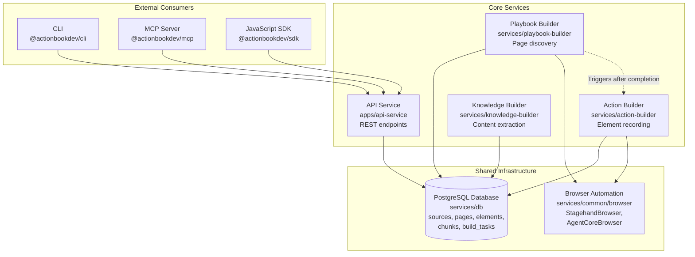
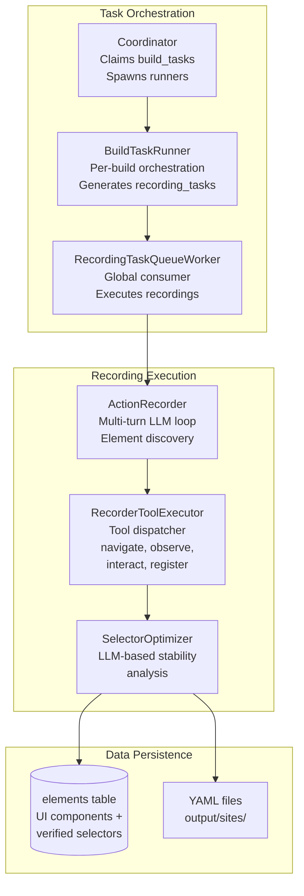
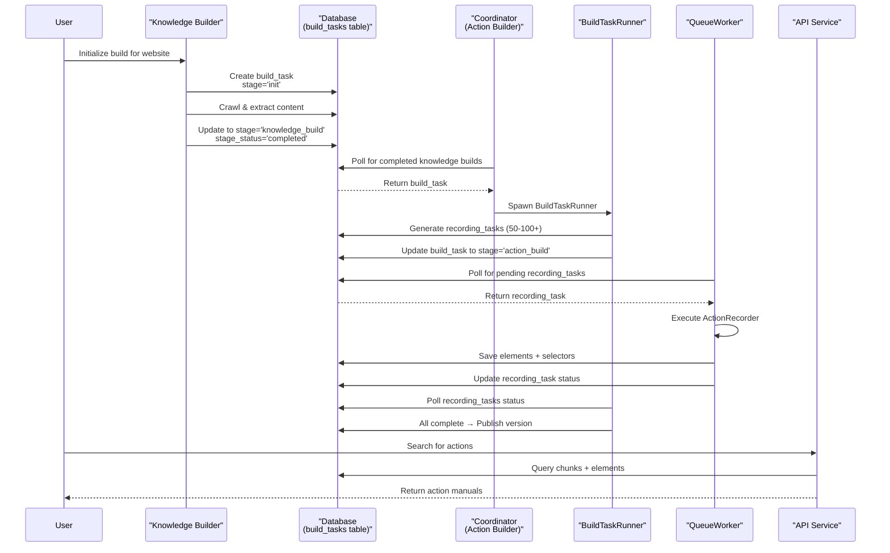
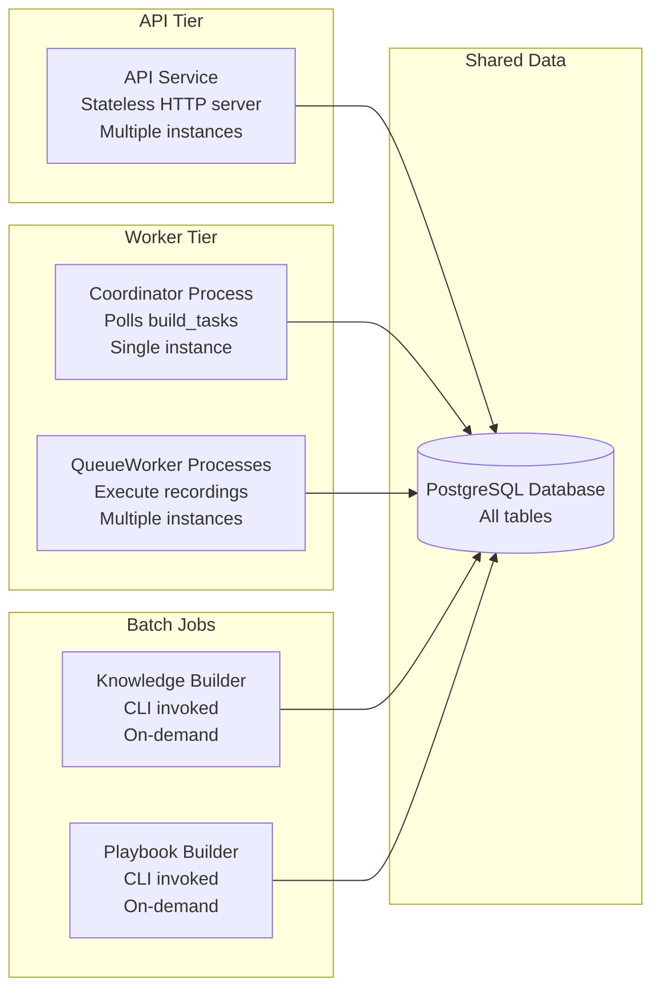

<!-- source: DeepWiki mcp.deepwiki.com · repo actionbook/actionbook · page 3 Core Services · fetched 2026-10-26 -->

# Core Services

<details>
<summary>Relevant source files</summary>

The following files were used as context for generating this wiki page:

- [.gitignore](.gitignore)
- [README.md](README.md)
- [mcp-servers.json](mcp-servers.json)
- [package.json](package.json)
- [pnpm-lock.yaml](pnpm-lock.yaml)
- [pnpm-workspace.yaml](pnpm-workspace.yaml)
- [services/action-builder/.nvmrc](services/action-builder/.nvmrc)
- [turbo.json](turbo.json)

</details>


This page provides an overview of the four backend services that power Actionbook's automation and documentation capabilities. These services work together to discover website structures, record UI interactions, generate action manuals, and serve them through a REST API.

For information about the user-facing interfaces that consume these services, see [User Interfaces](#2). For detailed database schema and storage architecture, see [Data Layer](#5).

## Purpose and Scope

The Core Services layer consists of:

1. **API Service** - REST API for searching and retrieving action manuals
2. **Action Builder** - Browser automation service that discovers and records UI elements
3. **Playbook Builder** - Documentation generation service that crawls and catalogs pages
4. **Knowledge Builder** - Content extraction service that generates embeddings for semantic search

Each service operates independently but shares common infrastructure through the database and browser automation layers. This page covers the architecture and responsibilities of each service. Child pages provide detailed implementation information for specific services.

## Service Architecture

The following diagram shows how the four core services relate to each other and their primary responsibilities:



**Sources:** README.md, architecture diagrams from system overview

## Service Responsibilities

| Service | Primary Function | Key Outputs | Dependencies |
|---------|-----------------|-------------|--------------|
| **API Service** | Query and retrieval | JSON responses via REST | `services/db` |
| **Action Builder** | UI element discovery | `elements` table records, YAML files | `services/db`, `services/common/browser` |
| **Playbook Builder** | Page structure documentation | `pages` table records, `documents` table | `services/db`, `services/common/browser` |
| **Knowledge Builder** | Content indexing | `chunks` table with embeddings | `services/db` |

**Sources:** Architecture diagrams, services directory structure

## API Service

The API Service provides a REST API for searching and retrieving action manuals. It is the primary interface between user-facing applications (CLI, MCP, SDK) and Actionbook's data layer.

**Location:** `apps/api-service` (not included in provided files)

**Key Endpoints:**
- `GET /actions/search` - Hybrid search combining full-text and vector similarity
- `GET /actions/:id` - Retrieve detailed action manual by ID
- `GET /sources` - List available websites
- `GET /sources/:id` - Get source details

The service implements hybrid search by combining PostgreSQL full-text search (GIN indexes on `chunks.content`) with vector similarity search (HNSW indexes on `chunks.embedding`).

For detailed API documentation including request/response formats and authentication, see [API Service](#3.1).

**Sources:** Architecture diagrams, README.md

## Action Builder Service

The Action Builder is responsible for discovering and recording UI elements on websites through browser automation. It orchestrates a multi-stage pipeline that generates recording tasks, executes them using AI-powered browser tools, and optimizes selectors for stability.

**Location:** `services/action-builder`

### Architecture Components



**Sources:** services/action-builder directory structure, Diagram 3 from system overview

### Key Classes and Files

| Component | Purpose | Key Methods |
|-----------|---------|-------------|
| `Coordinator` | Claims completed knowledge builds and spawns `BuildTaskRunner` instances | `claimTask()`, `spawnRunner()` |
| `BuildTaskRunner` | Generates recording tasks for a single build | `generateRecordingTasks()`, `pollTaskStatus()` |
| `RecordingTaskQueueWorker` | Global worker that executes recording tasks from queue | `claimTask()`, `executeTask()` |
| `ActionRecorder` | Orchestrates multi-turn LLM conversation for element discovery | `record()`, `executeToolLoop()` |
| `RecorderToolExecutor` | Dispatches tool calls to browser adapter | `executeTool()`, `navigate()`, `observe()`, `register()` |
| `SelectorOptimizer` | Uses LLM to analyze and filter unstable selectors | `optimizeSelectors()`, `detectUnstablePatterns()` |

The action-builder service processes builds in stages:
1. **Claim stage**: `Coordinator` claims `build_tasks` where `stage='knowledge_build'` and `stage_status='completed'`
2. **Generation stage**: `BuildTaskRunner` analyzes pages and creates 50-100+ `recording_tasks`
3. **Execution stage**: `RecordingTaskQueueWorker` claims tasks and uses `ActionRecorder` to discover elements
4. **Optimization stage**: `SelectorOptimizer` filters unstable selectors before persistence

For detailed information on the task pipeline, see [Task Execution Pipeline](#3.2.1). For recording mechanics, see [Action Recording](#3.2.2). For tool reference, see [Recording Tools Reference](#3.2.3).

**Sources:** Architecture diagrams, services/action-builder/.nvmrc indicates Node.js service

## Playbook Builder Service

The Playbook Builder discovers and documents the structure of websites, creating a foundation for subsequent action recording. It navigates through sites, identifies page types, and generates descriptive documentation.

**Location:** `services/playbook-builder`

### Core Functionality

The Playbook Builder operates independently from Action Builder but prepares the groundwork by:

1. **Page Discovery** - Crawls websites to identify distinct page types
2. **Structure Analysis** - Identifies navigation patterns and page relationships
3. **Documentation Generation** - Creates human-readable page descriptions
4. **Database Population** - Stores results in `pages` and `documents` tables

### Key Classes

| Component | Purpose |
|-----------|---------|
| `PlaybookTaskController` | Manages playbook generation lifecycle: polling, claiming, execution |
| Page discovery logic | Identifies unique page types through navigation patterns |
| Documentation generator | Creates structured descriptions of page capabilities |

The Playbook Builder uses the same browser automation layer as Action Builder (`services/common/browser`) but focuses on higher-level page structure rather than individual UI elements.

Upon completion, the Playbook Builder updates the `build_task` record to `stage='knowledge_build'` and `stage_status='completed'`, which triggers the Action Builder's `Coordinator` to begin element recording.

For detailed information on playbook task management, see [Playbook Task Controller](#3.3.1).

**Sources:** Architecture diagrams, services/playbook-builder directory structure

## Knowledge Builder Service

The Knowledge Builder extracts and indexes content from web pages for semantic search capabilities. It operates on crawled pages to generate embeddings that enable vector similarity search.

**Location:** `services/knowledge-builder`

### Core Functionality

1. **Content Extraction** - Parses HTML to extract meaningful text using readability algorithms
2. **Chunking** - Splits content into semantically coherent segments
3. **Embedding Generation** - Creates vector embeddings using OpenAI or compatible embedding models
4. **Index Population** - Stores chunks with embeddings in the `chunks` table

### Database Integration

The Knowledge Builder populates the following tables:

| Table | Records | Purpose |
|-------|---------|---------|
| `documents` | One per crawled page | Stores full page content and metadata |
| `chunks` | Multiple per document | Content segments with embeddings for search |

The `chunks` table includes:
- `content` (text) - Full-text indexed with GIN
- `embedding` (vector) - HNSW indexed for similarity search
- `document_id` (FK) - Links to source document
- `source_version_id` (FK) - Links to specific version

This enables the API Service to perform hybrid search combining keyword matching and semantic similarity.

**Sources:** Architecture diagrams, services/knowledge-builder directory structure

## Service Communication Flow

The following diagram shows how services interact during a typical build process:



**Sources:** Architecture diagrams, build pipeline overview

### Stage Progression

The build pipeline follows this stage sequence in the `build_tasks` table:

1. `stage='init'` - Initial task creation
2. `stage='knowledge_build'`, `stage_status='in_progress'` - Knowledge extraction active
3. `stage='knowledge_build'`, `stage_status='completed'` - Ready for action building
4. `stage='action_build'`, `stage_status='in_progress'` - Recording tasks being executed
5. `stage='action_build'`, `stage_status='completed'` - Build complete, version published

Each stage transition is managed by the respective service, creating a loosely coupled architecture where services communicate primarily through database state.

**Sources:** Diagram 3 from system overview

## Shared Infrastructure

All core services depend on shared packages located in `services/common` and `services/db`:

### Database Package (`services/db`)

Provides:
- Drizzle ORM schema definitions
- Database connection management (`getDb()` singleton)
- Migration scripts
- Type-safe query builders

Used by all services for data persistence and retrieval.

### Browser Package (`services/common/browser`)

Provides:
- `BrowserAdapter` interface - Unified API for browser automation
- `StagehandBrowser` - Local Playwright implementation with multi-LLM support
- `AgentCoreBrowser` - AWS cloud-based implementation

Used by Action Builder and Playbook Builder for web automation.

For detailed browser architecture, see [Browser Automation Layer](#4).

### Browser Profile Package (`services/common/browser-profile`)

Provides:
- `BrowserProfileManager` - Manages persistent browser state
- User data directory handling
- Lock file cleanup
- Anti-detection browser arguments

Used by services requiring persistent login sessions.

For profile management details, see [Browser Profiles](#4.4).

**Sources:** Architecture diagrams, pnpm-workspace.yaml, services directory structure

## Deployment Architecture

Each service can be deployed independently:



**Deployment Characteristics:**

| Service | Concurrency | State | Scaling Strategy |
|---------|-------------|-------|------------------|
| API Service | Multiple instances | Stateless | Horizontal (load balanced) |
| Coordinator | Single instance | Stateful (in-memory runner tracking) | Vertical or sequential |
| QueueWorker | Multiple instances | Stateless | Horizontal (task queue) |
| Knowledge Builder | One per build | Stateless | On-demand batch jobs |
| Playbook Builder | One per build | Stateless | On-demand batch jobs |

The architecture supports both centralized (all services on one host) and distributed (services across multiple hosts) deployments. Task coordination occurs through database polling rather than message queues, simplifying deployment at the cost of increased database load.

**Sources:** Architecture diagrams, build pipeline description

## Environment Configuration

Services share common environment variables defined in `.env` files at the service level:

**Common Variables:**
- Database connection: `DATABASE_URL`, `POSTGRES_URL`
- LLM providers: `OPENAI_API_KEY`, `ANTHROPIC_API_KEY`, `OPENROUTER_API_KEY`
- Browser settings: Browser profile paths, userDataDir locations
- Proxy settings: `HTTP_PROXY`, `HTTPS_PROXY` for network routing

Each service package contains an `.env.example` file documenting required and optional configuration.

**Sources:** README.md:719-723

## Build and Development

All services are built using the Turborepo monorepo build system defined in `turbo.json`:

```bash
# Build all services
pnpm build

# Run all services in development mode
pnpm dev

# Run specific service
cd services/action-builder && pnpm dev
```

The build system automatically handles dependencies between packages through the `dependsOn` configuration in `turbo.json:4-7`.

For detailed development setup instructions, see [Local Development Setup](#8.3).

**Sources:** README.md:702-735, turbo.json, package.json:8-14

---

