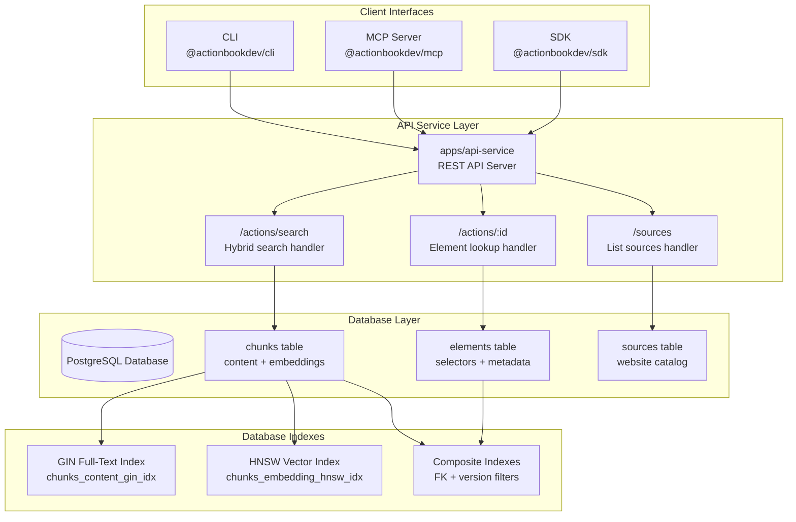
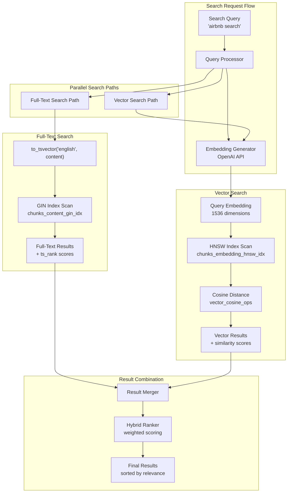
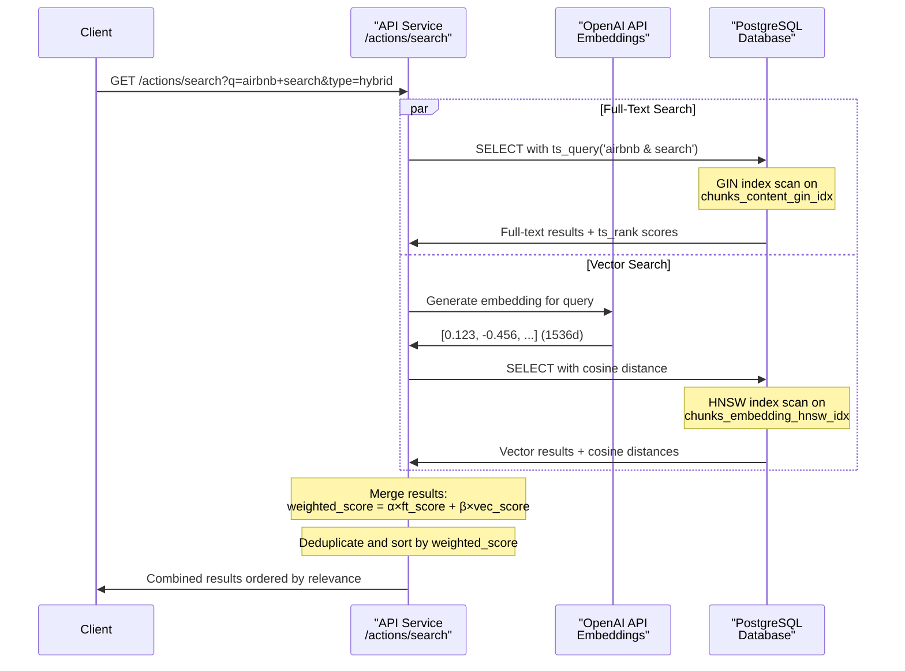
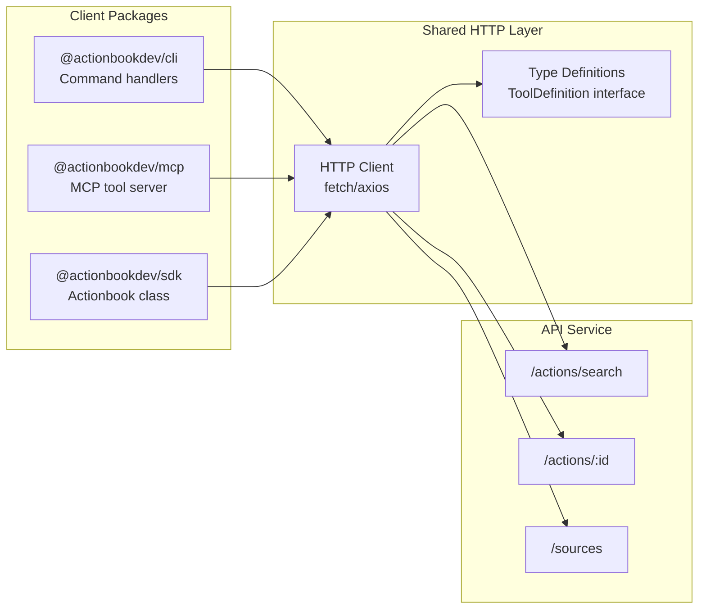

<!-- source: DeepWiki mcp.deepwiki.com · repo actionbook/actionbook · page 3.1 API Service · fetched 2026-10-26 -->

# API Service

<details>
<summary>Relevant source files</summary>

The following files were used as context for generating this wiki page:

- [README.md](README.md)
- [services/db/migrations/0019_add_vector_indexes.sql](services/db/migrations/0019_add_vector_indexes.sql)
- [services/db/migrations/0020_add_chunks_fulltext_index.sql](services/db/migrations/0020_add_chunks_fulltext_index.sql)

</details>


## Purpose and Scope

The API Service is a REST API that provides programmatic access to Actionbook's indexed action manuals and website capabilities. It exposes endpoints for searching actions, retrieving detailed action information, and listing available sources. The service implements hybrid search combining full-text and vector similarity to deliver relevant results.

This document covers the REST API endpoints, request/response formats, and the hybrid search implementation. For information about the SDK that wraps these endpoints, see [JavaScript SDK](#2.3). For details on the data storage layer, see [Database Schema](#5.1) and [Search and Indexing](#5.3).

**Sources:** [README.md:1-745]()

---

## Architecture Overview

The API Service acts as the primary data access layer for all Actionbook user interfaces. It serves pre-built action manuals stored in PostgreSQL and provides efficient search capabilities through specialized database indexes.



**Sources:** [README.md:1-745](), Architecture Diagrams

---

## Endpoints

The API Service exposes three primary REST endpoints for querying action manuals and source information.

### Endpoint Summary

| Endpoint | Method | Purpose | Primary Table |
|----------|--------|---------|---------------|
| `/actions/search` | GET | Search for actions using hybrid search (full-text + vector) | `chunks` |
| `/actions/:id` | GET | Retrieve detailed action information by element ID | `elements` |
| `/sources` | GET | List available indexed websites | `sources` |

**Sources:** [README.md:1-745](), Architecture Diagrams

---

## Search Actions Endpoint

### Endpoint: `GET /actions/search`

Performs hybrid search across indexed action manuals, combining full-text search and vector similarity to return relevant results.

#### Request Parameters

| Parameter | Type | Required | Description |
|-----------|------|----------|-------------|
| `q` or `query` | string | Yes | Search query (e.g., "airbnb search", "google login") |
| `type` | string | No | Search type: `hybrid` (default), `fulltext`, or `vector` |
| `limit` | number | No | Maximum number of results to return |

#### Response Format

Returns an array of search results with action details:

```typescript
{
  id: string              // Element ID (e.g., "site/airbnb.com/page/home/element/search-button")
  name: string            // Element name
  description: string     // What this action does
  selectors: {
    css?: string          // CSS selector
    xpath?: string        // XPath selector
    dataTestId?: string   // data-testid attribute
    ariaLabel?: string    // aria-label attribute
    // ... other selector types
  }
  page: {
    url: string           // Page URL pattern
    name: string          // Page name
  }
  source: {
    domain: string        // Website domain
    name: string          // Website name
  }
  relevance: number       // Search relevance score
}
```

#### Example Usage

```bash
# CLI
actionbook search "airbnb search"

# SDK
const results = await actionbook.searchActions('airbnb search')

# HTTP
GET /actions/search?q=airbnb+search&type=hybrid&limit=10
```

**Sources:** [README.md:119-130](), [README.md:449-470](), Architecture Diagrams

---

## Get Action by ID Endpoint

### Endpoint: `GET /actions/:id`

Retrieves complete details for a specific action element, including all available selectors and metadata.

#### Request Parameters

| Parameter | Type | Required | Description |
|-----------|------|----------|-------------|
| `id` | string | Yes | Element ID (path parameter) |

#### Response Format

Returns detailed action information from the `elements` table:

```typescript
{
  id: string              // Full element ID path
  name: string            // Element name
  description: string     // Detailed description
  elementType: string     // Type: button, input, link, etc.
  selectors: {
    css?: string
    xpath?: string
    dataTestId?: string
    ariaLabel?: string
    id?: string
    // All available selectors with confidence scores
  }
  allowedMethods: string[] // Allowed interaction methods
  page: {
    id: string
    url: string
    name: string
    module: string         // Page module classification
  }
  source: {
    id: string
    domain: string
    name: string
    version: string        // Active version
  }
}
```

#### Example Usage

```bash
# CLI
actionbook get "site/airbnb.com/page/home/element/search-button"

# SDK
const action = await actionbook.getActionById(results[0].id)

# HTTP
GET /actions/site%2Fairbnb.com%2Fpage%2Fhome%2Felement%2Fsearch-button
```

**Sources:** [README.md:123-124](), [README.md:461-463](), Architecture Diagrams

---

## Sources Endpoints

### Endpoint: `GET /sources`

Returns a list of all indexed websites available in the Actionbook database.

#### Request Parameters

None required. Optional filtering parameters may include:

| Parameter | Type | Required | Description |
|-----------|------|----------|-------------|
| `domain` | string | No | Filter by specific domain |
| `active` | boolean | No | Filter by active status |

#### Response Format

```typescript
{
  sources: [
    {
      id: string
      domain: string        // e.g., "airbnb.com"
      name: string          // e.g., "Airbnb"
      activeVersion: string // Current version ID
      indexedAt: string     // ISO 8601 timestamp
      pageCount: number     // Number of indexed pages
      elementCount: number  // Number of indexed elements
    }
  ]
}
```

**Sources:** [README.md:1-745](), Architecture Diagrams

---

## Hybrid Search Implementation

The API Service implements a sophisticated hybrid search system that combines full-text search and vector similarity search to deliver relevant results. This approach leverages PostgreSQL's native full-text search capabilities and the pgvector extension for semantic similarity.



**Sources:** Architecture Diagrams, [services/db/migrations/0019_add_vector_indexes.sql:1-22](), [services/db/migrations/0020_add_chunks_fulltext_index.sql:1-19]()

---

## Full-Text Search Implementation

Full-text search uses PostgreSQL's native text search capabilities with GIN (Generalized Inverted Index) indexes for fast keyword matching.

### Database Index Structure

The `chunks` table uses two GIN indexes optimized for different query patterns:

```sql
-- Primary GIN index for all chunks
CREATE INDEX chunks_content_gin_idx
ON chunks
USING gin (to_tsvector('english', content));

-- Optimized partial index for active versions
CREATE INDEX chunks_content_gin_active_idx
ON chunks
USING gin (to_tsvector('english', content))
WHERE source_version_id IS NOT NULL;
```

### Performance Characteristics

| Metric | Without Index | With GIN Index |
|--------|---------------|----------------|
| Search Time | ~2000ms | ~200ms |
| Index Type | Sequential Scan | GIN Index Scan |
| Disk Impact | None | Additional storage for index |

### Full-Text Query Processing

The full-text search path:

1. **Text Tokenization**: Query is processed using PostgreSQL's `to_tsquery()` function with English language configuration
2. **Index Scan**: GIN index quickly identifies matching documents using inverted index structure
3. **Ranking**: Results are ranked using `ts_rank()` function based on term frequency and position
4. **Filtering**: Additional filters applied for `source_version_id` to return only active versions

### Supporting Indexes

Additional indexes improve JOIN and filter performance:

```sql
-- Fast JOIN on document relationships
CREATE INDEX chunks_document_id_idx
ON chunks (document_id);

-- Composite index for version filtering
CREATE INDEX chunks_version_embedding_idx
ON chunks (source_version_id)
WHERE embedding IS NOT NULL;
```

**Sources:** [services/db/migrations/0020_add_chunks_fulltext_index.sql:1-19]()

---

## Vector Search Implementation

Vector search uses the pgvector extension with HNSW (Hierarchical Navigable Small World) indexes for approximate nearest neighbor search based on semantic similarity.

### Vector Index Structure

The `chunks` table stores 1536-dimensional embeddings (OpenAI text-embedding-3-small format) and uses HNSW indexing:

```sql
-- HNSW index for fast approximate nearest neighbor search
CREATE INDEX chunks_embedding_hnsw_idx
ON chunks
USING hnsw (embedding vector_cosine_ops)
WITH (m = 16, ef_construction = 64);
```

### HNSW Index Parameters

| Parameter | Value | Purpose |
|-----------|-------|---------|
| `m` | 16 | Number of bidirectional connections per layer. Higher values improve recall but slow down index construction and increase memory usage. |
| `ef_construction` | 64 | Size of dynamic candidate list during index construction. Higher values improve index quality but increase build time. |
| Distance Function | `vector_cosine_ops` | Uses cosine distance for similarity comparison, optimal for normalized embeddings. |

### Vector Search Query Flow

1. **Query Embedding Generation**: Search query is converted to a 1536-dimensional vector using the same embedding model (OpenAI)
2. **HNSW Traversal**: Index performs approximate nearest neighbor search by navigating the hierarchical graph structure
3. **Cosine Distance Calculation**: Similarity computed using cosine distance: `1 - cosine_similarity`
4. **Top-K Selection**: Returns K most similar chunks with similarity scores

### Performance Trade-offs

| Aspect | Exact Search | HNSW Approximate |
|--------|--------------|------------------|
| Accuracy | 100% | 95-99% |
| Query Time | O(n) linear | O(log n) approximate |
| Index Size | None | ~20% of vector data |
| Typical Latency | Seconds | <100ms |

### Supporting Indexes for Vector Search

```sql
-- Fast filtering by source version
CREATE INDEX chunks_source_version_id_idx
ON chunks (source_version_id)
WHERE source_version_id IS NOT NULL;

-- Composite index for common filter pattern
CREATE INDEX chunks_version_embedding_idx
ON chunks (source_version_id)
WHERE embedding IS NOT NULL;
```

**Sources:** [services/db/migrations/0019_add_vector_indexes.sql:1-22]()

---

## Hybrid Search Query Processing

The hybrid search combines full-text and vector search results using a weighted scoring algorithm to balance keyword relevance with semantic similarity.

### Search Flow Diagram



### Result Combination Algorithm

The hybrid search merges results from both search paths:

1. **Score Normalization**: Both full-text rank and vector similarity scores are normalized to [0, 1] range
2. **Weighted Combination**: 
   - Default weights: α = 0.5 (full-text), β = 0.5 (vector)
   - Combined score: `score = α × normalized_ft_rank + β × (1 - cosine_distance)`
3. **Deduplication**: Same chunks appearing in both result sets are merged with combined scores
4. **Sorting**: Final results sorted by combined relevance score in descending order
5. **Limit Application**: Top N results returned based on request limit parameter

### Query Optimization Strategies

The API Service applies several optimizations:

| Strategy | Implementation | Benefit |
|----------|----------------|---------|
| **Partial Index Usage** | Queries filter `WHERE source_version_id IS NOT NULL` to use `chunks_content_gin_active_idx` | Smaller index, faster scans |
| **Composite Index Leverage** | Version filtering uses `chunks_version_embedding_idx` for both conditions | Single index scan instead of two |
| **Parallel Execution** | Full-text and vector searches execute concurrently | ~50% reduction in total latency |
| **Result Set Limiting** | LIMIT clause applied at database level | Reduces data transfer and processing |

**Sources:** [services/db/migrations/0019_add_vector_indexes.sql:1-22](), [services/db/migrations/0020_add_chunks_fulltext_index.sql:1-19](), Architecture Diagrams

---

## Authentication and Access Control

### Current State (Open Beta)

During the open beta period, the API Service does not require authentication:

- No API keys needed for any endpoints
- Rate limiting may be applied at the infrastructure level
- All indexed action manuals are publicly accessible

### Usage in Client Libraries

The SDK and CLI are designed to support future authentication:

```typescript
// SDK initialization (API key optional during beta)
const actionbook = new Actionbook({
  apiKey: process.env.ACTIONBOOK_API_KEY  // Optional
})

// CLI with environment variable
export ACTIONBOOK_API_KEY=your_key_here
actionbook search "query"
```

**Sources:** [README.md:94-103](), [README.md:450-454]()

---

## Database Queries and Performance

### Index Strategy Summary

The API Service relies on specialized PostgreSQL indexes for optimal performance:

| Index Name | Type | Column(s) | Purpose | Impact |
|------------|------|-----------|---------|--------|
| `chunks_content_gin_idx` | GIN | `to_tsvector('english', content)` | Full-text search on all chunks | 10x faster text search |
| `chunks_content_gin_active_idx` | GIN (partial) | `to_tsvector('english', content)` WHERE active | Full-text search on active versions only | Smaller, faster for common queries |
| `chunks_embedding_hnsw_idx` | HNSW | `embedding vector_cosine_ops` | Approximate nearest neighbor search | <100ms vector search |
| `chunks_document_id_idx` | B-tree | `document_id` | JOIN optimization | Faster element lookups |
| `chunks_source_version_id_idx` | B-tree | `source_version_id` | Version filtering | Faster active version queries |
| `chunks_version_embedding_idx` | B-tree (partial) | `source_version_id` WHERE embedded | Combined filter optimization | Single index scan |

### Query Pattern Examples

#### Hybrid Search Query Structure

```sql
-- Full-text component
SELECT 
  c.id,
  c.content,
  ts_rank(to_tsvector('english', c.content), to_tsquery('english', $1)) as ft_score
FROM chunks c
WHERE to_tsvector('english', c.content) @@ to_tsquery('english', $1)
  AND c.source_version_id IS NOT NULL
ORDER BY ft_score DESC
LIMIT 50;

-- Vector component
SELECT
  c.id,
  c.content,
  1 - (c.embedding <=> $1::vector) as similarity
FROM chunks c
WHERE c.embedding IS NOT NULL
  AND c.source_version_id IS NOT NULL
ORDER BY c.embedding <=> $1::vector
LIMIT 50;
```

#### Element Lookup Query

```sql
SELECT 
  e.id,
  e.name,
  e.description,
  e.selectors,
  p.url as page_url,
  s.domain as source_domain
FROM elements e
JOIN pages p ON e.page_id = p.id
JOIN sources s ON p.source_id = s.id
WHERE e.id = $1;
```

**Sources:** [services/db/migrations/0019_add_vector_indexes.sql:1-22](), [services/db/migrations/0020_add_chunks_fulltext_index.sql:1-19]()

---

## Integration with Client Libraries

The API Service is consumed by three primary client interfaces, each providing different usage patterns:

### Client Integration Matrix

| Client | Package | Use Case | Integration Method |
|--------|---------|----------|-------------------|
| **CLI** | `@actionbookdev/cli` | Command-line usage, AI agent automation | Direct HTTP requests |
| **MCP Server** | `@actionbookdev/mcp` | IDE integration (Cursor, VS Code, etc.) | HTTP requests wrapped in MCP tools |
| **SDK** | `@actionbookdev/sdk` | Programmatic integration, custom agents | HTTP client with TypeScript types |

### API Client Architecture



### Tool Definition Schema

All client libraries expose consistent tool definitions for LLM integration:

```typescript
// searchActions tool
{
  name: "searchActions",
  description: "Search for action manuals by keyword",
  params: {
    json: {
      type: "object",
      properties: {
        query: { type: "string", description: "Search query" }
      },
      required: ["query"]
    },
    zod: z.object({ query: z.string() })
  }
}

// getActionById tool
{
  name: "getActionById",
  description: "Retrieve detailed action manual by ID",
  params: {
    json: {
      type: "object",
      properties: {
        id: { type: "string", description: "Element ID" }
      },
      required: ["id"]
    },
    zod: z.object({ id: z.string() })
  }
}
```

**Sources:** [README.md:473-489](), [README.md:493-659]()

---

## Error Handling and Status Codes

The API Service uses standard HTTP status codes and returns consistent error response formats.

### HTTP Status Codes

| Status Code | Meaning | When Used |
|-------------|---------|-----------|
| `200 OK` | Success | Request completed successfully |
| `400 Bad Request` | Invalid input | Missing required parameters, invalid query format |
| `404 Not Found` | Resource not found | Element ID does not exist |
| `429 Too Many Requests` | Rate limit exceeded | Client exceeding request quota |
| `500 Internal Server Error` | Server error | Database connection failure, unexpected errors |
| `503 Service Unavailable` | Service down | Maintenance mode, database unavailable |

### Error Response Format

```typescript
{
  error: {
    code: string        // Error code (e.g., "INVALID_QUERY", "NOT_FOUND")
    message: string     // Human-readable error message
    details?: object    // Additional error context
  }
}
```

**Sources:** Architecture Diagrams

---

