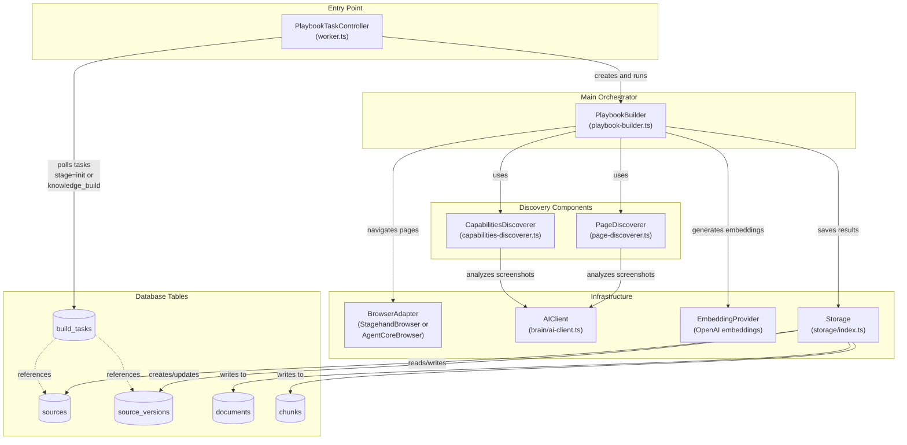
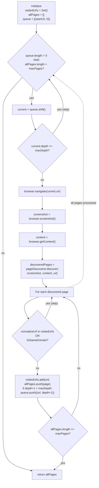
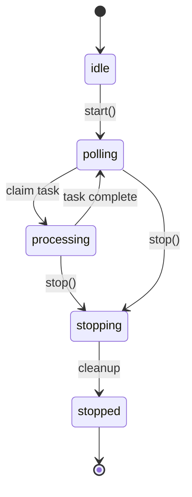
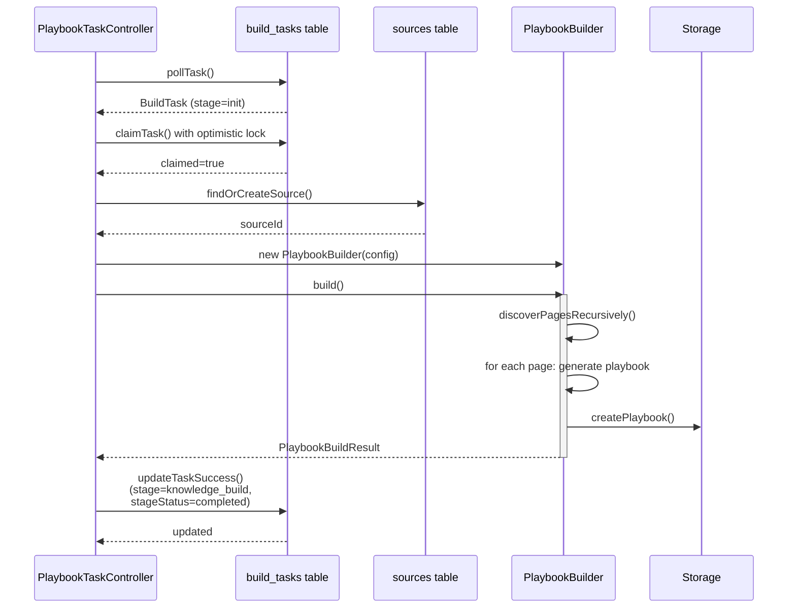
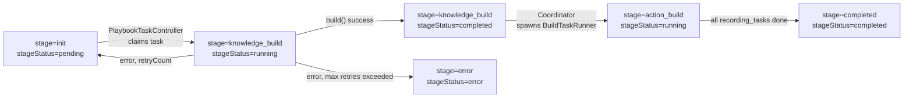
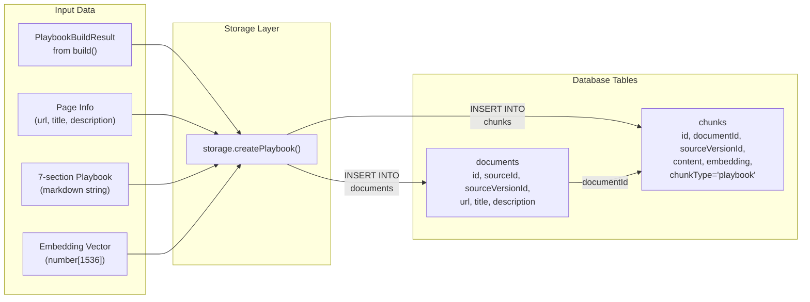
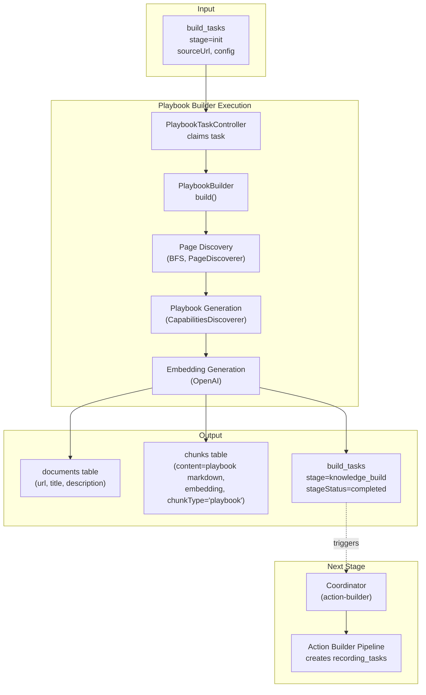

<!-- source: DeepWiki mcp.deepwiki.com · repo actionbook/actionbook · page 3.3 Playbook Builder Service · fetched 2026-10-26 -->

# Playbook Builder Service

<details>
<summary>Relevant source files</summary>

The following files were used as context for generating this wiki page:

- [README.md](README.md)
- [services/action-builder/src/task-worker/utils/prompt-builder.ts](services/action-builder/src/task-worker/utils/prompt-builder.ts)
- [services/db/src/models/build-task.ts](services/db/src/models/build-task.ts)
- [services/playbook-builder/scripts/worker.ts](services/playbook-builder/scripts/worker.ts)
- [services/playbook-builder/src/analyzer/page-analyzer.ts](services/playbook-builder/src/analyzer/page-analyzer.ts)
- [services/playbook-builder/src/controller/playbook-task-controller.ts](services/playbook-builder/src/controller/playbook-task-controller.ts)
- [services/playbook-builder/src/discoverer/capabilities-discoverer.ts](services/playbook-builder/src/discoverer/capabilities-discoverer.ts)
- [services/playbook-builder/src/discoverer/page-discoverer.ts](services/playbook-builder/src/discoverer/page-discoverer.ts)
- [services/playbook-builder/src/playbook-builder.ts](services/playbook-builder/src/playbook-builder.ts)
- [services/playbook-builder/src/types/index.ts](services/playbook-builder/src/types/index.ts)

</details>


## Purpose and Scope

The Playbook Builder Service is responsible for generating comprehensive documentation ("playbooks") for websites by discovering pages through recursive navigation and producing structured markdown documents that describe each page's purpose, capabilities, and structure. This service operates during the `knowledge_build` stage of the build pipeline and produces content that is stored as `documents` and `chunks` in the database with embeddings for semantic search.

This page covers the playbook-builder service architecture, components, and how it integrates with the build pipeline. For information about recording UI element selectors, see [Action Builder Service](#3.2). For details about the task orchestration system that manages both services, see [Task Execution Pipeline](#3.2.1).

Sources: [services/playbook-builder/src/playbook-builder.ts:1-10]()

---

## Service Overview

The Playbook Builder Service generates documentation by:

1. **Page Discovery** - Starting from a base URL, recursively discovers navigable pages up to a configured depth using LLM vision analysis
2. **Playbook Generation** - For each discovered page, generates a 7-section "Playbook" document using LLM analysis of screenshots and HTML
3. **Storage** - Saves playbooks as `documents` with associated `chunks` in the database, generating embeddings for search

The service differs fundamentally from the Action Builder Service:

| Aspect | Playbook Builder | Action Builder |
|--------|------------------|----------------|
| **Goal** | Document what pages exist and what they do | Record UI element selectors for automation |
| **Output** | Markdown documentation (playbooks) | Element records with selectors |
| **Stage** | `knowledge_build` (first) | `action_build` (second) |
| **Depth** | Explores entire site structure | Processes individual chunks |
| **Database** | Creates `documents` and `chunks` | Creates `pages` and `elements` |

Sources: [services/playbook-builder/src/playbook-builder.ts:1-30](), [README.md:42-47]()

---

## Architecture

### Component Diagram



**Architecture Overview**: The service uses a worker pattern where `PlaybookTaskController` polls the `build_tasks` table for pending tasks, then instantiates and runs `PlaybookBuilder` for each task. The main orchestrator uses two discoverers (`PageDiscoverer` and `CapabilitiesDiscoverer`) which leverage browser automation and AI vision models to analyze pages. Results are persisted through the `Storage` layer to the database.

Sources: [services/playbook-builder/src/playbook-builder.ts:30-77](), [services/playbook-builder/src/controller/playbook-task-controller.ts:1-11]()

---

## Main Components

### PlaybookBuilder

The `PlaybookBuilder` class is the main orchestrator located at [services/playbook-builder/src/playbook-builder.ts:30-272]().

**Key Responsibilities:**
- Initialize browser and AI client based on environment
- Create or get source version
- Recursively discover pages using BFS (breadth-first search)
- Generate playbooks for each discovered page
- Generate embeddings and persist results

**Configuration Interface:**

```typescript
interface PlaybookBuilderConfig {
  sourceId: number;              // Source ID to build playbook for
  startUrl: string;              // Starting URL for exploration
  headless?: boolean;            // Browser headless mode
  maxPages?: number;             // Max pages to explore (default: 10)
  maxDepth?: number;             // Max depth for recursive discovery (default: 1)
  sourceVersionId?: number;      // Optional version ID
  llmProvider?: string;          // LLM provider (auto-detected if not specified)
  customPrompt?: string;         // Site-specific optimization instructions
}
```

**Main Method - build():**

The `build()` method at [services/playbook-builder/src/playbook-builder.ts:82-182]() orchestrates the entire process:

1. Initialize browser using `createBrowserAuto()` (auto-detects StagehandBrowser or AgentCoreBrowser)
2. Create or get `source_version` using `storage.createVersion()`
3. Discover pages recursively via `discoverPagesRecursively()`
4. For each discovered page:
   - Navigate using `browser.navigate()`
   - Capture screenshot with `browser.screenshot()`
   - Get page content with `browser.getContent()`
   - Generate playbook using `capabilitiesDiscoverer.discover()`
   - Generate embedding if `OPENAI_API_KEY` is available
   - Save as document+chunk using `storage.createPlaybook()`
5. Return `PlaybookBuildResult` with playbook count and IDs

Sources: [services/playbook-builder/src/playbook-builder.ts:30-182](), [services/playbook-builder/src/types/index.ts:8-33]()

### Page Discovery Process

The `discoverPagesRecursively()` method at [services/playbook-builder/src/playbook-builder.ts:188-271]() implements a BFS algorithm:



**Key Features:**
- BFS ensures pages at depth N are processed before depth N+1
- URL normalization using `normalizeUrl()` prevents duplicate visits
- Domain checking using `isSameDomain()` prevents external links
- Early termination when `maxPages` reached

Sources: [services/playbook-builder/src/playbook-builder.ts:188-271]()

### PageDiscoverer

The `PageDiscoverer` class at [services/playbook-builder/src/discoverer/page-discoverer.ts:77-191]() identifies navigable pages from the current page.

**Tool Definition:**

Uses the `register_discovered_pages` tool call with this schema at [services/playbook-builder/src/discoverer/page-discoverer.ts:31-72]():

```typescript
{
  name: 'register_discovered_pages',
  parameters: {
    pages: [{
      semanticId: string,    // e.g., 'home', 'search', 'listing_detail'
      name: string,          // Human-readable name
      description: string,   // Page purpose
      url: string,           // URL or pattern
      navigation: string     // How to reach this page
    }]
  }
}
```

**Process:**
1. Extract navigation HTML using `extractNavigationHtml()` - finds `<nav>`, `<header>`, `<footer>`, `<a>` tags
2. Send screenshot + simplified HTML to LLM with system prompt
3. Append custom prompt if provided via `config.playbookBuilderPrompt`
4. Parse tool call response to get discovered pages
5. Normalize URLs to absolute using base URL

Sources: [services/playbook-builder/src/discoverer/page-discoverer.ts:77-191]()

### CapabilitiesDiscoverer

The `CapabilitiesDiscoverer` class at [services/playbook-builder/src/discoverer/capabilities-discoverer.ts:84-245]() generates comprehensive 7-section playbooks for each page.

**7-Section Playbook Format:**

Defined in the system prompt at [services/playbook-builder/src/discoverer/capabilities-discoverer.ts:23-79]():

```
### 0. Page URL
- URL with query parameters and dynamic params

### 1. Page Overview
- Core business objective in one sentence

### 2. Page Function Summary
- Function list with brief descriptions

### 3. Page Structure Summary
- Layout modules with CSS selectors

### 4. DOM Structure Instance
- Pattern recognition for different states
- Simplified HTML snippets

### 5. Parsing & Processing Summary
- Data retrieval scenarios (direct/interaction/implicit)
- Compatible parsing logic

### 6. Operation Summary
- Interactive operations (input/click/hover)
- Target selectors and expected results
```

**Generation Process:**

The `discover()` method at [services/playbook-builder/src/discoverer/capabilities-discoverer.ts:97-165]():

1. Simplify HTML using `getSimplifiedHTML()` - removes scripts, styles, SVG, images, inline styles
2. Build user prompt with page URL, title, and HTML structure
3. Append custom prompt if provided via `config.playbookBuilderPrompt`
4. Send to LLM with vision (no tool calls - direct markdown response)
5. Extract description from Section 1 using `extractDescription()`
6. Extract capabilities from Section 2 using `extractCapabilities()`
7. Return `PageCapabilities` with full playbook markdown

**PageCapabilities Interface:**

```typescript
interface PageCapabilities {
  description: string;      // Extracted from Section 1: Page Overview
  capabilities: string[];   // Extracted from Section 2: Page Function Summary
  playbook?: string;        // Full 7-section markdown document
  // Legacy fields (deprecated):
  functionalAreas?: string[];
  scenarios?: UserScenario[];
  prerequisites?: string[];
}
```

Sources: [services/playbook-builder/src/discoverer/capabilities-discoverer.ts:84-245](), [services/playbook-builder/src/types/index.ts:85-129]()

---

## PlaybookTaskController

The `PlaybookTaskController` at [services/playbook-builder/src/controller/playbook-task-controller.ts:51-561]() implements the worker pattern for continuous task processing.

### Task Controller State Machine



### Polling and Claiming

**Poll Query** at [services/playbook-builder/src/controller/playbook-task-controller.ts:174-203]():

Polls for tasks matching:
```sql
WHERE (
  (stage = 'init' AND stageStatus = 'pending')
  OR (stage = 'knowledge_build' AND stageStatus = 'pending')
)
ORDER BY createdAt
LIMIT 1
```

**Claim Task** at [services/playbook-builder/src/controller/playbook-task-controller.ts:309-330]():

Uses optimistic locking:
```sql
UPDATE build_tasks
SET 
  stage = 'knowledge_build',
  stageStatus = 'running',
  knowledgeStartedAt = NOW(),
  updatedAt = NOW()
WHERE id = ? AND stageStatus = 'pending'
RETURNING id
```

This prevents race conditions when multiple workers try to claim the same task.

Sources: [services/playbook-builder/src/controller/playbook-task-controller.ts:174-330]()

### Task Execution Flow



**Key Steps in executeTask()** at [services/playbook-builder/src/controller/playbook-task-controller.ts:209-303]():

1. **Claim task** - Optimistic lock to prevent duplicate execution
2. **Find or create source** - If `sourceId` is null, call `findOrCreateSource()` which:
   - Extracts domain from URL
   - Searches for existing source by `baseUrl`, `name`, or `domain`
   - Creates new source if not found
   - Updates task with `sourceId`
3. **Create PlaybookBuilder** - Extract config from `task.config`:
   - `playbookMaxPages` → `maxPages`
   - `playbookMaxDepth` → `maxDepth`
   - `playbookHeadless` → `headless`
   - `playbookBuilderPrompt` → `customPrompt`
4. **Execute build** - Call `builder.build()`
5. **Update task status** - Set to `knowledge_build/completed`
6. **Start heartbeat** - Update `updatedAt` every 60 seconds

Sources: [services/playbook-builder/src/controller/playbook-task-controller.ts:209-303](), [services/playbook-builder/src/controller/playbook-task-controller.ts:458-524]()

### Error Handling and Retry

At [services/playbook-builder/src/controller/playbook-task-controller.ts:349-376]():

```typescript
async handleTaskError(taskId, error, retryCount) {
  if (retryCount < maxRetries) {  // default: 3
    // Reset to pending for retry
    UPDATE build_tasks
    SET 
      stage = 'knowledge_build',
      stageStatus = 'pending',
      config = config || { _retryCount, _lastError }
  } else {
    // Permanent failure
    UPDATE build_tasks
    SET 
      stage = 'error',
      stageStatus = 'error',
      errorMessage = error.message
  }
}
```

Sources: [services/playbook-builder/src/controller/playbook-task-controller.ts:349-401]()

---

## Build Pipeline Integration

### Build Task Stage Progression

The Playbook Builder Service operates during the `knowledge_build` stage of the build pipeline:



**Stage Definitions** from [services/db/src/models/build-task.ts:112-117]():

| Stage | Description |
|-------|-------------|
| `init` | Initial state, waiting for knowledge build |
| `knowledge_build` | Playbook building in progress |
| `action_build` | Action builder recording in progress (next stage) |
| `completed` | All stages completed |
| `error` | Permanent error (max retries exceeded) |

Sources: [services/db/src/models/build-task.ts:18-117]()

### BuildTaskConfig for Playbook Builder

Configuration fields at [services/db/src/models/build-task.ts:141-162]():

```typescript
interface BuildTaskConfig {
  // Playbook Builder Config
  playbookMaxPages?: number;        // Max pages to process (default: 10)
  playbookMaxDepth?: number;        // Max depth for discovery (default: 1)
  playbookHeadless?: boolean;       // Run browser in headless mode
  playbookBuilderPrompt?: string;   // Site-specific optimization instructions
  
  // Action Builder Config (used by later stage)
  actionBuilderPrompt?: string;
  
  // Retry tracking (internal)
  _retryCount?: number;
  _lastError?: string;
  _errorAt?: string;
}
```

**Custom Prompt Usage:**

The `playbookBuilderPrompt` field is appended to LLM prompts in:
1. `PageDiscoverer` at [services/playbook-builder/src/discoverer/page-discoverer.ts:96-99]()
2. `CapabilitiesDiscoverer` at [services/playbook-builder/src/discoverer/capabilities-discoverer.ts:112-114]()

This allows site-specific instructions like:
```
"Focus on the main navigation menu and ignore promotional banners"
```

Sources: [services/db/src/models/build-task.ts:131-166](), [services/playbook-builder/src/discoverer/page-discoverer.ts:77-99](), [services/playbook-builder/src/discoverer/capabilities-discoverer.ts:97-114]()

---

## Storage and Data Flow

### Storage Operations

The `Storage` interface provides methods for persisting playbooks:

**createPlaybook()** creates both `document` and `chunk`:

```typescript
async createPlaybook({
  sourceId: number,
  sourceVersionId: number,
  url: string,
  title: string,
  description: string,
  chunkContent: string,      // Full playbook markdown
  embedding?: number[],      // 1536-dim vector from OpenAI
  embeddingModel?: string    // 'text-embedding-3-small'
})
```

**Database Schema Mapping:**



**Chunk Type:**

Playbooks are stored with `chunkType = 'playbook'` to distinguish them from other content chunks. This enables filtering during search and retrieval.

Sources: [services/playbook-builder/src/playbook-builder.ts:146-157]()

### Embedding Generation

At [services/playbook-builder/src/playbook-builder.ts:62-72]():

```typescript
if (process.env.OPENAI_API_KEY) {
  this.embedding = createEmbeddingProvider({ provider: 'openai' });
  // Uses model: 'text-embedding-3-small'
}
```

Embeddings are generated for the full playbook content:
```typescript
const chunkContent = capabilities.playbook || buildChunkContent(...);
const result = await this.embedding.embed(chunkContent);
embedding = result.embedding;  // number[1536]
```

This enables semantic search over playbook documentation in the API service.

Sources: [services/playbook-builder/src/playbook-builder.ts:62-144]()

---

## Worker Process

### CLI Entry Point

The worker script at [services/playbook-builder/scripts/worker.ts:1-83]() provides the CLI entry point:

**Usage:**
```bash
cd services/playbook-builder
pnpm dev
```

**Startup Sequence:**
1. Load environment variables from `.env`
2. Create controller: `createPlaybookTaskController()`
3. Configure callbacks:
   - `onTaskStart` - Log task start
   - `onTaskComplete` - Log results (playbook count, duration)
   - `onTaskError` - Log error and retry count
4. Setup graceful shutdown handlers for SIGINT/SIGTERM
5. Start continuous polling: `controller.start(options)`

**Graceful Shutdown:**

When SIGINT/SIGTERM received:
1. Call `controller.stop(reason)`
2. Clear poll timer
3. If currently processing:
   - Update task to `stage=error, stageStatus=error`
   - Wait for current execution to finish
4. Clear heartbeat timer
5. Exit with code 0

Sources: [services/playbook-builder/scripts/worker.ts:1-83]()

### Controller Options

```typescript
interface ControllerOptions {
  pollInterval?: number;        // Default: 30000 (30s)
  taskTimeout?: number;         // Default: 0 (no timeout)
  heartbeatInterval?: number;   // Default: 60000 (1min)
  maxRetries?: number;          // Default: 3
  
  // Callbacks
  onProgress?: (taskId, progress) => void;
  onTaskStart?: (taskId) => void;
  onTaskComplete?: (taskId, result) => void;
  onTaskError?: (taskId, error, retryCount) => void;
}
```

Sources: [services/playbook-builder/src/controller/types.ts](), [services/playbook-builder/scripts/worker.ts:52-63]()

---

## Configuration

### Environment Variables

Required:
- `DATABASE_URL` - PostgreSQL connection string (or Neon serverless)
- LLM Provider (one of):
  - `OPENROUTER_API_KEY` - OpenRouter API key
  - `OPENAI_API_KEY` - OpenAI API key (also used for embeddings)
  - `ANTHROPIC_API_KEY` - Anthropic API key
  - `AWS_REGION`, `AWS_ACCESS_KEY_ID`, `AWS_SECRET_ACCESS_KEY` - For Bedrock

Optional:
- `LLM_PROVIDER` - Force specific provider: 'openrouter' | 'openai' | 'anthropic' | 'bedrock'
- `HEADLESS` - Run browser in headless mode (default: true in production)

**Provider Auto-Detection:**

At [services/playbook-builder/src/playbook-builder.ts:56-59]():

```typescript
const llmProvider = this.config.llmProvider ||
  (process.env.LLM_PROVIDER as 'openrouter' | 'openai' | 'anthropic' | 'bedrock' | undefined);
this.ai = new AIClient({ provider: llmProvider });
// AIClient auto-detects based on available API keys if provider not specified
```

**Browser Auto-Detection:**

At [services/playbook-builder/src/playbook-builder.ts:54]():

```typescript
this.browser = createBrowserAuto({ headless: this.config.headless });
// Returns AgentCoreBrowser in AWS Lambda, StagehandBrowser locally
```

Sources: [services/playbook-builder/src/playbook-builder.ts:41-60]()

### Build Task Configuration

Example configuration for a build task:

```typescript
const buildTask = {
  sourceUrl: 'https://example.com',
  sourceName: 'Example Site',
  sourceCategory: 'any',
  stage: 'init',
  stageStatus: 'pending',
  config: {
    // Playbook builder settings
    playbookMaxPages: 20,
    playbookMaxDepth: 2,
    playbookHeadless: true,
    playbookBuilderPrompt: 'Focus on documentation pages and ignore blog posts',
    
    // Action builder settings (used in next stage)
    actionBuilderPrompt: 'Prioritize form interactions',
  }
}
```

The controller extracts playbook-specific config at [services/playbook-builder/src/controller/playbook-task-controller.ts:246-254]():

```typescript
const config = task.config;
new PlaybookBuilder({
  sourceId: task.sourceId,
  startUrl: task.sourceUrl,
  headless: config.playbookHeadless ?? true,
  maxPages: config.playbookMaxPages ?? 10,
  maxDepth: config.playbookMaxDepth ?? 1,
  customPrompt: config.playbookBuilderPrompt,
});
```

Sources: [services/playbook-builder/src/controller/playbook-task-controller.ts:246-254](), [services/db/src/models/build-task.ts:131-166]()

---

## Comparison with Action Builder

### Architectural Differences

| Aspect | Playbook Builder | Action Builder |
|--------|------------------|----------------|
| **Entry Class** | `PlaybookBuilder` | `BuildTaskRunner` + `QueueWorker` |
| **Task Granularity** | One task = entire site | One build task → 50-100+ recording tasks |
| **Concurrency** | Single worker, sequential pages | Multiple workers, parallel recording tasks |
| **Browser Usage** | Navigate and screenshot each page | Multi-turn interaction loop per chunk |
| **LLM Interaction** | One-shot vision analysis | Multi-turn tool calling (max 30 turns) |
| **Output Format** | Markdown playbooks | Structured element records with selectors |
| **Database Tables** | `documents`, `chunks` | `pages`, `elements` |

### Prompt Differences

**Playbook Builder** at [services/playbook-builder/src/discoverer/capabilities-discoverer.ts:23-79]():
- Goal: "Generate a standardized Playbook document"
- No tool calls - direct markdown response
- Focuses on WHAT (business objective, functions, structure)
- Sections: Page URL, Overview, Functions, Structure, DOM, Parsing, Operations

**Action Builder** at [services/action-builder/src/task-worker/utils/prompt-builder.ts:19-163]():
- Goal: "Execute task steps while recording UI elements"
- Tool calls: `navigate`, `observe_page`, `interact`, `register_element`
- Focuses on HOW (selectors, interactions, element patterns)
- Safe Mode: distinguish navigation vs destructive actions

Sources: [services/playbook-builder/src/discoverer/capabilities-discoverer.ts:23-79](), [services/action-builder/src/task-worker/utils/prompt-builder.ts:19-163]()

---

## Data Flow Summary



**Key Points:**

1. **Task Polling** - Controller continuously polls for `stage=init` or `stage=knowledge_build, status=pending` tasks
2. **Page Discovery** - BFS traversal up to `maxDepth`, respecting domain boundaries
3. **Playbook Generation** - LLM vision analysis produces 7-section markdown documents
4. **Embedding** - OpenAI embeddings enable semantic search in API service
5. **Stage Transition** - Completion updates task to `knowledge_build/completed`, triggering action-builder coordinator
6. **Retry Logic** - Up to 3 retries on error before permanent failure

Sources: [services/playbook-builder/src/playbook-builder.ts:82-182](), [services/playbook-builder/src/controller/playbook-task-controller.ts:150-303]()

---

