<!-- source: DeepWiki mcp.deepwiki.com · repo actionbook/actionbook · page 4.3 AgentCoreBrowser Implementation · fetched 2026-10-26 -->

# AgentCoreBrowser Implementation

<details>
<summary>Relevant source files</summary>

The following files were used as context for generating this wiki page:

- [services/action-builder/src/index.ts](services/action-builder/src/index.ts)
- [services/common/browser/package.json](services/common/browser/package.json)
- [services/common/browser/src/adapters/browser-adapter.ts](services/common/browser/src/adapters/browser-adapter.ts)
- [services/common/browser/src/adapters/index.ts](services/common/browser/src/adapters/index.ts)
- [services/common/browser/src/implementations/agent-core-browser.ts](services/common/browser/src/implementations/agent-core-browser.ts)
- [services/common/browser/src/implementations/stagehand-browser.ts](services/common/browser/src/implementations/stagehand-browser.ts)
- [services/common/browser/src/types/browser.ts](services/common/browser/src/types/browser.ts)
- [services/common/browser/test/e2e/stagehand-browser.e2e.test.ts](services/common/browser/test/e2e/stagehand-browser.e2e.test.ts)
- [services/common/browser/test/unit/agent-core-browser.ut.test.ts](services/common/browser/test/unit/agent-core-browser.ut.test.ts)

</details>


## Purpose and Scope

This document details the `AgentCoreBrowser` class, an AWS cloud-based implementation of the `BrowserAdapter` interface ([4.1](#4.1)). AgentCoreBrowser provides browser automation capabilities through AWS Bedrock AgentCore Browser Tool and uses Bedrock Claude for AI-powered element observation. For the local Playwright-based implementation, see [StagehandBrowser](#4.2).

**Sources:** [services/common/browser/src/implementations/agent-core-browser.ts:1-12]()

---

## Architecture Overview

AgentCoreBrowser delegates browser automation to AWS AgentCore while implementing AI capabilities through direct Bedrock Claude invocation. This approach eliminates the need for local browser installations and provides enterprise-grade session isolation.

```mermaid
graph TB
    subgraph "AgentCoreBrowser Class"
        ACB[AgentCoreBrowser]
        Config[AgentCoreBrowserConfig]
        State["Private State:<br/>client: PlaywrightBrowser<br/>bedrockClient: BedrockRuntimeClient<br/>initialized: boolean<br/>currentUrl: string"]
    end
    
    subgraph "External Dependencies"
        PWB["PlaywrightBrowser<br/>(bedrock-agentcore/browser/playwright)"]
        BRC["BedrockRuntimeClient<br/>(@aws-sdk/client-bedrock-runtime)"]
        IMC["InvokeModelCommand<br/>(Bedrock API)"]
    end
    
    subgraph "BrowserAdapter Interface"
        BAI["BrowserAdapter<br/>Lifecycle, Navigation,<br/>AI, Element Inspection"]
    end
    
    ACB --|implements| BAI
    ACB --|uses| PWB
    ACB --|uses| BRC
    ACB --|uses| Config
    BRC --|sends| IMC
    
    Config -.->|sessionTimeoutMinutes| PWB
    Config -.->|bedrockModelId| BRC
    State -.->|stores| PWB
    State -.->|stores| BRC
```

**Key Components:**

| Component | Type | Purpose |
|-----------|------|---------|
| `PlaywrightBrowser` | External | AWS AgentCore browser client for page automation |
| `BedrockRuntimeClient` | External | AWS SDK client for invoking Bedrock models |
| `AgentCoreBrowserConfig` | Interface | Configuration including region, timeouts, model ID |
| `currentUrl` | State | Tracks navigation state (AgentCore doesn't expose URL directly) |

**Sources:** [services/common/browser/src/implementations/agent-core-browser.ts:34-87](), [services/common/browser/package.json:40-41]()

---

## Initialization and Lifecycle

### Constructor and Configuration

The `AgentCoreBrowser` constructor accepts an `AgentCoreBrowserConfig` object with defaults resolved from environment variables:

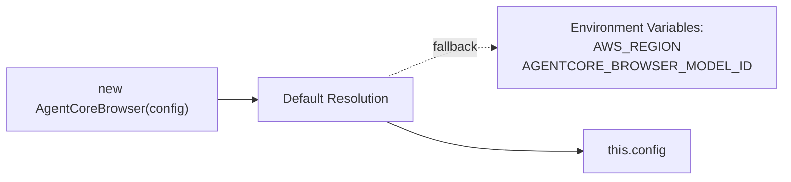

**Configuration Fields:**

| Field | Default | Environment Variable | Description |
|-------|---------|---------------------|-------------|
| `sessionTimeoutMinutes` | 15 | - | Session duration (max 480 for 8 hours) |
| `region` | 'us-east-1' | `AWS_REGION` | AWS region for AgentCore |
| `timeout` | 60000 | - | Default navigation timeout (ms) |
| `bedrockModelId` | 'us.anthropic.claude-3-5-sonnet-20241022-v2:0' | `AGENTCORE_BROWSER_MODEL_ID` | Bedrock model for AI operations |

**Sources:** [services/common/browser/src/implementations/agent-core-browser.ts:56-87]()

### Initialization Flow

The `initialize()` method creates both the browser client and Bedrock client but defers session creation until first use:

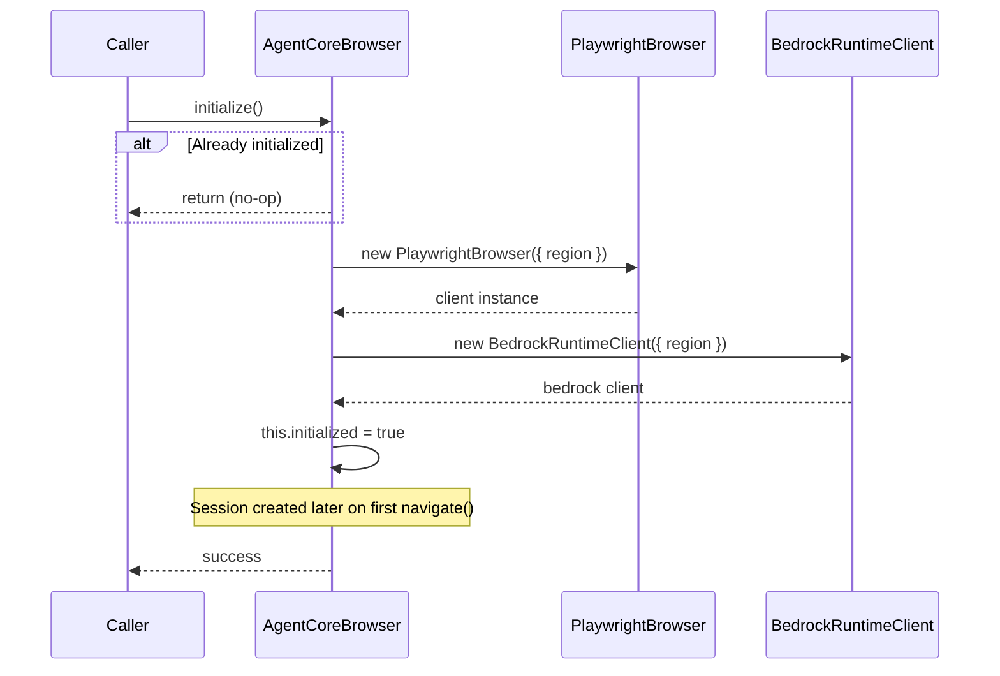

**Sources:** [services/common/browser/src/implementations/agent-core-browser.ts:93-124]()

### Session Lifecycle

Unlike local browsers, AgentCoreBrowser manages cloud-based sessions:

1. **Session Creation:** Implicit on first `navigate()` call
2. **Session Timeout:** Configured via `sessionTimeoutMinutes` (default 15 minutes, max 480)
3. **Session Termination:** Explicit via `close()` which calls `client.stopSession()`

**Sources:** [services/common/browser/src/implementations/agent-core-browser.ts:126-140]()

---

## Core Components

### PlaywrightBrowser Client

The `PlaywrightBrowser` class from `bedrock-agentcore` package provides the core browser automation API. All methods require object parameters:

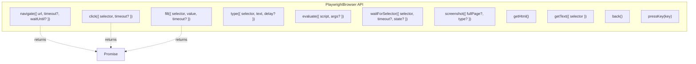

**Key Differences from Stagehand:**
- All methods require object parameters (not positional)
- `evaluate({ script })` takes JavaScript as string, not function
- Screenshot returns base64 string or Buffer
- No built-in AI observe/act (implemented separately via Bedrock)

**Sources:** [services/common/browser/src/implementations/agent-core-browser.ts:146-370]()

### BedrockRuntimeClient for AI

The `observe()` method uses `BedrockRuntimeClient` to invoke Claude with vision:

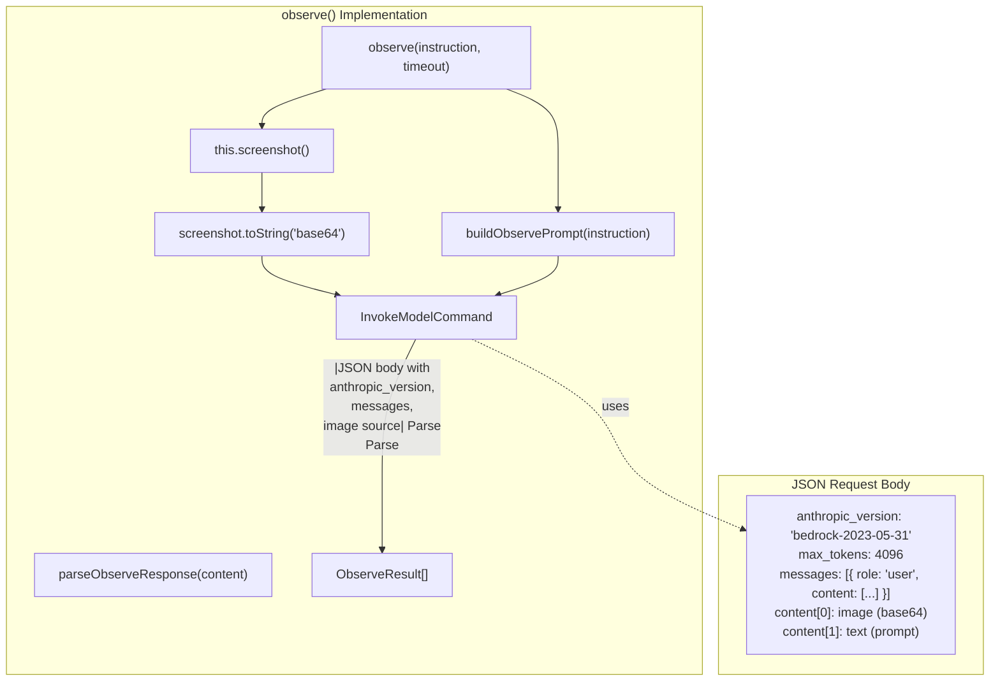

**Sources:** [services/common/browser/src/implementations/agent-core-browser.ts:112-116](), [services/common/browser/src/implementations/agent-core-browser.ts:396-475]()

---

## AI Capabilities Implementation

### observe() Method

The `observe()` method finds elements using AI vision analysis:

**Flow:**
1. Capture screenshot via `this.screenshot()`
2. Convert to base64 string
3. Build prompt with `buildObservePrompt(instruction)`
4. Invoke Bedrock Claude with screenshot + prompt
5. Parse response JSON with `parseObserveResponse(content)`
6. Return `ObserveResult[]` with selectors and descriptions

**Prompt Structure:**
```
You are helping the user automate the browser by finding elements...

Instruction: "{instruction}"

CRITICAL RULES:
- ONLY return elements that actually exist and match the instruction
- If no matching elements exist, return []
- Do NOT invent or guess elements that are not clearly visible
- Return ONLY a valid JSON array, no other text
```

**Sources:** [services/common/browser/src/implementations/agent-core-browser.ts:396-475](), [services/common/browser/src/implementations/agent-core-browser.ts:773-795]()

### Response Parsing

The `parseObserveResponse()` private method handles Claude's response with robust error handling:

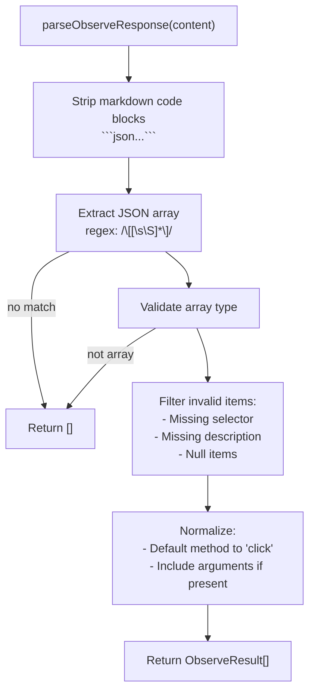

**Sources:** [services/common/browser/src/implementations/agent-core-browser.ts:800-847]()

### act() and actWithSelector()

The `act()` method routes requests based on input type:

| Input Type | Routing | Behavior |
|------------|---------|----------|
| `string` | `observe()` → `actWithSelector()` | Natural language → Find element → Execute action |
| `ActionObject` | `actWithSelector()` | Direct execution with selector |

**actWithSelector() Method Dispatch:**

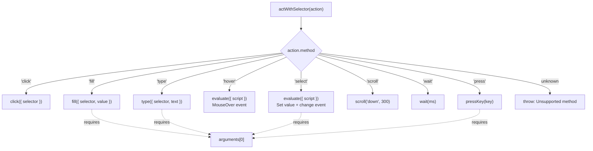

**Sources:** [services/common/browser/src/implementations/agent-core-browser.ts:482-584]()

---

## Method Implementations

### Navigation Methods

**navigate(url, options?)**

Calls `client.navigate({ url, timeout, waitUntil })` and updates `currentUrl` state:

```typescript
// AgentCore SDK requires object parameter
await client.navigate({
  url,
  timeout: options?.timeout ?? this.config.timeout,
  waitUntil: options?.waitUntil ?? 'domcontentloaded',
});
this.currentUrl = url; // Track URL manually
```

**goBack()**

Simple wrapper: `await client.back()`

**Sources:** [services/common/browser/src/implementations/agent-core-browser.ts:146-169]()

### Page Information Methods

**getUrl()**

Returns `this.currentUrl` (tracked internally, not from AgentCore)

**getTitle()**

```typescript
const title = await client.evaluate({ script: 'document.title' });
return title || '';
```

**getContent()**

```typescript
const html = await client.getHtml();
return html || '';
```

**Sources:** [services/common/browser/src/implementations/agent-core-browser.ts:175-199]()

### Screenshot Method

Handles format conversion and base64-to-Buffer:

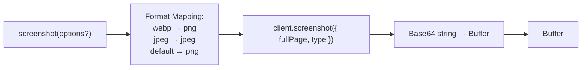

**Why webp → png:** AgentCore SDK only supports 'png' | 'jpeg', not 'webp'

**Sources:** [services/common/browser/src/implementations/agent-core-browser.ts:205-227]()

### Waiting Methods

**waitForSelector(selector, options?)**

Maps `BrowserAdapter` options to AgentCore state parameter:

| BrowserAdapter Option | AgentCore State |
|----------------------|-----------------|
| `hidden: true` | `'hidden'` |
| `visible: true` | `'visible'` |
| (default) | `'attached'` |

**wait(ms)**

Standard Promise-based delay: `new Promise(resolve => setTimeout(resolve, ms))`

**waitForText(text, timeout)**

Polls `getContent()` every 500ms until text found or timeout

**Sources:** [services/common/browser/src/implementations/agent-core-browser.ts:233-270](), [services/common/browser/src/implementations/agent-core-browser.ts:650-670]()

### Scrolling Methods

**scroll(direction, amount?)**

```typescript
const delta = direction === 'down' ? amount : -amount;
await client.evaluate({
  script: `window.scrollBy(0, ${delta})`,
});
```

**scrollToBottom(waitAfterMs?)**

Iteratively scrolls to bottom, checking `document.body.scrollHeight` until no change (max 10 attempts)

**Sources:** [services/common/browser/src/implementations/agent-core-browser.ts:262-310]()

---

## Element Inspection

### getElementAttributesFromXPath()

Extracts comprehensive element metadata via `evaluate()`:

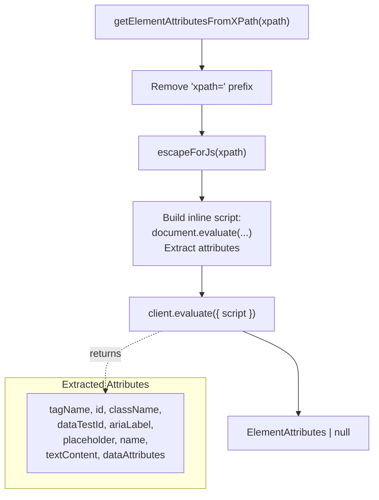

**Script Structure:**

```javascript
(() => {
  const el = document.evaluate(
    "//xpath/here",
    document,
    null,
    XPathResult.FIRST_ORDERED_NODE_TYPE,
    null
  ).singleNodeValue;
  
  if (!el) return null;
  
  // Collect data-* attributes
  const dataAttributes = {};
  for (const attr of el.attributes) {
    if (attr.name.startsWith('data-')) {
      dataAttributes[attr.name] = attr.value;
    }
  }
  
  return { tagName, id, className, ... };
})()
```

**Sources:** [services/common/browser/src/implementations/agent-core-browser.ts:589-630]()

### XPath and Selector Utilities

**isXPathSelector(selector)**

Checks if selector starts with `'xpath='`, `'/'`, or `'('`

**buildElementScript(selector, action)**

Generates JavaScript to find element (XPath or CSS) and execute action:

```typescript
if (isXPathSelector(selector)) {
  return `(() => { 
    const el = document.evaluate(${escapeForJs(cleanSelector)}, ...);
    ${action}
  })()`;
} else {
  return `(() => { 
    const el = document.querySelector(${escapeForJs(cleanSelector)});
    ${action}
  })()`;
}
```

**Sources:** [services/common/browser/src/implementations/agent-core-browser.ts:750-766]()

---

## Configuration and Environment

### Environment Variable Resolution

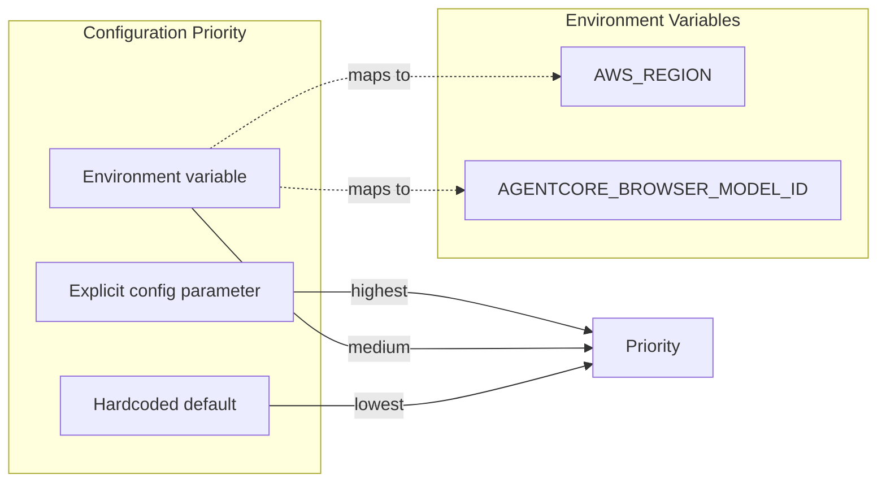

**Configuration Example:**

```typescript
const browser = new AgentCoreBrowser({
  sessionTimeoutMinutes: 30,      // Override default
  region: 'us-west-2',            // Override env
  bedrockModelId: 'custom-model', // Override env
});
```

**Sources:** [services/common/browser/src/implementations/agent-core-browser.ts:76-86]()

### AWS Credentials

AgentCoreBrowser requires AWS credentials via standard AWS SDK resolution:
- Environment variables: `AWS_ACCESS_KEY_ID`, `AWS_SECRET_ACCESS_KEY`, `AWS_SESSION_TOKEN`
- IAM role (when running on AWS)
- AWS credentials file (`~/.aws/credentials`)

**Required IAM Permissions:**
- `bedrock:InvokeModel` for AI observe operations
- AgentCore browser session management (specific permissions vary by AWS account setup)

**Sources:** [services/common/browser/src/implementations/agent-core-browser.ts:112-116]()

---

## Comparison with StagehandBrowser

### Key Differences

| Feature | AgentCoreBrowser | StagehandBrowser ([4.2](#4.2)) |
|---------|------------------|--------------------------------|
| **Execution** | AWS cloud-based | Local Playwright |
| **Installation** | No local browser needed | Requires Chromium/Chrome |
| **AI Provider** | Bedrock Claude (fixed) | OpenRouter/OpenAI/Anthropic/Bedrock |
| **Token Tracking** | Not tracked (Bedrock billing separate) | Tracked via Stagehand metrics |
| **Browser Profiles** | Not supported | Supported via `BrowserProfileManager` |
| **Session Management** | Cloud session with timeout | Local process |
| **Observe Implementation** | Screenshot + Bedrock InvokeModel | Stagehand SDK observe() |
| **Act Implementation** | Manual method dispatch | Stagehand SDK act() |
| **Proxy Support** | Via AWS VPC/networking | Via Playwright proxy config |

**Sources:** [services/common/browser/src/implementations/agent-core-browser.ts:1-849](), [services/common/browser/src/implementations/stagehand-browser.ts:1-1118]()

### When to Use AgentCoreBrowser

**Use AgentCoreBrowser when:**
- Running in AWS environment (Lambda, ECS, EC2)
- No local browser installation possible
- Need session recording/replay (AgentCore feature)
- Enterprise security requirements (VPC isolation)
- Automatic scaling needed

**Use StagehandBrowser when:**
- Local development
- Need multiple LLM provider options
- Require browser profile persistence
- Need detailed token usage metrics
- Proxy configuration required

**Sources:** [services/common/browser/src/implementations/agent-core-browser.ts:6-12]()

---

## Error Handling and Edge Cases

### Common Error Patterns

**Initialization State:**
```typescript
private ensureInitialized(): void {
  if (!this.client || !this.initialized) {
    throw new Error('Browser not initialized. Call initialize() first.');
  }
}
```

All major methods call `ensureInitialized()` or use `getClient()` which includes this check.

**Missing Arguments:**
```typescript
case 'fill':
case 'type':
  if (!args || args.length === 0) {
    throw new Error(`${method} action requires text argument`);
  }
```

**Element Not Found:**
```typescript
if (!selector) {
  throw new Error(`No elements found matching: ${instructionOrAction}`);
}
```

**Sources:** [services/common/browser/src/implementations/agent-core-browser.ts:724-738]()

### Response Parsing Robustness

The `parseObserveResponse()` handles various Claude response formats:

1. **Markdown code blocks:** Strips ` ```json ... ``` ` wrappers
2. **Plain JSON array:** Extracts `[...]` via regex
3. **Invalid JSON:** Returns empty array `[]`
4. **Non-array response:** Returns empty array `[]`
5. **Invalid items:** Filters out items missing required fields

**Sources:** [services/common/browser/src/implementations/agent-core-browser.ts:800-847]()

---

## Testing

### Unit Test Coverage

The unit tests mock external dependencies and verify internal logic:

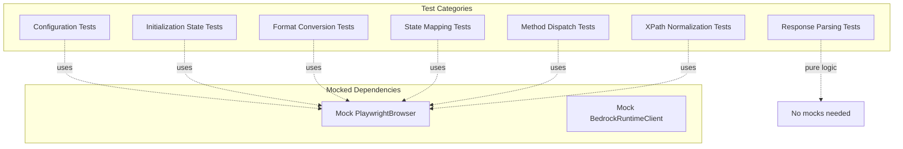

**Test File Structure:**

| Test Suite | Focus | Key Tests |
|------------|-------|-----------|
| Configuration | Config resolution | Default values, env vars, custom config |
| Initialization State | Lifecycle guards | Errors before init, double init |
| Screenshot Format Conversion | webp → png mapping | Format handling, base64 conversion |
| waitForSelector State Mapping | Option → state translation | hidden/visible/attached mapping |
| Scroll Direction | Delta calculation | up = negative, down = positive |
| act() Routing | Instruction vs ActionObject | String → observe, Object → actWithSelector |
| actWithSelector Method Dispatch | Switch statement logic | All action methods, error cases |
| XPath Normalization | Prefix handling | Remove 'xpath=' prefix |
| parseObserveResponse | JSON extraction | Markdown blocks, filtering, defaults |

**Sources:** [services/common/browser/test/unit/agent-core-browser.ut.test.ts:1-727]()

### E2E Test Considerations

E2E tests for AgentCoreBrowser require:
- AWS credentials with Bedrock access
- `AWS_AGENTCORE_RUNTIME=true` or `BROWSER_TYPE=agentcore`
- Tests are skipped when running in StagehandBrowser environment

**Example E2E test pattern:**
```typescript
const isAgentCoreEnv =
  process.env.AWS_AGENTCORE_RUNTIME === 'true' ||
  process.env.BROWSER_TYPE === 'agentcore';

const describeIfAgentCore = isAgentCoreEnv ? describe : describe.skip;

describeIfAgentCore('AgentCoreBrowser E2E', () => {
  // Tests run only in AgentCore environment
});
```

**Sources:** [services/common/browser/test/e2e/stagehand-browser.e2e.test.ts:17-30]()

---

## Integration with Action Builder

AgentCoreBrowser is used by the Action Builder service as one of the browser adapter options:

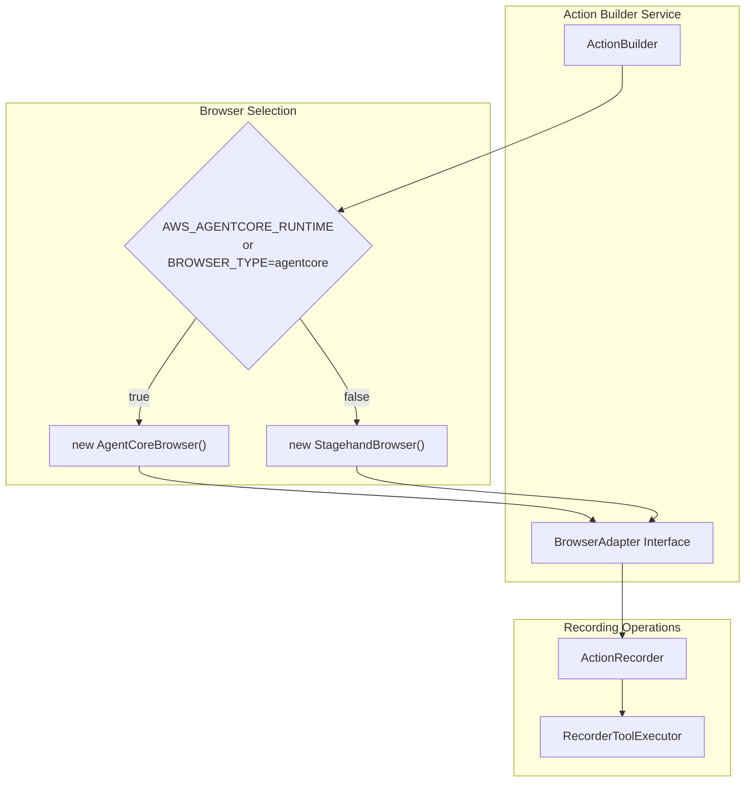

The selection is typically based on execution environment (AWS Lambda/ECS for AgentCore, local for Stagehand).

**Sources:** [services/action-builder/src/index.ts:5-6]()

---

## Package Structure and Dependencies

### Package Configuration

AgentCoreBrowser is part of the `@actionbookdev/browser` package with conditional dependencies:

```json
{
  "name": "@actionbookdev/browser",
  "exports": {
    "./agentcore": {
      "types": "./dist/implementations/agent-core-browser.d.ts",
      "import": "./dist/implementations/agent-core-browser.js"
    }
  },
  "peerDependencies": {
    "bedrock-agentcore": ">=0.1.0"
  },
  "peerDependenciesMeta": {
    "bedrock-agentcore": {
      "optional": true
    }
  },
  "dependencies": {
    "@aws-sdk/client-bedrock-runtime": "^3.966.0"
  }
}
```

**Dependency Strategy:**
- `bedrock-agentcore` is a peer dependency (optional) to avoid installation when not needed
- `@aws-sdk/client-bedrock-runtime` is a regular dependency (always installed)
- Build system (tsup) marks both as external to avoid bundling

**Sources:** [services/common/browser/package.json:1-74]()

### Import Pattern

```typescript
// Static import for external dependency
import { PlaywrightBrowser } from 'bedrock-agentcore/browser/playwright';
import {
  BedrockRuntimeClient,
  InvokeModelCommand,
} from '@aws-sdk/client-bedrock-runtime';

// Implementation
export class AgentCoreBrowser implements BrowserAdapter {
  private client: InstanceType<typeof PlaywrightBrowser> | null = null;
  private bedrockClient: BedrockRuntimeClient | null = null;
  // ...
}
```

**Sources:** [services/common/browser/src/implementations/agent-core-browser.ts:14-39]()

---

