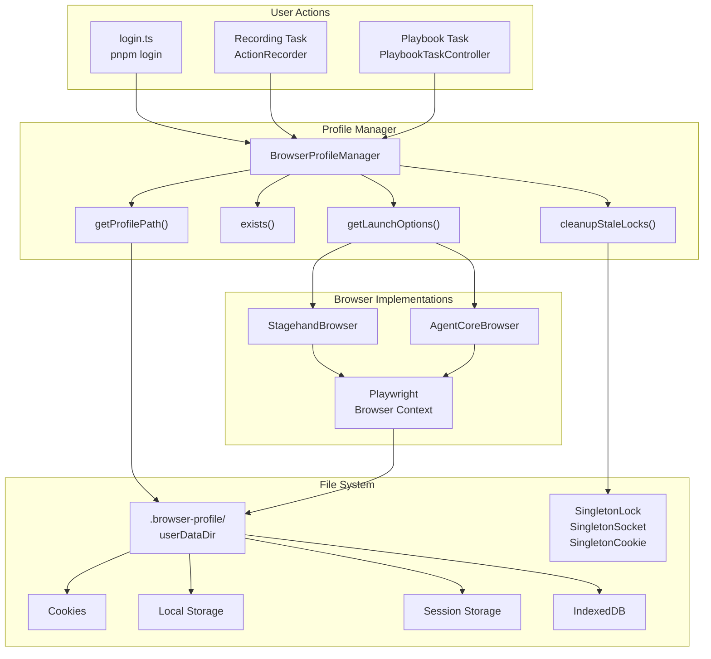
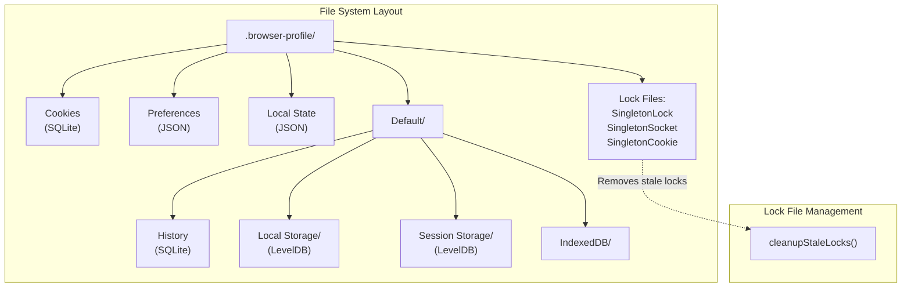
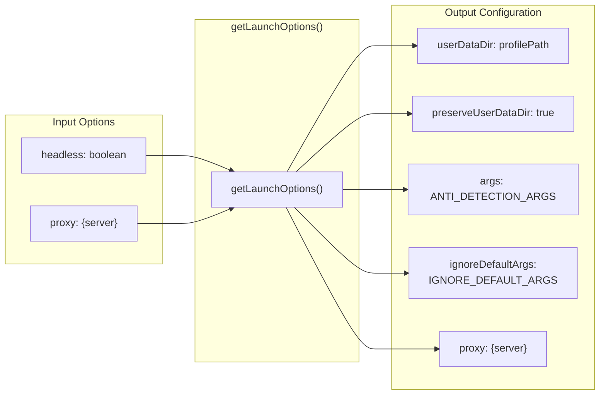
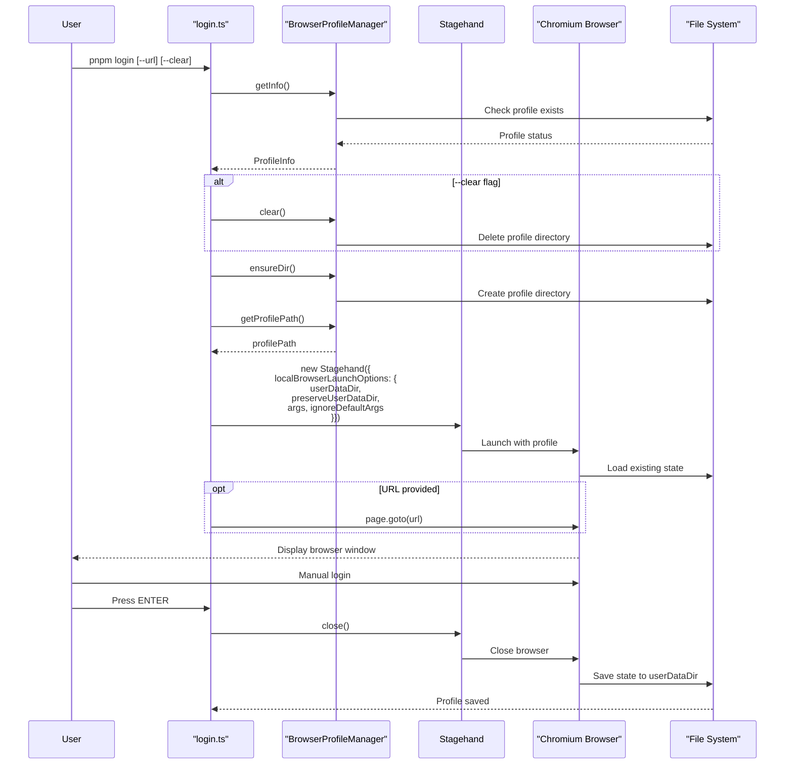
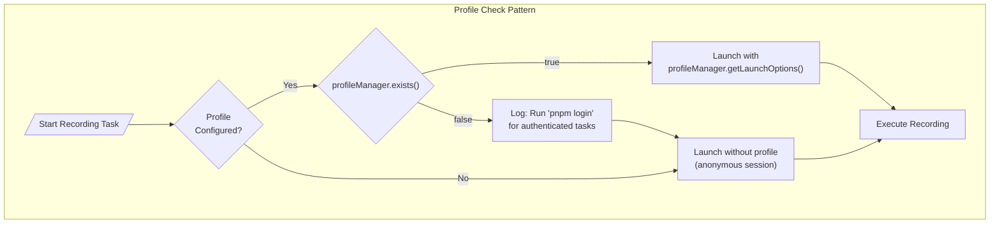

<!-- source: DeepWiki mcp.deepwiki.com · repo actionbook/actionbook · page 4.4 Browser Profiles · fetched 2026-10-26 -->

# Browser Profiles

<details>
<summary>Relevant source files</summary>

The following files were used as context for generating this wiki page:

- [.prettierignore](.prettierignore)
- [.prettierrc.json](.prettierrc.json)
- [CLAUDE.md](CLAUDE.md)
- [services/action-builder/scripts/login.ts](services/action-builder/scripts/login.ts)
- [services/action-builder/src/optimizer/SelectorOptimizer.ts](services/action-builder/src/optimizer/SelectorOptimizer.ts)
- [services/common/browser-profile/package.json](services/common/browser-profile/package.json)
- [services/common/browser-profile/src/BrowserProfileManager.ts](services/common/browser-profile/src/BrowserProfileManager.ts)

</details>


## Purpose and Scope

This document describes the browser profile management system that enables persistent login state across browser automation sessions. The `BrowserProfileManager` class provides a unified interface for managing Playwright's `userDataDir` feature, allowing "login once, reuse many times" workflows for recording and automation tasks.

For browser automation interfaces and implementations, see [BrowserAdapter Interface](#4.1), [StagehandBrowser Implementation](#4.2), and [AgentCoreBrowser Implementation](#4.3). For the broader browser automation architecture, see [Browser Automation Layer](#4).

## Overview

The browser profile system solves a critical problem in web automation: maintaining authenticated state across multiple sessions. Without persistent profiles, automation scripts must re-authenticate on every run, which is time-consuming, error-prone, and may trigger anti-bot detection.

The system is built around Playwright's `userDataDir` feature, which persists browser state (cookies, localStorage, sessionStorage, IndexedDB) to disk. The `BrowserProfileManager` class wraps this functionality with additional features:

- Lock file cleanup for crashed browser instances
- Anti-detection arguments to avoid automation detection
- Profile lifecycle management (create, clear, info)
- Proxy support configuration

**Sources:** [services/common/browser-profile/src/BrowserProfileManager.ts:1-239]()

## Architecture



**Sources:** [services/common/browser-profile/src/BrowserProfileManager.ts:74-99](), [services/action-builder/scripts/login.ts:1-149]()

## BrowserProfileManager Class

The `BrowserProfileManager` class is the core component for profile management, defined in [services/common/browser-profile/src/BrowserProfileManager.ts:100-239]().

### Constructor and Configuration

```typescript
interface ProfileConfig {
  baseDir?: string;      // Default: '.browser-profile'
  logger?: ProfileLogger;
}
```

The constructor accepts optional configuration:
- `baseDir`: Directory for profile storage, defaults to `DEFAULT_PROFILE_DIR` (`.browser-profile`)
- `logger`: Custom logging function for different log levels

**Sources:** [services/common/browser-profile/src/BrowserProfileManager.ts:37-107]()

### Core Methods

| Method | Return Type | Description |
|--------|-------------|-------------|
| `getProfilePath()` | `string` | Returns absolute path to profile directory |
| `exists()` | `boolean` | Checks if profile directory exists |
| `ensureDir()` | `void` | Creates profile directory if missing |
| `clear()` | `void` | Deletes all profile data |
| `cleanupStaleLocks()` | `void` | Removes stale Chromium lock files |
| `getInfo()` | `ProfileInfo` | Returns profile metadata (exists, path, size) |
| `getLaunchOptions()` | `Record<string, unknown>` | Returns browser launch options with profile config |

**Sources:** [services/common/browser-profile/src/BrowserProfileManager.ts:109-238]()

## Profile Storage Structure

The profile directory stores persistent browser state in Chromium's native format:



### Lock File Cleanup

Chromium creates lock files (`SingletonLock`, `SingletonSocket`, `SingletonCookie`) to prevent multiple browser instances from using the same profile simultaneously. If a browser crashes, these files persist and prevent future launches. The `cleanupStaleLocks()` method removes these files before launching.

**Implementation:** [services/common/browser-profile/src/BrowserProfileManager.ts:148-166]()

```typescript
cleanupStaleLocks(): void {
  const profilePath = this.getProfilePath();
  const lockFiles = ["SingletonLock", "SingletonSocket", "SingletonCookie"];
  
  for (const lockFile of lockFiles) {
    const lockPath = path.join(profilePath, lockFile);
    if (fs.existsSync(lockPath)) {
      fs.unlinkSync(lockPath);
    }
  }
}
```

**Sources:** [services/common/browser-profile/src/BrowserProfileManager.ts:148-166]()

## Anti-Detection Configuration

The system provides anti-detection arguments to prevent websites from detecting automation:

### Constants

```typescript
// Defined at module level
export const ANTI_DETECTION_ARGS = [
  "--disable-blink-features=AutomationControlled",
  "--no-first-run",
];

export const IGNORE_DEFAULT_ARGS = ["--enable-automation"];
```

**Sources:** [services/common/browser-profile/src/BrowserProfileManager.ts:63-71]()

### Launch Options

The `getLaunchOptions()` method returns browser launch configuration with profile and anti-detection settings:



**Implementation:** [services/common/browser-profile/src/BrowserProfileManager.ts:218-238]()

The method:
1. Calls `cleanupStaleLocks()` before launch
2. Sets `userDataDir` to profile path
3. Enables `preserveUserDataDir` to prevent cleanup on close
4. Applies anti-detection arguments
5. Optionally configures proxy from environment or parameters

**Sources:** [services/common/browser-profile/src/BrowserProfileManager.ts:218-238]()

## Login Workflow

The `pnpm login` command launches an interactive browser session for manual authentication:



### Command Line Arguments

| Argument | Description |
|----------|-------------|
| `--url <url>` | Navigate to specific URL on launch |
| `--clear` | Clear existing profile before login |
| `--help` or `-h` | Display help message |

**Sources:** [services/action-builder/scripts/login.ts:1-149]()

### Script Implementation Details

The login script [services/action-builder/scripts/login.ts:59-143]():

1. **Initialize Manager**: Creates `BrowserProfileManager` with default directory
2. **Display Info**: Shows current profile status (path, size)
3. **Clear Profile** (optional): Removes existing profile if `--clear` flag provided
4. **Ensure Directory**: Creates profile directory if missing
5. **Configure Browser**: Builds launch options with profile path and anti-detection args
6. **Proxy Support**: Automatically detects `HTTPS_PROXY` or `HTTP_PROXY` environment variables
7. **Launch Browser**: Initializes Stagehand with persistent profile
8. **Navigate** (optional): Opens specified URL if `--url` provided
9. **Wait for User**: Displays instructions and waits for ENTER key
10. **Save and Exit**: Closes browser, automatically persisting state to disk

**Sources:** [services/action-builder/scripts/login.ts:59-143]()

## Integration with Browser Adapters

Both `StagehandBrowser` and `AgentCoreBrowser` can use persistent profiles, though the implementation differs:

### StagehandBrowser Integration

`StagehandBrowser` runs locally with Playwright and supports full profile persistence:

```typescript
// StagehandBrowser initialization with profile
const profileManager = new BrowserProfileManager();
const launchOptions = profileManager.getLaunchOptions({
  headless: false,
  proxy: proxyConfig
});

const stagehand = new Stagehand({
  env: "LOCAL",
  localBrowserLaunchOptions: launchOptions,
});
```

The profile manager's launch options are directly compatible with Stagehand's `localBrowserLaunchOptions` parameter.

**Sources:** [services/action-builder/scripts/login.ts:92-112](), [services/common/browser-profile/src/BrowserProfileManager.ts:218-238]()

### Profile Usage Pattern



**Sources:** [services/common/browser-profile/src/BrowserProfileManager.ts:74-99](), [services/action-builder/scripts/login.ts:1-149]()

## Environment Variables and Proxy Support

The profile system respects standard proxy environment variables:

| Variable | Purpose |
|----------|---------|
| `HTTPS_PROXY` | HTTPS proxy URL (checked first) |
| `HTTP_PROXY` | HTTP proxy URL (fallback) |

When either variable is set, the profile manager automatically configures the browser to use the proxy. This is particularly useful in corporate environments or when routing traffic through debugging proxies.

**Implementation:** [services/action-builder/scripts/login.ts:86-105]()

**Sources:** [services/action-builder/scripts/login.ts:86-105](), [services/common/browser-profile/src/BrowserProfileManager.ts:218-238]()

## Package Structure

The browser profile functionality is packaged as an internal monorepo package:

```
services/common/browser-profile/
├── src/
│   ├── BrowserProfileManager.ts    # Main class
│   └── index.ts                     # Public exports
├── package.json                     # Package metadata
└── tsconfig.json                    # TypeScript config
```

**Package Name:** `@actionbookdev/browser-profile`

**Exports:**
- `BrowserProfileManager` - Main class
- `DEFAULT_PROFILE_DIR` - Default directory constant (`.browser-profile`)
- `ANTI_DETECTION_ARGS` - Browser arguments array
- `IGNORE_DEFAULT_ARGS` - Arguments to ignore array
- `ProfileConfig` - Configuration interface
- `ProfileInfo` - Info result interface
- `ProfileLogger` - Logger function type

**Sources:** [services/common/browser-profile/package.json:1-34](), [services/common/browser-profile/src/BrowserProfileManager.ts:1-239]()

## Best Practices

### When to Use Profiles

| Scenario | Use Profile? | Reason |
|----------|-------------|--------|
| Recording authenticated pages | Yes | Maintains login state across recordings |
| Batch crawling multiple sites | Yes | Avoids rate limiting, maintains sessions |
| Public pages only | No | Profile overhead unnecessary |
| CI/CD environments | Conditional | Use if login state can be pre-configured |
| Development testing | Yes | Faster iteration, consistent state |

### Profile Lifecycle Management

1. **Initial Setup**: Run `pnpm login` once per development environment
2. **Maintenance**: Clear profile (`pnpm login --clear`) if:
   - Login state becomes invalid
   - Testing different user accounts
   - Profile corruption suspected
3. **Cleanup**: Profile is preserved between sessions by default (`.browser-profile` in `.gitignore`)

### Anti-Detection Considerations

The anti-detection configuration helps avoid detection but is not foolproof:
- Disables `navigator.webdriver` property
- Removes automation indicators
- Preserves normal browser fingerprint

For sensitive automation tasks, consider additional measures:
- Random delays between actions
- Human-like mouse movements
- Viewport size variation
- User agent rotation

**Sources:** [services/common/browser-profile/src/BrowserProfileManager.ts:63-71](), [services/action-builder/scripts/login.ts:1-149]()

---

