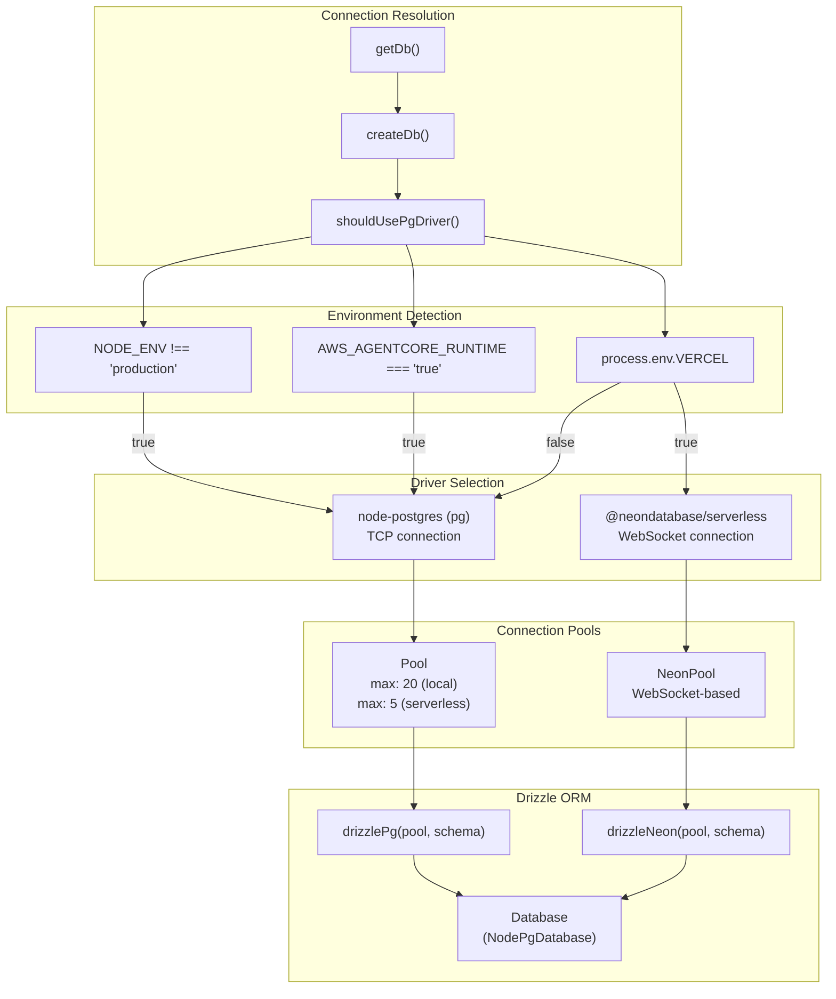
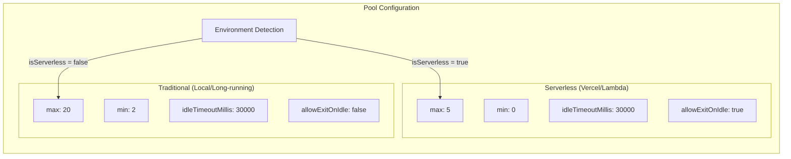
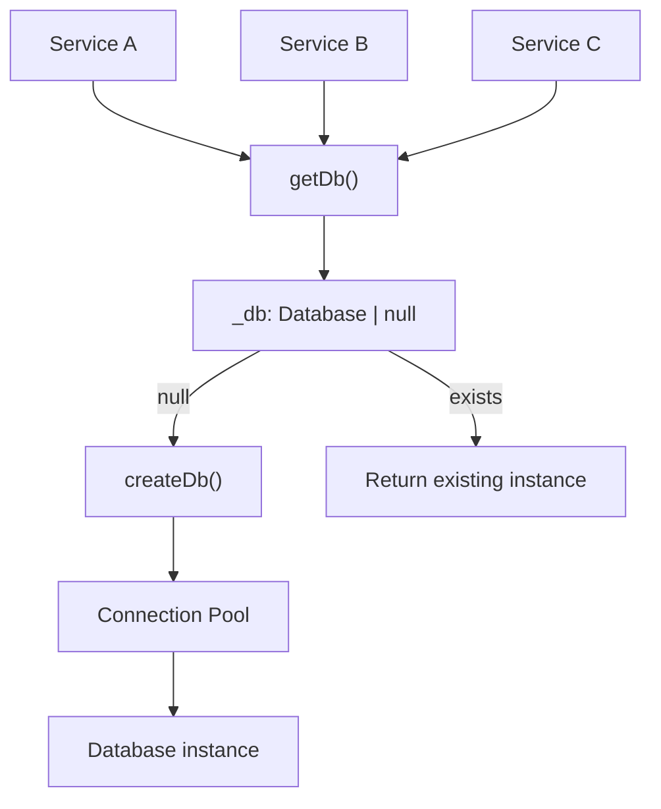
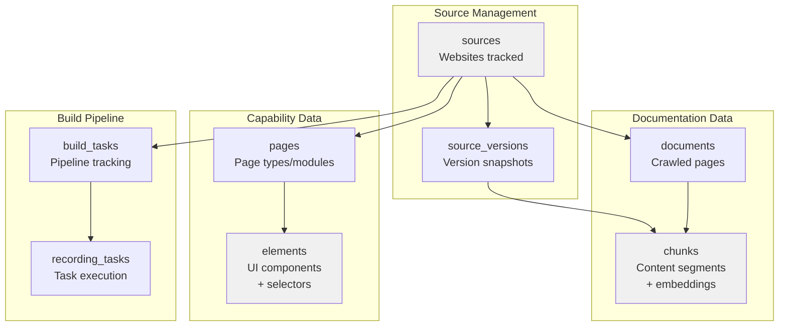
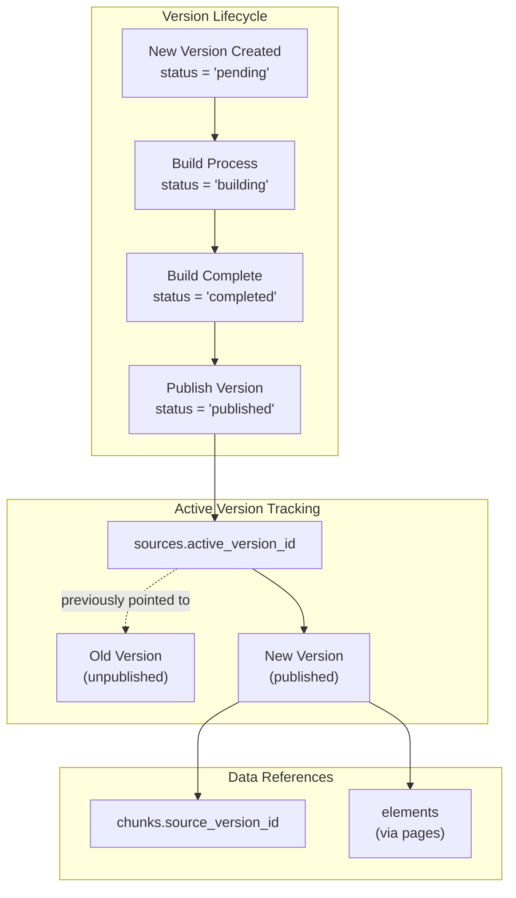
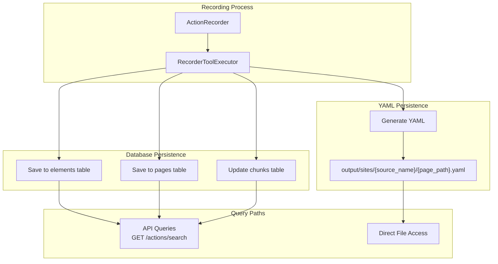
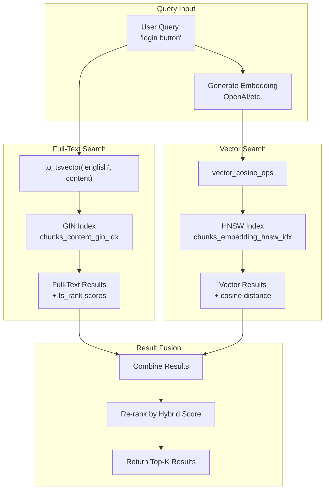
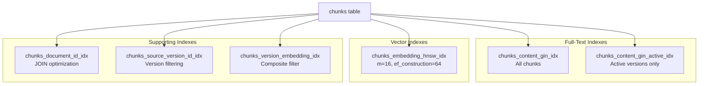
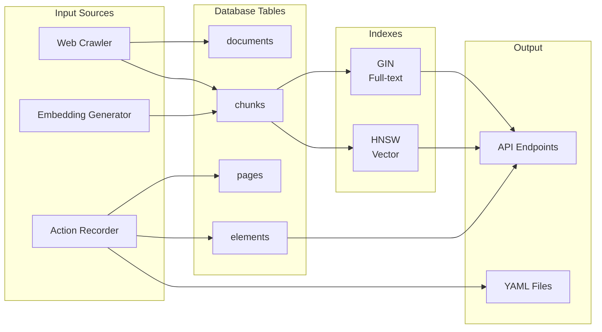

<!-- source: DeepWiki mcp.deepwiki.com · repo actionbook/actionbook · page 5 Data Layer · fetched 2026-10-26 -->

# Data Layer

<details>
<summary>Relevant source files</summary>

The following files were used as context for generating this wiki page:

- [services/db/migrations/0019_add_vector_indexes.sql](services/db/migrations/0019_add_vector_indexes.sql)
- [services/db/migrations/0020_add_chunks_fulltext_index.sql](services/db/migrations/0020_add_chunks_fulltext_index.sql)
- [services/db/src/connection.ts](services/db/src/connection.ts)

</details>


## Purpose and Scope

The Data Layer provides persistent storage for all Actionbook data, including discovered website capabilities, recorded UI elements, crawled documentation, and build pipeline state. This page covers the overall data storage architecture, including the PostgreSQL database, schema organization, version management, and the dual persistence strategy that maintains both structured database records and human-readable YAML files.

For detailed information on specific aspects of the data layer:
- Database schema tables, relationships, and fields: see [Database Schema](#5.1)
- Connection pooling, driver selection, and the `getDb()` singleton: see [Database Connection Management](#5.2)
- Full-text indexes, vector indexes, and hybrid search implementation: see [Search and Indexing](#5.3)

## Storage Architecture

Actionbook uses PostgreSQL as its primary data store with a dual persistence strategy:

| Storage Type | Purpose | Use Cases |
|--------------|---------|-----------|
| **PostgreSQL Database** | Structured querying, search, and transactional operations | API queries, task orchestration, version management, hybrid search |
| **YAML Files** | Human-readable action manuals | Direct file inspection, git version control, offline reference |

The database serves as the source of truth for all structured data, while YAML files in `output/sites/` provide portable, human-readable exports of discovered capabilities.

Sources: [Diagram 5 from architecture overview]

## Database Connection Management

### Connection Strategy

Actionbook uses different PostgreSQL drivers depending on the execution environment:



Sources: [services/db/src/connection.ts:1-147]()

### Driver Selection Logic

The `shouldUsePgDriver()` function determines which driver to use:

| Condition | Driver Used | Reason |
|-----------|-------------|--------|
| `NODE_ENV !== 'production'` | **node-postgres** | Local development with TCP |
| `AWS_AGENTCORE_RUNTIME === 'true'` | **node-postgres** | Node.js runtime needs TCP, not WebSocket |
| `!process.env.VERCEL` | **node-postgres** | Non-Vercel production environments |
| `process.env.VERCEL` (production) | **Neon serverless** | Vercel edge/serverless with WebSocket support |

Sources: [services/db/src/connection.ts:25-40]()

### Connection Pool Configuration

Connection pool settings are optimized based on the execution environment:



**Key Parameters:**
- **max**: Maximum pool connections (20 for traditional, 5 for serverless)
- **min**: Minimum idle connections (2 for traditional, 0 for serverless)
- **idleTimeoutMillis**: Close idle connections after 30 seconds
- **connectionTimeoutMillis**: Timeout when acquiring connection (5 seconds)
- **allowExitOnIdle**: Allow process exit when no connections (serverless only)

Sources: [services/db/src/connection.ts:77-88]()

### Singleton Pattern

The `getDb()` function provides a singleton database instance:



The singleton pattern ensures all parts of an application share the same connection pool, avoiding connection exhaustion.

Sources: [services/db/src/connection.ts:140-147]()

## Schema Organization

The Actionbook database schema is organized into several logical groups:



Sources: [Diagram 5 from architecture overview]

### Key Tables Overview

| Table | Primary Purpose | Key Fields |
|-------|----------------|------------|
| `sources` | Website tracking | `id`, `name`, `base_url`, `active_version_id` |
| `source_versions` | Version snapshots | `id`, `source_id`, `version`, `status`, `published_at` |
| `documents` | Crawled pages | `id`, `source_id`, `url`, `title`, `content` |
| `chunks` | Content segments | `id`, `document_id`, `source_version_id`, `content`, `embedding` |
| `pages` | Page types | `id`, `source_id`, `url`, `module`, `capabilities` |
| `elements` | UI capabilities | `id`, `page_id`, `action`, `selectors`, `element_type` |
| `build_tasks` | Build orchestration | `id`, `source_id`, `stage`, `stage_status`, `heartbeat_at` |
| `recording_tasks` | Recording execution | `id`, `build_task_id`, `chunk_id`, `status`, `retry_count` |

For detailed schema definitions, see [Database Schema](#5.1).

## Version Management

Actionbook implements Blue-Green deployment through the version management system:



**Key Concepts:**

- **source_versions**: Each build creates a new version record with a unique version number
- **active_version_id**: The `sources.active_version_id` field points to the currently published version
- **Publishing**: Atomically switches `active_version_id` to the new version, enabling zero-downtime deployments
- **Rollback**: Simply revert `active_version_id` to a previous version

This design allows multiple versions to coexist in the database while only one is active for API queries.

Sources: [Diagram 5 from architecture overview, section on version management]

## Dual Persistence Strategy

Actionbook maintains data in both PostgreSQL and YAML files:



### YAML File Structure

YAML files are organized by website and page path:

```
output/
└── sites/
    └── example.com/
        ├── index.yaml
        ├── login.yaml
        ├── dashboard/
        │   └── index.yaml
        └── settings/
            └── profile.yaml
```

Each YAML file contains:
- Page metadata (URL, title, module)
- Element capabilities (actions, selectors, descriptions)
- Human-readable formatting for manual inspection

### Benefits of Dual Persistence

| Aspect | Database | YAML Files |
|--------|----------|------------|
| **Querying** | Fast structured queries, indexes | File system traversal |
| **Search** | Hybrid search (full-text + vector) | Text search tools (grep, ripgrep) |
| **Versioning** | Built-in with `source_versions` | Git-friendly text format |
| **Portability** | Requires database connection | Self-contained files |
| **Human Readability** | Raw SQL/JSON | Formatted, documented |
| **Use Case** | Production API, automated tools | Development, debugging, documentation |

Sources: [Diagram 5 from architecture overview, Diagram 1 showing dual persistence]

## Search Infrastructure

Actionbook implements hybrid search combining full-text and vector similarity:



### Index Types

**GIN Index (Generalized Inverted Index)** - Full-Text Search
- Index name: `chunks_content_gin_idx`
- Accelerates `to_tsvector('english', content)` queries
- Improves full-text search from ~2s to ~200ms
- Partial index `chunks_content_gin_active_idx` for active versions only

**HNSW Index (Hierarchical Navigable Small World)** - Vector Similarity
- Index name: `chunks_embedding_hnsw_idx`
- Uses cosine distance (`vector_cosine_ops`)
- Parameters: `m=16`, `ef_construction=64`
- Enables fast approximate nearest neighbor search

Sources: [services/db/migrations/0020_add_chunks_fulltext_index.sql:1-19](), [services/db/migrations/0019_add_vector_indexes.sql:1-22]()

### Index Configuration



**Index Purposes:**

| Index | Purpose | Query Pattern |
|-------|---------|---------------|
| `chunks_content_gin_idx` | Full-text search on all chunks | `to_tsvector('english', content)` |
| `chunks_content_gin_active_idx` | Full-text search on active versions | Same, with `source_version_id IS NOT NULL` |
| `chunks_embedding_hnsw_idx` | Vector similarity search | `ORDER BY embedding <=> query_vector` |
| `chunks_document_id_idx` | JOIN with documents table | `JOIN documents ON chunks.document_id = documents.id` |
| `chunks_source_version_id_idx` | Filter by version | `WHERE source_version_id = ?` |
| `chunks_version_embedding_idx` | Combined version + embedding filter | `WHERE source_version_id = ? AND embedding IS NOT NULL` |

Sources: [services/db/migrations/0020_add_chunks_fulltext_index.sql:1-19](), [services/db/migrations/0019_add_vector_indexes.sql:1-22]()

### Hybrid Search Implementation

The API implements hybrid search by:

1. Executing full-text search with `ts_rank` scoring
2. Executing vector similarity search with cosine distance
3. Normalizing scores from both methods
4. Combining results with configurable weights
5. Re-ranking and returning top-K results

For implementation details, see [Search and Indexing](#5.3).

Sources: [Diagram 5 from architecture overview]

## Data Flow Summary



**Data Flow:**

1. **Web Crawler** (Playbook Builder) discovers pages and generates documentation content
2. **Content** is stored in `documents` and segmented into `chunks`
3. **Embedding Generator** produces vector embeddings for each chunk
4. **Action Recorder** discovers UI capabilities and stores them in `pages` and `elements`
5. **Indexes** (GIN and HNSW) are automatically maintained for fast search
6. **API Endpoints** query indexed data to serve search requests
7. **YAML Files** are generated alongside database records for portability

Sources: [Diagram 5 from architecture overview, Diagram 3 showing build pipeline data flow]

---

