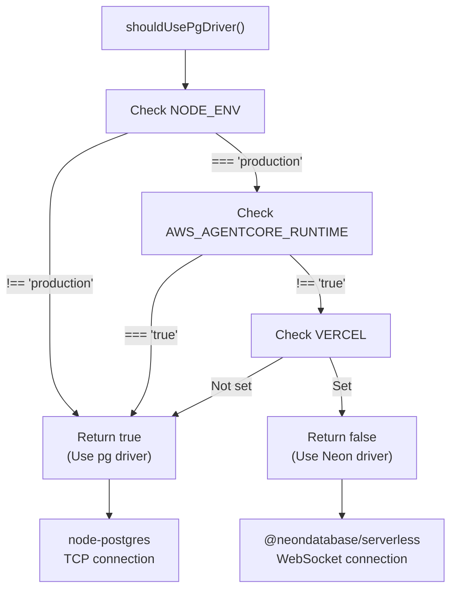
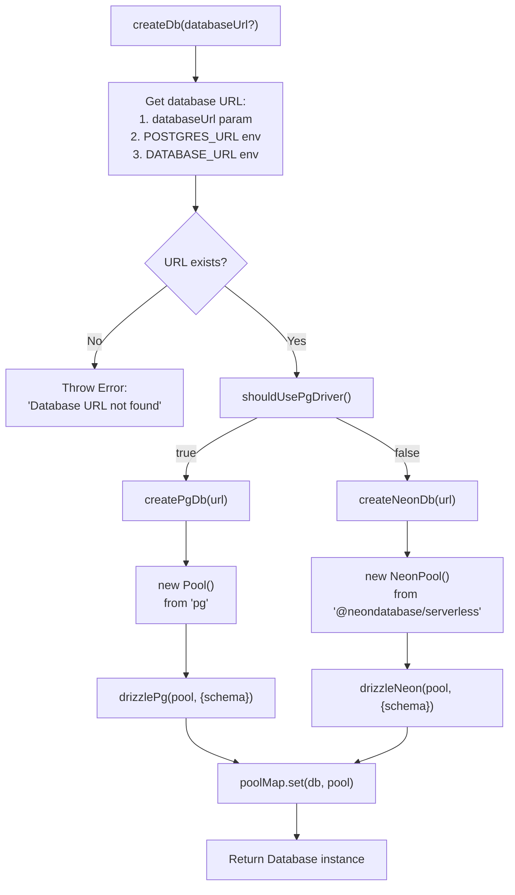
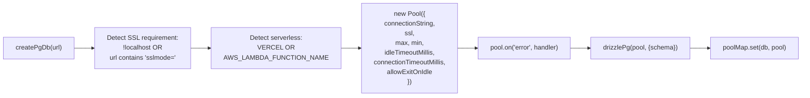
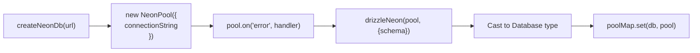
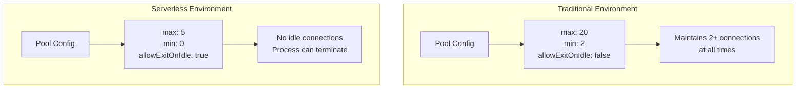
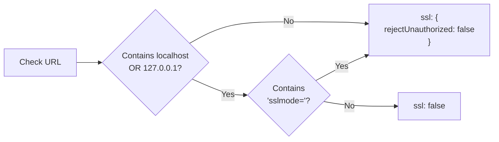
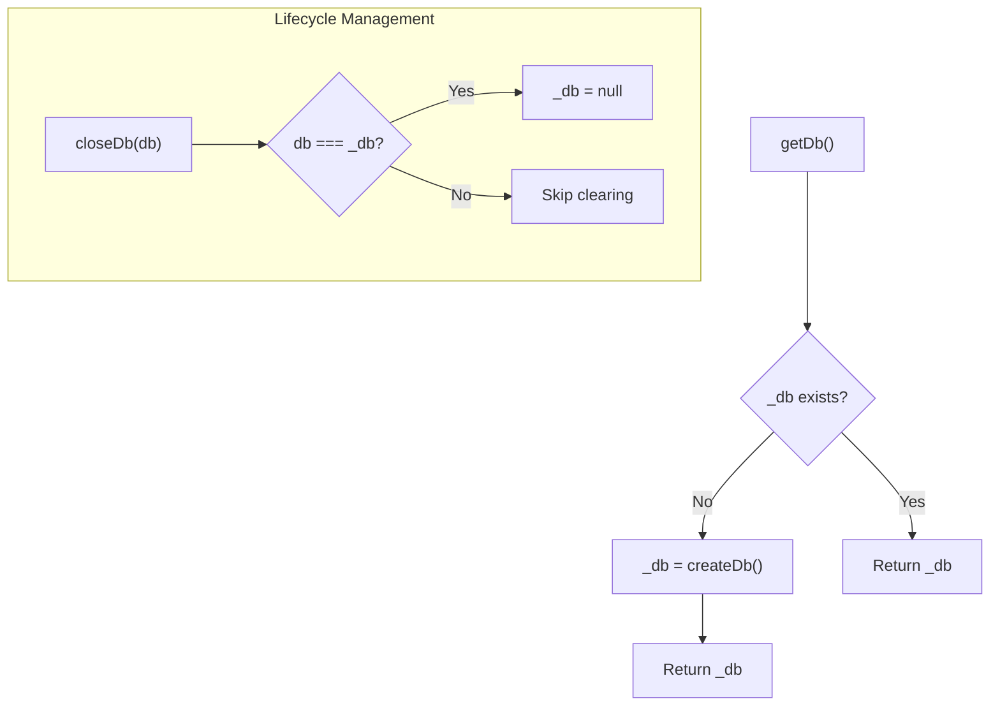
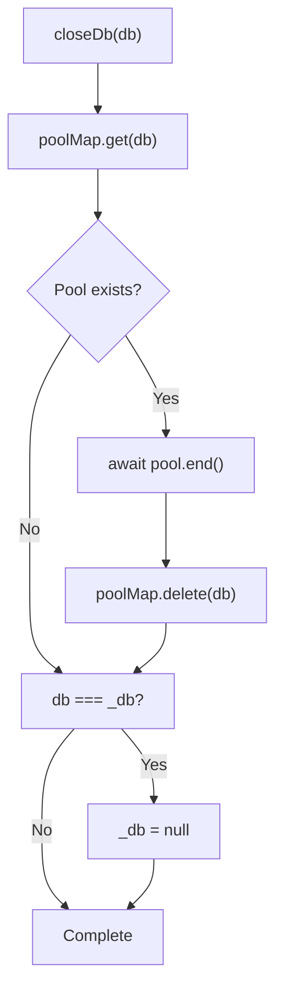

<!-- source: DeepWiki mcp.deepwiki.com · repo actionbook/actionbook · page 5.2 Database Connection Management · fetched 2026-10-26 -->

# Database Connection Management

<details>
<summary>Relevant source files</summary>

The following files were used as context for generating this wiki page:

- [services/db/src/connection.ts](services/db/src/connection.ts)

</details>


## Purpose and Scope

This document describes how Actionbook manages PostgreSQL database connections across different runtime environments. The system uses a dual-driver strategy to support both traditional Node.js environments (using `node-postgres`) and serverless platforms (using Neon's WebSocket-based driver). Topics covered include driver selection logic, connection pooling configurations, and the singleton pattern used for database access.

For details on the database schema and tables, see [Database Schema](#5.1). For information on search and indexing implementation, see [Search and Indexing](#5.3).

---

## Driver Selection Strategy

The system automatically selects between two PostgreSQL drivers based on the runtime environment:

- **node-postgres (`pg`)**: Used for local development, AgentCore runtime, and non-Vercel production environments
- **Neon serverless**: Used exclusively for Vercel deployments (edge/serverless functions with WebSocket support)

### Environment Detection Logic

The driver selection is determined by the `shouldUsePgDriver()` function, which evaluates environment variables in the following order:



**Sources:** [services/db/src/connection.ts:25-40]()

| Environment | `NODE_ENV` | `AWS_AGENTCORE_RUNTIME` | `VERCEL` | Driver Selected |
|-------------|------------|-------------------------|----------|-----------------|
| Local development | `!== 'production'` | N/A | N/A | `pg` (node-postgres) |
| AgentCore (AWS) | `production` | `'true'` | N/A | `pg` (node-postgres) |
| Vercel | `production` | N/A | Set | Neon serverless |
| Other production | `production` | N/A | Not set | `pg` (node-postgres) |

The rationale for this strategy:
- **AgentCore runtime** requires TCP connections because it runs in a Node.js environment without native WebSocket support
- **Vercel** requires WebSocket-based connections for edge and serverless functions
- **Local development** uses standard TCP for simplicity and compatibility with local PostgreSQL instances

**Sources:** [services/db/src/connection.ts:18-40]()

---

## Database Type Unification

Both drivers return compatible types through a unified `Database` type definition:

```typescript
export type Database = NodePgDatabase<typeof schema>;
```

This type alias allows the codebase to use a single interface regardless of the underlying driver. The Neon serverless driver's return type is cast to match:

```typescript
const db = drizzleNeon(pool, { schema }) as unknown as Database;
```

This ensures that all database operations use the same TypeScript types and Drizzle ORM methods, regardless of whether the connection uses TCP (node-postgres) or WebSocket (Neon).

**Sources:** [services/db/src/connection.ts:11](), [services/db/src/connection.ts:116]()

---

## Connection Creation

The `createDb()` function serves as the main entry point for establishing database connections:



**Sources:** [services/db/src/connection.ts:49-64]()

### Node-Postgres Connection (`createPgDb`)

For traditional environments, the `createPgDb()` function creates a connection using the `pg` driver:



**Sources:** [services/db/src/connection.ts:70-99]()

### Neon Serverless Connection (`createNeonDb`)

For Vercel deployments, the `createNeonDb()` function creates a WebSocket-based connection:



**Sources:** [services/db/src/connection.ts:106-119]()

---

## Connection Pooling Strategies

The system uses different pooling configurations based on the deployment environment to optimize resource usage:

### Pooling Parameters

| Parameter | Traditional Environment | Serverless Environment | Purpose |
|-----------|------------------------|------------------------|---------|
| `max` | 20 | 5 | Maximum number of connections in the pool |
| `min` | 2 | 0 | Minimum number of idle connections maintained |
| `idleTimeoutMillis` | 30000 | 30000 | Time before idle connections are closed (30 seconds) |
| `connectionTimeoutMillis` | 5000 | 5000 | Timeout when acquiring a connection (5 seconds) |
| `allowExitOnIdle` | false | true | Allow process to exit when all connections are idle |

**Sources:** [services/db/src/connection.ts:79-88]()

### Serverless Optimization

Serverless environments (Vercel, AWS Lambda) use more aggressive pooling settings:
- **Lower `max` (5)**: Reduces total connections since functions scale horizontally
- **Zero `min`**: Avoids maintaining idle connections that consume resources
- **`allowExitOnIdle: true`**: Allows the function to terminate when no work is pending

Traditional environments use higher limits:
- **Higher `max` (20)**: Supports more concurrent operations in long-running processes
- **Non-zero `min` (2)**: Keeps connections warm for better latency



**Sources:** [services/db/src/connection.ts:76-88]()

### SSL Configuration

SSL is automatically enabled for non-localhost connections or when the URL contains `sslmode=`:



**Sources:** [services/db/src/connection.ts:71-81]()

### Error Handling

Both drivers attach error handlers to prevent unhandled error events from crashing the process:

```typescript
pool.on('error', (err) => {
  console.error('[Database Pool Error]', err.message);
  // Don't throw - let individual query errors be handled by their callers
});
```

This pattern ensures that pool-level errors (e.g., network disconnections) are logged but don't terminate the application. Query-specific errors are still propagated to the calling code.

**Sources:** [services/db/src/connection.ts:91-94](), [services/db/src/connection.ts:110-113]()

---

## Singleton Pattern

The database connection is managed through a singleton pattern implemented by the `getDb()` function:



**Sources:** [services/db/src/connection.ts:140-147](), [services/db/src/connection.ts:131-133]()

### Usage Pattern

The singleton is the recommended pattern for most services:

```typescript
import { getDb } from '@actionbookdev/db';

// Lazy initialization on first access
const db = getDb();
```

For scenarios requiring explicit connection management (e.g., testing, multiple databases), use `createDb()` directly:

```typescript
import { createDb, closeDb } from '@actionbookdev/db';

const db = createDb(customUrl);
try {
  // Use database
} finally {
  await closeDb(db);
}
```

**Sources:** [services/db/src/connection.ts:49-64](), [services/db/src/connection.ts:124-134]()

---

## Connection Lifecycle Management

### Pool Tracking

The system uses a `WeakMap` to associate each `Database` instance with its underlying connection pool:

```typescript
const poolMap = new WeakMap<Database, Pool | NeonPool>();
```

This allows the `closeDb()` function to access the correct pool for cleanup, while automatically allowing garbage collection when database instances are no longer referenced.

**Sources:** [services/db/src/connection.ts:14](), [services/db/src/connection.ts:97](), [services/db/src/connection.ts:117]()

### Cleanup Process

The `closeDb()` function performs proper cleanup:



**Sources:** [services/db/src/connection.ts:124-134]()

The cleanup process:
1. Retrieves the pool from `poolMap` using the `Database` instance
2. Calls `pool.end()` to close all connections in the pool
3. Removes the entry from `poolMap`
4. Clears the global singleton if the closed database matches `_db`

This ensures proper resource cleanup when shutting down services or in testing scenarios where multiple database instances are created and destroyed.

**Sources:** [services/db/src/connection.ts:124-134]()

---

## Integration with Services

The connection management system is consumed by all Actionbook services:

| Service | Connection Pattern | Notes |
|---------|-------------------|-------|
| API Service | Singleton (`getDb()`) | Long-running HTTP server |
| Action Builder | Singleton (`getDb()`) | Long-running worker process |
| Playbook Builder | Singleton (`getDb()`) | Long-running worker process |
| Knowledge Builder | Singleton (`getDb()`) | Long-running worker process |
| CLI | Explicit (`createDb()` + `closeDb()`) | Short-lived commands |

Services running in AWS AgentCore automatically use the `pg` driver due to the `AWS_AGENTCORE_RUNTIME` environment variable check, ensuring compatibility with the Node.js-based runtime.

**Sources:** [services/db/src/connection.ts:25-40](), [services/db/src/connection.ts:142-147]()

---

