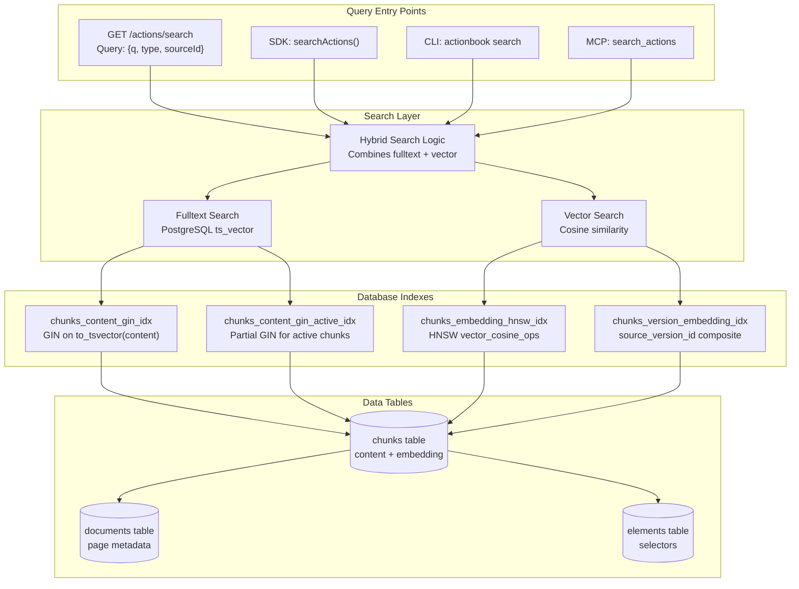
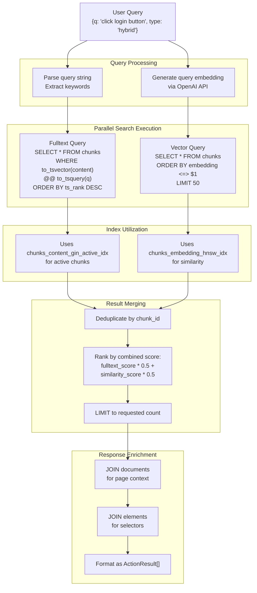

<!-- source: DeepWiki mcp.deepwiki.com · repo actionbook/actionbook · page 5.3 Search and Indexing · fetched 2026-10-26 -->

# Search and Indexing

<details>
<summary>Relevant source files</summary>

The following files were used as context for generating this wiki page:

- [services/db/migrations/0019_add_vector_indexes.sql](services/db/migrations/0019_add_vector_indexes.sql)
- [services/db/migrations/0020_add_chunks_fulltext_index.sql](services/db/migrations/0020_add_chunks_fulltext_index.sql)

</details>


This document covers the search and indexing implementation in Actionbook's data layer. It explains how the system enables fast retrieval of actions through full-text search, vector similarity search, and hybrid search that combines both approaches.

For information about the overall database schema, see [Database Schema](#5.1). For details on database connection management, see [Database Connection Management](#5.2). For information about how search is exposed through the API, see [API Service](#3.1).

## Purpose and Scope

The search and indexing system provides:

- **Full-text search** using PostgreSQL's GIN (Generalized Inverted Index) for keyword-based queries
- **Vector similarity search** using HNSW (Hierarchical Navigable Small World) indexes for semantic similarity
- **Hybrid search** combining both approaches for optimal relevance
- **Performance optimization** through specialized indexes and query patterns

All search operations target the `chunks` table, which contains text segments extracted from crawled pages along with their vector embeddings. Search results reference related `elements` (UI components with selectors) and `pages`.

## Search Architecture

The following diagram shows how search queries flow through the system and which indexes are used:



Sources: [services/db/migrations/0019_add_vector_indexes.sql:1-22](), [services/db/migrations/0020_add_chunks_fulltext_index.sql:1-19]()

## Index Types

The system uses three specialized index types on the `chunks` table:

| Index Name | Type | Purpose | Performance Impact |
|------------|------|---------|-------------------|
| `chunks_content_gin_idx` | GIN | Full-text search on all chunks | ~200ms queries (vs ~2s without) |
| `chunks_content_gin_active_idx` | Partial GIN | Full-text search on active chunks only | Faster than full index for common queries |
| `chunks_embedding_hnsw_idx` | HNSW | Vector similarity search | Approximate nearest neighbor in <100ms |
| `chunks_version_embedding_idx` | Composite B-tree | Filter by version with embedding | Speeds up hybrid queries |
| `chunks_source_version_id_idx` | B-tree | Join optimization | Faster version filtering |
| `chunks_document_id_idx` | B-tree | Join optimization | Faster document lookups |

Sources: [services/db/migrations/0019_add_vector_indexes.sql:1-22](), [services/db/migrations/0020_add_chunks_fulltext_index.sql:1-19]()

## Full-Text Search Implementation

Full-text search uses PostgreSQL's native text search capabilities with GIN indexes on `to_tsvector('english', content)`.

### GIN Indexes

Two GIN indexes are created for different query patterns:

**Full Index** - All chunks:
```sql
CREATE INDEX IF NOT EXISTS chunks_content_gin_idx
ON chunks
USING gin (to_tsvector('english', content));
```

**Partial Index** - Active chunks only (optimization):
```sql
CREATE INDEX IF NOT EXISTS chunks_content_gin_active_idx
ON chunks
USING gin (to_tsvector('english', content))
WHERE source_version_id IS NOT NULL;
```

The partial index is smaller and faster when queries filter by active source versions, which is the most common pattern.

Sources: [services/db/migrations/0020_add_chunks_fulltext_index.sql:5-14]()

### Performance Characteristics

- **Without index**: ~2 seconds per query
- **With GIN index**: ~200ms per query
- **With partial GIN index**: <100ms for active chunk queries (most common case)

The dramatic performance improvement comes from GIN's ability to index all lexemes (words) in the text, enabling rapid lookup without scanning every row.

Sources: [services/db/migrations/0020_add_chunks_fulltext_index.sql:2]()

## Vector Similarity Search

Vector search uses the pgvector extension with HNSW indexes for approximate nearest neighbor search on the `embedding` column.

### HNSW Index Configuration

```sql
CREATE INDEX IF NOT EXISTS chunks_embedding_hnsw_idx
ON chunks
USING hnsw (embedding vector_cosine_ops)
WITH (m = 16, ef_construction = 64);
```

**Parameters**:
- `m = 16`: Number of connections per layer (default). Higher values improve recall but slow index building.
- `ef_construction = 64`: Size of dynamic candidate list during construction (default). Higher values improve index quality.
- `vector_cosine_ops`: Uses cosine distance metric for similarity comparison.

Sources: [services/db/migrations/0019_add_vector_indexes.sql:7-10]()

### HNSW Algorithm

HNSW (Hierarchical Navigable Small World) is an approximate nearest neighbor algorithm that:

1. Builds a multi-layer graph structure where each node represents a vector
2. Uses greedy search through the layers to find approximate neighbors
3. Provides fast queries (typically <100ms) with high recall (>90%)
4. Trades exact accuracy for speed - acceptable for semantic search

The cosine distance metric measures similarity between embeddings:
- Distance of 0: Identical vectors
- Distance of 1: Completely orthogonal vectors
- Distance of 2: Opposite vectors

## Composite Indexes for Filtering

Additional indexes optimize common filtering patterns:

### Version and Embedding Filter

```sql
CREATE INDEX IF NOT EXISTS chunks_version_embedding_idx
ON chunks (source_version_id)
WHERE embedding IS NOT NULL;
```

This composite index helps queries that:
- Filter by a specific source version
- Only consider chunks with embeddings

This pattern is common in hybrid search where the API filters by the active version before searching.

Sources: [services/db/migrations/0019_add_vector_indexes.sql:18-21]()

### Version Join Optimization

```sql
CREATE INDEX IF NOT EXISTS chunks_source_version_id_idx
ON chunks (source_version_id)
WHERE source_version_id IS NOT NULL;
```

Optimizes joins between `chunks` and `source_versions` tables when filtering by active versions.

Sources: [services/db/migrations/0019_add_vector_indexes.sql:12-15]()

## Hybrid Search Strategy

The following diagram shows how hybrid search combines full-text and vector results:



Sources: [services/db/migrations/0019_add_vector_indexes.sql:1-22](), [services/db/migrations/0020_add_chunks_fulltext_index.sql:1-19]()

### Hybrid Search Algorithm

The hybrid search implementation performs these steps:

1. **Execute parallel queries**:
   - Full-text search using `to_tsvector` and `to_tsquery` with GIN index
   - Vector search using cosine distance `<=>` operator with HNSW index

2. **Score normalization**:
   - Full-text scores: Use `ts_rank()` or `ts_rank_cd()` (cover density)
   - Vector scores: Convert cosine distance to similarity (1 - distance)

3. **Result merging**:
   - Deduplicate chunks appearing in both result sets
   - Combine scores with configurable weights (typically 0.5 each)
   - Sort by combined score in descending order

4. **Enrichment**:
   - Join with `documents` to get page URLs and titles
   - Join with `elements` to get selectors and capabilities
   - Format as complete action results

### Search Type Selection

The API supports three search types:

| Type | Behavior | Use Case |
|------|----------|----------|
| `fulltext` | Only GIN-based text search | Exact keyword matching |
| `vector` | Only HNSW-based similarity | Semantic/conceptual search |
| `hybrid` | Combined approach (default) | Best general-purpose results |

## Query Optimization Patterns

### Active Version Filtering

Most queries filter by active source versions to avoid returning stale data:

```sql
WHERE source_version_id IN (
  SELECT id FROM source_versions 
  WHERE status = 'active'
)
```

The partial GIN index `chunks_content_gin_active_idx` specifically optimizes this pattern, reducing index size and improving query speed.

Sources: [services/db/migrations/0020_add_chunks_fulltext_index.sql:11-14]()

### Embedding Existence Check

When performing vector search, the query must filter out chunks without embeddings:

```sql
WHERE embedding IS NOT NULL
```

The composite index `chunks_version_embedding_idx` includes this condition in its WHERE clause, making it particularly efficient.

Sources: [services/db/migrations/0019_add_vector_indexes.sql:19-21]()

### Document Join Optimization

Search results often need page context from the `documents` table:

```sql
JOIN documents ON chunks.document_id = documents.id
```

The `chunks_document_id_idx` index accelerates this join operation.

Sources: [services/db/migrations/0020_add_chunks_fulltext_index.sql:17-18]()

## Index Maintenance

### Building Indexes

All indexes are created with `IF NOT EXISTS` to be idempotent across migrations:

```sql
CREATE INDEX IF NOT EXISTS index_name ON table_name ...
```

### Index Build Time

Index construction time varies by size:

| Index Type | Build Time (est.) | Notes |
|------------|------------------|-------|
| GIN (full) | 1-5 minutes | For ~100k chunks |
| GIN (partial) | 30 seconds - 2 minutes | Smaller subset |
| HNSW | 5-15 minutes | More expensive construction |
| B-tree | <1 minute | Fast for simple indexes |

HNSW construction is CPU-intensive due to graph building. The `ef_construction` parameter directly impacts build time.

### Index Storage

Approximate storage overhead:

- **GIN indexes**: 50-100% of indexed column size
- **HNSW indexes**: 30-60% of embedding column size (depends on `m` parameter)
- **B-tree indexes**: 10-30% of indexed column size

## Performance Monitoring

### Query Plan Analysis

Use `EXPLAIN ANALYZE` to verify index usage:

```sql
EXPLAIN ANALYZE
SELECT * FROM chunks
WHERE to_tsvector('english', content) @@ to_tsquery('login');
```

Expected output should show:
```
Bitmap Heap Scan on chunks
  -> Bitmap Index Scan on chunks_content_gin_idx
```

### Index Statistics

PostgreSQL tracks index usage in `pg_stat_user_indexes`:

```sql
SELECT 
  indexrelname,
  idx_scan,
  idx_tup_read,
  idx_tup_fetch
FROM pg_stat_user_indexes
WHERE tablename = 'chunks';
```

Key metrics:
- `idx_scan`: Number of index scans
- `idx_tup_read`: Number of index entries returned
- `idx_tup_fetch`: Number of rows fetched

Sources: [services/db/migrations/0019_add_vector_indexes.sql:1-22](), [services/db/migrations/0020_add_chunks_fulltext_index.sql:1-19]()

---

