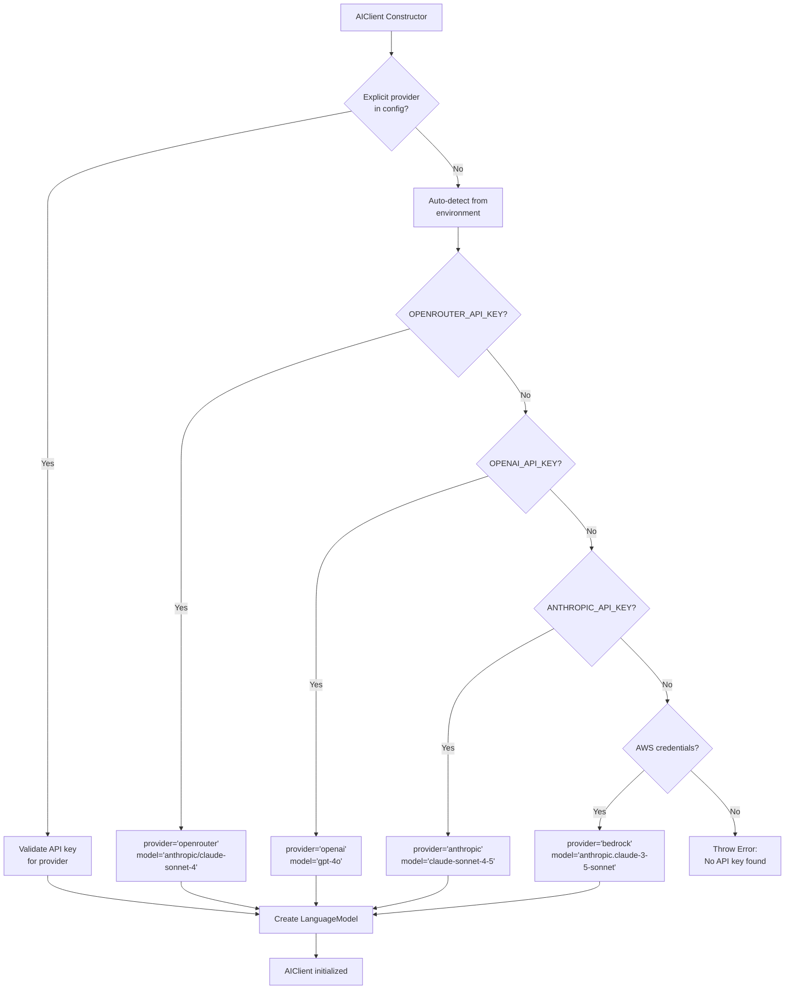
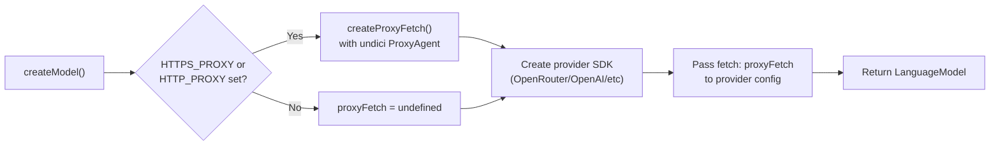
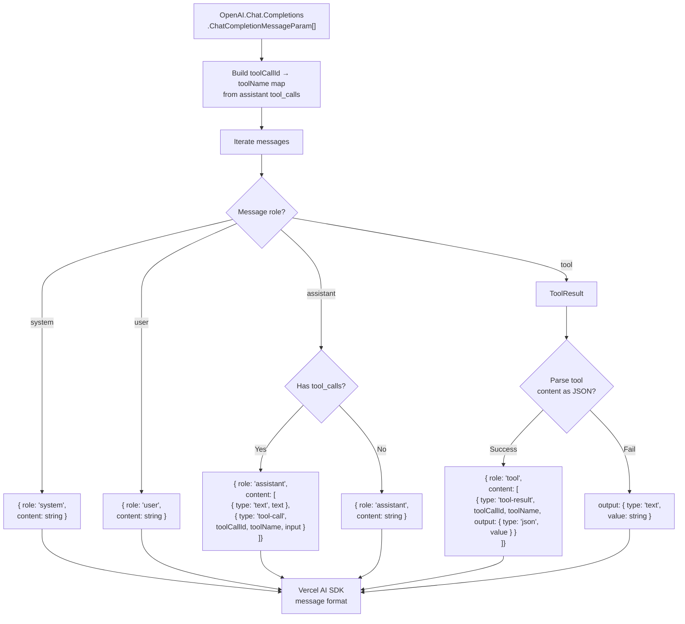
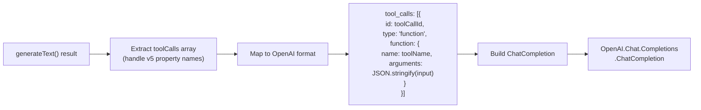
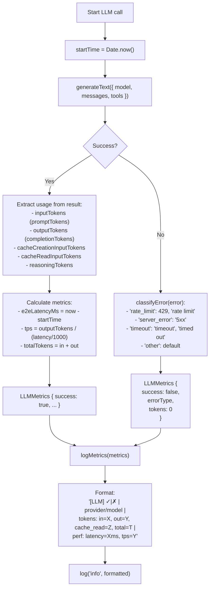
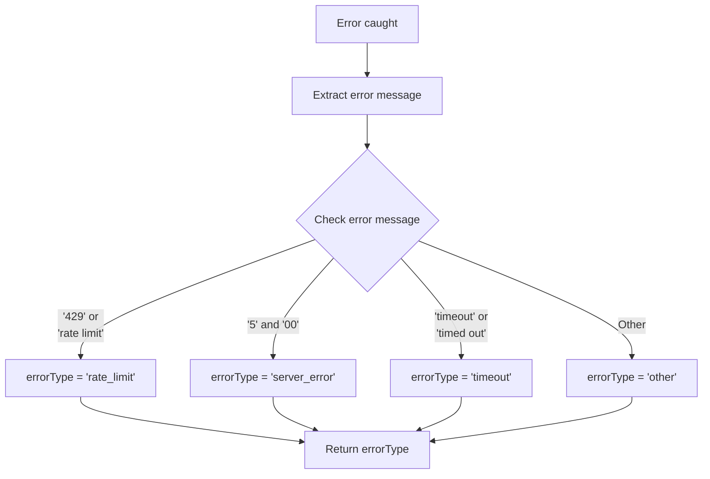
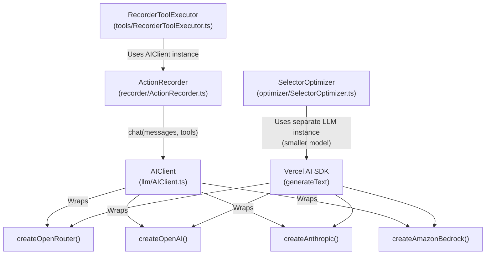

<!-- source: DeepWiki mcp.deepwiki.com · repo actionbook/actionbook · page 6.1 AIClient · fetched 2026-10-26 -->

# AIClient

<details>
<summary>Relevant source files</summary>

The following files were used as context for generating this wiki page:

- [.prettierignore](.prettierignore)
- [.prettierrc.json](.prettierrc.json)
- [CLAUDE.md](CLAUDE.md)
- [services/action-builder/.gitignore](services/action-builder/.gitignore)
- [services/action-builder/package.json](services/action-builder/package.json)
- [services/action-builder/scripts/crawl-playbook-batch.ts](services/action-builder/scripts/crawl-playbook-batch.ts)
- [services/action-builder/scripts/crawl-sites.txt.example](services/action-builder/scripts/crawl-sites.txt.example)
- [services/action-builder/scripts/import-playbook-batch.ts](services/action-builder/scripts/import-playbook-batch.ts)
- [services/action-builder/scripts/login.ts](services/action-builder/scripts/login.ts)
- [services/action-builder/src/llm/AIClient.ts](services/action-builder/src/llm/AIClient.ts)
- [services/action-builder/src/optimizer/SelectorOptimizer.ts](services/action-builder/src/optimizer/SelectorOptimizer.ts)
- [services/action-builder/src/utils/logger.ts](services/action-builder/src/utils/logger.ts)
- [services/action-builder/vitest.setup.ts](services/action-builder/vitest.setup.ts)
- [services/common/browser-profile/package.json](services/common/browser-profile/package.json)
- [services/common/browser-profile/src/BrowserProfileManager.ts](services/common/browser-profile/src/BrowserProfileManager.ts)
- [services/db/migrations/meta/0018_snapshot.json](services/db/migrations/meta/0018_snapshot.json)

</details>


## Purpose and Scope

`AIClient` is a multi-provider LLM client wrapper built on Vercel AI SDK that provides unified access to OpenRouter, OpenAI, Anthropic, and AWS Bedrock language models. It handles provider auto-detection, configuration resolution, message format conversion, metrics collection, and retry logic with exponential backoff. The client presents an OpenAI-compatible interface for backward compatibility while supporting multiple underlying providers.

For information about how `AIClient` is used in selector optimization workflows, see [Selector Optimizer](#6.2). For details on the recording tools that invoke `AIClient` for action discovery, see [Recording Tools Reference](#3.2.3).

**Sources:** [services/action-builder/src/llm/AIClient.ts:1-543]()

---

## Architecture and Provider Support

The `AIClient` class abstracts provider-specific differences behind a unified interface, supporting four LLM providers with automatic fallback detection.

### Provider Resolution Hierarchy



**Sources:** [services/action-builder/src/llm/AIClient.ts:88-171]()

### Supported Providers

| Provider | Environment Variables | Default Model | SDK Package |
|----------|----------------------|---------------|-------------|
| **OpenRouter** | `OPENROUTER_API_KEY`, `OPENROUTER_MODEL` | `anthropic/claude-sonnet-4` | `@openrouter/ai-sdk-provider` |
| **OpenAI** | `OPENAI_API_KEY`, `OPENAI_MODEL` | `gpt-4o` | `@ai-sdk/openai` |
| **Anthropic** | `ANTHROPIC_API_KEY`, `ANTHROPIC_MODEL` | `claude-sonnet-4-5` | `@ai-sdk/anthropic` |
| **AWS Bedrock** | `AWS_ACCESS_KEY_ID`, `AWS_SECRET_ACCESS_KEY`, `AWS_BEDROCK_MODEL`, `AWS_REGION` | `anthropic.claude-3-5-sonnet-20241022-v2:0` | `@ai-sdk/amazon-bedrock` |

**Sources:** [services/action-builder/src/llm/AIClient.ts:56-180](), [services/action-builder/package.json:45-49]()

---

## Configuration Resolution

### AIClientConfig Interface

```typescript
interface AIClientConfig {
  provider?: LLMProvider;  // 'openrouter' | 'openai' | 'anthropic' | 'bedrock'
  model?: string;          // Model name override
  apiKey?: string;         // API key override
}
```

The `resolveConfig()` method implements the following resolution logic:

1. **Explicit Provider**: If `config.provider` is specified, use corresponding environment variable or `config.apiKey`
2. **Auto-detection**: Check environment variables in priority order: OpenRouter → OpenAI → Anthropic → Bedrock
3. **Model Override**: Use `config.model` if provided, otherwise use provider-specific environment variable (e.g., `OPENROUTER_MODEL`), falling back to default
4. **Bedrock Special Case**: Uses AWS credentials instead of API key

**Sources:** [services/action-builder/src/llm/AIClient.ts:58-71, 101-171]()

### Model Creation with Proxy Support



**Sources:** [services/action-builder/src/llm/AIClient.ts:36-54, 183-220]()

---

## Message Format Conversion

`AIClient` accepts OpenAI-style messages and converts them to Vercel AI SDK format, handling tool calls, tool results, and multi-turn conversations.

### Message Conversion Flow



**Sources:** [services/action-builder/src/llm/AIClient.ts:224-312]()

### Tool Call Conversion Details

The `convertMessages()` method handles special cases:

- **Tool Call Arguments**: Parses `tc.function.arguments` JSON string, defaults to `{}` on parse failure
- **AI SDK v5 Format**: Uses `input` field instead of `args` for tool calls
- **Tool Result Output**: Wraps in discriminated union with `{ type: 'json'|'text', value }` format
- **Tool Name Resolution**: Maps `tool_call_id` back to `toolName` using pre-built map from assistant messages

**Sources:** [services/action-builder/src/llm/AIClient.ts:258-307]()

---

## Tool Calling Support

`AIClient` supports OpenAI-style tool definitions, converting them to Vercel AI SDK format using direct JSON Schema passthrough.

### Tool Conversion Process

```typescript
// Input: OpenAI.Chat.Completions.ChatCompletionTool[]
// Output: Record<string, aiTool>

convertTools(tools) {
  for (const tool of tools) {
    if (tool.type === 'function') {
      result[tool.function.name] = aiTool({
        description: tool.function.description,
        inputSchema: jsonSchema(tool.function.parameters), // Direct JSON Schema
      });
    }
  }
}
```

**Key Design Decision**: Uses `jsonSchema()` from Vercel AI SDK for direct JSON Schema passthrough, avoiding Zod conversion issues with complex parameter schemas.

**Sources:** [services/action-builder/src/llm/AIClient.ts:318-337]()

### Tool Call Response Conversion



**Sources:** [services/action-builder/src/llm/AIClient.ts:476-528]()

---

## Metrics Collection

`AIClient` tracks comprehensive metrics for each LLM call, enabling observability and performance monitoring.

### LLMMetrics Interface

```typescript
interface LLMMetrics {
  // Token statistics
  inputTokens: number;
  outputTokens: number;
  totalTokens: number;
  cacheCreationInputTokens?: number;    // Anthropic prompt caching
  cacheReadInputTokens?: number;        // Anthropic cache hits
  reasoningTokens?: number;             // o1/o3 models
  
  // Performance statistics
  e2eLatencyMs: number;                 // End-to-end latency
  tps: number;                          // Tokens per second
  
  // Request metadata
  provider: string;
  model: string;
  success: boolean;
  errorType?: string;                   // 'rate_limit' | 'server_error' | 'timeout' | 'other'
}
```

**Sources:** [services/action-builder/src/llm/AIClient.ts:13-31]()

### Metrics Collection and Logging



**Sources:** [services/action-builder/src/llm/AIClient.ts:343-421, 423-471]()

### Example Log Output

```
[LLM] ✓ | openrouter/anthropic/claude-sonnet-4 | tokens: in=2341, out=856, cache_read=1200, total=3197 | perf: latency=3240ms, tps=264.2
[LLM] ✗ rate_limit | openai/gpt-4o | tokens: in=0, out=0, total=0 | perf: latency=1250ms, tps=0
```

**Sources:** [services/action-builder/src/llm/AIClient.ts:445-471]()

---

## Error Handling and Retry Logic

### Built-in Retry Mechanism

`AIClient` leverages Vercel AI SDK's automatic retry with exponential backoff for transient failures:

```typescript
const result = await generateText({
  model: this.model,
  messages: modelMessages,
  tools: aiTools,
  maxOutputTokens: 4096,
  maxRetries: 5,  // 1 initial + 5 retries = 6 total attempts
});
```

**Retry Behavior**:
- Rate limit errors (`429`): Exponential backoff automatically applied
- Total attempts: 6 (1 initial + 5 retries)
- Errors are classified and logged with `errorType` metric

**Sources:** [services/action-builder/src/llm/AIClient.ts:357-363]()

### Error Classification



**Sources:** [services/action-builder/src/llm/AIClient.ts:426-440]()

---

## Proxy Support

`AIClient` supports HTTP/HTTPS proxies via `HTTPS_PROXY` or `HTTP_PROXY` environment variables, using undici's `ProxyAgent`.

### Proxy Configuration Flow

```typescript
function createProxyFetch(): typeof fetch | undefined {
  const proxyUrl = process.env.HTTPS_PROXY || process.env.HTTP_PROXY;
  if (!proxyUrl) return undefined;
  
  const proxyAgent = new ProxyAgent(proxyUrl);
  
  return async (input: RequestInfo | URL, init?: RequestInit): Promise<Response> => {
    const url = typeof input === 'string' ? input : 
                input instanceof URL ? input.href : 
                input.url;
    const response = await undiciFetch(url, {
      ...init,
      dispatcher: proxyAgent,
    });
    return response as unknown as Response;
  };
}
```

**Usage**: Proxy fetch function is passed to each provider SDK during model creation:

```typescript
const openrouter = createOpenRouter({
  apiKey,
  fetch: proxyFetch,  // Custom fetch with proxy
});
```

**Sources:** [services/action-builder/src/llm/AIClient.ts:36-54, 189-192]()

---

## Usage in Action Builder

### Class Structure and Dependencies



**Sources:** [services/action-builder/src/llm/AIClient.ts:1-10](), [services/action-builder/src/optimizer/SelectorOptimizer.ts:1-18]()

### ActionRecorder Integration Example

The `ActionRecorder` uses `AIClient` for multi-turn tool-calling loops:

```typescript
class ActionRecorder {
  private aiClient: AIClient;
  
  constructor() {
    this.aiClient = new AIClient();  // Auto-detects provider
  }
  
  async executeRecording() {
    const messages: OpenAI.Chat.Completions.ChatCompletionMessageParam[] = [
      { role: 'system', content: systemPrompt },
      { role: 'user', content: taskDescription },
    ];
    
    for (let turn = 0; turn < maxTurns; turn++) {
      const response = await this.aiClient.chat(messages, tools);
      
      // Handle tool calls...
      if (response.choices[0].message.tool_calls) {
        // Execute tools and append results to messages
      }
    }
  }
}
```

**Sources:** [services/action-builder/src/llm/AIClient.ts:343-421]()

---

## Configuration Examples

### OpenRouter (Recommended)

```bash
# Access to all models through single API key
export OPENROUTER_API_KEY="sk-or-..."
export OPENROUTER_MODEL="anthropic/claude-sonnet-4"  # Optional, uses default if not set
```

### OpenAI

```bash
export OPENAI_API_KEY="sk-..."
export OPENAI_MODEL="gpt-4o"  # Optional
```

### Anthropic

```bash
export ANTHROPIC_API_KEY="sk-ant-..."
export ANTHROPIC_MODEL="claude-sonnet-4-5"  # Optional
```

### AWS Bedrock

```bash
export AWS_ACCESS_KEY_ID="AKIA..."
export AWS_SECRET_ACCESS_KEY="..."
export AWS_REGION="us-east-1"  # Optional, defaults to us-east-1
export AWS_BEDROCK_MODEL="anthropic.claude-3-5-sonnet-20241022-v2:0"  # Optional
```

### Proxy Configuration

```bash
# Applies to all providers
export HTTPS_PROXY="http://proxy.example.com:8080"
# or
export HTTP_PROXY="http://proxy.example.com:8080"
```

**Sources:** [services/action-builder/src/llm/AIClient.ts:101-171]()

---

## Related Components

`SelectorOptimizer` implements similar provider resolution logic but uses smaller/faster models (e.g., `gpt-4o-mini`, `claude-3-5-haiku-latest`) for cost efficiency. It also uses Vercel AI SDK directly rather than wrapping it in an OpenAI-compatible interface.

For usage of `AIClient` in the action recording workflow, see [Action Recording](#3.2.2).

**Sources:** [services/action-builder/src/optimizer/SelectorOptimizer.ts:95-153]()

---

